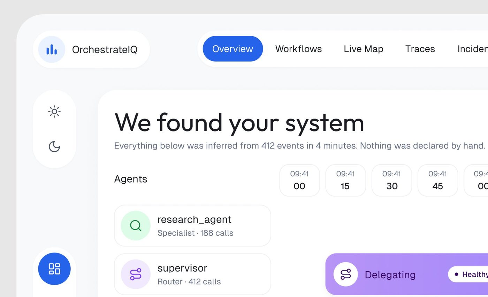

# 01 · Sistema visual (os fundamentos do estilo)

Esta seção descreve os **fundamentos** que se repetem nas telas de produto de
referência: cor, tipografia, espaço, raio, camadas, ícones e gráficos. Não trata
de componentes prontos (seção 02) nem de como montar a imagem de apresentação
(seção 05).

**Fonte primária.** As folhas de variáveis do Figma publicadas de dois produtos,
Permitly (claro) e AgentPay (escuro), estão transcritas em
[design-system-publicado.md](design-system-publicado.md) e mandam sobre
qualquer medição desta seção. Os outros arquivos partem delas e estendem com o
que foi medido em pixel nos demais produtos.

Os recortes de apoio estão em
[`../galeria/01-sistema-visual/`](../galeria/01-sistema-visual/).

## Arquivos da seção

| Arquivo | O que responde |
|---|---|
| [design-system-publicado.md](design-system-publicado.md) | **A folha publicada**: 33 tokens de cor claros, 36 escuros, três famílias de fonte, escala de tipo, espaço, raio, elevação, tile de ícone |
| [cor.md](cor.md) | Canvas, painel, card, linha, texto em 3 níveis, acento por produto, trio de estado (500/tint/700), claro e escuro, com a validação medido × declarado |
| [tipografia.md](tipografia.md) | Geist + Inter + Geist Mono, escala declarada e medida em outros produtos, peso, tracking, números tabulares |
| [espacamento-e-raio.md](espacamento-e-raio.md) | Grade de 4, padding, gap, larguras, altura de linha e de item de menu, raio por nível e a regra do raio aninhado |
| [superficie-e-profundidade.md](superficie-e-profundidade.md) | Camada por troca de superfície, as duas sombras, borda, hachura, orbe de IA, gradiente, grade de pontos |
| [iconografia.md](iconografia.md) | Biblioteca de ícones, traço, tamanho, a regra "ícone = metade do tile" |
| [graficos-e-dados.md](graficos-e-dados.md) | Gauge segmentado, barras, hachura, linha, heatmap, donut, sparkline, barra segmentada, tooltip |
| [tokens.css](tokens.css) | Variáveis CSS com os nomes da folha (claro e escuro) e a origem de cada valor |

## Como a medição foi feita (e a escala usada)

| Formato da imagem | Fator para px de tela | Como foi estabelecido |
|---|---|---|
| Retrato 2391 a 3018 de largura (recortes e folhas do design system) | **3** | **[CONFIRMADO]** na folha de tipo: a maiúscula de `display/64` mede 137 px e a de `body/16` mede 35 px, o que dá fator 2,95 a 3,16 em todos os 15 tamanhos. No app de entrega, o iPhone mede 1170 px = 390 pt × 3 |
| Paisagem 4096 × ~3072 (tela inteira) | **2,5** (faixa medida 2,4 a 2,6) | Ver [Escala](#escala-dos-shots-de-4096-px), logo abaixo: maiúscula de texto Inter e linha de 1 px medidas em três produtos, com o método calibrado na folha **[MEDIDO]** |
| 1600, 1200, 1024 de largura | 1,0 / 0,75 / 0,64 | quadro de 1600 em escala direta |

### Escala dos shots de 4096 px

**Resultado: fator ~2,5, com faixa medida de 2,4 a 2,6.** Os valores 2,84, 2,9
e 3 estão descartados para esse formato: com eles, uma linha de 1 px teria 2,84
a 3 px no arquivo e um item de menu `medium/13` teria maiúscula de 26,9 a 28,4
px; o medido fica em 2,35 a 2,65 px e 22,6 a 25,5 px. O fator 3 continua valendo
para os recortes em retrato e as folhas.

**Método.** Três medidas independentes, em três shots de 4096 × 3072 de
produtos diferentes (Rillo, Vero e Ctrl.ai), mais uma linha no Fino:

1. **Altura da maiúscula** de texto em Inter, pela soma da cobertura de cada
   linha de pixel da letra (sem depender de limiar). O método foi calibrado na
   folha de tipo do Permitly, que é 3x: deu 30,5 px em `medium/14`, 28,4 em
   `medium/13` e 24,0 em `label/11`, exatamente 0,727 × corpo × 3. Depois a
   folha foi reduzida para 2,56x e salva em JPEG, e a medida caiu dentro de 0,5
   px do esperado. Nos shots: item de menu 22,6 a 23,1 px (Rillo e Vero) e 25,0
   a 25,5 (Ctrl.ai); rótulo em caixa-alta 19,1 a 19,5 px nos três. Lendo o item
   de menu como `medium/13` e o rótulo como `label/11` (os tokens da folha),
   sai **2,39 a 2,44**; no Ctrl.ai, lendo o menu como 14, **2,48**.
2. **Espessura de uma linha de 1 px** (divisória), pela soma da cobertura no
   perfil médio de centenas de linhas de pixel: 2,35 e 2,50 no Ctrl.ai, 2,53 no
   Rillo, 2,65 no Fino, média **2,51**. Na folha a 3x a mesma medida dá 3,00
   exatos; na simulação a 2,56x em JPEG ela sobra 0,02 a 0,18 px, então o valor
   real fica um pouco abaixo de 2,5.
3. **Largura da casca do app**: 3.686 px no Rillo e 3.702 px no Ctrl.ai. Se a
   casca for uma tela de 1.440, o fator é 2,56 a 2,57; com 2,5, ela tem 1.474 a
   1.481. As duas leituras cabem na faixa.

A conferência cruzada aponta para o mesmo lugar: o mesmo texto do FixTrack
mede 1,20 a 1,28 vez mais no recorte @3x que no shot de 4096, o que dá
3 ÷ 1,28 a 3 ÷ 1,20 = **2,34 a 2,50**. E a seção 02, calibrando imagem por
imagem, chegou a 2,49 no FixTrack e 2,55 no Ergond
([navegação](../02-componentes/navegacao.md)).

**O que a medida não separa.** Entre 2,44 e 2,56 a diferença é de 5%, menos de
1 px em qualquer valor até 20. A regra prática desta biblioteca é **dividir os
pixels do shot de 4096 por 2,5**; o erro esperado é de ±4%. As tabelas desta
seção que foram convertidas com 2,56 (tipografia, espaçamento) ficam dentro
dessa margem e estão marcadas com o fator usado.

Legenda usada em todos os arquivos: **[CONFIRMADO]** está escrito na folha
publicada; **[MEDIDO]** saiu de amostragem de pixel; **[OBSERVADO]** foi visto
em N telas; **[INFERIDO]** é dedução sem prova direta.

### Validação: o que a medição em pixel acerta sem a folha

As medições desta seção foram feitas em pixel, sem a folha, e depois
comparadas com ela. A comparação mostra onde o método é confiável:

| Item | Medido no pixel | Declarado na folha | Resultado |
|---|---|---|---|
| Canvas do Permitly | #efeef4 | #EFEEF4 | idêntico |
| Lima do Permitly | #c9f24c | #C9F24C | idêntico |
| Card do Permitly | #f4f3f8 | #F4F4F8 | 1 nível |
| Texto primário | #0e0d13 | #111116 | texto sai 2 a 8 níveis mais escuro que o token (a amostra pega o miolo do traço) |
| Saudação "Good morning" do Permitly | maiúscula de 72 px @3x | `display/32`: 72 px na folha | **mesma medida** |
| "Needs attention" | 43 px @3x → ~20 | `display/20`: 43 px | mesma medida |
| Item de menu "Projects" | estimado 14 | `medium/13` (29 px nos dois) | a medida bate; o arredondamento errou para cima |
| "PL-2796" | 13 a 14, mono | `mono/13` Geist Mono | certo |
| "PERMITTING" | 11 a 12, caixa-alta | `label/11` Inter Semi Bold | certo |
| Raio dos painéis do Permitly | 32 | panels 32 | certo |
| Raio da caixa de dados do cartão | 16 e 20 | tiles 16 e 20 | certo |
| Raio dos quadrados de amostra da folha (8, 12, 16, 20, 24, 32) | 7, 11, 11 a 15, 19, 22, 32 | valores da folha | método de 45° erra até 3 a 4 px para baixo nos raios pequenos |
| Regra do selo | fundo L 90-93%, texto L 29-36%, mesma matiz | trio 500/tint/700; tint L 89-93%, 700 L 27-38% | confirmado, faixa 2 pontos mais larga |
| Grade | 4 com 8 dominando | 4, 8, 12, 16, 20, 24, 32, 40, 48, 64 | confirmado |
| Tile de ícone | glifo ≈ metade do círculo | "o ícone é sempre metade do tile" | confirmado |
| Família | "grotesca, candidatas Geist e Inter"; mono "JetBrains ou Geist Mono" | Geist, Inter, Geist Mono | acertou as candidatas, não fechou a escolha |

Resumo: **cor de superfície e medida de maiúscula batem 1:1; cor de texto sai 2
a 8 níveis escura; raio pequeno sai 1 a 4 px baixo.** É com essa margem que se
lêem as medições dos outros produtos.

### As telas medidas (22 + as 6 folhas)

| # | Produto e tela | Tipo | Modo |
|---|---|---|---|
| DS | Permitly, folhas de cor, tipo, espaço/raio/elevação | folha | claro |
| DS | AgentPay, folhas de cor, tipo, espaço/raio/tile | folha | escuro |
| 1 | OrchestrateIQ, visão geral | web | claro |
| 2 | OrchestrateIQ, Live Agent Map | web | claro |
| 3 | FixTrack, dashboard | web | claro |
| 4 | FixTrack, recorte @3x | web | claro |
| 5 | Ergond, agente | web | claro |
| 6 | medspa, relatórios | web | claro |
| 7 | Haulsight, mapa de frota | web | claro |
| 8 | Mongi, entregador | web | claro |
| 9 | Permitly, recorte @3x | web | claro |
| 10 | CollectAI, recorte @3x | web | claro |
| 11 | ResolveAI, recorte @3x | web | claro |
| 12 | cartão Documents (hipoteca) | web | claro |
| 13 | AgentTrail, mapa de risco | web | escuro |
| 14 | AgentTrail, evento (recorte ~3,5x) | web | escuro |
| 15 | AgentTrail, modal de integridade | web | escuro |
| 16 | AgentTrail, pacote de evidência | web | escuro |
| 17 | Vero, audit log | web | escuro |
| 18 | Shuto & Co, entregas | mobile | claro |
| 19 | app do técnico (contractor) | mobile | claro |
| 20 | Torin, assinaturas | mobile | claro |
| 21 | medspa, paciente | mobile | claro |
| 22 | Lepo, insights | mobile | escuro |

Estatística geral de 309 imagens de produto **[MEDIDO]**: 71% claras
(luminância > 0,6), 26% escuras (< 0,35), 4% de tom médio. Saturação mediana
**0,029** (0,019 nas claras, 0,10 nas escuras). Em 302 das 309 a cor de maior
área é um cinza neutro. Mediana de visualizações: 1.941 nas claras, 1.544 nas
escuras.

## Os 10 princípios do sistema

1. **Tudo é variável, nada é solto.** Toda cor, borda, padding e gap está ligado
   a um token. Evidência **[CONFIRMADO]**: na folha clara (Permitly), *"Every
   fill and stroke in the file is bound to a variable"* e *"Every padding and
   gap in the file is bound"*; na folha escura (AgentPay), a de espaço diz *"0
   to 80, bound to every gap and padding"*, e a de cor fala dos tints e linhas
   com alpha próprio, sem a frase do "every fill and stroke".
2. **Profundidade por troca de superfície, não por sombra.** Canvas tingido >
   painel branco > card cinza claríssimo. Painel fica chapado; só um elemento
   flutua. Evidência: `bg/canvas #EFEEF4 > bg/panel #FFFFFF > bg/card #F4F4F8` e
   *"Panels sit flat on the canvas; only the plan viewer lifts"*
   **[CONFIRMADO]**; a mesma ordem medida em 12 telas claras de outros produtos.
3. **Um acento por produto, e em metade deles a ação primária é preta.** A cor
   própria vai para selo, toggle, cartão de destaque e gráfico. Evidência: lima
   #C9F24C no Permitly com menu ativo preto; azul #2F6BFF no AgentPay
   **[CONFIRMADO]**; preto como ação em 9 de 17 produtos medidos.
4. **O neutro é tingido pela matiz do produto.** Evidência: o canvas do Permitly
   é `hsl(250 21% 95%)` e o texto `hsl(240 13% 8%)` **[CONFIRMADO]**; o texto do
   FixTrack é #112e24 (verde) e o canvas do CollectAI #eff1ea (verde)
   **[MEDIDO]**.
5. **Cada estado é um trio 500 / tint / 700.** Selo = tint no fundo + 700 no
   texto, contraste 4,5 a 5,6:1. No escuro, tint a 14% (a folha marca
   "alpha"), borda `border-40` e texto 400. Evidência: lima, argila e âmbar no
   Permitly; verde e âmbar no AgentPay **[CONFIRMADO]**. A borda é o caso à
   parte: o NOME diz 40, a folha marca "solid", e o hex medido equivale a 40%
   sobre o painel **[MEDIDO]**.
6. **Raio por nível de profundidade, e o raio é decisão de produto.** Leve:
   painel 32, cartão 24, tile 16/20, pílula. Denso: cartão 16, controle 8 a 12.
   O interno não segue a fórmula concêntrica. Evidência: as duas folhas
   **[CONFIRMADO]**; OrchestrateIQ 40/28/16, CollectAI 24/16, ResolveAI 32/24
   **[MEDIDO]**.
7. **Grade de 4 para espaço; o tipo tem escala própria.** Espaço 4, 8, 12, 16,
   20, 24, 32, 40, 48, 64; tipo com 11, 13 e 15, fora da grade. Evidência: as
   duas folhas **[CONFIRMADO]**; gap de 16 medido em 6 telas web, 12 em 2 mobiles.
8. **Três famílias, cada uma com papel fixo.** Geist para título e número, Inter
   para corpo até 16, Geist Mono para ID, hora, unidade e dinheiro. Número tem
   escala separada do título. Evidência: *"Geist for display and numbers, Inter
   for body at 16 and below, Geist Mono for ids, times and units"*
   **[CONFIRMADO]**.
9. **Ícone de traço, sempre metade do tile.** Tiles de 24, 32, 40, 48 e 64 com
   ícone de 12 a 32; traço de 1,5 px; tile no tint da cor do ícone. Evidência:
   *"The icon is always half the tile"* **[CONFIRMADO]**; Hugeicons Stroke
   Rounded na maioria dos produtos ("Hugeicons Pro, stroke and rounded", confirmado por escrito),
   Lucide no OrchestrateIQ **[OBSERVADO]**.
10. **Gráfico feito de peças arredondadas e segmentadas, com rótulo no dado.**
    Haste arredondada, barra-pílula, hachura diagonal (`line/hatch #CFCEDB`)
    para o vazio ou o "antes", tooltip escuro, legenda com ponto. Evidência:
    gauge do FixTrack, barras do Torin, hachura do ResolveAI e do
    OrchestrateIQ, donut de 10 fatias **[OBSERVADO]** em 11 gráficos.

## Como reproduzir, em uma frase por camada

- Comece por `tokens.css`: são os nomes e valores da folha publicada. Troque só
  a matiz (H) para mudar de produto.
- Monte a tela em três superfícies (canvas, painel, card) e use `line/soft`
  antes de pensar em sombra; `shadow/pop` só no elemento que flutua.
- Tipo: Geist 400/500 para título e número, Inter 13/14 para corpo, Geist Mono
  13/11 para ID.
- Raio: produto leve 32/24/16/pílula; produto denso 16/8-12/pílula.
- Ícone de 20 px em tile de 40 px no tint, sempre metade.
