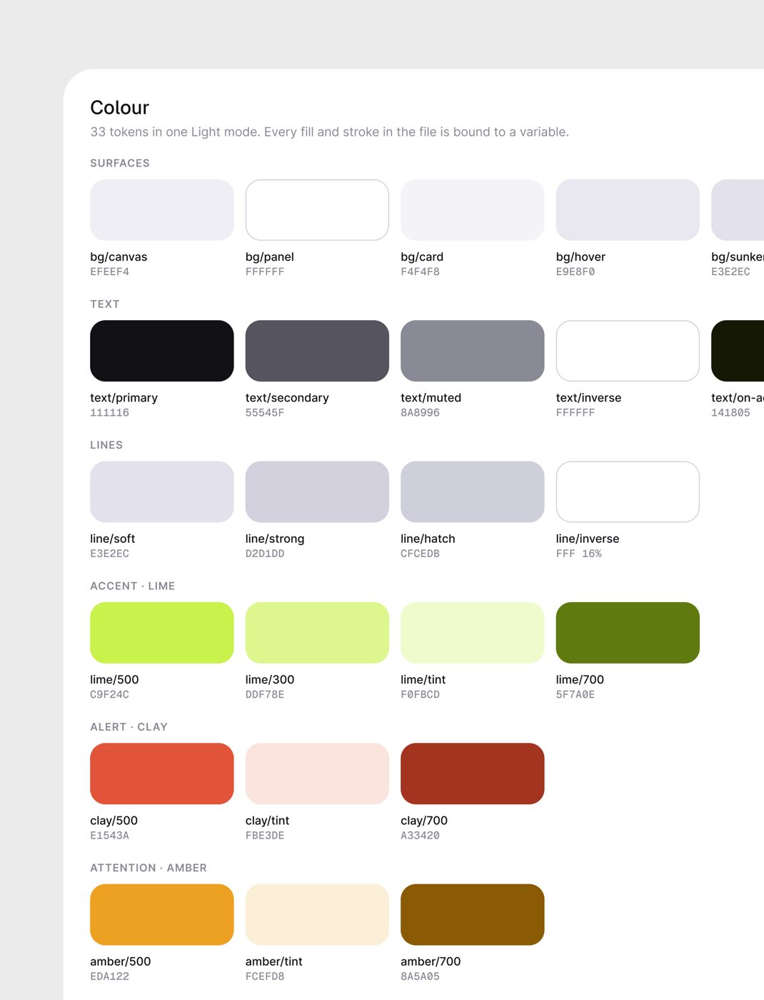
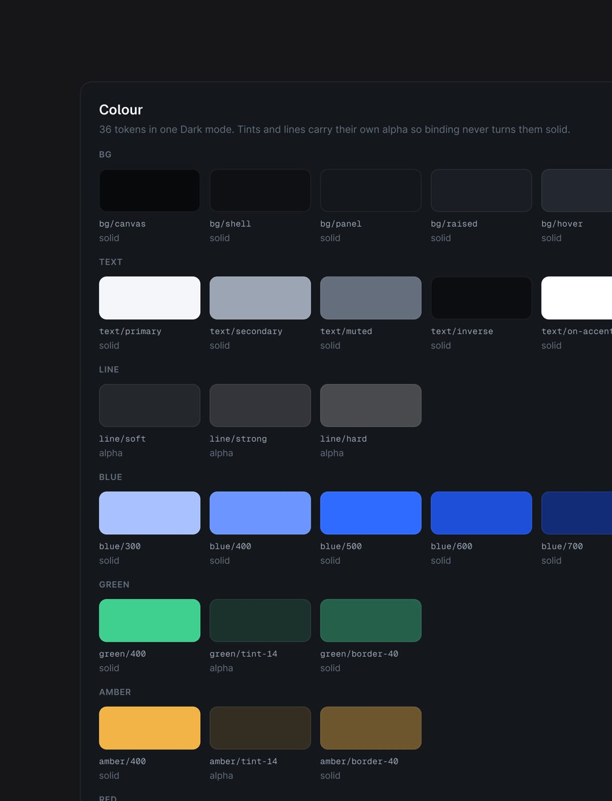
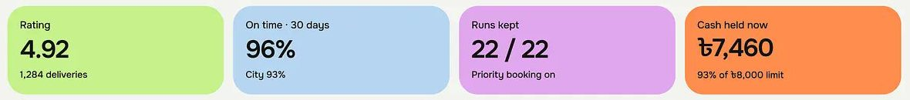
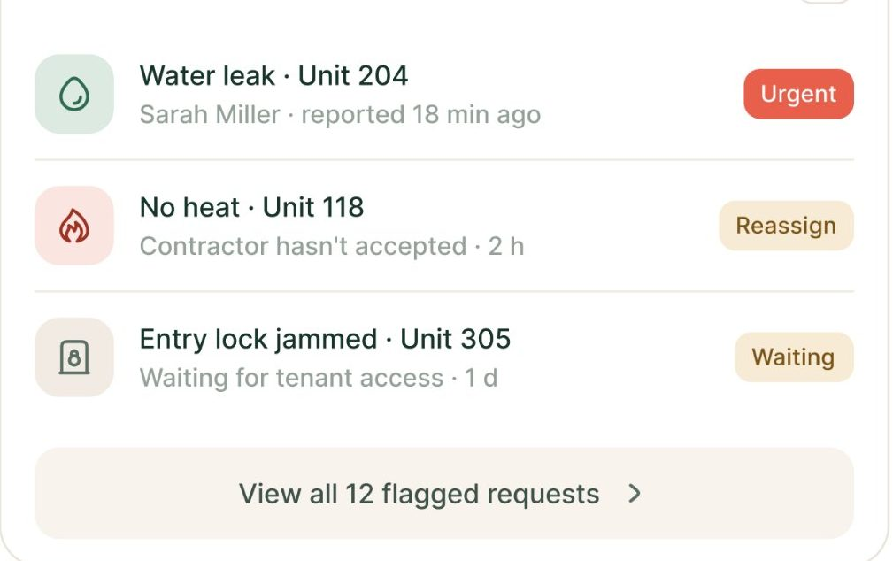
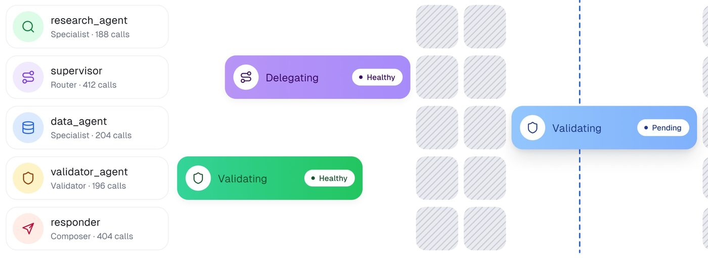
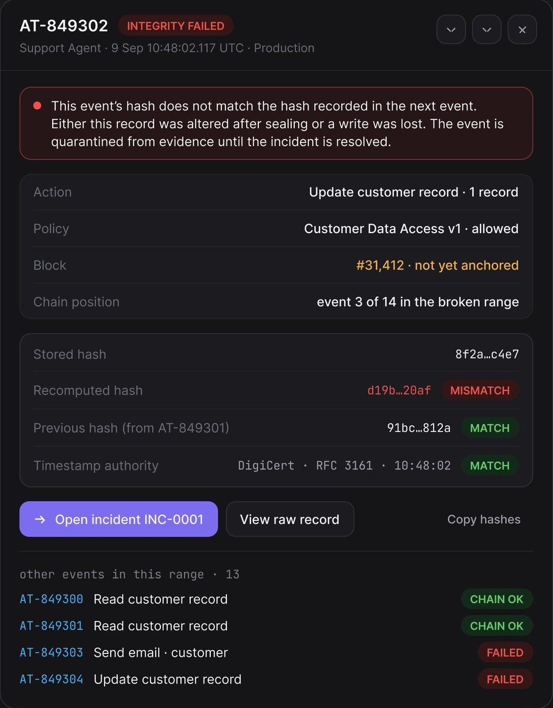
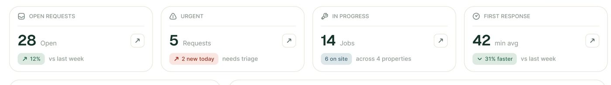
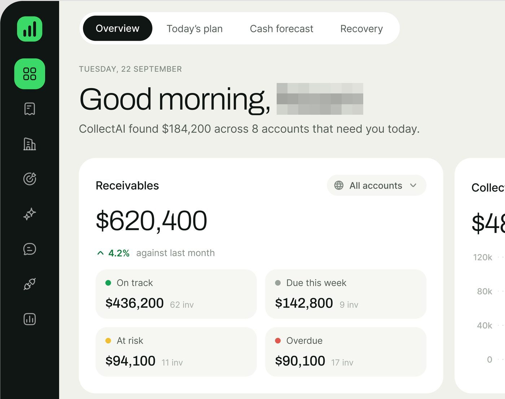
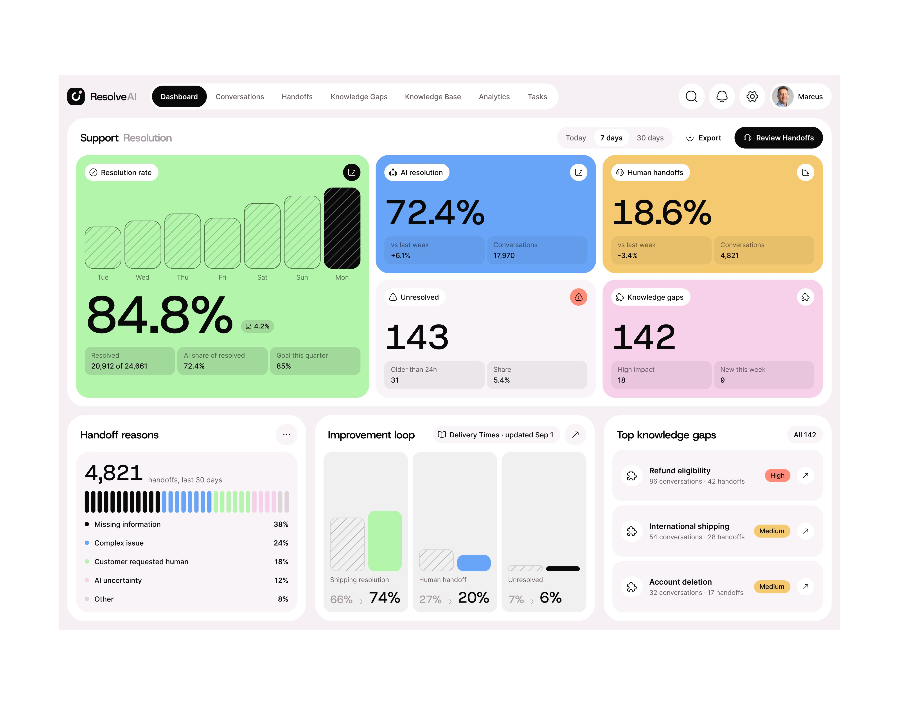

# Cor

## O que é

O sistema de cor do método é **quase todo neutro**: cinza-lavanda no
fundo, branco no painel, cinza claríssimo no cartão, quase-preto no texto. A cor
aparece em três lugares só: **um acento por produto**, os **trios de estado**
(`500` sólido, `tint` de fundo, `700` de texto) e os **dados** (barras, heatmap,
donut). O que dá personalidade a cada produto não é a quantidade de cor, é **o
tingimento dos neutros** pela matiz da marca.

**Fonte primária**: as folhas de variáveis publicadas de dois produtos,
transcritas em [design-system-publicado.md](design-system-publicado.md):
Permitly (claro, hex escritos na folha) e AgentPay (escuro, hex medidos). Esta
página parte dessas folhas e estende com o que foi medido nos outros 15
produtos. Onde houver conflito, **vale a folha**.

Números gerais (309 imagens de produto) **[MEDIDO]**: saturação mediana 0,029;
em 302 das 309 imagens a cor de maior área é um cinza neutro; 71% das imagens
são claras e 26% escuras.

## Medido × declarado: a validação do método

Sem a folha, as cores do Permitly foram amostradas no pixel de um recorte @3x
da tela. Comparando com o que a folha declara:

| Token da folha | Declarado | Medido na tela | Diferença |
|---|---|---|---|
| `bg/canvas` | #EFEEF4 | #efeef4 | **idêntico** |
| `lime/500` | #C9F24C | #c9f24c | **idêntico** |
| `bg/card` | #F4F4F8 | #f4f3f8 (cabeçalho de tabela, pílula, contador) | 1 nível no vermelho |
| `line/soft` | #E3E2EC | #e5e4ec (divisor), #e7e6ec (borda da caixa) | 2 a 4 níveis (antisserrilhado da linha de 1 px) |
| `text/primary` | #111116 | #0e0d13 | 3 níveis mais escuro (a medição pega o miolo do traço) |
| `text/secondary` | #55545F | #525157 (menu) | 3 a 8 níveis |
| `text/muted` | #8A8996 | #88878e, #86868d | 2 a 8 níveis |
| `text/on-accent` | #141805 | #0c1900 | 8 níveis (texto pequeno sobre lima) |
| `amber/500` | #EDA122 | #d8a020 | selo "Under review" sobre foto: JPEG e sombra escurecem |

Conclusão: **superfície chapada sai idêntica; texto sai 2 a 8 níveis mais
escuro que o token**, porque a amostra pega o centro do traço. Nas tabelas
abaixo, a cor de texto medida em outros produtos deve ser lida como "token ≈
medido + 3 a 5 níveis". A divergência maior (âmbar) é da foto por trás do selo,
não do método.

## Anatomia: as camadas de cor, com os nomes da folha

```
cena (fora do app, só na apresentação)   #d3d3d3 a #eeeeee   cinza neutro
└ bg/canvas   fundo do app              #EFEEF4 (Permitly)  off-white TINGIDO pelo acento
  └ bg/panel  painel (sidebar, área)    #FFFFFF             branco puro
    └ bg/card cartão dentro do painel   #F4F4F8             cinza claríssimo tingido, sem borda
      └ selo: tint + 700                #F0FBCD + #5F7A0E   par da mesma matiz
bg/hover #E9E8F0 · bg/sunken #E3E2EC (trilho, campo) · line/soft #E3E2EC · line/strong #D2D1DD
```

**Vocabulário**: a "moldura" do app é o `bg/canvas`; o "cartão branco" é o
`bg/panel`; o "bloco interno" é o `bg/card`. Os tokens de `tokens.css` usam os
nomes da folha.




## Medidas: superfícies no modo claro, por produto

Amostragem de pixel (mediana de uma área 5 × 5) **[MEDIDO]**; a linha do
Permitly é a declarada.

| Produto (tela) | Cena | `bg/canvas` | `bg/panel` | `bg/card` | `line/soft` |
|---|---|---|---|---|---|
| **Permitly (declarado)** | · | **#EFEEF4** | **#FFFFFF** | **#F4F4F8** | **#E3E2EC** |
| OrchestrateIQ (1) | #e7e7e7 | #f8f9fb | #ffffff | #f6f7f9 | #f0f0f2 |
| FixTrack (3) | #ededed | #ffffff (canvas branco, borda #e3e0db) | #ffffff com borda | #f8f3ed, #f4efe9 (trilho) | #e8e4df (quente) |
| Ergond (5) | #eeeeee | #fbfaff | #ffffff | #f7f7f7, #f2f2f4 | #f4f4f4 a #eaeaea |
| medspa (6) | #ececec | #f3f3f5 | #ffffff | #f3f3f5 | sem borda |
| Haulsight (7) | #d7d7d7 | #f4f4f2 | #ffffff | #ededeb | #eaeae8 |
| Mongi (8) | #dee2e5 | #f3f4ef | #ffffff | #ebece7 | sem borda |
| CollectAI (10) | #e2e2e2 | #eff1ea | #ffffff | #f6f7f2 | sem borda |
| ResolveAI (11) | #ffffff | #f6f0f4 | #ffffff | #f8f4f7 | sem borda |
| Documents (12) | #f7f7f7 | (cartão solto) | #ffffff | #f2f1f8 | cinza fino |
| Shuto, mobile (18) | #e9e9e9 | tela #ffffff | #ffffff | #eff9de (tile do ícone) | #ededeb |
| Técnico, mobile (19) | #e6e6e6 | tela #f1f1ef | #ffffff | #f1f2ed (trilho) | cartão ativo com borda azul |
| Torin, mobile (20) | #d3d3d3 | tela #eeeeec | #ffffff | #e9e9e7 (trilho) | sem borda |
| medspa, mobile (21) | #e4e4e4 | tela #f3f3f5 | #ffffff | #f4f2ff | sem borda |

O que a tabela mostra:

- A **cena** vai de #d3d3d3 a #eeeeee e é sempre neutra. Não faz parte do
  produto nem do design system: é o "papel" da apresentação.
- O **canvas** tem luminosidade de 94 a 98% e **carrega a matiz do produto**. O
  do Permitly é `hsl(250 21% 95%)`, lavanda; o do CollectAI é verde (#eff1ea);
  o do ResolveAI, rosado (#f6f0f4); o do OrchestrateIQ, azul frio (#f8f9fb); o
  do Haulsight e do Mongi, quente (#f4f4f2, #f3f4ef).
- O **painel** é branco puro em 100% das telas claras.
- O **card** interno fica 1 a 4 pontos abaixo do painel e repete a matiz do
  canvas (#F4F4F8 é `hsl(240 22% 96%)`).
- A **linha** tem contraste de 1,15 a 1,3:1 com o branco (#E3E2EC = 1,28:1).
  No FixTrack ela é quente (#e8e4df), acompanhando a paleta bege.

## Medidas: superfícies no modo escuro

A folha escura publicada (AgentPay, acento azul) tem cinco degraus de fundo. O
AgentTrail, a série escura com mais telas (acento violeta), segue a mesma
estrutura com números próprios **[MEDIDO]**.

| Degrau | AgentPay (folha) | AgentTrail (telas 13 a 16) | Vero (17) | Lepo (22) |
|---|---|---|---|---|
| `bg/canvas` | #08090B | #0c0c0e (área de conteúdo) | #1d1d1d | #1b1b1b (tela) |
| `bg/shell` | #0E1013 | #111113 (sidebar) | #1a1a1a | · |
| `bg/panel` | #14171C | #151517 | #191919 | #2c2c2c |
| `bg/raised` | #1A1E24 | #1c1b20, #1d1c22 | · | · |
| `bg/hover` (e item ativo) | #232830 | #242328 | #242424 | #333333 |
| `line/soft` | #24272C (alpha) | #202022 | · | · |

- Cada degrau sobe **+2 a +4 pontos de luminosidade** (#08 → #0E → #14 → #1A →
  #23 no canal vermelho).
- O cinza escuro **também é tingido**: azul no AgentPay (o canal azul é sempre o
  maior, #14171C), violeta no AgentTrail (#151517, #242328).
- A cena da apresentação escura é #1b1b1b a #313131, mais clara que o app.




## Medidas: texto em três níveis

Declarado pelo Permitly: `text/primary #111116`, `text/secondary #55545F`,
`text/muted #8A8996`. Nos outros produtos, cor do texto = mediana dos 6% de
pixels mais distantes do fundo numa caixa de texto **[MEDIDO]** (lembrar: o
token real é 3 a 5 níveis mais claro).

| Produto | Primário | Secundário | Muted / caixa-alta |
|---|---|---|---|
| **Permitly (declarado)** | **#111116** | **#55545F** | **#8A8996** |
| **AgentPay (folha, escuro)** | **#F4F6F9** | **#9BA5B4** | **#646E7C** |
| OrchestrateIQ | #18191e | #6a6e7a | #676d79 |
| FixTrack | #112e24 (KPI), #192f26 | #5c6863 (menu), #8d938f | #a6aca8 |
| Ergond | #0d0e0f | #3f4143 (menu), #5d5e60 | #5b5b5e |
| medspa | #101013 | #707076 | #98989d |
| Haulsight | #23110c | #555452 | #9c9b99 |
| Mongi | #000000 | #5b5c57 | #535353 |
| CollectAI | #101613 | #525c55 | #828c84, #a4aca4 |
| ResolveAI | #0a0a0a | #4c6549 (sobre verde) | #a89ca4 |
| Documents | #0f0c1d | #57536b | #9894aa |
| Shuto (mobile) | #0e0e0e | #686868 | #666666 |
| Técnico (mobile) | #131314 | #575758 | #898987, #9fa09e |
| Torin (mobile) | #262625 | #575755 | #727270 |
| AgentTrail (escuro) | #f8f7fc | #a2a1a6 | #6f6e74; mono #7e7e83 |
| Vero (escuro) | #ffffff, #dbdbdb | #959595 | #7a7a7a |
| Lepo (escuro) | #f4f4f4 | #bdbdbd | #a8a8a8 |

Regras que saem daí:

- **O primário nunca é #000 puro** (a exceção é o Mongi). É um quase-preto com
  a matiz do produto: #111116 é `hsl(240 13% 8%)`; verde no FixTrack (#112e24)
  e no CollectAI; violeta no Documents (#0f0c1d); marrom no Haulsight (#23110c).
- **Secundário entre 35 e 45% de luminosidade** (#55545F = 35%, contraste
  7,5:1; #6a6e7a = 45%, 5,1:1).
- **Muted perto de 55%** (#8A8996 = 56%, contraste 3,4:1 no branco e 3,1:1 sobre
  o `bg/card`). O muted **não passa AA** para texto pequeno, e a folha aceita isso
  em metadado, rótulo de grupo e eixo **[CONFIRMADO]**. Nas telas desta skill o
  medidor cobra 4,5:1 (regra 15 do `SKILL.md`).
- **No escuro**: primário #F4F6F9 (16,6:1 no painel), secundário #9BA5B4
  (7,2:1), muted #646E7C (3,5:1). O muted do escuro é o mesmo papel do claro.
- `text/on-accent` não é preto: sobre o lima vai #141805, um preto esverdeado
  (14:1). No azul do escuro é branco (4,5:1, no limite do AA).

## O acento: um por produto

Declarado: Permitly = **lima #C9F24C** (com `lime/300 #DDF78E`,
`lime/tint #F0FBCD`, `lime/700 #5F7A0E`); AgentPay = **azul #2F6BFF** (com
escala 300 a 700). Medido nos demais:

| Produto | Acento de ação | Cor-assinatura (destaque) | Onde aparece |
|---|---|---|---|
| **Permitly** | preto `text/primary` #111116 no item ativo | **lima #C9F24C** | menu ativo e barra de progresso em preto; selo de alerta, toggle, cartão "Permit AI" em lima |
| **AgentPay** | **azul #2F6BFF** | verde #3FCF8E, âmbar #F2B347 | botão "New agent", tile de ícone #6C95FF |
| OrchestrateIQ | **#2563eb** azul royal (lido #2563ea) | amarelo #ffd33f no cartão "Do first" | aba ativa, menu ativo, marcador de tempo |
| FixTrack | **#1f493b** verde-floresta | coral #e85f4c (urgente), bege #f8f3ed | "New request", barra de agenda, tooltip #16342a |
| Ergond | **#111214** preto | azul-aço #1e5e8c + laranja #c2410c | "Publish v3", canais; barras e links |
| medspa | **#141318** preto | lavanda #c7b8f9, violeta #7556df, lima #daeebd | aba ativa, exportar; KPI destacado, heatmap |
| Haulsight | **#1b5a33** verde-escuro | amarelo #f4b910, gradiente azul→verde no botão de IA | "Live Map", "Review action", "Ask Haulsight" |
| Mongi | **#264c3f** verde-escuro e preto | lima #c7f18b, azul #b6d5f1, rosa #e0a7ee, laranja #ff8d4e | barra atual, menu ativo; quatro KPIs coloridos |
| CollectAI | **#101613** preto-esverdeado | verde #3bd968 | trilho lateral, aba ativa; logo, barra de saúde |
| ResolveAI | **#0a0a0a** preto | verde #b4f5ac, azul #68a5f8, rosa #f7d0ea | aba ativa, barra destacada; cartões de KPI |
| Documents | preto #0f0c1d | índigo #3a0dcc (IA), lima #c4e35a | donut, dica de IA |
| AgentTrail | **#7c6cf0** violeta | rosa #f062b0 | "Log risk", "Open incident", interruptores |
| Vero | branco em fundo escuro | verde-azulado #387565 | "Export"; "Ask vero" |
| Shuto (mobile) | **#141414** preto | verde #274b3f, lima #c6f08c, laranja #fe8c4e | aba ativa; cartão principal, KPIs |
| Técnico (mobile) | **#4051e3** índigo | lima #d8e86b | "i'm on the way", horários, aba ativa |
| Torin (mobile) | **#272727** preto | coral **#ff6b4b** | "Review 3 charges"; barras, alertas |
| medspa (mobile) | **#141318** preto | lavanda #c7b8f9, violeta #6e5abd | "View appointment"; cartão de consulta |
| Lepo (escuro) | branco | verde-água #5fe3b8 + rosa #f27ad0 | barras e progresso |

- **Preto como ação principal em 9 de 17 produtos**; a cor própria vai para um
  cartão de destaque, um selo ou o gráfico. O Permitly confirma isso na folha: o
  acento declarado é o lima, mas o item ativo do menu é preto.
- **O lima é quase uma assinatura do estilo**: aparece como segunda cor em 8
  produtos (#C9F24C, #c6f08c, #c7f18b, #b4f5ac, #c4e35a, #daeebd, #d8e86b), com
  a mesma função do marca-texto `#f9fc50` do [site de vitrine](../09-do-generico-ao-produto/site-de-vitrine.md).

Como escolher a matiz **[INFERIDO]**, pela correlação entre domínio e cor:
agente, governança e pagamento → azul ou violeta (AgentPay, OrchestrateIQ,
AgentTrail); operação e dinheiro do dia a dia → verde escuro (FixTrack,
CollectAI, Mongi, Haulsight, Shuto); saúde e estética → lavanda (medspa);
finança pessoal → coral (Torin); construção e licença → lima (Permitly).



## Estado: o trio 500 / tint / 700

### Claro (declarado no Permitly)

| Estado | `500` sólido | `tint` fundo | `700` texto | Contraste tint × 700 |
|---|---|---|---|---|
| Lima (acento da marca, positivo) | #C9F24C | #F0FBCD | #5F7A0E | 4,5:1 |
| Argila (erro, urgente) | #E1543A | #FBE3DE | #A33420 | 5,6:1 |
| Âmbar (atenção) | #EDA122 | #FCEFD8 | #8A5A05 | 5,2:1 |

A regra em HSL: **mesma matiz (±1°), tint com luminosidade 89 a 93% e
saturação 78 a 86%, 700 com luminosidade 27 a 38%**. Antes da folha, a
medição em outros produtos tinha chegado a "fundo 90 a 93%, texto 29 a 36%":
a folha confirma e alarga a faixa em 2 pontos.

### Claro, medido nos outros produtos

| Estado | `tint` | `700` | `500` (ponto, barra) | Evidência |
|---|---|---|---|---|
| Sucesso | #dcfce7, #e3f4ea, #ddeae1, #e2f3ea, #e8f5d9, #eff9de | #1f7744, #1e6240, #396451, #0e7a3c, #4f7325, #2e6415 | #22c55e, #3bd968, #14a254 | OrchestrateIQ, Ergond, FixTrack, CollectAI, medspa, Shuto |
| Atenção | #fef3c6, #fdf1db, #f7ebd5, #fff1d9 | #795b1a, #6e5424, #b97e1d | #f0be31, #e0b55e, #f7b615 | OrchestrateIQ, Ergond, FixTrack, CollectAI, Haulsight |
| Erro | #ffece6, #fde8e3, #fae5e0, #fceae8 | #972a26, #8a382e, #bb494c, #b33921 | #e85f4c, #e2564f, #eb5036 | OrchestrateIQ, Ergond, FixTrack, medspa, Haulsight |
| Info | #dbeaff, #e5f0fa, #e7ebfb, #dde7e9 | #285a7d, #3038a5, #455f6a | #2563eb, #4051e3 | OrchestrateIQ, Ergond, técnico, FixTrack |
| Neutro | #f4f3f8 (= `bg/card`), #f6f7f9 | #111116, #4f555c | · | Permitly, OrchestrateIQ |

No **OrchestrateIQ** os trios são literalmente a paleta padrão do Tailwind
**[MEDIDO]**: #dcfce7 = green-100, #dbeafe = blue-100, #fef3c7 = amber-100,
#2563eb = blue-600. Nos produtos com design system próprio (Permitly, FixTrack)
o trio sai da paleta da marca.





### Escuro: tint com alpha e borda

Declarado no AgentPay: `green/400 #3FCF8E`, `green/tint-14` (verde a 14% sobre
o painel = #1A312C), `green/border-40` (#25614A); o mesmo para âmbar
(#F2B347, #332D22, #6D552D). **No escuro o selo ganha borda de 1 px** e o
texto é o `400` sólido. O tint a folha marca "alpha"; a borda, não: o NOME diz
40, a folha marca "solid", e o hex medido equivale a 40% da cor sobre o painel
**[MEDIDO]**.

| Estado | Fundo | Texto | Evidência |
|---|---|---|---|
| Sucesso | #1A312C (folha); #113014, #132a1b, #17371e | #3FCF8E (folha); #6cca76, #5fd068 | "VERIFIED", "MATCH", "Auto approved" |
| Atenção | #332D22 (folha); #332612, #2a2112 | #F2B347 (folha); #e8b75f, #f2b33d | "PARTIAL · 3 GAPS", "Needs approval" |
| Erro | #431617, #411818, #3a1718 | #eb5957, #e85b58 | "Blocked", "MISMATCH" |
| Violeta (agente) | #1e1a35, #171628 | #ac9efe, #b7acf8 | cartão "Trigger", hash |
| Rosa (política) | #2c1a28 | #ef7ec0 | cartão "Policy evaluation" |
| Info (ID) | sem fundo | #4faeee, #55adea | "AT-849291" em mono |
| Neutro | #232328 | #a0a0a9 | "38 CONTROLS", "2.1 GB" |

Em HSL, o escuro inverte o claro: fundo com luminosidade 15 a 17% (é o efeito
dos 14% de alpha) e texto em 53 a 64%. Contraste de 6,9 a 7,4:1.

No AgentTrail a borda de 40% aparece no tile do ícone de sucesso do pacote de
evidência, mas **não** nos selos "MATCH" e "CHAIN OK", que são só tint e texto
**[MEDIDO]**. A regra que vale é a da folha do AgentPay, com a borda.



## Variações

- **Neutro frio × neutro quente.** Permitly, AgentPay, OrchestrateIQ e medspa
  usam cinza frio (canal azul maior); FixTrack, Haulsight e Mongi, cinza quente
  (bege, papel). Acento frio, neutro frio.

  
- **Cartão colorido chapado.** Mongi (quatro KPIs), ResolveAI (verde e azul),
  medspa (lavanda e lima), Shuto (verde-escuro, lima, laranja), Permitly
  (cartão "Permit AI" em lima). Aparece nos produtos de consumo e operação,
  nunca nos de governança.
- **Gradiente só em peça de IA**: barras de evento do OrchestrateIQ (#b592f6 →
  #ad8df8; #30d08a → #28ca74), botão "Ask Haulsight" (#014bca → #1e8653), orbe
  do assistente. Ver [superficie-e-profundidade.md](superficie-e-profundidade.md).



## Quando usar cada coisa

- **Produto de agente, pagamento, auditoria** → modo escuro, cinzas tingidos de
  azul ou violeta, estado em tint com borda, mono para ID e dinheiro (AgentPay,
  AgentTrail, Vero).
- **Produto para pessoa não técnica** (licença, manutenção, entrega, clínica) →
  modo claro, canvas tingido, um cartão chapado de destaque (Permitly, FixTrack,
  Mongi, Shuto, medspa).
- **Momento "a IA encontrou algo"** → acento frio e um elemento com gradiente.

## Tokens (tabela)

A base é a folha publicada: claro = Permitly (declarado), escuro = AgentPay
(medido na folha). `tokens.css` implementa esta tabela com os mesmos nomes.

| Token (nome da folha) | Claro | Escuro | Papel |
|---|---|---|---|
| `bg/canvas` | #EFEEF4 | #08090B | fundo do app |
| `bg/shell` | (não existe no claro) | #0E1013 | moldura do app no escuro |
| `bg/panel` | #FFFFFF | #14171C | painel: sidebar, área de conteúdo |
| `bg/card` / `bg/raised` | #F4F4F8 | #1A1E24 | cartão dentro do painel |
| `bg/hover` | #E9E8F0 | #232830 | hover, item ativo discreto |
| `bg/sunken` | #E3E2EC | (usar `bg/canvas`) | trilho, campo rebaixado |
| `text/primary` | #111116 | #F4F6F9 | texto principal |
| `text/secondary` | #55545F | #9BA5B4 | apoio |
| `text/muted` | #8A8996 | #646E7C | metadado, rótulo, placeholder |
| `text/inverse` | #FFFFFF | #0B0D10 | texto sobre fundo invertido |
| `text/on-accent` | #141805 | #FFFFFF | texto sobre o acento |
| `line/soft` | #E3E2EC | branco a ~8% (#24272C sobre o painel) | borda de cartão, divisor |
| `line/strong` | #D2D1DD | branco a ~14% (#33353A) | borda de controle, input |
| `line/hard` | · | branco a ~24% (#484A4E) | borda de foco |
| `line/hatch` | #CFCEDB | · | listras do slot vazio |
| `line/inverse` | branco 16% | · | borda sobre fundo escuro |
| acento `500` | lima #C9F24C | azul #2F6BFF | ação ou marca |
| acento `tint` / `700` | #F0FBCD / #5F7A0E | azul 14% / #A9C2FF | selo do acento |
| `clay/500 · tint · 700` | #E1543A · #FBE3DE · #A33420 | (vermelho cortado na folha) | erro |
| `amber/500 · tint · 700` | #EDA122 · #FCEFD8 · #8A5A05 | #F2B347 · 14% · borda 40% | atenção |
| `green/500 · tint · 700` | **[INFERIDO]** #2F9E5B · #E1F5E8 · #1E6B3D | #3FCF8E · 14% · borda 40% | sucesso |

As porcentagens de alpha das linhas do escuro são **[INFERIDO]**: a folha diz
só "alpha"; o valor sai de resolver a cor medida sobre o `bg/panel`. O trio
verde do claro não está visível na folha (a borda direita da imagem publicada
está cortada) e foi montado pela regra do trio.

## Como reproduzir

1. **Escolha o acento** pelo domínio do produto e decida se a ação primária é
   ele ou preto (`text/primary`). Se for preto, o acento vai para selo, toggle,
   cartão de destaque e gráfico.
2. **Tinja os neutros** com a matiz do acento: canvas `hsl(H 20% 95%)`, card
   `hsl(H 20% 96%)`, sunken e line/soft `hsl(H 20% 91%)`, texto primário
   `hsl(H 13% 8%)`, secundário `hsl(H 6% 35%)`, muted `hsl(H 6% 56%)`. Com
   H = 245 sai perto da folha do Permitly, não igual: o secundário bate
   (#55545F), e os outros cinco ficam a 1 ou 2 níveis de 255 em algum canal
   (canvas #F0F0F5 contra #EFEEF4, card #F3F3F7 contra #F4F4F8, sunken #E4E3ED
   contra #E3E2EC, primário #121217 contra #111116, muted #898896 contra
   #8A8996) **[MEDIDO]**. Para o Permitly, use os hex da folha; a fórmula serve
   para outra matiz.
3. **Monte cada estado como trio**: `500` qualquer; `tint = hsl(H 80-86% 89-93%)`;
   `700 = hsl(H 67-93% 27-38%)`. Selo = tint + 700, sem borda.
4. **No escuro**: fundos em degraus de +2 a +4 de luminosidade, estado com
   `tint` = 500 a 14% de alpha, borda = 500 a 40% já composto sobre o painel
   (cor sólida, como a folha marca), texto = 400 sólido.
5. Tudo como variável, nada solto: é a regra escrita na folha.

```css
.badge { background:var(--amber-tint); color:var(--amber-700); border-radius:999px; font:500 12px/16px var(--font-body); padding:4px 10px; }
[data-theme="dark"] .badge { background:rgb(242 179 71 / .14); color:#F2B347; box-shadow:inset 0 0 0 1px rgb(242 179 71 / .40); }
```

## Cor viva em cartão inteiro **[OBSERVADO]**

Duas séries usam cor saturada em **cartão inteiro**, sem quebrar o acento único:

- **ResolveAI**: cada métrica num cartão de uma cor (verde, azul, amarelo, rosa), o resto da tela
  branco: *"A lot of colors, still no noise in the interface."* A pergunta que a tela responde:
  *"How do you handle information-heavy pages while keeping the layout consistent, engaging, and
  colorful?"* A cor identifica a métrica e se repete na aba correspondente do celular.
- **LeaseFlow**: um amarelo-limão `#F0F054` **[MEDIDO, amostra quantizada]** só no cartão que
  responde a pergunta da tela, na data da visita e no que a IA preparou; barras hachuradas para "o
  resto" e cheias para "o agora".

A regra que as duas seguem: cor cheia marca **o que é cada coisa** (a métrica, a resposta), nunca
decoração; e tudo que não é a resposta fica neutro ou hachurado.



