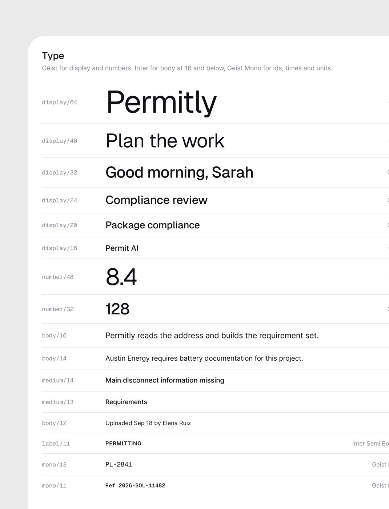
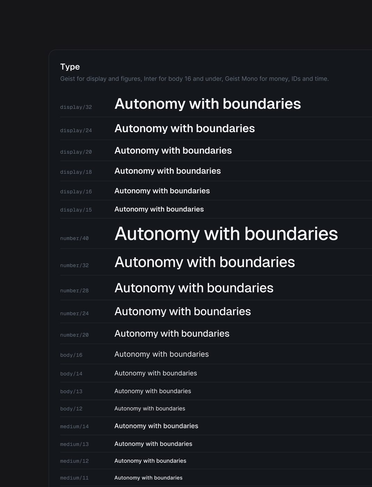

# O design system publicado

> **Fonte primária.** As folhas de variáveis do Figma de dois produtos, publicadas
> como peça: o **Permitly** (tema claro, legenda *"Does your vibe-coded product
> maintain a proper design system?"*) e o **AgentPay / AgentTrail** (tema escuro,
> *"Designed with a scalable design system."*).
> Tudo o que está aqui é **[CONFIRMADO]**: é o que está escrito na própria folha.
> A exceção são os hex do tema escuro, que a folha não imprime. Esses foram
> **[MEDIDOS]** no pixel do centro de cada amostra.
> Onde as outras páginas desta seção **mediram no olho** e divergirem daqui,
> **vale esta página**.

## A regra declarada na folha

- *"Every fill and stroke in the file is bound to a variable."*
  Nenhuma cor solta no arquivo.
- *"Every padding and gap in the file is bound."*
  Nenhum espaçamento solto.
- *"Tints and lines carry their own alpha so binding never turns them solid."*
  No escuro, o fundo de selo (`tint-14`) e as linhas são cor com transparência
  própria, e a folha os marca "alpha". Assim o mesmo token funciona sobre
  qualquer superfície. A borda do selo (`border-40`) a folha marca "solid".
- *"Panels sit flat on the canvas; only the plan viewer lifts."*
  Sombra quase não existe. O único elemento que flutua é o visualizador de planta.


## Cor, tema claro (Permitly): 33 tokens, hex escritos na folha

| Grupo | Token | Hex | Papel |
|---|---|---|---|
| Superfície | `bg/canvas` | `#EFEEF4` | fundo da página, cinza levemente lavanda |
| | `bg/panel` | `#FFFFFF` | painel principal (sidebar, área de conteúdo) |
| | `bg/card` | `#F4F4F8` | cartão dentro do painel |
| | `bg/hover` | `#E9E8F0` | hover de item |
| | `bg/sunken` | `#E3E2EC` | área rebaixada (trilho, campo) |
| Texto | `text/primary` | `#111116` | texto principal, quase preto |
| | `text/secondary` | `#55545F` | texto de apoio |
| | `text/muted` | `#8A8996` | metadado, rótulo, placeholder |
| | `text/inverse` | `#FFFFFF` | texto sobre fundo escuro |
| | `text/on-accent` | `#141805` | texto sobre o lima (não é preto puro: é um preto esverdeado) |
| Linha | `line/soft` | `#E3E2EC` | borda de cartão, divisória |
| | `line/strong` | `#D2D1DD` | borda de controle, input |
| | `line/hatch` | `#CFCEDB` | as listras diagonais do slot vazio |
| | `line/inverse` | `FFF 16%` | borda sobre escuro |
| Acento, lima | `lime/500` | `#C9F24C` | o acento da marca (selo "7 projects need…", toggle, item ativo) |
| | `lime/300` | `#DDF78E` | variação clara |
| | `lime/tint` | `#F0FBCD` | fundo de selo |
| | `lime/700` | `#5F7A0E` | texto sobre `lime/tint` |
| Alerta, argila | `clay/500` | `#E1543A` | erro, urgente |
| | `clay/tint` | `#FBE3DE` | fundo de selo de erro |
| | `clay/700` | `#A33420` | texto do selo de erro |
| Atenção, âmbar | `amber/500` | `#EDA122` | "Under review", atenção |
| | `amber/tint` | `#FCEFD8` | fundo de selo de atenção |
| | `amber/700` | `#8A5A05` | texto do selo de atenção |

A folha diz 33 tokens, mas a imagem mostra 24. A borda direita está cortada na
imagem publicada. Pela lógica dos grupos, o mais provável é que os 9 que faltam
sejam mais superfícies, uma quinta coluna de texto e um grupo verde ou azul de
sucesso e informação **[INFERIDO]**.

**O padrão de cada cor de estado é sempre um trio**: `500` (sólido), `tint`
(fundo) e `700` (texto sobre o tint). Selo = tint no fundo + 700 no texto. É essa
a razão de os selos parecerem "limpos": contraste alto sem cor berrante.

## Cor, tema escuro (AgentPay): 36 tokens, hex medidos no pixel


| Grupo | Token | Hex medido | Observação |
|---|---|---|---|
| BG | `bg/canvas` | `#08090B` | quase preto, levemente azulado |
| | `bg/shell` | `#0E1013` | a moldura do app |
| | `bg/panel` | `#14171C` | painel |
| | `bg/raised` | `#1A1E24` | cartão elevado |
| | `bg/hover` | `#232830` | hover |
| Texto | `text/primary` | `#F4F6F9` | branco frio, não puro |
| | `text/secondary` | `#9BA5B4` | cinza azulado |
| | `text/muted` | `#646E7C` | metadado |
| | `text/inverse` | `#0B0D10` | texto sobre fundo claro |
| | `text/on-accent` | `#FFFFFF` | texto sobre o azul |
| Linha (alpha) | `line/soft` | `#24272C` sobre o painel | a folha marca "alpha" |
| | `line/strong` | `#33353A` sobre o painel | |
| | `line/hard` | `#484A4E` sobre o painel | |
| Azul | `blue/300` | `#A9C2FF` | |
| | `blue/400` | `#6C95FF` | cor do ícone dentro do tile |
| | `blue/500` | `#2F6BFF` | o acento (botão "New agent") |
| | `blue/600` | `#1E4FD9` | hover/pressionado |
| | `blue/700` | `#122C78` | |
| Verde | `green/400` | `#3FCF8E` | sucesso, "Auto approved" |
| | `green/tint-14` | `#1A312C` sobre o painel | verde a 14% de alpha |
| | `green/border-40` | `#25614A` | borda do selo; a folha marca "solid" |
| Âmbar | `amber/400` | `#F2B347` | atenção, "Needs approval" |
| | `amber/tint-14` | `#332D22` sobre o painel | âmbar a 14% |
| | `amber/border-40` | `#6D552D` | borda do selo; a folha marca "solid" |
| Vermelho | `red/...` | cortado na imagem | o grupo existe (rótulo "RED" visível) |

**No escuro o selo ganha borda**: fundo a 14% de alpha, borda `border-40` e
texto sólido. No claro, o selo é só tint e texto, sem borda. Os nomes `tint-14`
e `border-40` guardam a porcentagem no próprio nome, mas só o tint é alpha na
folha: da borda, o NOME diz 40, a folha marca "solid", e o hex medido equivale a
40% da cor sobre o painel **[MEDIDO]** (verde: 0,4 × #3FCF8E + 0,6 × #14171C =
#25614A; âmbar: 0,4 × #F2B347 + 0,6 × #14171C = #6D552D).

Tile de ícone medido: fundo `#18233C` (azul a ~14% sobre o painel) e ícone
`#6C95FF` (`blue/400`).

## Tipografia: três famílias, cada uma com um papel



A regra, escrita nas duas folhas:

> *"Geist for display and numbers, Inter for body at 16 and below, Geist Mono for
> ids, times and units."* (claro)
> *"Geist for display and figures, Inter for body 16 and under, Geist Mono for
> money, IDs and time."* (escuro)

| Papel | Família | Por quê (leitura do método) |
|---|---|---|
| Título, saudação, número grande | **Geist** | grotesca geométrica de personalidade leve; número fica "de produto" |
| Texto de corpo ≤ 16px | **Inter** | a mais legível em tamanho pequeno de interface |
| ID, hora, unidade, dinheiro no escuro | **Geist Mono** | alinha coluna, dá cara de "sistema de verdade" (hash, `PL-2841`) |

**Escala do claro (Permitly)**

| Token | Tamanho | Exemplo na folha |
|---|---|---|
| `display/64` | 64 | "Permitly" (marca) |
| `display/40` | 40 | "Plan the work" |
| `display/32` | 32 | "Good morning, Sarah" (saudação da home) |
| `display/24` | 24 | "Compliance review" (título de página) |
| `display/20` | 20 | "Package compliance" (título de cartão) |
| `display/16` | 16 | "Permit AI" (título pequeno) |
| `number/48` | 48 | "8.4" |
| `number/32` | 32 | "128" |
| `body/16` | 16 | frase de explicação |
| `body/14` | 14 | corpo padrão |
| `medium/14` | 14, peso médio | título de item de lista |
| `medium/13` | 13, peso médio | item de menu |
| `body/12` | 12 | metadado ("Uploaded Sep 18 by Elena Ruiz") |
| `label/11` | 11, Inter Semi Bold, caixa alta com espaçamento | rótulo de grupo ("PERMITTING") |
| `mono/13` | 13, Geist Mono | "PL-2841" |
| `mono/11` | 11, Geist Mono | "Ref 2026-SOL-11482" |



**Escala do escuro (AgentPay)** é mais compacta, porque é produto denso:
`display/32, 24, 20, 18, 16, 15`, `number/40, 32, 28, 24, 20`,
`body/16, 14, 13, 12` e `medium/14, 13, 12, 11`.

O que as duas escalas ensinam:
- **O número tem escala própria**, separada do título. KPI nunca usa token de título.
- **O corpo para em 16px.** Acima disso, a fonte já é Geist.
- **Existe 13 e 15**, fora da grade de 4. Tipografia de produto denso não segue grade de 4px.

## Espaço


- Claro: `4 · 8 · 12 · 16 · 20 · 24 · 32 · 40 · 48 · 64`, e a folha diz "0 a 120".
- Escuro: a mesma escala, "0 a 80".
- **É grade de 4**, com saltos de 8 a partir de 24 e de 16 a partir de 48.

## Raio: um raio por nível de profundidade

| Tema | Regra escrita na folha | Escala |
|---|---|---|
| Claro (Permitly, produto leve, cliente pouco técnico) | *"Panels 32, cards 24, tiles 16 and 20, pills full."* | 8, 12, 16, 20, 24, 32, full |
| Escuro (AgentPay, produto denso de finanças e agentes) | *"Cards 16, controls 8 to 12, pills full."* | 8, 10, 12, 16, 20, full |

**O raio muda com o tipo de produto.** Produto leve e amigável usa raio grande
(painel 32). Produto denso e sério usa raio contido (cartão 16). Não existe "um
raio da marca". O raio é decisão de produto.

## Elevação

Duas sombras só: `shadow/soft` e `shadow/pop`. E a regra: *"Panels sit flat on
the canvas; only the plan viewer lifts."* A profundidade vem da **troca de
superfície** (canvas → panel → card), não de sombra.

## Tile de ícone


*"The icon is always half the tile. 24 / 32 / 40 / 48 / 64 only."*

| Tile | Ícone |
|---|---|
| 24 | 12 |
| 32 | 16 |
| 40 | 20 |
| 48 | 24 |
| 64 | 32 |

## Onde o sistema publicado falha no contraste (medido)

Medido numa tela que copia o Permitly:

| Par | Contraste | Veredito para texto de 14 px |
|---|---|---|
| branco sobre `clay/500` `#E1543A` (o selo sólido "High" da tabela do Permitly) | **3,80:1** | reprova (mínimo 4,5) |
| branco sobre `clay/700` `#A33420` | 6,84:1 | passa |
| `clay/700` sobre `clay/tint` | 5,59:1 | passa |
| `amber/700` sobre `amber/tint` | 5,21:1 | passa |

**Como copiar sem herdar o defeito:** o sólido do mais grave usa `clay/700`, que já
é do próprio sistema. Os selos tint passam como estão.

**No escuro (AgentPay), medido pixel a pixel no shot:** o fundo é `#08090B`, a
lateral `#0F1014` e o cartão `#14171C`, praticamente preto. O texto apagado `#646E7C`
dá **3,48:1** sobre o cartão e reprova. Posto lado a lado com três degraus mais
claros, o escolhido é o **grafite** (fundo `#181A1F`, cartão `#23272E`, texto
apagado `#8A93A0` a 4,83:1), o padrão da skill `/design-de-produto` (regra 16). Ao
clarear o fundo, o vermelho do selo tem de subir para `#FF8A8A`, e as bordas dos
selos passam a `rgb(cor / .40)`, que acompanham qualquer fundo.

## Como reproduzir (CSS)

```css
/* Tema claro, Permitly. Valores escritos na folha. */
:root {
  --bg-canvas:#EFEEF4; --bg-panel:#FFFFFF; --bg-card:#F4F4F8; --bg-hover:#E9E8F0; --bg-sunken:#E3E2EC;
  --text-primary:#111116; --text-secondary:#55545F; --text-muted:#8A8996; --text-inverse:#FFFFFF; --text-on-accent:#141805;
  --line-soft:#E3E2EC; --line-strong:#D2D1DD; --line-hatch:#CFCEDB; --line-inverse:rgb(255 255 255 / .16);
  --lime-500:#C9F24C; --lime-300:#DDF78E; --lime-tint:#F0FBCD; --lime-700:#5F7A0E;
  --clay-500:#E1543A; --clay-tint:#FBE3DE; --clay-700:#A33420;
  --amber-500:#EDA122; --amber-tint:#FCEFD8; --amber-700:#8A5A05;
  --r-8:8px; --r-12:12px; --r-tile:16px; --r-tile-lg:20px; --r-card:24px; --r-panel:32px; --r-pill:999px;
  --font-display:"Geist", sans-serif; --font-body:"Inter", sans-serif; --font-mono:"Geist Mono", monospace;
}
/* Tema escuro, AgentPay. Hex medidos; linhas e tints com alpha, como a folha manda. */
[data-theme="dark"] {
  --bg-canvas:#08090B; --bg-shell:#0E1013; --bg-panel:#14171C; --bg-raised:#1A1E24; --bg-hover:#232830;
  --text-primary:#F4F6F9; --text-secondary:#9BA5B4; --text-muted:#646E7C; --text-inverse:#0B0D10; --text-on-accent:#FFFFFF;
  --blue-300:#A9C2FF; --blue-400:#6C95FF; --blue-500:#2F6BFF; --blue-600:#1E4FD9; --blue-700:#122C78;
  --green-400:#3FCF8E; --green-tint:rgb(63 207 142 / .14); --green-border:#25614A; /* solid na folha = 40% sobre o painel */
  --amber-400:#F2B347; --amber-tint:rgb(242 179 71 / .14); --amber-border:#6D552D; /* solid na folha = 40% sobre o painel */
  --r-control:8px; --r-card:16px; --r-pill:999px;
}
.badge      { background:var(--amber-tint); color:var(--amber-700); border-radius:var(--r-pill); font:500 12px/1 var(--font-body); padding:4px 10px; }
[data-theme="dark"] .badge { color:var(--amber-400); border:1px solid var(--amber-border); }
.icon-tile  { width:40px; height:40px; border-radius:12px; display:grid; place-items:center; }
.icon-tile svg { width:50%; height:50%; }   /* "o ícone é sempre metade do tile" */
.kpi        { font:500 32px/1 var(--font-display); font-variant-numeric:tabular-nums; }
.id         { font:400 13px/1 var(--font-mono); color:var(--text-muted); }
```
