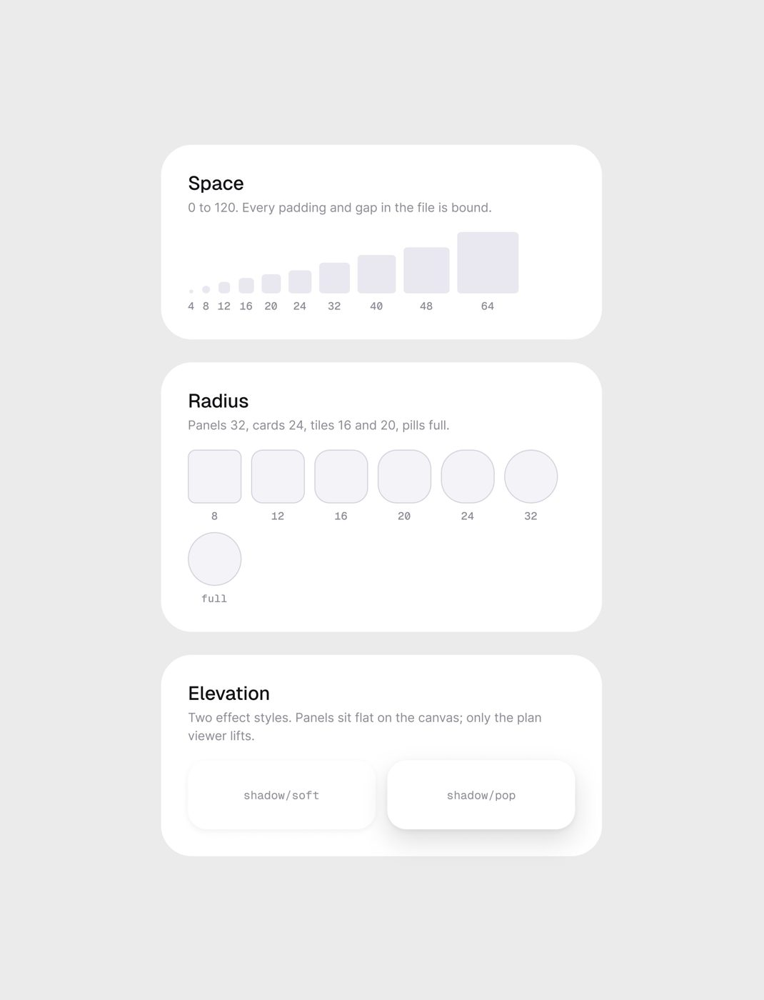
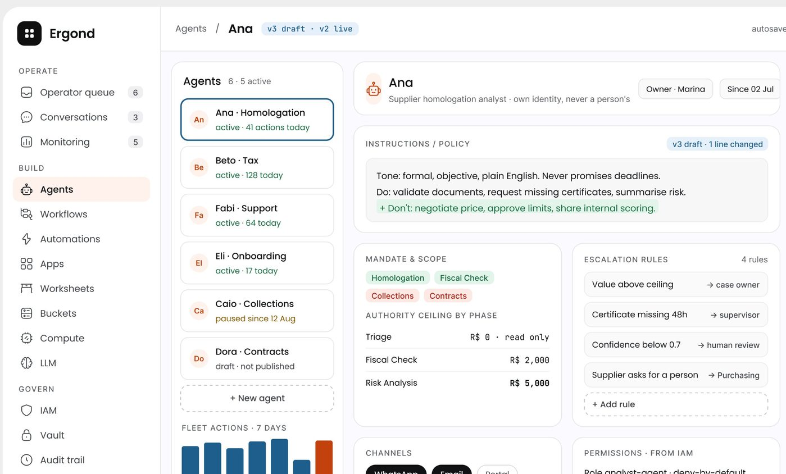
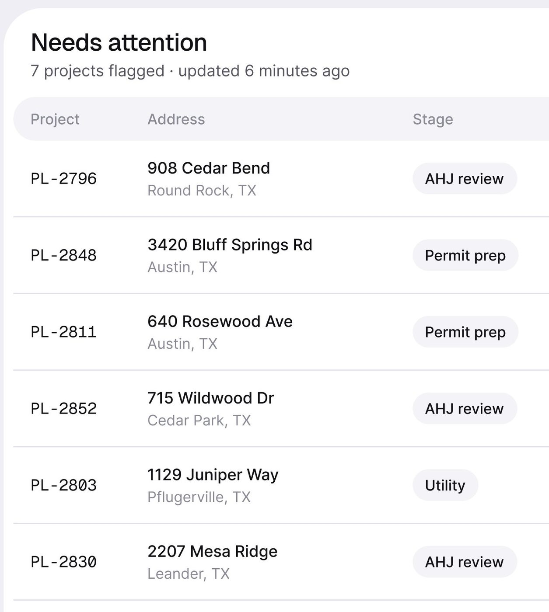
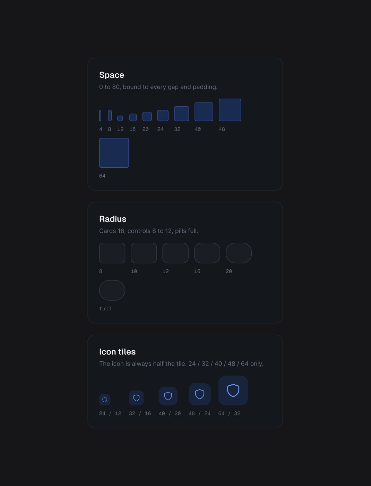
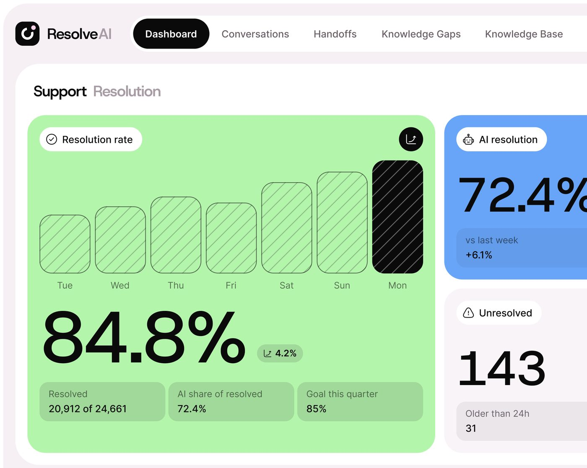

# Espaçamento e raio

## O que é

Espaço em **grade de 4**, ligado a variável em todo padding e gap; raio em
**degraus por nível de profundidade**, com uma escala para produto leve e outra
para produto denso. As duas regras estão escritas nas folhas do design system
publicado **[CONFIRMADO]**, e as medições dos outros produtos mostram como
aplicá-las.



## Espaço

### Declarado

| Folha | Escala | Faixa | Frase da folha |
|---|---|---|---|
| Permitly (claro) | 4 · 8 · 12 · 16 · 20 · 24 · 32 · 40 · 48 · 64 | 0 a 120 | *"Every padding and gap in the file is bound."* |
| AgentPay (escuro) | 4 · 8 · 12 · 16 · 20 · 24 · 32 · 40 · 48 · 64 | 0 a 80 | *"0 to 80, bound to every gap and padding."* |

Passo de 4 até 24, de 8 até 48, de 16 até 64. O produto denso para em 80; o
leve vai a 120 (margem de tela grande).

### Medido nos produtos

Px de tela convertidos com 2,56 na paisagem e 3 no retrato **[MEDIDO]**,
arredondado para o token mais próximo (valor bruto entre parênteses quando
diverge mais de 1 px). Com o fator 2,5 da seção
[Escala](README.md#escala-dos-shots-de-4096-px), os valores da paisagem sobem
cerca de 2%: menos de 1 px até 40, e uma sidebar de 250 vira ~256.

| Produto | Sidebar | Canvas → painel | Gap entre painéis | Padding do painel | Gap interno |
|---|---|---|---|---|---|
| Permitly (@3x) | 240 (ilha) | 16 | 16 | 20 a 24 (texto); 8 (foto encaixada) | 12 |
| OrchestrateIQ | 64 (trilho de ícones em pílula) | 24 | 16 | 24 | 12 (entre linhas de agente) |
| FixTrack | 250 | 20 (18,4 + borda) | 16 na horizontal, 24 na vertical | 16 | 12 |
| Ergond | 218 | 16 | 16 (13,7 + bordas) | 16 | 8 |
| medspa | 250 (ilha) | 16 (15,6) | 16 | 20 | 8 a 12 |
| Haulsight | 224 | 24 (23,4) | 16 | 24 | 12 |
| Mongi (1,0) | 237 | 28 | 16 | 16 | 12 |
| CollectAI (@3x) | 84 (trilho escuro) | 28 | 16 | 24 | 12 entre tiles |
| ResolveAI (@3x) | · | 16 | 16 | 16 | 8 a 12 |
| AgentTrail (escuro) | 227 | 20 (21) | 16 a 20 | 20 | 8 entre linhas, 12 entre células |

| Mobile | Margem lateral | Gap entre cartões |
|---|---|---|
| Shuto | **20** | 12 |
| Técnico | **20** | 12 a 14 (13,7) |
| Torin | **20** | 8 entre linhas da lista |
| medspa | **20** | 28 depois do cartão principal (27 a 30) |
| Lepo (escuro) | 18 | 8 |

O que sai daí:

- **Gap entre painéis = 16** em 10 de 10 produtos web; no mobile vai de **8
  (lista) a 12 (cartões)**, com um respiro maior (24 a 28) só depois do cartão
  de destaque.
- **Margem lateral do mobile = 20** em 4 de 5 apps (o Lepo usa 18).
- **Padding do painel = 16 a 24**: 24 com respiro (OrchestrateIQ, CollectAI,
  Haulsight), 16 no mais apertado (FixTrack, Ergond, Mongi, ResolveAI).
- **Sidebar de 218 a 250**, ou um trilho só de ícones de 64 a 84.
- **Gap e padding caem na grade de 4** (8, 12, 16, 20, 24, 28), como a folha
  declara. **Largura não cai:** as sidebars medem 218, 227, 237 e 250, a margem
  do Lepo é 18 e o padding do bloco interno do ResolveAI fica em ~10. A grade
  vale para o espaço entre e dentro das peças, não para a largura de coluna.



### Altura de linha de tabela e de item de menu

| Elemento | Produto | Altura ou passo | Tipo |
|---|---|---|---|
| Linha de tabela, 1 linha de texto | Vero | 44 | claro-escuro denso |
| | medspa (lista de categorias) | 43 a 44 | |
| | Mongi (razão de caixa) | 45 | |
| | OrchestrateIQ (handoffs, com borda) | 44 + 4 de gap | |
| | Ergond (regras de escalonamento) | 40 + 8 de gap | |
| | AgentTrail (modal, pares rótulo-valor) | 36 a 37 | escuro denso |
| Linha de tabela, 2 linhas (título + meta) | Permitly | **64** (63,1) | |
| | FixTrack (com tile de ícone de 36) | 58 | |
| | Haulsight (lista "Critical now") | 54 | |
| | Mongi (trabalhos recentes) | 50 | |
| Cabeçalho de tabela | Permitly | 36, em pílula `bg/card` | |
| Item de menu (passo) | Permitly | 39 a 40 | |
| | FixTrack, AgentTrail, Haulsight | 37 a 38 | |
| | medspa | 43 | |
| | Ergond | 34 | |
| Item de menu ativo (altura do fundo) | Permitly | 38 | pílula preta |
| | Ergond, FixTrack, Haulsight, AgentTrail | 34 a 37 | |
| Trilho de ícone | OrchestrateIQ | 48 (botão) em passo de 54 | |

Regra: **linha simples 36 a 44, linha dupla 54 a 64; item de menu com fundo de
34 a 40, em passo de 36 a 44**. O escuro denso usa a ponta baixa (36).



### Alturas de controle

| Controle | Medido | Onde |
|---|---|---|
| Botão desktop | 32 (Ergond), 36 (AgentTrail, Haulsight), 40 (OrchestrateIQ, FixTrack), 44 a 46 (medspa) | |
| Botão mobile (CTA) | 52 a 56 | técnico, Torin, medspa mobile |
| Campo de busca | 40 | FixTrack, AgentTrail |
| Navegação em pílula | 46 (CollectAI), 54 (OrchestrateIQ) | abas no topo |
| Aba ativa dentro da pílula | 32 a 38 | |
| Chip / selo | 18 a 26 (desktop), 24 (mobile) | |
| Barra de abas mobile | 70, com item ativo de 55 | Shuto |
| Avatar | 32 a 40 | |
| Tile de ícone | 24 · 32 · 40 · 48 · 64 declarados; 36 a 44 medidos | ver `iconografia.md` |

## Raio

### Declarado

| Folha | Frase da folha | Escala mostrada |
|---|---|---|
| Permitly (claro, produto leve) | *"Panels 32, cards 24, tiles 16 and 20, pills full."* | 8 · 12 · 16 · 20 · 24 · 32 · full |
| AgentPay (escuro, produto denso) | *"Cards 16, controls 8 to 12, pills full."* | 8 · 10 · 12 · 16 · 20 · full |



### Como o raio foi medido, e quanto a medida erra

Método: a partir das duas bordas retas do cartão, mede-se a distância até a
curva na diagonal de 45°; raio = distância ÷ (√2 − 1). Testado nos quadrados de
amostra da própria folha **[MEDIDO]**: 8 → 7, 12 → 11, 16 → 11 a 15, 20 → 19,
24 → 22, painel 32 → 32. **Erro de até 4 px para baixo nos raios pequenos, zero
nos grandes.** Os valores abaixo já estão arredondados para o token mais
próximo com essa margem.

### Medido nos produtos

| Produto | Canvas ou moldura do app | Painel | Card ou bloco interno | Controle | Chip e pílula |
|---|---|---|---|---|---|
| **Permitly (folha)** | · | **32** | **24** | tiles **16 / 20** | full |
| Permitly (tela) | · | 32 (medido 32) | caixa de dados 16, cartão de endereço 20 | 12 a 16 | full |
| OrchestrateIQ | **40** | **28** | **16** | 12 (slot hachurado, célula de hora) | full |
| ResolveAI | 32 | 32 | cartão colorido 24; tile 16; bloco no colorido 12 | · | full |
| CollectAI | · | 24 | 16 | · | full; barra de 12 com ponta redonda |
| Haulsight | 32 (30,7) | 24 | 16 (14,7) | 12 | 12 (pílula pequena) |
| medspa | 28 (26,7) | 24 | 12 a 16 | 12 (menu ativo) | 8 (chip), full (aba) |
| FixTrack | 24 | 20 (18,7) | 12 (tile, caixa da marca) | 10 a 12 (busca, botão, menu) | 8 |
| Ergond | 24 | 16 (14,7) | 12 (linha de regra) | 8 a 10 | 6 a 8; barra 3 |
| **AgentPay (folha, escuro)** | · | **16** | · | **8 a 12** | full |
| AgentTrail (escuro) | · | 12 a 16 | 12 (célula do heatmap) | 8 a 10 (botão, aba) | 8 (selo) |
| Shuto (mobile) | aparelho 32 | 24 | tile 16 | · | 12 (pílula de 24); barra de abas full |
| Técnico (mobile) | aparelho 32 | 20 | · | botão full | 12 |
| Torin (mobile) | · | 28 | · | botão full | full |

Leitura:

- **Dois regimes, como a folha diz.** Raio grande: 32 / 24 / 16 (Permitly,
  OrchestrateIQ, ResolveAI, CollectAI, Haulsight, medspa, apps mobile). Raio
  contido, em produto denso de operação ou governança: 24 / 16 / 8 a 12 (Ergond,
  AgentTrail, AgentPay).
- **O FixTrack não cabe na divisão.** O produto é declaradamente leve, para
  cliente pouco técnico (*"Fixtrack is for property maintenance, not very
  high-tech client"*, ver [06](../06-produtos/fixtrack.md)), e a tela confirma:
  7 a 9 cartões grandes, um número por cartão. Mas o raio medido fica na escala
  contida (24 / 20 / 12). Ou seja, o raio acompanha o setor na maioria dos
  produtos, não em todos.
- **O raio do painel e o do aparelho mobile são iguais (32) no regime leve.** O
  cartão interno fica em 24.
- **Pílula (full) para tudo que é navegação e estado**: aba, chip, botão mobile,
  barra de abas, toggle.

### A regra do raio aninhado: por nível, não concêntrica

A fórmula clássica é *raio interno = raio externo − padding*. Medido **[MEDIDO]**:

| Caso | Externo | Padding | Concêntrico daria | Usado |
|---|---|---|---|---|
| CollectAI: painel → tile | 24 | 24 | 0 | **16** |
| OrchestrateIQ: painel → cartão de agente | 28 | 24 | 4 | **16** |
| OrchestrateIQ: moldura → painel | 40 | 24 | 16 | **28** |
| ResolveAI: moldura → painel | 32 | 16 | 16 | **32** |
| ResolveAI: painel → cartão verde | 32 | 16 | 16 | **24** |
| ResolveAI: cartão verde → bloco interno | 24 | ~10 | 14 | **12** |
| Haulsight: painel → bloco "Critical now" | 24 | 16 | 8 | **16** |

Em 6 de 7 casos o raio interno é **maior** que o concêntrico. A regra é a que
está escrita na folha: **um raio por nível de profundidade** (painel 32, card
24, tile 16), independentemente do padding. Na prática, **cada nível desce 8
ou 12, e às vezes repete**: na tabela acima, −8 em 3 casos (24 → 16, 32 → 24,
24 → 16), −12 em 3 (28 → 16, 40 → 28, 24 → 12) e 0 em 1 (a moldura 32 e o
painel 32 do ResolveAI). O resultado são cantos internos mais redondos do que a
geometria pediria, o que dá o ar "macio" e amigável das telas do método. A fórmula
concêntrica só coincide quando o padding é pequeno (8 a 10).




## Variações

- **Canvas branco com borda** (FixTrack): a moldura do app é branca com linha de
  1 px, e o raio dela cai para 24. É produto leve no conteúdo com raio contido.
- **Trilho de ícones** (OrchestrateIQ, CollectAI): sem sidebar de texto; o
  trilho vira uma ilha de 64 a 84 px, em pílula ou coluna escura.
- **Mobile**: margem 20 fixa, cartões 20 a 28, tudo que é tocável em pílula.

## Quando usar cada coisa

- **Produto novo, cliente pouco técnico** → escala leve (32/24/16), padding 24,
  linhas de 64.
- **Produto de operação ou auditoria** → escala densa (16/8-12), padding 16,
  linhas de 36 a 44, raio pequeno nos controles.
- **Imagem de apresentação em recorte** → o recorte @3x mostra os raios grandes
  com destaque; é o regime leve que domina as peças mais vistas.

## Como reproduzir

```css
:root{
  /* espaço: grade de 4 (folha) */
  --space-1:4px; --space-2:8px; --space-3:12px; --space-4:16px; --space-5:20px;
  --space-6:24px; --space-8:32px; --space-10:40px; --space-12:48px; --space-16:64px;

  /* raio, regime leve (Permitly) */
  --radius-panel:32px; --radius-card:24px; --radius-tile-lg:20px; --radius-tile:16px;
  --radius-control:12px; --radius-sm:8px; --radius-pill:999px;
}
[data-density="dense"], [data-theme="dark"]{
  /* regime denso (AgentPay) */
  --radius-panel:16px; --radius-card:16px; --radius-tile:12px; --radius-control:10px; --radius-sm:8px;
}

.app      { background:var(--bg-canvas); padding:var(--space-4); gap:var(--space-4); display:grid; grid-template-columns:240px 1fr; }
.panel    { background:var(--bg-panel); border-radius:var(--radius-panel); padding:var(--space-6); }
.panel .card { background:var(--bg-card); border-radius:var(--radius-card); padding:var(--space-4); } /* um degrau abaixo, não concêntrico */
.card .tile  { border-radius:var(--radius-tile); }
.nav-item { height:38px; padding:0 var(--space-3); border-radius:var(--radius-pill); font:500 13px/1 var(--font-body); }
.table-row{ min-height:64px; padding:var(--space-3) var(--space-4); border-bottom:1px solid var(--line-soft); }
.table-row--dense{ min-height:40px; }
@media (max-width:480px){ .app{ padding:0 20px; } }
```

Em Tailwind: `gap-4` entre painéis, `p-6` no painel leve e `p-4` no denso,
`rounded-[32px]` no painel, `rounded-3xl` (24) no card, `rounded-2xl` (16) no
tile, `rounded-full` em aba e chip, `px-5` como margem do mobile.
