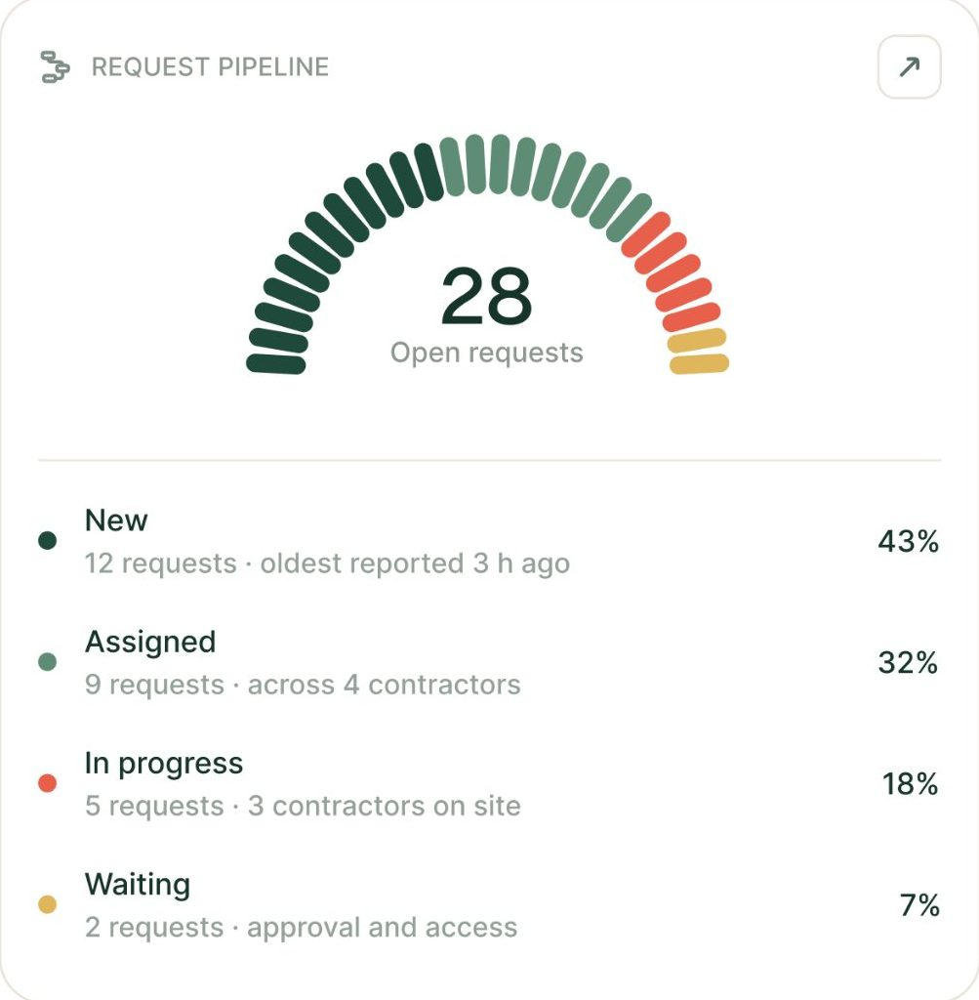
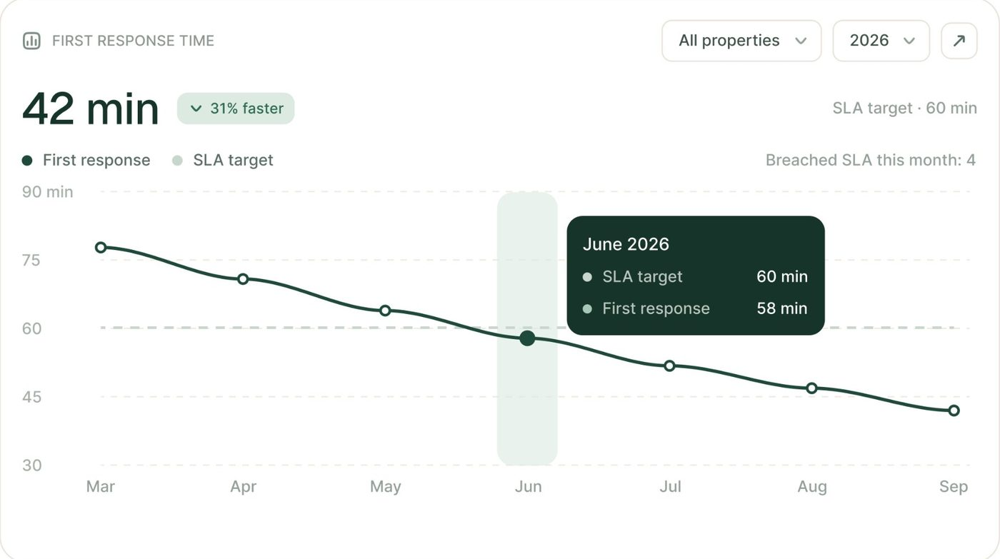
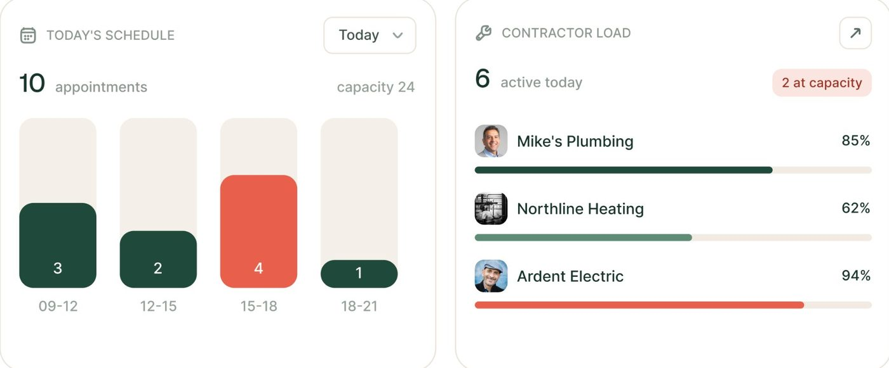
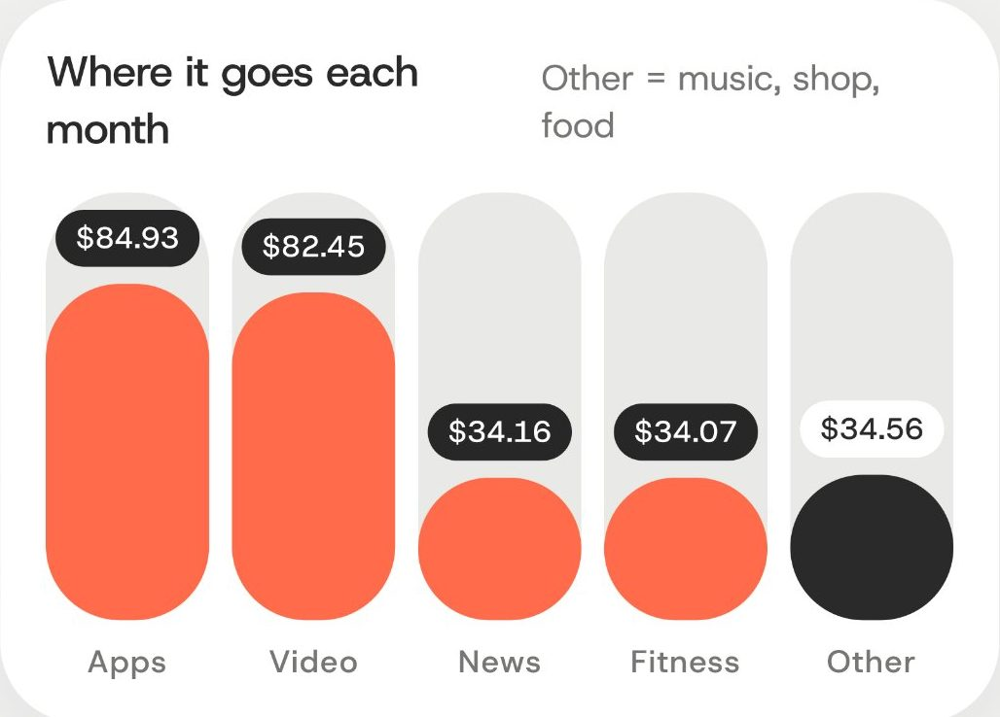
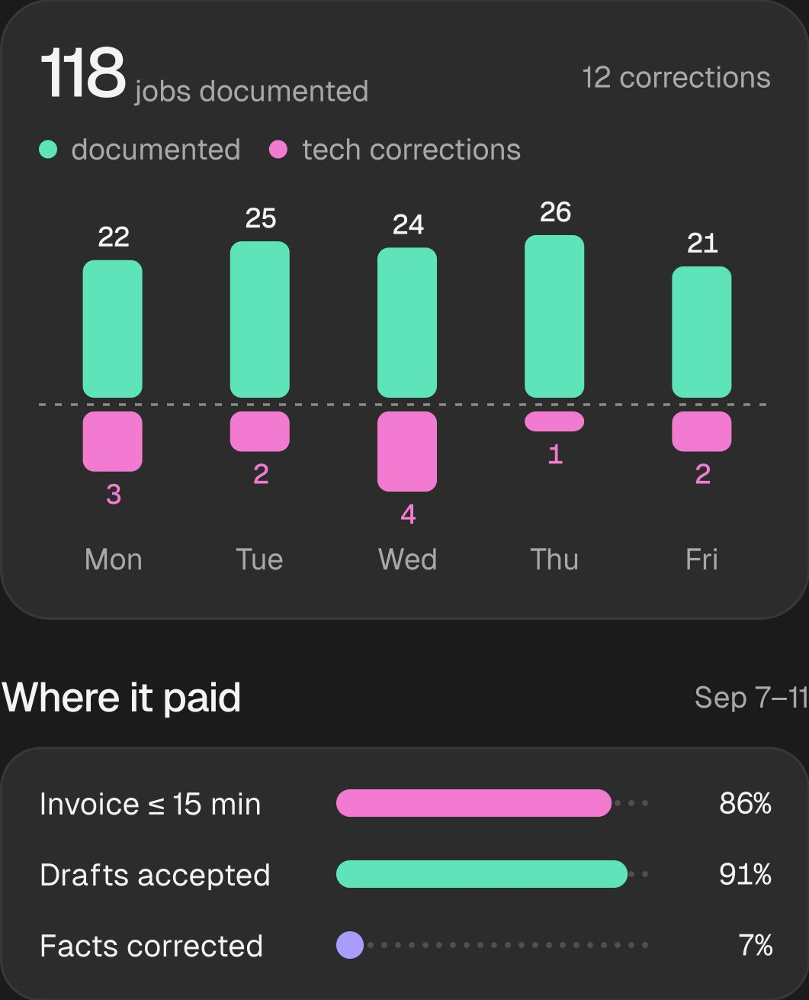
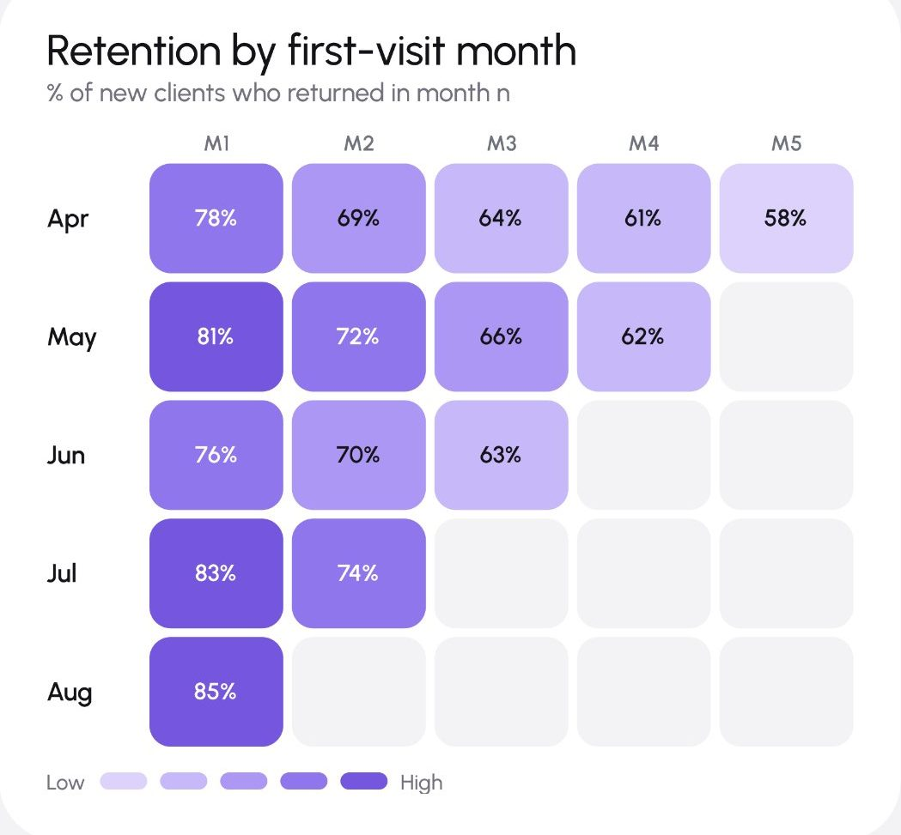
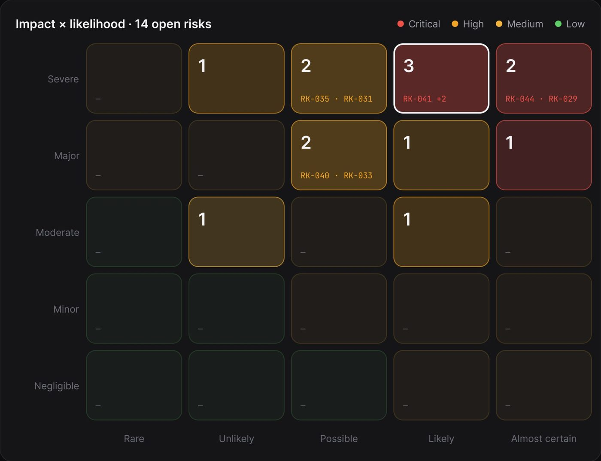
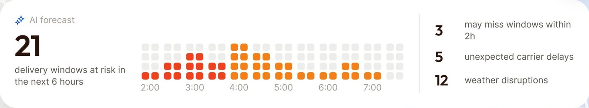
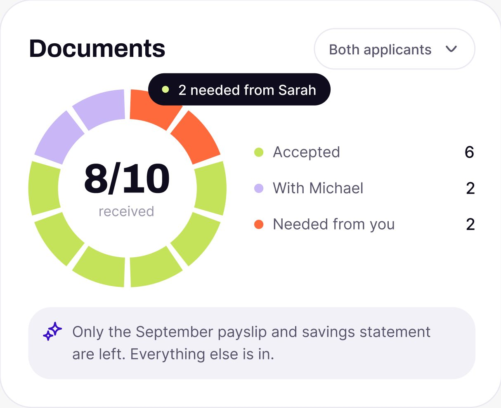
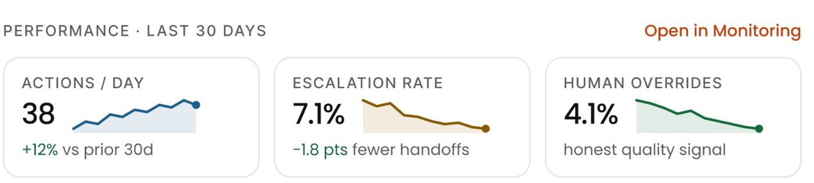

# Gráficos e dados

## O que é

Os gráficos do método são feitos de **peças soltas e arredondadas**: haste com ponta
redonda, barra-pílula, quadradinho de raio pequeno, fatia com vão. Quase nunca
há eixo desenhado; a grade, quando existe, é tracejada e só horizontal. O valor
vem **escrito no próprio dado** (dentro da barra, em cima dela, numa pílula
escura) e a legenda é quase sempre **uma lista com ponto colorido e valor
alinhado à direita**, que funciona ao mesmo tempo como tabela. A folha do design
system não tem seção de gráfico; tudo aqui é **[MEDIDO]** ou **[OBSERVADO]** nas
telas, com as cores ligadas aos tokens da folha quando dá.

Medidas em px de tela pelas escalas do README.

## Regras gerais

| Regra | Valor | Evidência |
|---|---|---|
| Forma de toda marca | arredondada: ponta redonda ou raio 2 a 16 | 11 gráficos, 9 produtos |
| Espessura de linha | 2 px | FixTrack, Mongi, Ergond |
| Grade | 1 px tracejada, só horizontal, cor ~`line/soft` (#ecece8 no FixTrack) | FixTrack, Lepo (linha de base) |
| Eixo | sem linha; só rótulo em `text/muted` 11 a 12 | FixTrack, Mongi, medspa, Torin |
| Rótulo de valor | no dado: dentro da barra, em cima, ou em pílula escura | FixTrack, Torin, Lepo, medspa |
| Legenda | ponto de 6 a 8 px + rótulo secundário; vira lista com valor à direita | gauge, donut, motivos de handoff, saúde de cobrança |
| Tooltip | cartão escuro (tom mais escuro do acento), raio 10 a 12, texto branco 12, pontos de legenda | FixTrack #16342a, Documents #0f0c1d |
| Destaque | uma barra ou célula em cor forte, o resto em tom neutro ou claro | Mongi, Ergond, ResolveAI, medspa |
| "Vazio", meta, "antes" | hachura diagonal da mesma matiz (`line/hatch`) | ResolveAI, OrchestrateIQ |

### Três estratégias de cor

1. **Um destaque sobre neutro** (a mais usada): barras cinza #989e92 e a atual
   em verde-escuro #264c3f (Mongi); barras azul-aço #1e5e8c e "hoje" em laranja
   #c2410c (Ergond); barras hachuradas e a de hoje em preto (ResolveAI); funil
   lavanda com a maior queda em amarelo #f4c865 e o fim em lima #c3e696 (medspa).
2. **Rampa de uma matiz**: heatmap de coorte em 5 degraus de violeta
   (#ddd2fc, #c7b8f9, #ac97f4, #8f76ec, #7556df) com vazio em #f3f3f5 (medspa).
3. **Categórica curta, 3 a 5 cores**, sempre com uma delas preta ou cinza:
   preto / azul #68a5f8 / verde #b4f5ac / rosa #f7d0ea / cinza #dfd4d9
   (ResolveAI); lima #c4e35a / lilás #c9b6f7 / laranja #ff6a3d (Documents);
   verde-água #5fe3b8 / rosa #f27ad0 / violeta #a99cff (Lepo, escuro); coral
   #ff6b4b / preto / cinzas (Torin).

Em estado (bom, atenção, ruim) vai o `500` do trio: verde #3bd968, âmbar
#f0be31, vermelho #e2564f no CollectAI; e no escuro as cores de estado a 20% de
alpha no fundo da célula com borda da mesma cor.

## Anatomia e medidas por tipo

### Gauge segmentado (FixTrack)

- Arco de **28 hastes** em forma de cápsula, de ~184° de ponta a ponta (da
  borda da primeira à borda da última; de centro a centro, ~178°, um
  semicírculo), com vão de ~20% do passo entre elas **[MEDIDO]** (varredura
  angular em três raios em volta do centro ajustado: 28 hastes nos três, de
  −1,9° a 181,9° no raio interno). É o mesmo gauge de 28 peças da
  [seção 02](../02-componentes/graficos.md).
- Cada haste tem ~9 px de largura e ~21 px de comprimento radial, ponta redonda
  **[OBSERVADO]**.
- A cor segue a composição: verde-escuro #1f493b (New, 43%), verde-sálvia
  #5f8c75 (Assigned, 32%), coral #e85f4c (In progress, 18%), mostarda #e0b55e
  (Waiting, 7%). O número de hastes de cada cor é proporcional à fatia.
- Centro: `number/32` ("28") + rótulo `body/14` muted ("Open requests").
- Legenda embaixo = lista de 4 linhas com ponto, título, meta e porcentagem à
  direita. A legenda é a tabela.



### Linha com tooltip (FixTrack)

- Linha de 2 px em `accent` #1f493b, sem suavização forte.
- Marcadores: anel oco de ~9 px (miolo branco, borda 2 px); o ponto
  selecionado é cheio e maior (~12 a 14 px) **[MEDIDO]**.
- Faixa vertical de destaque do mês selecionado: 42 px de largura, #e9f2ed (tint
  do acento), cantos arredondados, altura total do gráfico.
- Meta (SLA) como linha tracejada cinza horizontal; grade horizontal tracejada
  de 1 px #ecece8.
- Tooltip escuro #16342a (o acento escurecido), raio ~10, título "June 2026" e
  duas linhas com ponto, rótulo e valor à direita.
- Cabeçalho do cartão: `number/32` "42 min" + selo tint "↓ 31% faster" + legenda
  em linha, com a meta escrita à direita em muted ("SLA target · 60 min").



Variante no Mongi: curva suave de 2 px em verde-escuro, série de comparação
tracejada cinza, e o último ponto marcado com um círculo lima de borda escura.

### Barras com trilho (FixTrack, "Today's schedule")

- Barras de **60 px** de largura, vão de **16 px** (medido 16,8 a 17,6), raio 12.
- Cada barra tem um **trilho** da mesma largura e altura total em #f4efe9 (bege,
  `bg/card` do produto); a barra cresce de baixo dentro dele.
- Valor escrito **dentro da barra, embaixo**, em branco ("3", "2", "4", "1").
- A barra fora do padrão fica em coral #e85f4c; as outras no acento.
- Barra horizontal de carga (contractor load): trilho #f2ebe3, preenchimento no
  acento ou em coral acima de 90%, valor em % à direita do rótulo.



### Barras-pílula com rótulo em pílula (Torin)

- Barras de **55 px**, vão de **10 px**, raio total (cápsula) **[MEDIDO]**.
- Trilho em #e9e9e7 do mesmo formato atrás de cada barra.
- Valor numa **pílula escura** #272727 com texto branco, apoiada no topo da
  barra ("$84.93"); a categoria "Other" é a única em preto.
- Nomes da categoria embaixo em muted.



### Barras simples com uma em destaque (Mongi, Ergond)

- Mongi: barras de 74 a 75 px, vão de 10 a 11, raio ~6; todas #989e92, a de
  hoje #264c3f; rótulo do dia de hoje em peso maior.
- Ergond: barras estreitas, raio ~3, azul-aço #1e5e8c, a de hoje em laranja
  #c2410c com o rótulo "Today" também em laranja.

### Barras hachuradas (ResolveAI)

- Barras de ~66 px, vão de 8, raio 16; fundo na cor do cartão (#b4f5ac), hachura
  de 45° em #88b882 com passo de 16 px, contorno de 1 px na cor da hachura.
- A barra de hoje é **preta com hachura clara**: o destaque vem por inversão.
- Na comparação "antes → depois" (Improvement loop), o "antes" é hachurado
  cinza e o "depois" é cheio na cor.


### Barras divergentes (Lepo, escuro)

- Barras de **26 px**, passo de 64 (vão de 38), raio ~8 **[MEDIDO]**.
- Série positiva em verde-água #5fe3b8 para cima, série de correção em rosa
  #f27ad0 para baixo de uma **linha de base tracejada**.
- Valor em cima (positivo, branco) e embaixo (negativo, na cor rosa).
- No mesmo cartão: barras horizontais de progresso com o restante do trilho em
  **pontinhos** (não em barra cinza), e um valor mínimo como um só ponto violeta.



### Heatmap de coorte (medspa)

- Células de ~**60 × 50 px**, vão de **4 px**, raio 8 a 10 **[MEDIDO]**.
- 5 degraus de violeta: #ddd2fc, #c7b8f9, #ac97f4, #8f76ec, #7556df. Texto da
  célula em preto nos 3 claros e branco nos 2 escuros (a troca acontece no
  #8f76ec).
- Célula sem dado em #f3f3f5, mesmo raio: a grade fica inteira.
- Legenda "Low ▭▭▭▭▭ High" com 5 pílulas pequenas de cada degrau.



### Matriz de risco (AgentTrail, escuro)

- Células grandes (~113 px de largura), vão de 12, raio 12.
- Preenchimento = cor do estado com pouca opacidade sobre o cartão (crítico
  #4a2725, alto #423219, baixo #191d1c) e **borda de 1 px da mesma matiz** mais
  forte (#8f4039, #9d783b, #253329) **[MEDIDO]**. É o trio escuro aplicado a uma
  célula.
- Célula selecionada: borda branca de 2 px.
- Dentro: número grande no canto superior esquerdo e os IDs em mono na cor do
  estado, embaixo.



### Matriz de pontos (Haulsight)

- Quadradinhos de ~**8 px**, vão de ~4, raio 2 **[MEDIDO]**, em colunas por
  meia hora; vermelho #ef411e, laranja #f2801a, vazio #ededeb.
- É um "sparkline de densidade": sem eixo vertical, só o horário embaixo.
- Ao lado, o número grande `number/40` ("21") com a frase explicativa.



### Donut segmentado (Documents)

- Anel de **~160 px** de diâmetro, espessura de **~23 px** (~15% do diâmetro)
  **[MEDIDO]**.
- **10 fatias iguais com vão branco de ~4 px** e pontas retas: cada fatia é um
  documento, não uma proporção. Cor por estado: lima #c4e35a (aceito), lilás
  #c9b6f7 (com terceiro), laranja #ff6a3d (falta de você).
- Centro: "8/10" em Geist negrito (~32) + "received" em muted.
- Uma pílula escura com ponto lima ancorada numa fatia ("2 needed from Sarah")
  funciona como tooltip fixo.
- Legenda à direita em lista, valor alinhado à direita.



### Sparklines (Ergond)

- Dentro de um mini-cartão de KPI com borda: rótulo caixa-alta, número `number/20`
  e a sparkline à direita do número, na mesma linha.
- Linha de 2 px, **área preenchida da mesma cor em ~10 a 15% de opacidade**, e
  um ponto cheio de ~6 px no último valor.
- Cor pela leitura: azul-aço quando neutro, âmbar-marrom e verde quando o valor
  é "bom caindo"; o delta vem embaixo em verde ("-1.8 pts").



### Barras segmentadas e de progresso

| Onde | Forma | Medida |
|---|---|---|
| Shuto (mobile), progresso da rota | 7 segmentos de ~41 px com vão de 3, os feitos em lima-escuro #90d13f e o pendente em laranja #fe8c4e | **[MEDIDO]** |
| CollectAI, saúde da cobrança | uma barra de 12 px dividida em 3 partes proporcionais (verde #3bd968, âmbar #f0be31, vermelho #e2564f) com vão de 4 px, pontas redondas | **[MEDIDO]** |
| ResolveAI, motivos de handoff | "código de barras": traços verticais de 8 px com vão de 4, agrupados por cor (preto, azul, verde, rosa, cinza); a quantidade de traços é a proporção | **[MEDIDO]** |
| Torin, divisão por grupo | barra empilhada com vãos, e as fatias pequenas viram só pontos | **[OBSERVADO]** |
| Permitly, avanço do projeto | barra preta de ~8 px sobre trilho `bg/sunken`, com "78%" à direita | **[OBSERVADO]** |
| Técnico, progresso do dia | barra lima #d8e86b de ~10 px sobre trilho #f1f2ed | **[MEDIDO]** |

Regra: **proporção é mostrada como contagem de peças iguais** (hastes, traços,
fatias, segmentos) sempre que o total é pequeno; a barra contínua fica para
porcentagem.

## Variações

- **Claro × escuro**: no escuro a cor do dado é mais saturada e clara (verde-água,
  rosa-choque) e o "vazio" vira pontinhos ou célula quase preta; no claro o
  vazio é trilho bege ou cinza.
- **Número herói no lugar do gráfico**: ResolveAI e CollectAI deixam o número em
  48 a 96 px e o gráfico pequeno embaixo. O gráfico apoia; o número conta.

## Quando usar cada gráfico

| Pergunta que a tela responde | Gráfico |
|---|---|
| Como se divide um total pequeno? | gauge segmentado, donut de fatias iguais, código de barras |
| Como foi hoje contra os outros dias? | barras com uma em destaque (cor, preto, inversão) |
| Qual a tendência contra uma meta? | linha com meta tracejada e faixa do ponto escolhido |
| Onde está o problema numa grade? | heatmap com rampa de uma matiz, ou matriz de estado |
| Quando vai acontecer? | matriz de pontos por hora |
| Está melhor ou pior que antes? | "antes" hachurado ao lado do "depois" cheio |
| Qual o KPI e o ritmo dele? | número + sparkline com área |

## Como reproduzir

```css
.chart-bar      { width:60px; border-radius:12px; background:var(--accent); }
.chart-track    { width:60px; height:100%; border-radius:12px; background:var(--bg-card); display:flex; align-items:flex-end; }
.chart-bar-pill { width:56px; border-radius:999px; }
.chart-value    { font:500 12px/1 var(--font-body); color:#fff; background:#272727; border-radius:999px; padding:4px 8px; }
.chart-grid     { border-top:1px dashed var(--line-soft); }
.chart-axis     { font:400 11px/1 var(--font-body); color:var(--text-muted); }
.chart-hatch    { background:repeating-linear-gradient(135deg, var(--hatch-line) 0 1.5px, transparent 1.5px 11px), var(--hatch-bg); outline:1px solid var(--hatch-line); outline-offset:-1px; }
.chart-tooltip  { background:color-mix(in srgb, var(--accent) 70%, #000); color:#fff; border-radius:10px; padding:12px; font:400 12px/16px var(--font-body); }
.legend-row     { display:grid; grid-template-columns:8px 1fr auto; gap:12px; align-items:center; font:400 14px/20px var(--font-body); }
.legend-dot     { width:8px; height:8px; border-radius:50%; }
.heat-cell      { width:60px; height:50px; border-radius:8px; }       /* vão de 4 px */
.dot-matrix i   { width:8px; height:8px; border-radius:2px; }        /* vão de 4 px */
.donut          { --segments:10; --gap:4px; --thickness:23px; }       /* fatias iguais, pontas retas */
```

Em biblioteca (Recharts, ECharts): `radius=[12,12,12,12]` nas barras, `strokeWidth={2}`
na linha, `dot={{ r:4, fill:'#fff', strokeWidth:2 }}`, `CartesianGrid
strokeDasharray="4 4" vertical={false}`, eixos com `axisLine={false}` e
`tickLine={false}`, rótulo com `LabelList` dentro ou acima da barra.
