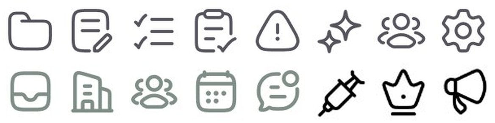
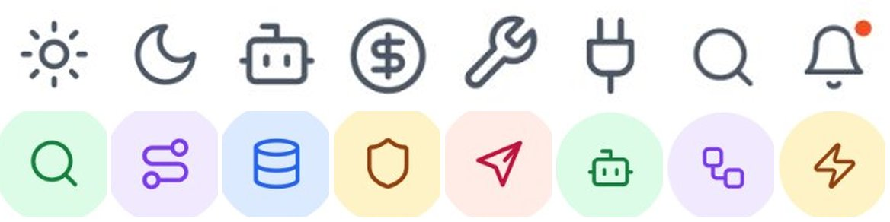

# Iconografia

## O que é

Ícone de **traço** (nunca preenchido, com exceção do estado ativo), arredondado
nas pontas e nas junções, na cor do texto secundário quando está no menu e na
cor `700` (ou `400` no escuro) quando está dentro de um **tile** de fundo tint.
A regra de tamanho está escrita **[CONFIRMADO]** na folha do AgentPay:

> *"The icon is always half the tile. 24 / 32 / 40 / 48 / 64 only."*


## Anatomia do tile

| Tile | Ícone | Raio do tile (medido @3x) | Fundo (escuro) | Traço do ícone |
|---|---|---|---|---|
| 24 | 12 | ~8 | #18233C | ~1,0 px |
| 32 | 16 | ~10 | #18233C | 1,3 px |
| 40 | 20 | 12 | #18233C | ~1,7 px |
| 48 | 24 | 14 a 16 | #18233C | ~2,0 px |
| 64 | 32 | 16 | #18233C | ~2,7 px |

**[MEDIDO]** na folha escura (tiles de 40 e 64 com borda exata; os raios dos
tiles pequenos têm a margem de erro de até 3 px do método). Quatro regras saem daí:

1. **Ícone = metade do tile** **[CONFIRMADO]**.
2. **Raio do tile ≈ 1/4 do lado** (8, 10, 12, 14-16, 16), com teto em 16 no
   escuro **[MEDIDO]**. No claro, os tiles de ícone medidos são círculos
   completos (OrchestrateIQ, Torin) ou quadrados de 12 a 16 (FixTrack, Shuto).
3. **Traço proporcional ao ícone**: ~1/12 do tamanho (1,3 px em 16, 1,7 px em
   20). É a proporção de um ícone desenhado em 24 com traço 2 e escalado, e não
   um traço fixo.
4. **Fundo do tile = cor do ícone a 14% sobre o painel** no escuro (#18233C =
   azul #2F6BFF a ~14% sobre #14171C), e o `tint` do trio no claro.

## Biblioteca provável

Comparação lado a lado de 48 ícones de 7 produtos **[OBSERVADO]**:

| Produto | Biblioteca | Traço ÷ tamanho | Traço que decide |
|---|---|---|---|
| Permitly, FixTrack, medspa, Haulsight, Ergond | **Hugeicons, Stroke Rounded** | ~1/15 (Permitly: 1,33 px num ícone de 20) **[MEDIDO]** | `user-group` com dois arcos laterais, `dashboard-square-01` de quatro "squircles", `analytics` com barras dentro de quadrado arredondado, `invoice` com borda serrilhada, `alert-02` de triângulo com cantos muito redondos, `sparkles` de duas estrelas côncavas |
| OrchestrateIQ, AgentPay (folha) | **Lucide** | ~1/12 (OrchestrateIQ: 1,6 a 1,9 px num ícone de 20) **[MEDIDO]** | `sun`, `moon`, `bot`, `circle-dollar-sign`, `wrench`, `plug`, `settings`, `route`, `database`, `shield`, `send` iguais aos do Lucide; o escudo do tile da folha escura é o `shield` do Lucide |
| AgentTrail | conjunto geométrico simples, traço grosso (candidatas: ícones próprios; Phosphor Bold) | ~1/10 | losango vazio para "Risk", dois círculos para "Agents", "+ ‖" para "Activity", janela preenchida para "Evidence" |

A diferença que se vê a olho: **Hugeicons tem traço mais fino (1,5 em 24) e
formas mais "gordinhas"**; **Lucide tem traço 2 em 24 e desenho mais técnico**.
O Hugeicons vai nos produtos de cliente final e o Lucide nos de agente e dev. **O Hugeicons está
confirmado por escrito**: à pergunta de qual biblioteca vai no construtor do "Refund Assistant", a
resposta foi *"Hugeicons Pro, stroke and rounded."* **[CONFIRMADO]**. O Lucide no OrchestrateIQ e
na folha do AgentPay continua **[INFERIDO]** pela forma.

A mesma resposta dá a regra do ladrilho colorido: *"those tiles are the type system, not
decoration"*. A cor do ladrilho codifica o **tipo** do nó (gatilho, IA, lógica, ação, humano), o
ladrilho é idêntico na biblioteca e no canvas ("what you drag is what you get"), e nada mais no
canvas tem cor. Sem os ladrilhos, a leitura cai para os rótulos, bem mais lenta num fluxo de 12
nós. Ver [../04-tipos-de-tela/construtor.md](../04-tipos-de-tela/construtor.md).





## Medidas: tamanho e cor

### Tamanho

| Onde | Ícone | Container | Produto |
|---|---|---|---|
| Item de menu | 18 a 20 (glifo visível 16 a 18) | sem container | Permitly (18 × 17 visível), OrchestrateIQ, FixTrack |
| Trilho de ícones | 20 | botão de 48 | OrchestrateIQ |
| Tile em lista (agente, pedido) | 18 a 20 | 36 a 44 | OrchestrateIQ (círculo ~40), FixTrack (quadrado 36, raio 12), Shuto (44, raio 16), Torin (círculo 40) |
| Tile de KPI ("Detected") | 20 | círculo 40 | OrchestrateIQ |
| Rótulo de cartão ("OPEN REQUESTS") | 14 a 16 | sem container, à esquerda do rótulo caixa-alta | FixTrack |
| Botão | 16 | dentro do botão, antes do texto | todos |

### Cor

| Contexto | Cor do ícone | Exemplo medido |
|---|---|---|
| Menu, inativo | `text/secondary` ou um pouco mais claro | Permitly #515156; OrchestrateIQ #495059; FixTrack #7f8884 (verde-acinzentado, tingido); AgentTrail #717178 |
| Menu, ativo | branco sobre preto ou acento; ou o acento claro no escuro | Permitly branco no item preto; AgentTrail #baaffc (violeta) no item #242328 |
| Tile de estado, claro | `700` da matiz sobre o `tint` (-100) | OrchestrateIQ: verde #1a7740 em #dcfce7, violeta #7240d1 em #f0e8fe, azul #2b5fd2 em #d6e8fd, âmbar #864010 em #fef3c6, vermelho #ac1339 em #ffece6; FixTrack: #32634e em #dae9e0, #8c3124 em #f9e1d9 |
| Tile de estado, escuro | `400` sobre o 500 a 14% | AgentPay #6C95FF em #18233C; AgentTrail verde #5fd068 em #132a1b com borda |
| Ícone sobre cor chapada | branco (em círculo) ou preto | Torin: seta preta em círculo coral #ff6b4b; Shuto: seta em círculo branco sobre o cartão verde |
| IA | acento ou índigo, sempre o `sparkles` | Documents #3a0dcc; Haulsight azul; Permitly no círculo preto sobre lima |

No OrchestrateIQ, os pares de ícone e tile batem com a paleta do Tailwind
(green-700 sobre green-100, violet-700 sobre violet-100, amber-800 sobre
amber-100, rose-700 sobre red-50) **[MEDIDO]**.


## Variações

- **Círculo × quadrado arredondado**: círculo em produto leve (OrchestrateIQ,
  Torin, medspa), quadrado de raio 1/4 no FixTrack (produto leve de raio contido) e no AgentPay (denso).
- **Tile colorido por categoria**: cada agente do OrchestrateIQ tem uma cor
  (busca verde, supervisor violeta, dados azul, validador âmbar, resposta
  vermelho). A cor identifica o agente em todas as telas, como uma legenda.
- **Selo de notificação**: ponto de 6 a 8 px no canto superior direito do sino
  ou do ícone de mensagens, em laranja-coral (#e55429 no OrchestrateIQ,
  #fe8c54 no Shuto) ou vermelho.
- **Sparkles como marca da IA**: o ícone de duas estrelas aparece em todo lugar
  onde a IA fala ("AI Assistant", "Flow Assist", "Re-route saves", "AI forecast",
  "Ask Haulsight", dica do Documents) **[OBSERVADO]** em 8 produtos.

## Quando usar cada coisa

- **Menu**: ícone sem container, na cor secundária; ativo ganha fundo, não troca
  o desenho.
- **Lista de entidades** (agente, pedido, assinatura): tile de 40 no tint da
  categoria ou do estado.
- **Rótulo de cartão**: ícone pequeno de 14 a 16 antes do rótulo em caixa-alta,
  na cor muted.
- **Estado grave**: o tile passa do tint para o `500` sólido com ícone branco
  (Torin: círculo coral cheio para "prices went up").

## Como reproduzir

```bash
# Hugeicons Stroke Rounded (produto de cliente final)
npm i @hugeicons/react @hugeicons/core-free-icons
# ou Lucide (produto de agente e dev)
npm i lucide-react
```

```css
.icon      { width:20px; height:20px; stroke-width:1.5; stroke-linecap:round; stroke-linejoin:round; color:var(--text-secondary); }
.icon-tile { --size:40px; width:var(--size); height:var(--size); border-radius:calc(var(--size) / 4);
             display:grid; place-items:center; background:var(--tone-tint); color:var(--tone-700); }
.icon-tile svg { width:50%; height:50%; }             /* "o ícone é sempre metade do tile" */
.icon-tile--round { border-radius:999px; }
[data-theme="dark"] .icon-tile { background:color-mix(in srgb, var(--tone-500) 14%, var(--bg-panel)); color:var(--tone-400); }
```

Tamanhos permitidos de tile: 24, 32, 40, 48, 64. Ícone: 12, 16, 20, 24, 32.
