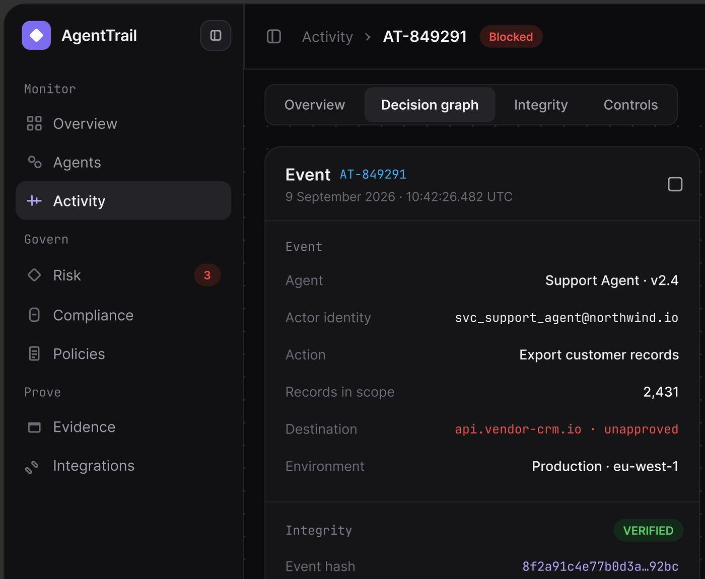
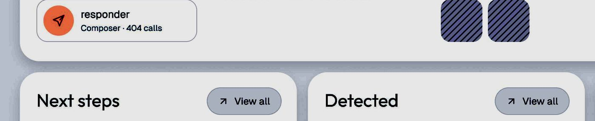
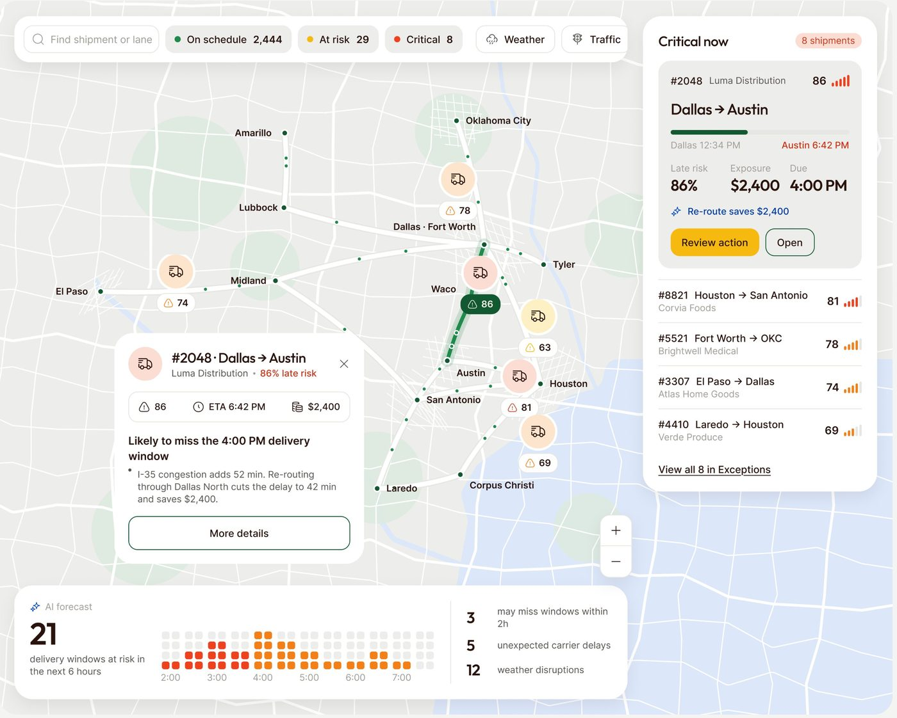
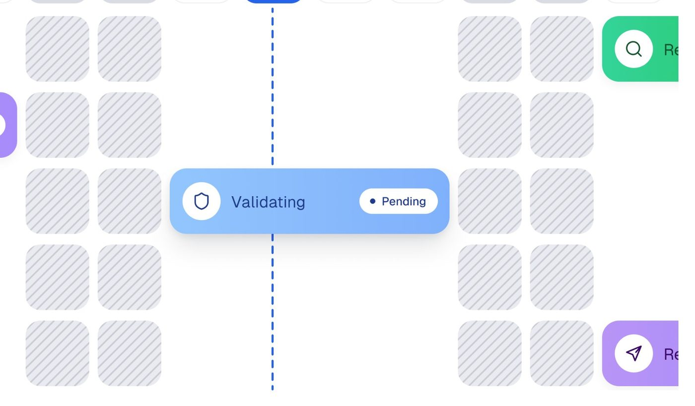
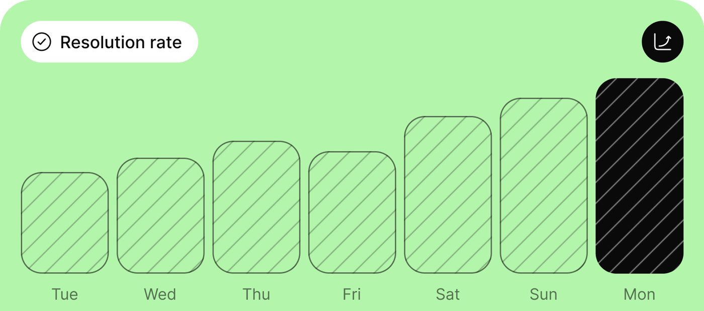
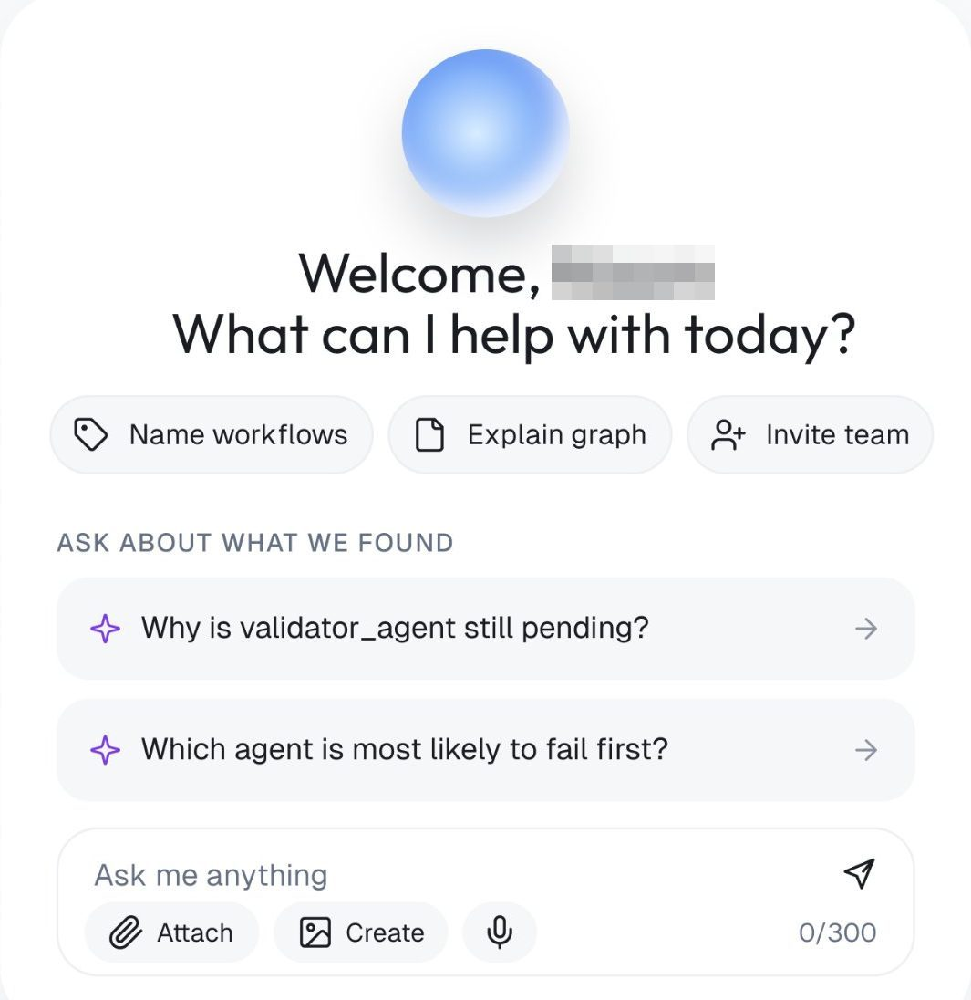
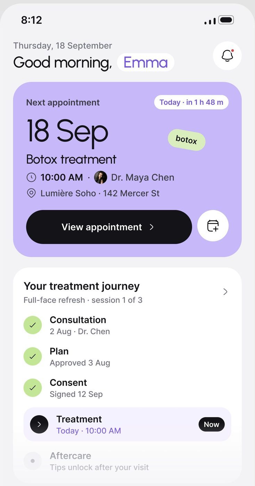

# Superfície e profundidade

## O que é

O método cria camadas **trocando a cor da superfície**, não empilhando sombra. A
regra está escrita na folha do Permitly **[CONFIRMADO]**:

> *"Two effect styles. Panels sit flat on the canvas; only the plan viewer lifts."*

Ou seja: três superfícies de luminosidade diferente (`bg/canvas` → `bg/panel` →
`bg/card`), linha de 1 px quase invisível quando precisa separar, e **só dois
efeitos de sombra** no arquivo inteiro, reservados para o que de fato flutua. Os
recursos extras (hachura, grade de pontos, gradiente, orbe) aparecem em lugares
específicos e sempre com a mesma função.

## Anatomia: a pilha de camadas

| Nível | Claro (Permitly) | Escuro (AgentPay) | Como se separa do nível de baixo |
|---|---|---|---|
| Cena da apresentação | #d3d3d3 a #eeeeee | #1b1b1b a #313131 | fora do produto (ver seção 05) |
| `bg/canvas` | #EFEEF4 | #08090B | canto de 32 a 40 contra a cena |
| `bg/shell` | · | #0E1013 | +2 pontos de luminosidade |
| `bg/panel` | #FFFFFF | #14171C | **só a troca de cor**, sem sombra, sem borda |
| `bg/card` / `bg/raised` | #F4F4F8 | #1A1E24 | troca de cor, às vezes `line/soft` |
| Selo, tile | trio tint | tint 14% + borda 40% | cor de estado |
| Elemento que flutua | `shadow/pop` | `shadow/pop` | sombra |

No claro, a diferença entre canvas e painel é de 1,15:1 de contraste; entre
painel e card, 1,1:1. É pouca, e funciona porque a tela inteira é dessas três
cores e mais nada.



## Sombra

### As duas declaradas, medidas no pixel da folha

Os dois cartões de amostra da folha (@3x, branco sobre branco) foram lidos linha
a linha a partir da borda **[MEDIDO]**:

| Efeito | Escurecimento na borda de baixo | Até onde vai | Na lateral | Leitura |
|---|---|---|---|---|
| `shadow/soft` | 10 níveis (255 → 245), ~4% | some em ~8 px | 7 níveis, some em ~10 px | sombra curta e baixíssima, quase uma borda borrada |
| `shadow/pop` | 36 níveis (255 → 219), ~14% | some em ~25 px | 23 níveis, some em ~16 px | sombra deslocada para baixo, média e larga |

CSS que reproduz os dois perfis **[INFERIDO do perfil medido]**:

```css
--shadow-soft: 0 1px 2px rgb(17 17 22 / .04), 0 2px 8px rgb(17 17 22 / .04);
--shadow-pop:  0 2px 6px rgb(17 17 22 / .06), 0 12px 32px -6px rgb(17 17 22 / .16);
```

### Onde a sombra aparece, medido nas telas

| Tela | Sombra encontrada | Leitura |
|---|---|---|
| Permitly | **nenhuma** entre os painéis: o canvas fica em 240 constante até a borda do painel **[MEDIDO]** | obedece à própria regra |
| OrchestrateIQ | escurecimento de 7 níveis (#f8f9fb → #f1f2f4) colado ao painel, sumindo em ~16 px **[MEDIDO]** | `shadow/soft` aplicada nos painéis: é a variação "levemente elevada" |
| OrchestrateIQ, "Open Agent Detail" | sombra **azul** (#d5e5fc) sob o botão, ~16 px | sombra colorida no CTA principal |
| OrchestrateIQ, barras de estado | sombra violeta sob a barra "Delegating" | o elemento vivo "flutua" |
| Haulsight | cartões brancos opacos sobre o mapa, com sombra média | `shadow/pop` no que está sobre conteúdo |
| Técnico (mobile) | cartão "next" com sombra **índigo** (#dee2ed → #f1f2ed em ~29 px) **[MEDIDO]** | destaque do próximo item |
| Shuto (mobile) | barra de abas flutuante com sombra suave | só o que fica sobre o scroll |
| AgentTrail (escuro) | nenhuma sombra visível | no escuro a elevação é só a troca de degrau |

Regra: **painel no chão; sombra só em (1) o que está sobre outro conteúdo
(popover, mapa, barra flutuante, visualizador) e (2) o CTA ou item que se quer
destacar, e aí a sombra pega a cor do acento.**





## Borda

| Tipo | Valor | Onde |
|---|---|---|
| `line/soft` (claro) | 1 px #E3E2EC (declarado); #f0f0f2 no OrchestrateIQ; #e8e4df quente no FixTrack | cartão com borda, divisor de tabela |
| `line/strong` (claro) | 1 px #D2D1DD | input, botão contornado |
| Linhas no escuro | alpha: #24272C, #33353A, #484A4E sobre o painel | *"Tints and lines carry their own alpha"* **[CONFIRMADO]** |
| Borda de selo no escuro | cor do estado a 40% | "Auto approved", "Needs approval" |
| Borda de seleção | 2 px branca (célula selecionada do heatmap, AgentTrail); 2 px do acento (cartão "next" do técnico, alerta do Torin) | item selecionado |
| Borda tracejada | 1 px tracejada cinza | "+ New agent", "+ Add rule" (Ergond), "Ask an agent…" |
| Borda tracejada colorida | âmbar ou vermelha | nó degradado ou falhando no grafo (OrchestrateIQ Live Map) |

A borda nunca é o que define a camada; ela aparece quando dois elementos da
**mesma** cor se encostam (cartão branco sobre painel branco, no OrchestrateIQ e
no FixTrack) ou para marcar seleção e estado.

## Textura hachurada (slot vazio, meta, "antes")

Declarada: `line/hatch #CFCEDB` **[CONFIRMADO]**. Medida em dois produtos:

| Onde | Fundo | Linha | Ângulo | Passo | Espessura | Significado |
|---|---|---|---|---|---|---|
| OrchestrateIQ, linha do tempo | #eaebf0 | #c9c9d1 | 45°, subindo para a direita | 8,8 px na horizontal (≈ 6,2 px perpendicular) | ~1,5 px | intervalo sem atividade |
| ResolveAI, barras | #b4f5ac (a cor da própria barra) | #88b882 (mesma matiz, mais escura) | 45° | 16 px na horizontal (≈ 11 px perpendicular) | ~1,3 px | dia anterior; "antes" em comparação "66% → 74%" |
| ResolveAI, barra de hoje | preto #0f0f0f | linhas cinza claro | 45° | 16 px | | o valor atual se destaca por inversão |

**[MEDIDO]**. A hachura é **a mesma matiz da superfície em que está**, uns 20 a
30 níveis mais escura; nunca preta sobre cor. As barras hachuradas do ResolveAI
têm ainda contorno de 1 px na cor da linha.

```css
.hatch{
  background:
    repeating-linear-gradient(135deg, var(--line-hatch) 0 1.5px, transparent 1.5px 6px),
    var(--bg-card);
}
```





## Grade de pontos (canvas de grafo)

No AgentTrail, a área do "Decision graph" tem pontos de ~1,5 px, cor de pico
#2f2f31 sobre #0c0c0e, a cada ~22 px (provável 24) **[MEDIDO]** na tela de
evento. É a textura de "tela infinita" de ferramenta de fluxo. Não aparece no
claro.

```css
.canvas-dots{ background: radial-gradient(circle, rgb(255 255 255 / .12) .75px, transparent 1px) 0 0 / 24px 24px, var(--bg-canvas); }
```

## Gradiente: só na IA

| Onde | Gradiente | Leitura |
|---|---|---|
| Orbe do assistente (OrchestrateIQ) | radial, 72 px, borda #88b3f9 → brilho #d4eaff deslocado para cima, sombra cinza curta embaixo **[MEDIDO]** | a "presença" da IA |
| Barras de estado da linha do tempo (OrchestrateIQ) | horizontal e suave: #b592f6 → #ad8df8; #30d08a → #28ca74; #8abbfd → #80b2fb | a atividade ao vivo parece "acesa" |
| Botão "Ask Haulsight" | horizontal, azul #014bca → verde #1e8653, com sombra azul | o único botão com gradiente é o de perguntar à IA |
| Sparkline (Ergond) | área sob a linha, da cor da linha para transparente | volume sob a série |

Fora disso, **nenhum gradiente de fundo, nenhum blob, nenhum brilho**. Nas 309
imagens de produto medidas, a saturação mediana é 0,029 **[MEDIDO]**.

```css
.ai-orb{
  width:72px; height:72px; border-radius:50%;
  background: radial-gradient(circle at 50% 35%, #d4eaff 0%, #b4d3fe 35%, #88b3f9 100%);
  box-shadow: 0 10px 16px -8px rgb(17 17 22 / .18);
}
```



## Glassmorphism

**Não aparece nos produtos** **[OBSERVADO]** nas 22 telas medidas. O único
cartão de vidro com brilho da amostra é de uma peça genérica ("SALES $54,550"),
não de produto. Um token de vidro (`#f0f0f08c` com borda `#fff9`) cabe no site
de vitrine, não no produto. Nos produtos, o que fica sobre mapa ou foto é
**branco opaco** (Haulsight, Permitly).

## Tom sobre tom (aninhamento em cartão colorido)

Dentro de um cartão colorido, o bloco interno é **a mesma cor, um degrau mais
escuro**, sem borda **[MEDIDO]**:

| Produto | Cartão | Bloco interno |
|---|---|---|
| ResolveAI | verde #b4f5ac | #a0d999 |
| ResolveAI | azul #68a5f8 | #629cea |
| ResolveAI | cinza-rosado #f8f4f7 | #eae6e9 |
| AgentTrail (escuro) | "Trigger" #1e1a35 | #171628 |

É a mesma lógica canvas → painel → card, aplicada dentro de uma cor.



## Variações

- **Painel chapado × painel com `shadow/soft`**: Permitly chapado (a regra
  escrita); OrchestrateIQ com halo curto. Os dois convivem nas telas de produto.
- **Foto como superfície**: no Permitly, a foto do telhado vira o fundo de um
  cartão, e um cartão branco se encaixa dentro dela com 8 px de margem.
- **Mapa como canvas**: no Haulsight, o mapa ocupa o painel inteiro e os
  cartões flutuam sobre ele com `shadow/pop`.

## Quando usar cada coisa

- **Tela de dashboard comum** → só troca de superfície; nenhuma sombra.
- **Popover, tooltip, cartão sobre mapa, barra de abas flutuante** → `shadow/pop`.
- **CTA principal ou "próximo passo"** → sombra na cor do acento.
- **Slot vazio, período anterior, meta** → hachura.
- **Qualquer coisa que representa a IA falando** → gradiente ou orbe.

## Como reproduzir

```css
:root{
  --bg-canvas:#EFEEF4; --bg-panel:#FFFFFF; --bg-card:#F4F4F8;
  --line-soft:#E3E2EC; --line-hatch:#CFCEDB;
  --shadow-soft:0 1px 2px rgb(17 17 22 / .04), 0 2px 8px rgb(17 17 22 / .04);
  --shadow-pop:0 2px 6px rgb(17 17 22 / .06), 0 12px 32px -6px rgb(17 17 22 / .16);
}
.panel   { background:var(--bg-panel); border-radius:32px; }            /* chapado */
.card    { background:var(--bg-card);  border-radius:24px; }            /* troca de cor, sem borda */
.popover { background:var(--bg-panel); border-radius:16px; box-shadow:var(--shadow-pop); }
.cta     { background:var(--accent); border-radius:999px; box-shadow:0 8px 20px -6px color-mix(in srgb, var(--accent) 45%, transparent); }
.same-on-same { border:1px solid var(--line-soft); }                   /* branco sobre branco */
```

Checklist: se uma tela sua tem mais de dois tipos de sombra, ou sombra em painel
de dashboard, ela já saiu do sistema.
