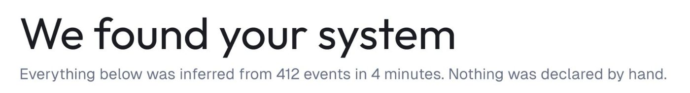
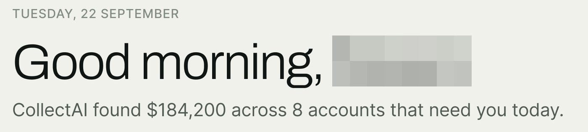
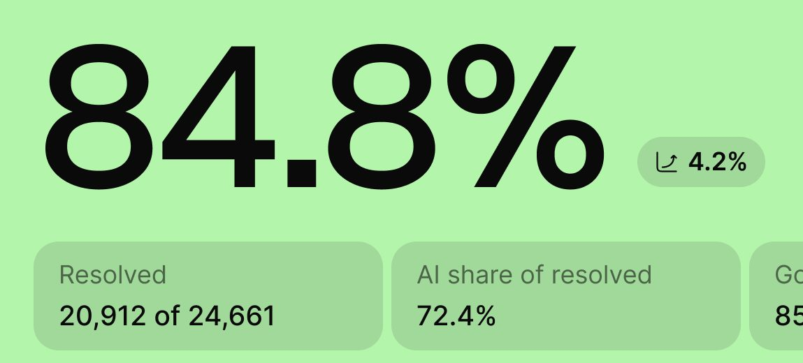
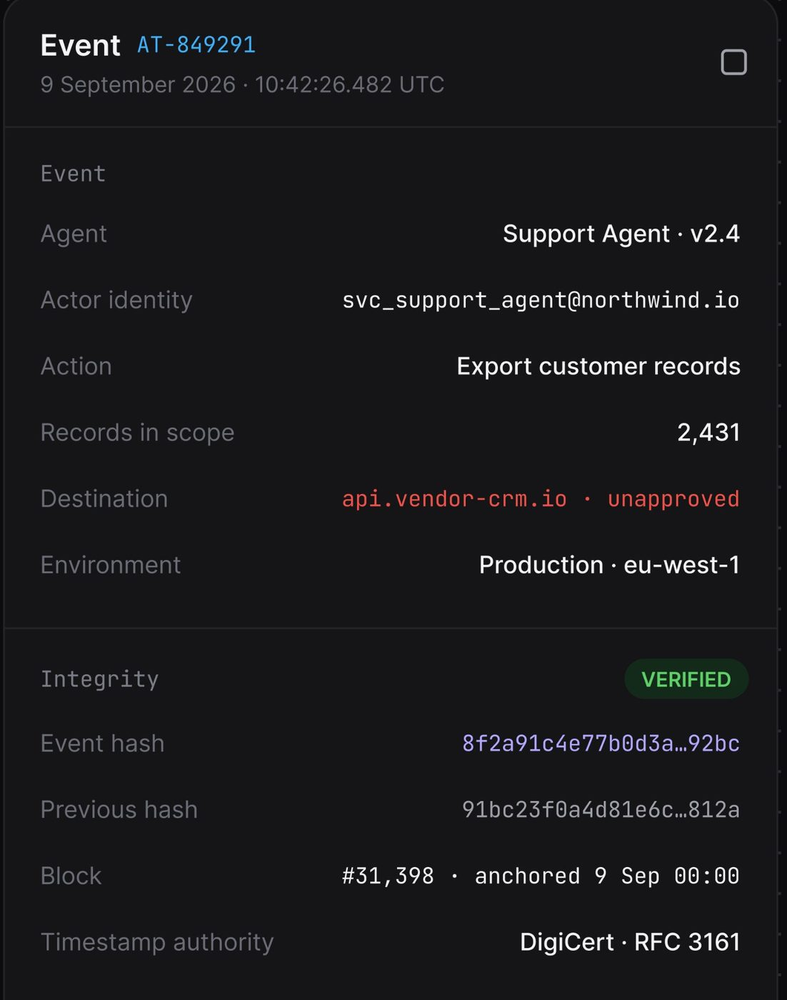
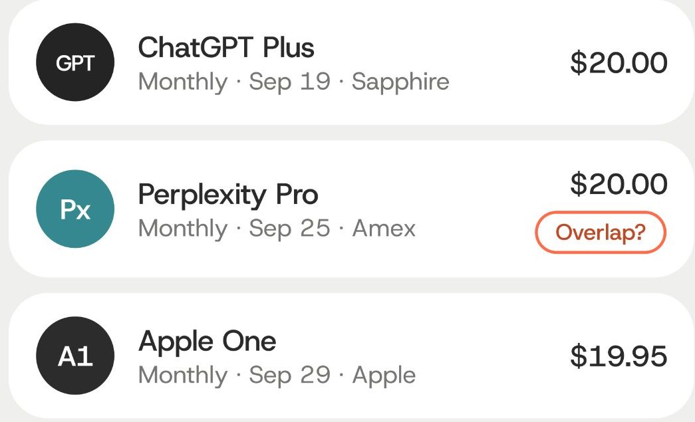
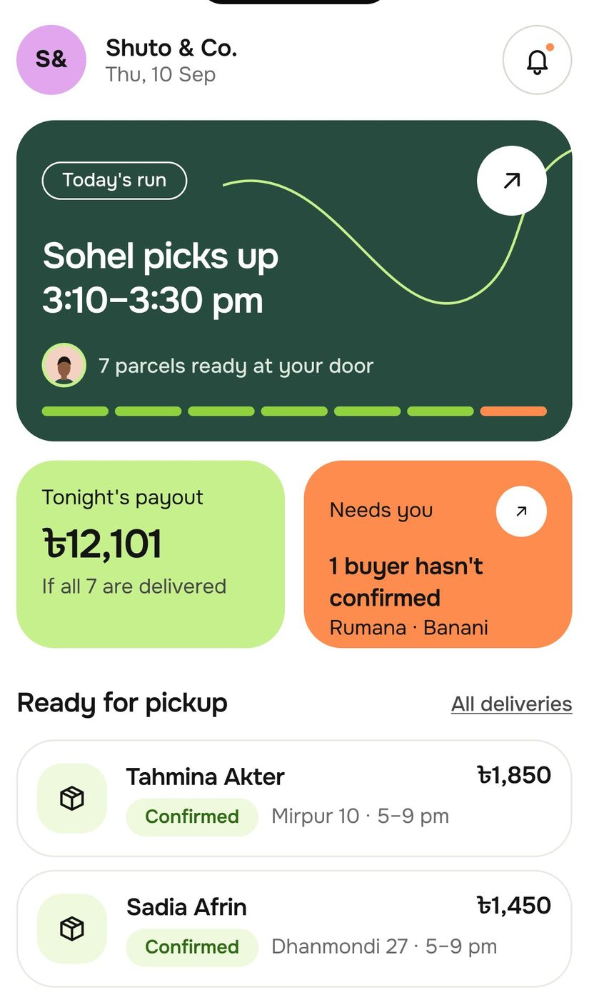

# Tipografia

## O que é

Três famílias com papel fixo, escrito nas duas folhas do design system
publicado **[CONFIRMADO]**:

> *"Geist for display and numbers, Inter for body at 16 and below, Geist Mono
> for ids, times and units."* (Permitly, claro)
> *"Geist for display and figures, Inter for body 16 and under, Geist Mono for
> money, IDs and time."* (AgentPay, escuro)

| Papel | Família | Tamanhos |
|---|---|---|
| Título, saudação, marca, **número** | **Geist** | 15 a 64 |
| Corpo, menu, rótulo, metadado | **Inter** | 11 a 16 (nunca acima de 16) |
| ID, hora, unidade, hash, dinheiro no escuro | **Geist Mono** | 11 e 13 |

O [site de vitrine](../09-do-generico-ao-produto/site-de-vitrine.md) usa Geist
Mono + Karla. O Karla não aparece em nenhum produto.


## Anatomia da escala

### Declarada (as duas folhas)

| Token | Claro (Permitly) | Escuro (AgentPay) | Família | Exemplo na folha |
|---|---|---|---|---|
| `display/64` | 64 | · | Geist | "Permitly" (marca) |
| `display/40` | 40 | · | Geist | "Plan the work" |
| `display/32` | 32 | 32 | Geist | "Good morning, Sarah" (saudação da home) |
| `display/24` | 24 | 24 | Geist | "Compliance review" (título de página) |
| `display/20` | 20 | 20 | Geist | "Package compliance" (título de cartão) |
| `display/18` | · | 18 | Geist | |
| `display/16` | 16 | 16 | Geist | "Permit AI" (título pequeno) |
| `display/15` | · | 15 | Geist | |
| `number/48` | 48 | · | Geist | "8.4" |
| `number/40` | · | 40 | Geist | |
| `number/32` | 32 | 32 | Geist | "128" |
| `number/28`, `/24`, `/20` | · | 28, 24, 20 | Geist | |
| `body/16` | 16 | 16 | Inter | frase explicativa |
| `body/14` | 14 | 14 | Inter | corpo padrão |
| `body/13` | · | 13 | Inter | corpo denso |
| `body/12` | 12 | 12 | Inter | "Uploaded Sep 18 by Elena Ruiz" |
| `medium/14` | 14 | 14 | Inter 500 | título de item de lista |
| `medium/13` | 13 | 13 | Inter 500 | item de menu ("Requirements") |
| `medium/12`, `/11` | · | 12, 11 | Inter 500 | |
| `label/11` | 11 | · | Inter Semi Bold, caixa-alta | "PERMITTING" |
| `mono/13` | 13 | (dinheiro, ID) | Geist Mono | "PL-2841" |
| `mono/11` | 11 | | Geist Mono | "Ref 2026-SOL-11482" |

### Conferida no pixel

A folha é uma imagem @3x. A altura da maiúscula de cada amostra, dividida por 3
e pelo tamanho declarado, dá a proporção de maiúscula da fonte **[MEDIDO]**:

| Amostra | Maiúscula (px @3x) | Maiúscula ÷ tamanho |
|---|---|---|
| `display/64` "P" | 137 | 0,714 |
| `display/40` "P" | 85 | 0,708 |
| `display/20` "P" | 43 | 0,717 |
| `number/32` "1" | 68 | 0,708 |
| `body/16` "P" | 35 | 0,729 |
| `medium/13` "R" | 29 | 0,744 |
| `label/11` "P" | 25 | 0,758 |
| `mono/13` "P" | 28 | 0,718 |

Geist tem maiúscula de **~0,71** do corpo; Inter de **~0,73**. Esse é o número
que converte qualquer medida de maiúscula em tamanho de fonte nos outros
produtos (tamanho = maiúscula ÷ 0,71 para título, ÷ 0,73 para corpo).

## Medidas: peso, entrelinha, tracking, cor

### Peso

| Nível | Peso | Evidência |
|---|---|---|
| Display grande (40, 64) | **400** | haste do "P" = 0,117 da maiúscula nas duas amostras **[MEDIDO]**, que é peso regular |
| Display 16 a 32 no claro | **500** | haste de 0,15 a 0,16 da maiúscula em `display/20` **[MEDIDO]**; visivelmente mais cheio que o 40 |
| Display no escuro (15 a 32) | **600** | a folha escura inteira em semi-negrito **[OBSERVADO]** |
| Número grande | 400 (48) e 500 (32 e menores) | folha clara **[OBSERVADO]** |
| Corpo | 400 | `body/*` |
| Item de lista, menu | 500 | `medium/*` **[CONFIRMADO]** pelo nome |
| Rótulo caixa-alta | 600 | "Inter Semi Bold" **[CONFIRMADO]** |

A regra que sai daí: **quanto maior o título, mais leve**. No claro, o título
gigante vai em 400 e o título de cartão em 500. No escuro, onde o texto claro
"engorda" por irradiação, tudo sobe um degrau (600).

### Entrelinha

A folha não declara entrelinha. Medido pelo espaçamento entre linhas de
parágrafos nas telas @3x **[MEDIDO]**:

| Uso | Tamanho | Passo entre linhas | Entrelinha |
|---|---|---|---|
| Corpo de alerta (AgentTrail, modal) | 14 | 17,9 px | ~1,3 (18) |
| Dica de IA (Documents) | 14 | 18,2 px | ~1,3 (18 a 20) |
| Título de duas linhas (OrchestrateIQ, "Welcome, [nome] / What can I help…") | ~24 | 26,4 px | ~1,1 |
| Número grande | 32 a 96 | uma linha | 1,0 |

Receita: corpo 14/20 ou 14/18, 13/18, 12/16; display 1,1 a 1,2; número 1,0.

### Tracking

- **Rótulo em caixa-alta**: "PERMITTING" em `label/11` ocupa 73,5 px; a soma das
  larguras das letras em Inter Semi Bold dá ~66 px. A diferença, dividida pelos
  9 intervalos, é **~0,8 px = +0,07 em** **[MEDIDO, aproximado]**. Em outros
  produtos o mesmo rótulo aparece com espaçamento visível parecido ("OPEN
  REQUESTS" no FixTrack, "ASK ABOUT WHAT WE FOUND" no OrchestrateIQ,
  "INSTRUCTIONS / POLICY" no Ergond) **[OBSERVADO]** em 6 produtos.
- **Display**: tracking levemente negativo, mais apertado quanto maior (Torin
  "Subscriptions", CollectAI "Good morning") **[OBSERVADO]**. No site de vitrine,
  o título em Geist Mono usa -0,72 px tanto em 24 px (-0,03 em) quanto em 20 px
  (-0,036 em), e o resumo em Karla 18 px usa -0,36 px (-0,02 em) **[MEDIDO]** no
  estilo computado da página (ver
  [09](../09-do-generico-ao-produto/site-de-vitrine.md)).
- **Mono**: tracking zero; a largura fixa já espaça.

### Cor por nível

| Nível | Claro | Escuro |
|---|---|---|
| Título, número, valor | `text/primary` #111116 | #F4F6F9 |
| Corpo de apoio, subtítulo | `text/secondary` #55545F | #9BA5B4 |
| Metadado, rótulo caixa-alta, eixo, placeholder | `text/muted` #8A8996 | #646E7C |
| ID em destaque | primário em mono (Permitly) | azul #4faeee ou violeta #b7acf8 em mono (AgentTrail) |
| Texto sobre acento | `text/on-accent` #141805 (sobre lima) | #FFFFFF (sobre azul) |

Um detalhe recorrente: **título em primário com uma segunda palavra em muted na
mesma linha** ("Support **Resolution**" no ResolveAI, "Good morning, **Emma**"
em violeta no medspa mobile, "$270**.17 / month**" no Torin). É hierarquia
dentro da mesma linha, sem trocar de tamanho **[OBSERVADO]** em 4 produtos.



## Medidas nos outros produtos

Tamanho = altura da maiúscula ÷ 0,71 (título, número) ou ÷ 0,73 (corpo), já
convertido para px de tela pela escala do README **[MEDIDO]**. Na última coluna,
o token da folha mais próximo.

| Produto | Elemento | Medido | Token mais próximo |
|---|---|---|---|
| Permitly (@3x) | saudação "Good morning, [nome]" | maiúscula 72 px = a mesma da folha | `display/32` (idêntico) |
| Permitly | "Needs attention" | 43 px = a mesma da folha | `display/20` (idêntico) |
| Permitly | "Projects" (menu) | 29 px | `medium/13` (idêntico) |
| Permitly | "PL-2796" | 28 px | `mono/13` (idêntico) |
| Permitly | "PERMITTING" | 24 px | `label/11` |
| CollectAI (@3x) | saudação | ~44 | entre `display/40` e `/48` |
| CollectAI | "$620,400" | ~40 | `number/40` |
| CollectAI | "87%" | ~48 | `number/48` |
| CollectAI | "$436,200" (tile) | ~20 | `number/20` |
| CollectAI | "TUESDAY, 22 SEPTEMBER" | ~11 | `label/11` |
| ResolveAI (@3x) | "84.8%" | ~92 a 96 | fora da escala: número herói |
| OrchestrateIQ (2,56) | "We found your system" | ~37 | `display/40` (ou 36) |
| OrchestrateIQ | subtítulo | ~13 | `body/13` |
| FixTrack (2,56) | KPI "28" | ~28 | `number/28` |
| FixTrack | "42 min" | ~32 | `number/32` |
| FixTrack | menu "Dashboard" | ~13 | `medium/13` |
| FixTrack | "OPEN REQUESTS" | ~11 | `label/11` |
| medspa (2,56) | "Reports" | ~29 | entre `display/24` e `/32` |
| medspa | "Revenue by category" | ~19 | `display/20` |
| medspa | "$142,380" | ~35 | `number/32` a `/40` |
| Ergond (2,56) | "Ana", título de cartão | ~16 | `display/16` |
| Ergond | KPI "38" | ~20 | `number/20` |
| Ergond | "ACTIONS" | ~9 a 10 | abaixo de `label/11` |
| Mongi (1,0) | "Sohel Rana" | ~25 | `display/24` |
| Mongi | "4.92" | ~32 | `number/32` |
| AgentTrail (2,56) | título "Risk", menu, título de cartão | ~15 | `display/15`, `medium/14` |
| AgentTrail | "RK-041" | ~12 | mono 12 |
| Shuto (mobile @3x) | "Ready for pickup" | 17 | tamanho iOS (headline) |
| Shuto | nome do item / meta / aba | 15 / 13 / 11 | iOS body, footnote, caption |
| Shuto | "Sohel picks up" | 24 | `display/24` |

Leitura da tabela:

- A escala declarada **vale para boa parte dos outros produtos**: 22 das 31
  medidas caem num token da folha com erro de até 1 px.
- As que ficam fora são títulos de página e números grandes (saudação de ~44 no
  CollectAI, "Reports" de ~29 e "$142,380" de ~35 no medspa, título de ~37 no
  OrchestrateIQ), um rótulo menor que 11 no Ergond e o **número herói**: o
  ResolveAI usa um KPI de ~96 px que a folha não tem. É o recurso de impacto
  para imagem de apresentação.
- **No mobile vale a escala do iOS** (17, 15, 13, 11), não a da folha.





## Variações: a família nos produtos sem folha publicada

Nos produtos em que não há folha, a comparação de letra a letra com a amostra
Geist da folha dá **[INFERIDO]**:

| Produto | Display | Traço que decide |
|---|---|---|
| Permitly, AgentPay | **Geist** | **[CONFIRMADO]** |
| CollectAI, técnico, Torin | Geist (CollectAI em peso mais leve) | "G" sem esporão e com barra reta, "g" de um andar com cauda aberta, iguais à amostra "Good morning, Sarah" |
| AgentTrail, Vero | Inter no display e no corpo | "t" e "9" de Inter; título pequeno (15), onde Geist e Inter quase não se distinguem |
| OrchestrateIQ | geométrica de outra família (candidatas: Figtree, Onest) | "o" e "e" quase circulares e "t" com topo em diagonal; em Geist o topo do "t" é reto |
| medspa | geométrica (candidatas: Outfit, Urbanist, Plus Jakarta Sans) | "J" que desce da linha e "y" reto em letra redonda larga |
| Ergond | geométrica arredondada (candidata: Poppins) | "o" circular e "g" de um andar redondo |
| Shuto | grotesca mais estreita (candidatas: Satoshi, General Sans) | "3" de topo reto e "k" compacto |

Ou seja: **o sistema declarado é Geist + Inter + Geist Mono**, e alguns
produtos de cliente final trocam o display por uma geométrica mais amigável
(clínica, entrega, orquestração de agentes). O corpo e a mono se mantêm.

## Mono e números

- **Geist Mono** para tudo que é identificador ou unidade: "PL-2841", "AT-849291",
  "RK-041", hashes ("8f2a91c4e77b0d3a…92bc"), horários ("06:02:14" no Vero),
  "v3 draft · v2 live" e "R$ 0 · read only" no Ergond. No escuro, também
  dinheiro **[CONFIRMADO]**.
- A mono aparece **também como rótulo de seção** no AgentTrail ("Monitor",
  "Govern", "Prove", "Mapped controls", "changes are versioned"), em muted
  #7e7e83, no lugar da caixa-alta **[OBSERVADO]** em 4 telas.
- **Números tabulares**: no Torin, "$20.00" e "$19.95" têm cada algarismo na
  mesma posição horizontal, inclusive o "1" (o "1" ocupa 7,9 px, igual ao "2")
  **[MEDIDO]**: é `tabular-nums`. No Mongi, "+৳1,850", "+৳1,720" e "+৳5,890"
  começam em posições diferentes, alinhados à direita: é proporcional
  **[MEDIDO]**. Regra prática: coluna de dinheiro alinhada = tabular (ou mono
  no escuro, como a folha manda).





## Quando usar cada tamanho

- **Saudação da home**: `display/32` (desktop) ou 24 a 32 (mobile), às vezes com
  o nome em cor ou em pílula ("Good morning, **Emma**").
- **Título de página**: `display/24`. **Título de cartão**: `display/20` no
  produto leve, `display/16` ou 15 no denso.
- **KPI**: `number/32` padrão; 40 e 48 quando o cartão é só o número; ~96 no
  post de impacto.
- **Tabela e lista**: `medium/14` no título da linha + `body/12` ou 13 no meta
  em muted, duas linhas por linha de tabela.
- **Rótulo de grupo do menu**: `label/11` caixa-alta (claro) ou mono 12 em
  caixa normal (escuro).



## Como reproduzir

```css
@import url("https://fonts.googleapis.com/css2?family=Geist:wght@300..700&family=Geist+Mono:wght@400..600&family=Inter:wght@400..600&display=swap");

:root{
  --font-display:"Geist", system-ui, sans-serif;
  --font-body:"Inter", system-ui, sans-serif;
  --font-mono:"Geist Mono", ui-monospace, monospace;
}
.display-64{font:400 64px/1.05 var(--font-display); letter-spacing:-0.03em}
.display-40{font:400 40px/1.1 var(--font-display); letter-spacing:-0.025em}
.display-32{font:500 32px/1.15 var(--font-display); letter-spacing:-0.02em}
.display-24{font:500 24px/1.2 var(--font-display); letter-spacing:-0.015em}
.display-20{font:500 20px/1.25 var(--font-display); letter-spacing:-0.01em}
.display-16{font:500 16px/1.3 var(--font-display)}
.number-48{font:400 48px/1 var(--font-display); letter-spacing:-0.02em; font-variant-numeric:tabular-nums}
.number-32{font:500 32px/1 var(--font-display); font-variant-numeric:tabular-nums}
.body-16{font:400 16px/24px var(--font-body)}
.body-14{font:400 14px/20px var(--font-body)}
.body-12{font:400 12px/16px var(--font-body); color:var(--text-muted)}
.medium-14{font:500 14px/20px var(--font-body)}
.medium-13{font:500 13px/18px var(--font-body)}
.label-11{font:600 11px/14px var(--font-body); text-transform:uppercase; letter-spacing:.07em; color:var(--text-muted)}
.mono-13{font:400 13px/18px var(--font-mono)}
.mono-11{font:400 11px/14px var(--font-mono)}
[data-theme="dark"] [class^="display-"]{font-weight:600}
```

Em Tailwind: `font-[Geist] text-[32px] font-medium tracking-[-0.02em]` para a
saudação; `text-[13px] font-medium` para o menu; `text-[11px] font-semibold
uppercase tracking-[0.07em]` para o rótulo; `font-mono text-[13px]` para ID;
`tabular-nums` em toda coluna de número.

Os tracking negativos do display e as entrelinhas são **[INFERIDO]** a partir da
aparência e do CSS do site de vitrine; os tamanhos, pesos nominais e famílias são
da folha.

## Serifa e caixa minúscula dentro da tela de produto **[OBSERVADO]**

A regra é sans em tudo (Geist, Inter, Geist Mono), e a serifa mora no site de marketing. Em algumas
séries ela aparece **dentro de produto**, em três usos, e sempre com a interface em sans em volta:

| Uso | Onde | Como |
|---|---|---|
| Título da página | Clawback ("Good morning, [nome]", "Heat exchanger", "Settings") e a versão recusada do app | serifa de texto em peso médio, no tamanho do título; o resto da tela em sans |
| Subtítulo-conclusão | Bench ("Time to field ready fell 4.1 days this quarter...", "284 screened technicians you already know") | a frase do analista em serifa logo abaixo do título sans |
| Documento gerado | CaseDraft (a carta jurídica na prévia do Finalize & Export) | só o artefato que sai do produto é serifado |

E o caso oposto: **Quotepilot com toda a interface em minúsculas**, inclusive título e botão ("ac
replacement — miller residence", "price it with ai", "messages"), em sans.

Como usar: serifa só num papel por tela (título ou conclusão ou documento), nunca em número, rótulo
ou botão. É voz de marca de um produto específico, não regra do método.


