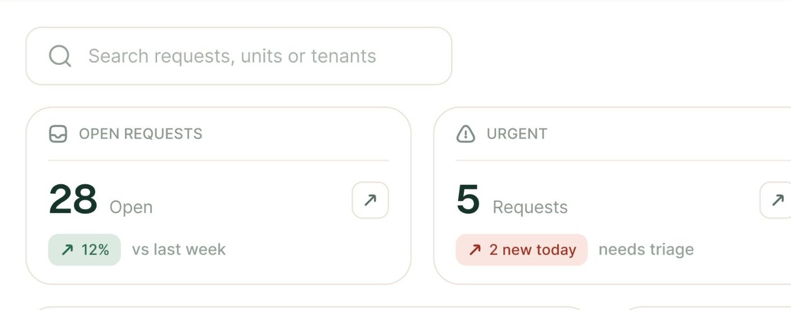
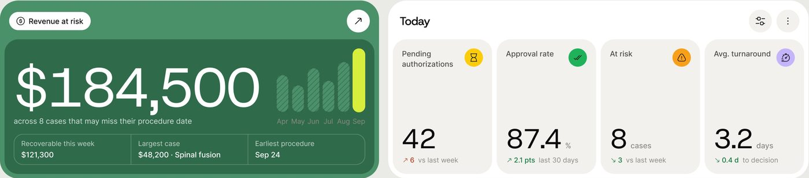
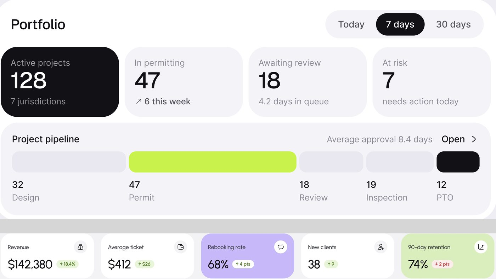
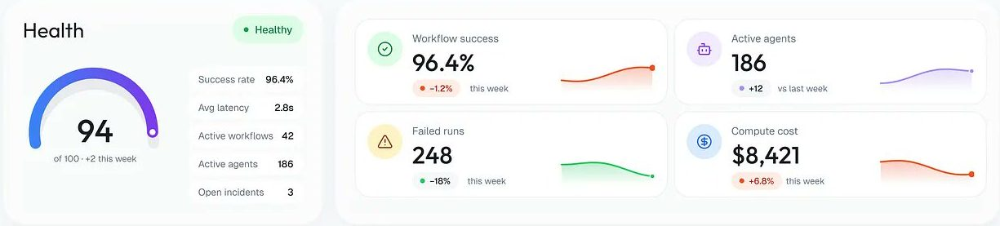
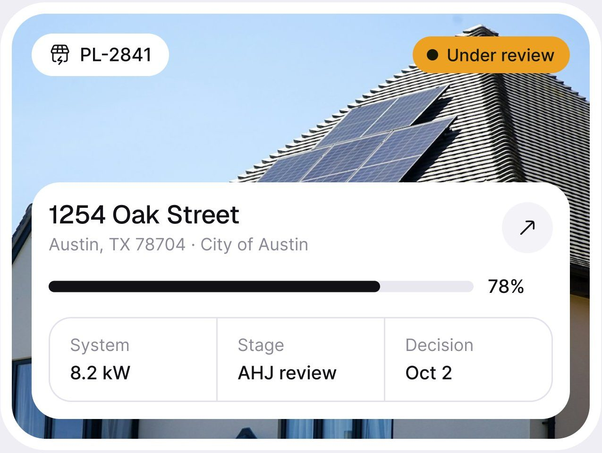
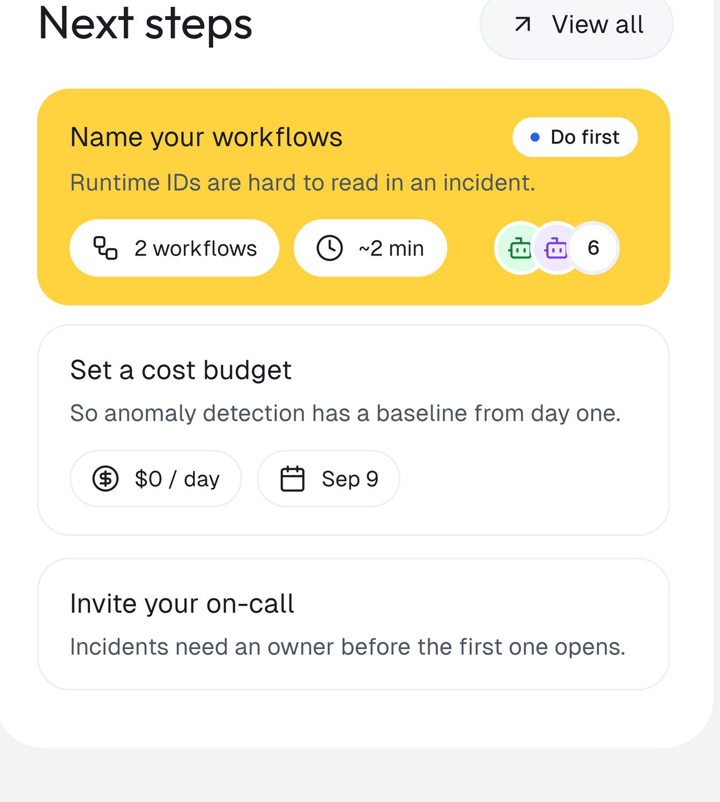
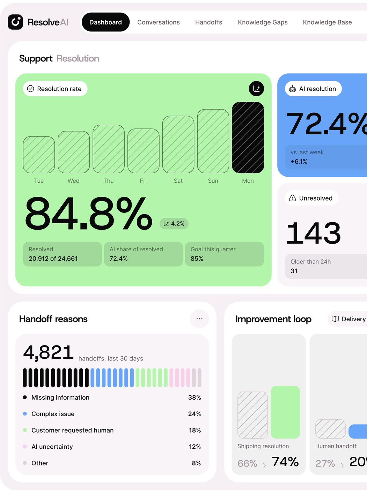

# Cartões e KPIs

O cartão é a unidade de tudo nos painéis do método. Este arquivo cobre cinco componentes: o cartão de KPI (e
suas quatro variantes), o cartão aninhado, o cartão com foto, o cartão de destaque colorido e a grade bento.

Escala e método: [README](README.md#escala-e-método). Tokens oficiais:
[design-system-publicado.md](../01-sistema-visual/design-system-publicado.md). Regra de raio escrita na folha
do Permitly: *"Panels 32, cards 24, tiles 16 and 20, pills full"*; para o AgentPay: *"Cards 16,
controls 8 to 12, pills full"*. Número de KPI é sempre **Geist** (`number/32`, `number/48`), com algarismos
tabulares; a unidade é **Geist Mono** quando é unidade técnica (ms, KB) e Inter quando é palavra.

---

## 1. Cartão de KPI

**O que é.** Um número que importa, com o rótulo que diz o que ele é e uma pista de direção (subiu, desceu,
está no prazo). Aparece em 26 das 61 telas **[OBSERVADO]**. É o componente mais repetido depois do selo de
status.



### Anatomia (FixTrack, fator 2,49)

1. **Rótulo**: ícone de traço 16 px + texto em CAIXA ALTA 11 px, espaçado, cinza `#7d8a84`.
2. **Divisor**: linha de 1 px `#efeae4`, recuada 16 px das bordas, 12 px abaixo do rótulo.
3. **Número**: 32 px, peso médio, verde quase preto `#14352a` (equivale ao token `number/32` em Geist).
4. **Unidade**: "Open", "Requests", "Jobs", "min avg" em 15 px cinza, na mesma linha de base do número, 8 px
   à direita. É o traço mais marcante do KPI do método: a unidade fica AO LADO do número, nunca embaixo.
5. **Selo de variação**: 52 × 22 px, raio 8, fundo tint (`#ddeae1` verde, `#fae6df` vermelho, `#e3f0ef`
   azul-cinza), seta ↗ ou ↘ + valor **[MEDIDO]**.
6. **Comparação**: "vs last week", "needs triage", "across 4 properties" em 14 px cinza, depois do selo.
7. **Botão de seta ↗**: quadrado de 26 px, borda 1 px `#e9e6df`, raio 5, alinhado verticalmente com o número,
   no canto direito **[MEDIDO]**.

### Medidas

| Medida | Valor |
|---|---|
| Cartão | 273 × 126 px, branco, borda 1 px `#ebe8e3`, raio ~16 |
| Respiro interno | 16 px nas laterais, 14 px no topo |
| Distância rótulo → número | ~34 px (divisor no meio) |
| Número → selo | 10 px |
| Grade | 4 cartões em linha, gap 12 px |

### Variantes



**a) Ladrilho com ícone em círculo colorido** (PriorAuth, fator 2,53).
Ladrilho de 173 × 236 px, raio 23, fundo `#f2f1ed` **[MEDIDO]**. Rótulo em duas linhas no topo à esquerda,
círculo cheio de 24 px à direita (amarelo, verde, laranja, lilás, cada um com ícone preto). Número grande
(~48 px) no PÉ do ladrilho, unidade pequena ao lado ("%", "cases", "days"), e uma linha de variação colorida
abaixo ("↗ 6 vs last week"). O ladrilho é alto e o número desce: o vazio no meio é intencional.

**b) Ladrilho preto como o primeiro da fila** (Permitly, fator 3,0). Quatro
ladrilhos de 168 × 100 px, raio 24 (token de cartão, `r-card`); o primeiro é preto `#111113`
(≈ `text/primary` `#111116`) com texto branco, os outros `#f2f1f6` (≈ `bg/card` `#F4F4F8`) **[MEDIDO]**.
Número em `number/32` ("128"), rótulo em Inter 14 `text/secondary`. O preto marca o total ("Active projects 128"); os cinzas são os recortes.



**c) Ladrilho com destaque de cor** (medspa, fator 2,50). Cinco cartões de
214 × 104 px, raio 23 **[MEDIDO]**. Três brancos, um lilás `#c7b8f9` e um lima `#daeebd`: os dois coloridos
são as métricas de retenção, que é o assunto da página. Ícone em círculo branco no canto superior direito;
selo de variação colado ao número ("$142,380 ↑18.4%").

**d) Mini-KPI com sparkline** (OrchestrateIQ). Cartão largo e baixo (~400 × 108 px):
círculo de ícone tint 40 px à esquerda, rótulo 13 px, número ~30 px, selo "● −1.2%" com ponto, e uma
sparkline de ~120 × 36 px à direita com área em degradê embaixo da linha e ponto no fim **[MEDIDO ±3 px]**.



**f) KPI com tile de ícone e selo de pendência** (AgentPay, fator ~2,7 calculado pelo raio de cartão 16 do design system). Cartão `bg/panel` `#14171C` de ~300 ×
155 px, raio 16, borda `line/soft`. No topo, **tile de ícone de 32 px com ícone de 16 px** (a regra da folha:
*"The icon is always half the tile. 24 / 32 / 40 / 48 / 64 only"*) + rótulo Inter 14 `text/secondary`.
Número Geist 28 a 32. Embaixo, ou a variação verde ("↗ 12.4% vs last month"), ou um selo de estado
("● Needs you" âmbar com `amber/tint-14` e borda `amber/border-40`) seguido do valor preso em cinza
("$9,240 held"), ou só a consequência ("$18,600 prevented").

**e) KPI técnico** (AgentTrail, escuro). Rótulo em minúsculas monoespaçadas com
sublinhado ("evaluations_30d", "would_have_held"), número 32 px branco, linha de apoio cinza ou âmbar
("0.19% of evaluations · 3 agents"). O rótulo-variável é a assinatura do produto de governança.

### Regras que se repetem

- Tile de ícone só em 24, 32, 40, 48 ou 64 px, com o ícone na metade (regra publicada). As medidas acima
  que caíram fora disso (FixTrack 36 px) são produtos anteriores ao design system publicado.
- A variação é SEMPRE um selo com fundo tint, nunca só texto colorido (26 de 26 telas com variação).
- O número nunca vem sozinho: tem unidade ao lado ou frase de contexto embaixo.
- O botão ↗ aparece quando o cartão leva a uma página de detalhe (12 telas).

### Como reproduzir

```html
<article class="w-[273px] rounded-2xl border border-[#ebe8e3] bg-white px-4 pt-3.5 pb-4">
  <header class="flex items-center gap-2 text-[11px] tracking-[0.06em] uppercase text-[#7d8a84]">
    <svg class="size-4">…</svg> Open requests
  </header>
  <hr class="my-3 border-[#efeae4]">
  <div class="flex items-center">
    <p class="text-[32px] font-medium text-[#14352a] leading-none">28
      <span class="ml-2 text-[15px] font-normal text-[#8a948f]">Open</span></p>
    <button class="ml-auto size-[26px] rounded-[5px] border border-[#e9e6df] grid place-items-center">↗</button>
  </div>
  <div class="mt-2.5 flex items-center gap-2 text-[14px] text-[#8a948f]">
    <span class="h-[22px] px-2 rounded-lg bg-[#ddeae1] text-[#2d6a4f] text-[13px] grid place-items-center">↗ 12%</span>
    vs last week
  </div>
</article>
```

---

## 2. Cartão aninhado (cartão dentro de cartão)

**O que é.** Um cartão grande de seção que contém cartões menores com um recuo fixo. É a estrutura por trás
do "limpo e profundo" do método. 20 telas **[OBSERVADO]**.

### Medidas

| Onde | Externo | Interno | Recuo |
|---|---|---|---|
| PriorAuth, receita em risco | verde `#4a9169`, raio 32 | verde escuro `#2f6a4a`, raio 23 | 8 px **[MEDIDO]** |
| ResolveAI, seção Support | branco, raio 32 | verde `#b4f5ac`, raio 24 | 16 px **[MEDIDO]** |
| AgentTrail, política | `#1e1a36`, raio 14 | `#171528`, raio 11 | 9 px **[MEDIDO]** |
| Permitly, cartão com foto | branco, raio ~28 | foto, raio ~22 | 8 px **[MEDIDO ±2]** |

**A regra do raio.** O raio interno é o externo menos o recuo (32 − 8 ≈ 23; 32 − 16 ≈ 24 arredondado).
Nenhum caso medido foge disso: em todos a conta fecha com erro de ±2 px **[MEDIDO]**.

---

## 3. Cartão com foto

**O que é.** Foto real ocupando o cartão, com um cartão branco sobreposto na parte de baixo carregando os
dados. Raro no produto: só o Permitly **[OBSERVADO]**. É comum no trabalho genérico
(Skillup, cursos com foto), e sai no produto.



### Anatomia (fator 3,0; convertido)

1. **Moldura** branca de ~423 × 315 px, raio ~28, recuo de 8 px até a foto.
2. **Chip do identificador** no canto superior esquerdo: pílula branca com ícone + "PL-2841".
3. **Selo de estado** no canto superior direito: pílula âmbar `#eba222`, 110 × 25 px, com ponto preto + "Under review" **[MEDIDO]**.
4. **Cartão sobreposto** branco (~379 × 166 px, raio ~24), colado no pé da foto:
   título 20 px ("1254 Oak Street"), linha de endereço cinza, botão ↗ em círculo cinza 36 px.
5. **Barra de progresso** preta sobre trilho cinza, 6 px de altura, com a porcentagem à direita ("78%").
6. **Mini-tabela de 3 colunas** com borda e divisórias internas (System / Stage / Decision), raio ~16.

---

## 4. Cartão de destaque colorido

**O que é.** O cartão que manda a pessoa fazer uma coisa primeiro. Uma única cor saturada numa tela
neutra. 16 telas **[OBSERVADO]**.



### Anatomia ("Next steps" do OrchestrateIQ, em duas telas)

1. **Cartão amarelo** `#ffd33f`, raio 20 (token de tile grande), no topo de uma pilha de cartões brancos **[MEDIDO cor]**.
2. **Selo "● Do first"**: pílula branca, ponto azul `#2563eb`, canto superior direito, 23 px de altura.
3. **Título** 15 px preto + descrição 13 px em preto a 70%.
4. **Chips de metadado** brancos em pílula com ícone ("2 workflows", "~2 min").
5. **Avatares de agente empilhados** (ícones em círculos tint) + contador "6" em círculo branco.
6. **Cartões seguintes** brancos com borda, mesmo layout, chips contornados em vez de brancos.

### Variações de cor (todas **[MEDIDO]** por amostra de pixel)

| Produto | Cor | Uso |
|---|---|---|
| OrchestrateIQ | amarelo `#ffd33f` | próximo passo prioritário |
| PriorAuth | verde `#4a9169` + `#2f6a4a` | dinheiro em risco |
| Permitly | `lime/500` `#C9F24C` e preto `#111113` | IA ligada; alerta de IA |
| Mongi (celular) | verde escuro `#274b3f`, lima `#c8ed90`, laranja `#fe8c4e` | rota do dia, pagamento, pendência |
| medspa | lilás `#c7b8f9`, lima `#daeebd` | métrica em foco |
| ResolveAI | verde `#b4f5ac`, azul `#68a5f8` | taxa de resolução, resolução por IA |
| Edu.ai | roxo com botão lima | sugestão da IA |

**A regra.** No máximo dois cartões coloridos por tela, e a cor fala da coisa mais importante (dinheiro em
risco, próximo passo, o que precisa de você) **[OBSERVADO em 16 telas]**.

### Como reproduzir

```html
<article class="rounded-[20px] bg-[#ffd33f] p-4">
  <div class="flex items-start">
    <h4 class="text-[15px] font-medium">Name your workflows</h4>
    <span class="ml-auto h-[23px] px-2.5 rounded-full bg-white text-[12px] flex items-center gap-1.5">
      <i class="size-1.5 rounded-full bg-[#2563eb]"></i>Do first</span>
  </div>
  <p class="mt-1 text-[13px] text-black/70">Runtime IDs are hard to read in an incident.</p>
  <div class="mt-3 flex gap-2">
    <span class="h-8 px-3 rounded-full bg-white text-[13px] flex items-center gap-1.5">2 workflows</span>
    <span class="h-8 px-3 rounded-full bg-white text-[13px] flex items-center gap-1.5">~2 min</span>
  </div>
</article>
```

---

## 5. Grade bento

**O que é.** A página montada como um mosaico de cartões de tamanhos diferentes, com um cartão protagonista
maior. 20 telas **[OBSERVADO]**.



### Anatomia (ResolveAI, fator ~3,0)

1. **Contêiner de seção** branco, raio 32, com título de duas cores ("Support" preto + "Resolution" cinza).
2. **Protagonista** verde `#b4f5ac` ocupando ~2/3 da largura, raio 24, recuo de 16 px do contêiner
   **[MEDIDO]**.
3. **Coluna lateral** com dois cartões empilhados: azul `#68a5f8` (número gigante recortado pela borda) e
   branco.
4. **Fileira de baixo** com dois cartões de largura igual.
5. **Gap** de 12 px entre cartões **[MEDIDO]**.

### Padrões de composição vistos

| Padrão | Onde |
|---|---|
| Protagonista 2/3 + coluna de 2 cartões | ResolveAI, PriorAuth (hero verde + "Today"), Permitly |
| Fileira de 4 ou 5 KPIs + duas colunas desiguais embaixo | FixTrack, medspa, OrchestrateIQ, Mongi desktop |
| Gráfico largo + calendário estreito + 3 cartões iguais embaixo | Mortgage Flow |
| 3 colunas de lista (fila, detalhe, contexto) | Ergond, Rillo, Vero |

**Traço do método:** o número grande às vezes é cortado pela borda do cartão (ResolveAI "72.4%"): o dado
vaza de propósito para dar escala **[OBSERVADO em 2 telas]**.
