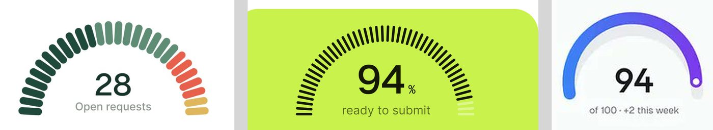
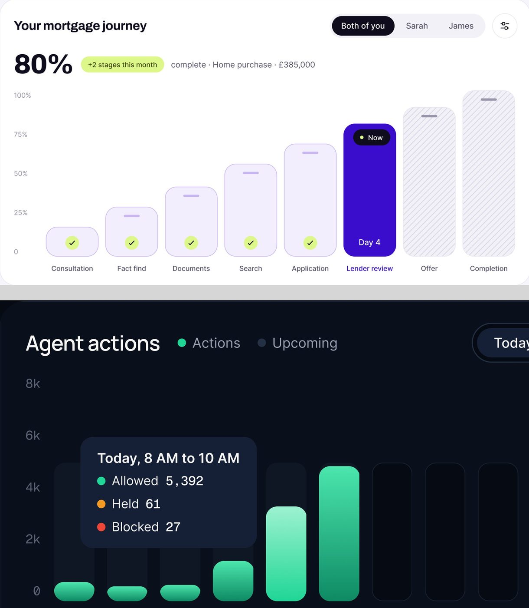
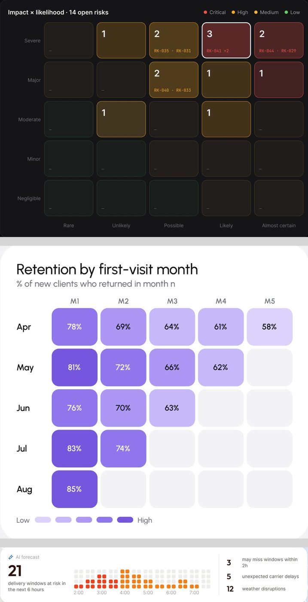
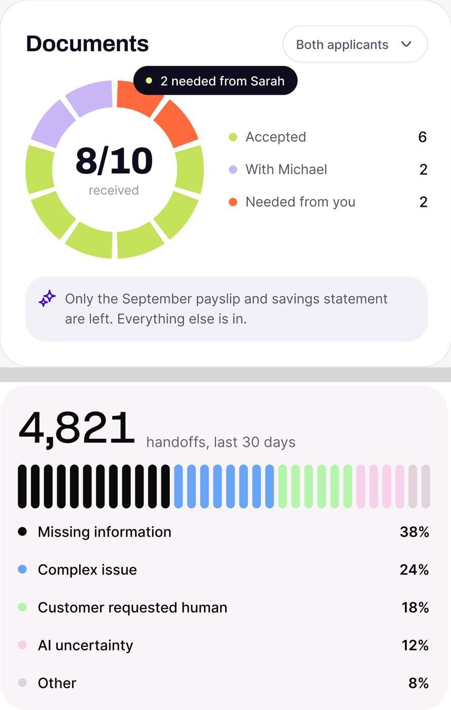
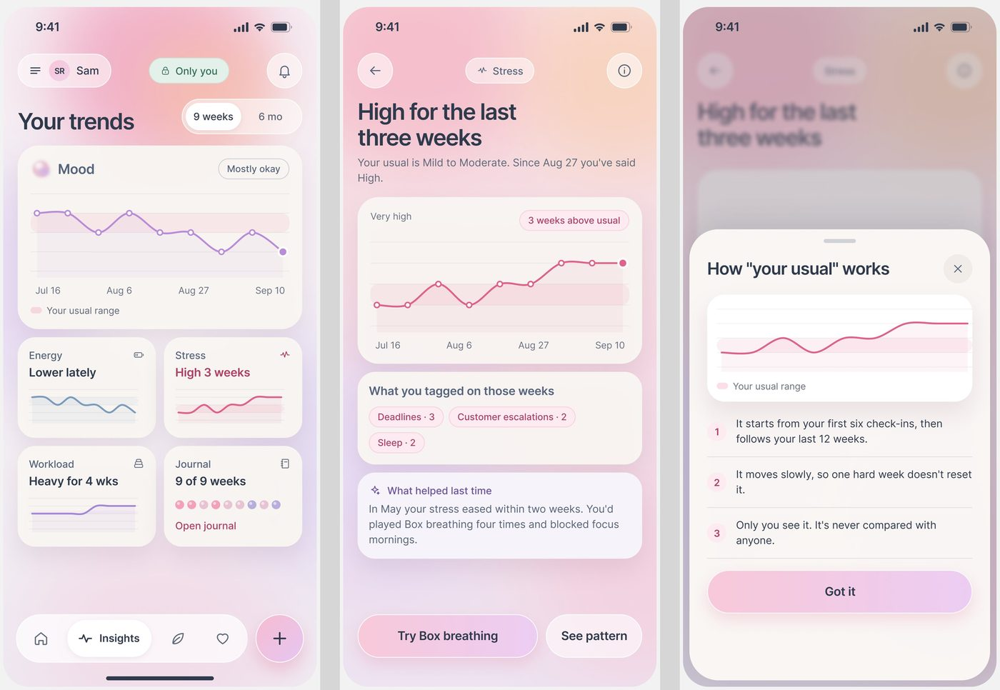

# Gráficos (como componentes)

Os gráficos do método são peças de interface com tamanho fixo, não "charts" de biblioteca. Este arquivo trata cada
um como componente: gauge segmentado, barras, mapa de calor, donut segmentado, barra de progresso (e suas
variantes em tiques) e sparkline (incluindo a nova linha com faixa "do seu normal").

Escala e método: [README](README.md#escala-e-método). A seção `01-sistema-visual` tem a leitura de cor dos
gráficos; aqui ficam anatomia, medida e receita.

---

## 1. Gauge segmentado

**O que é.** Um arco de 180° que mostra um total ou uma nota, feito de peças separadas em vez de uma faixa
contínua. 5 telas **[OBSERVADO]**.



### Anatomia (FixTrack, fator 2,49)

1. **Arco** de 180°, ~200 px de largura, raio externo ~98 px **[MEDIDO ±3]**.
2. **Cápsulas**: 28 peças de ~21 × 7 px, raio total, apontando para o centro **[MEDIDO ±1]**.
3. **Cor por categoria**, na ordem da legenda: verde escuro `#1f493b` (New), verde médio `#608772`
   (Assigned), coral `#e85f4c` (In progress), mostarda `#e5b65e` (Waiting) **[MEDIDO]**.
4. **Centro**: número Geist 32 ("28") + rótulo 13 px cinza ("Open requests").
5. **Legenda embaixo**: ponto + nome + detalhe cinza + porcentagem à direita (43%, 32%, 18%, 7%).

**O detalhe que ensina.** São 28 cápsulas para 28 pedidos abertos, e a divisão de cores bate com as
porcentagens da legenda (12, 9, 5 e 2 peças). Cada peça é um pedido **[INFERIDO pela contagem]**. O gauge é
contagem literal, não enfeite.

### Variações

- **Tiques finos** (Permitly "Package compliance"): ~45 traços pretos finos sobre
  cartão `lime/500`; os traços que faltam para 100% aparecem desbotados. Centro "94" enorme com "%" pequeno e
  "ready to submit".
- **Arco contínuo em degradê** (OrchestrateIQ "Health"): traço de ~14 px de azul a
  roxo sobre trilho cinza, botão branco com anel roxo na ponta, centro "94" + "of 100 · +2 this week".
- **Escuro** (Automax "Execution Health"): arco em degradê verde-amarelo-vermelho, 97,4% no centro.

### Como reproduzir (SVG, cápsulas)

```js
// n cápsulas num arco de 180°, uma por item, coloridas por categoria
const R = 88, len = 21, w = 7, n = 28;
for (let i = 0; i < n; i++) {
  const a = Math.PI * (1 - i / (n - 1));           // 180° → 0°
  const x = 100 + R * Math.cos(a), y = 100 - R * Math.sin(a);
  // <rect x={-len/2} y={-w/2} width={len} height={w} rx={w/2}
  //   transform={`translate(${x} ${y}) rotate(${-a * 180 / Math.PI})`} fill={corDaCategoria(i)} />
}
```

---

## 2. Barras

**O que é.** Comparação entre períodos ou etapas. 15 telas **[OBSERVADO]**. A barra "padrão" quase não
aparece: cada produto tem uma forma de barra própria.



| Forma | Onde | Receita |
|---|---|---|
| **Barra em trilho** | FixTrack "Today's schedule" | colunas de 62 px com raio 11; trilho bege `#f5f1ec` na altura total; preenchimento verde escuro `#234a3b` ou coral `#e85f4c`; o número vai DENTRO da barra, embaixo, em branco **[MEDIDO]** |
| **Vaga de etapa** | Mortgage "Your mortgage journey" | colunas altas de 86 px com raio 17 e altura crescente; feitas em lilás claro com círculo lima de check no pé; a atual em roxo `#3a0dcc` com selo preto "● Now" e "Day 4"; as futuras hachuradas **[MEDIDO]** |
| **Barra hachurada** | ResolveAI, PriorAuth (mini barras do hero) | barras com listras diagonais finas; a do dia atual em preto (ResolveAI) ou lima (PriorAuth) |
| **Pílula com etiqueta** | Torin | colunas totalmente arredondadas sobre trilho cinza de altura total; o valor em pílula preta acima de cada barra; a categoria "Other" em preto |
| **Degradê sobre fundo escuro** | ctrl.ai "Agent actions" | barras verdes em degradê com topo arredondado; as horas futuras como trilhos vazios; tooltip escuro com três linhas de ponto colorido |
| **Divergente** | Lepo "Insights" (escuro) | verde para cima (documentados), rosa para baixo (correções), números acima e abaixo |
| **Funil em degraus** | medspa "Journey conversion" | barras lilás decrescentes; a maior queda em mostarda e a etapa final em verde, com um selo "Biggest drop: Plan → Consent" no topo do cartão |

**Regras comuns.** Sem linhas de grade horizontais fortes (no máximo pontilhadas e muito claras); rótulos do
eixo X em 11 a 12 px cinza; a barra que importa (hoje, a etapa atual, a maior queda) muda de cor e as outras
ficam neutras **[OBSERVADO em 15 telas]**.

---

## 3. Mapa de calor

**O que é.** Uma grade em que a cor diz a intensidade. 3 telas **[OBSERVADO]**.



| Onde | Grade | Receita |
|---|---|---|
| AgentTrail "Impact × likelihood" (fator 2,54) | 5 × 5, célula ~120 × 86 px, gap 8, raio ~10 | fundo tint por gravidade (âmbar `#423219`, vermelho `#5a2827`) com borda da mesma cor mais clara; células vazias com um traço "–"; número grande no canto superior esquerdo e IDs em Geist Mono no pé ("RK-035 · RK-031"); a célula selecionada ganha borda branca de 2 px **[MEDIDO]** |
| medspa "Retention by first-visit month" | 5 × 5 triangular (coorte) | escala lilás de `#e9e2ff` a `#7659e9`; porcentagem dentro de cada célula (branca no escuro); células futuras em cinza claro; legenda "Low ▭▭▭▭▭ High" **[MEDIDO]** |
| Haulsight "AI forecast" | 4 linhas × ~24 colunas de quadradinhos arredondados | cinza (sem risco), laranja, vermelho; horas no eixo; o número "21" grande à esquerda diz o total |

---

## 4. Donut segmentado

**O que é.** Um anel partido em peças, uma por item. 3 telas **[OBSERVADO]**.



### Anatomia (Mortgage "Documents")

1. **Anel** de 10 peças com vão de ~6° entre elas, espessura ~22% do raio.
2. **Cor por estado**: lima (aceito), lilás (com outra pessoa), coral (falta você).
3. **Centro**: "8/10" em Geist bold + "received" cinza.
4. **Balão preso ao arco**: pílula preta "● 2 needed from Sarah" apontando para as peças coral.
5. **Legenda** à direita com ponto, nome e contagem alinhada à direita (6, 2, 2).
6. **Faixa de IA** no pé ("✦ Only the September payslip…").

Mesmo princípio do gauge: 10 peças para 10 documentos.

---

## 5. Barra de progresso

**O que é.** Quanto falta. 18 telas **[OBSERVADO]**, o gráfico mais frequente do método.

| Variante | Onde | Receita |
|---|---|---|
| Linha fina | Permitly cartão com foto, FixTrack "Contractor load" | 6 px, raio total, preenchimento escuro sobre trilho cinza, porcentagem à direita |
| **Segmentos proporcionais** | Permitly "Project pipeline" | uma pílula por etapa com largura proporcional à contagem; a etapa principal em `lime/500`, a última em preto; número e nome embaixo de cada pílula |
| **Tiques** | PriorAuth "Approval odds" (10 pílulas verdes), Mortgage "Lender review" (tiques roxos + "Day 4 of ~10"), ResolveAI "Handoff reasons" (~30 tiques coloridos por motivo) | cada tique é uma unidade; os que faltam em cinza claro |
| **Uma peça por item** | Mongi hero (7 segmentos, um por encomenda; o último laranja) | o progresso conta coisas reais |
| **Restante pontilhado** | Lepo "Documented today" | preenchimento verde sólido e o que falta como uma linha de pontos, não como trilho |
| Empilhada | Torin "share by group", AgentPay "Decision split" | segmentos coloridos com vão de 4 px, legenda em duas colunas embaixo |
| Cobertura | OrchestrateIQ "Coverage by source" | barra azul com trechos laranja onde há lacuna |

---

## 6. Sparkline e linha

**O que é.** Tendência em espaço pequeno. 5 telas com sparkline dentro de KPI, 6 com gráfico de linha de
cartão inteiro **[OBSERVADO]**.

### Sparkline de KPI (OrchestrateIQ)

~120 × 36 px, linha de 1,5 px na cor da variação (vermelho se piorou, verde se melhorou, roxo se neutro),
área embaixo em degradê que some até transparente, ponto cheio na última leitura **[MEDIDO ±3]**.

### Linha com "faixa do seu normal"

App de bem-estar e o cartão "How 'your usual' works" (imagem 3): a linha da
pessoa passa por cima de uma **faixa rosa translúcida** que marca o intervalo habitual dela ("Your usual
range"), com círculos vazados nos pontos semanais e o último ponto cheio. Nos mini-cartões 2 × 2 (Energy,
Stress, Workload, Journal) a mesma faixa aparece em miniatura. É a sparkline com contexto: o dado só é bom
ou ruim comparado com o normal daquela pessoa.



### Linha de cartão inteiro

- **FixTrack "First response time"**: linha verde escura com pontos vazados, linha tracejada da meta (SLA),
  coluna do mês destacada em tint verde e tooltip verde escuro com duas linhas de ponto.
- **PriorAuth "Approval rate"**: área preenchida em lima clara, linha
  preta, ponto lima no fim, eixo em Geist Mono ("Jun 29", "Jul 27"), segmentado "Week / Month" no cabeçalho.
- **Custo de IA** (OrchestrateIQ): área azul em degradê, linha tracejada do período
  anterior, linha de orçamento pontilhada âmbar com etiqueta "Budget $360/day", tooltip branco.
