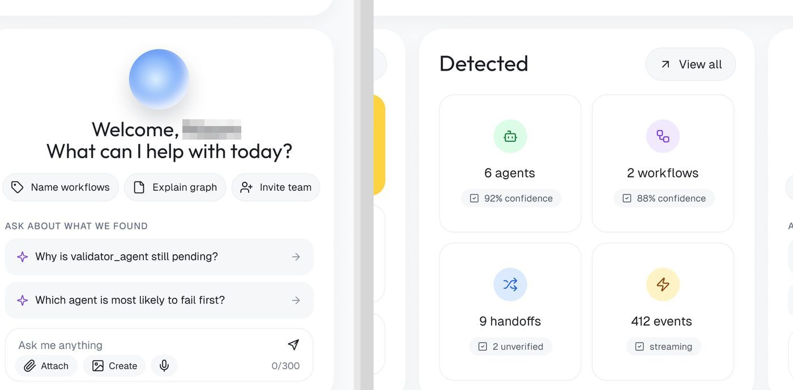
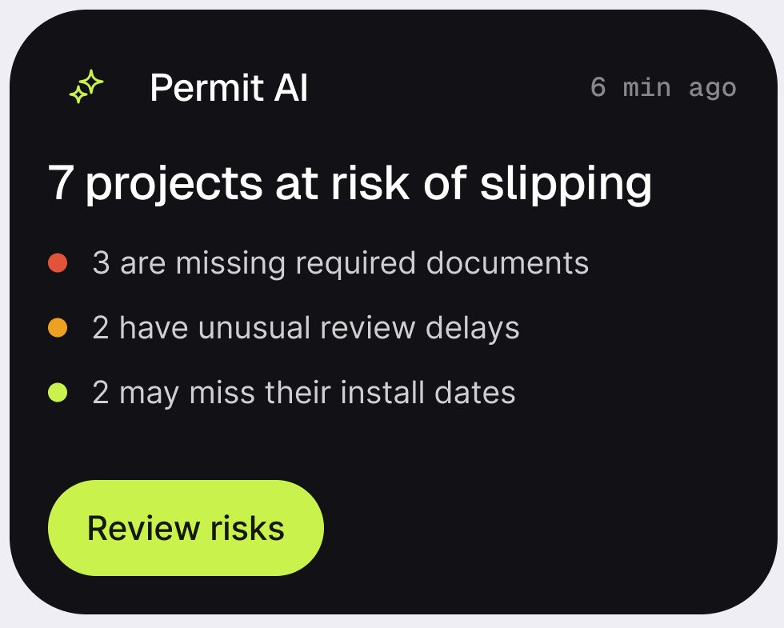
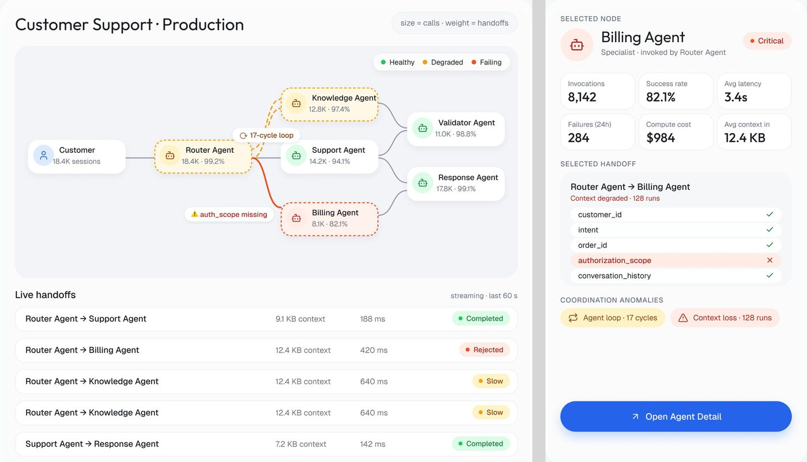
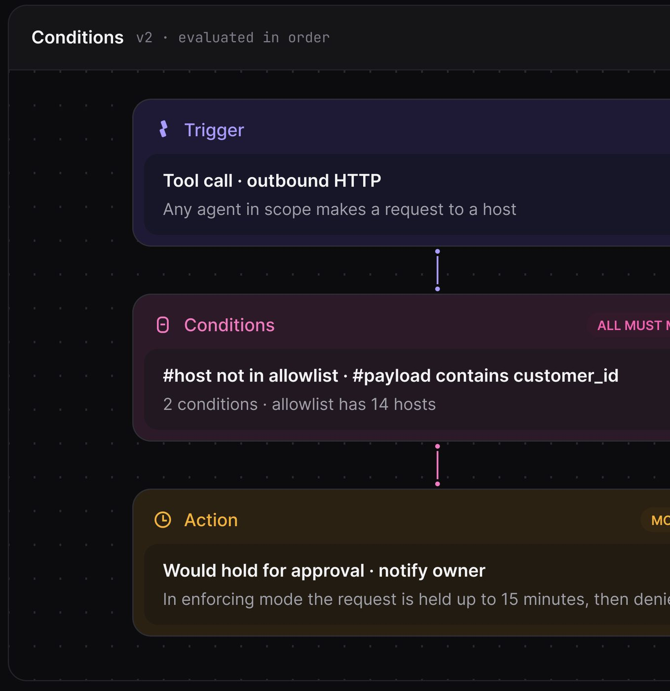
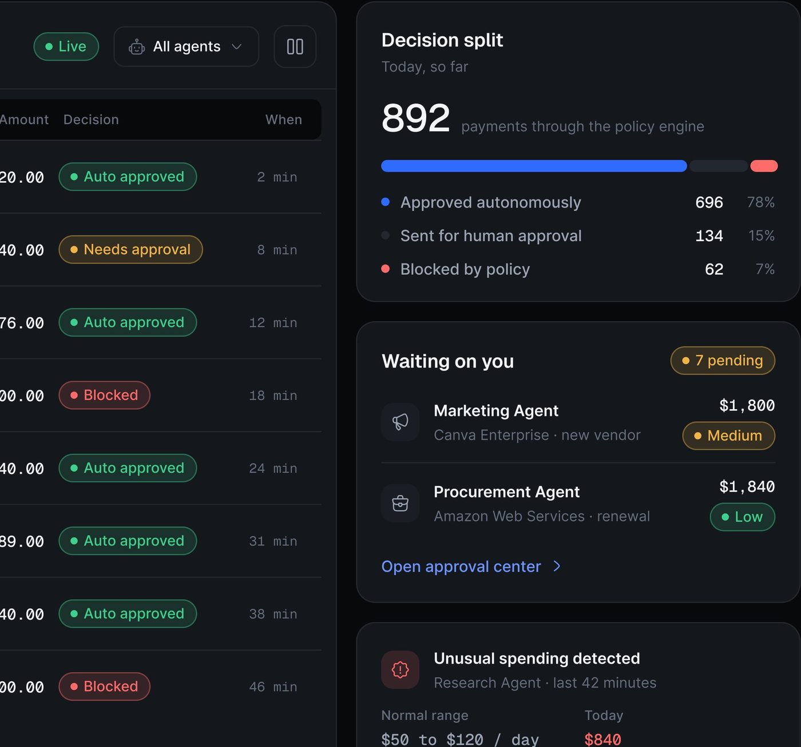
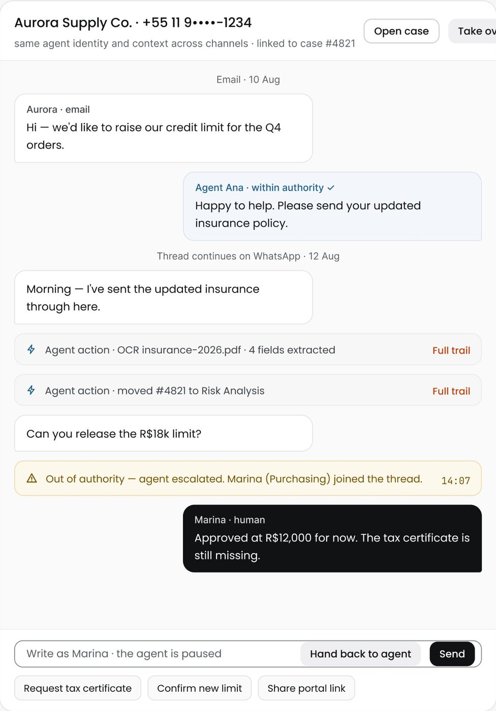
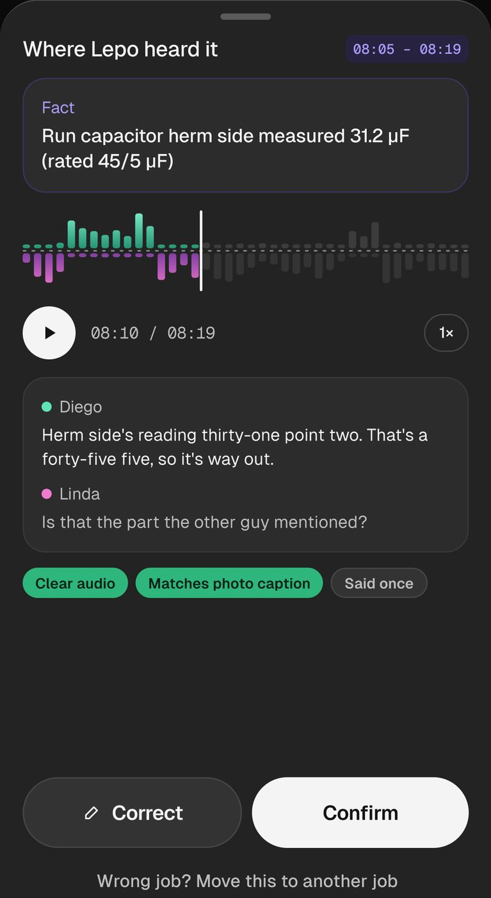
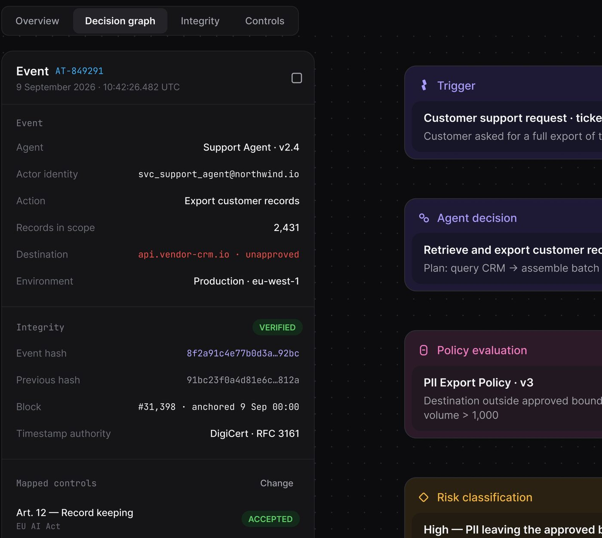

# IA e agentes

Os componentes que existem porque o produto tem IA dentro: o painel de assistente, a faixa de insight da IA,
o nó de agente, o grafo de handoff, o waterfall de execução, o cartão de política (Trigger → Conditions →
Action), o selo de confiança e o "humano no circuito" (aprovar, corrigir, devolver ao agente).

Escala e método: [README](README.md#escala-e-método). Tokens oficiais:
[design-system-publicado.md](../01-sistema-visual/design-system-publicado.md). Para o raciocínio por trás
de cada padrão (por que a tela mostra confiança, por que o humano aprova), ver a seção `03-padroes-de-ia`;
aqui fica a peça: anatomia e medida.

---

## 1. Painel de assistente (chat com orbe)

**O que é.** O painel que convida a perguntar à IA sobre o que ela acabou de encontrar. 3 telas com o painel
completo (OrchestrateIQ ×2, Automax) e 8 com ponto de entrada ("Ask vero", "Ask Haulsight", "Ask rillo ⌘K",
"Ask Ctrl", barra de pergunta do Mortgage, item "AI Assistant" do Permitly) **[OBSERVADO]**.



### Anatomia (OrchestrateIQ, fator 2,475)

1. **Orbe**: esfera de 74 px em degradê radial azul (centro claro `#bad8fe`, borda azul mais viva), com
   sombra suave embaixo **[MEDIDO]**. É o único elemento "mágico" da tela; não tem rosto nem ícone.
2. **Saudação em duas linhas** centralizada: "Welcome, [nome]" + "What can I help with today?", ~22 px
   (Geist, `display/20` a `display/24`).
3. **Chips de ação** em pílula com ícone, 35 px de altura, fundo `#f5f6f8`, borda 1 px: "Name workflows",
   "Explain graph", "Invite team" **[MEDIDO]**.
4. **Rótulo de seção** em caixa alta: "ASK ABOUT WHAT WE FOUND".
5. **Perguntas prontas**: linhas de 45 px, fundo `#f4f5f7`, raio 10, ícone de brilho roxo à esquerda e seta
   à direita. As perguntas são sobre os dados daquela tela ("Why is validator_agent still pending?"), não
   genéricas **[MEDIDO]**.
6. **Campo "Ask me anything"**: caixa de 65 px, raio 14, borda 1 px, com botão de enviar (avião de papel) no
   canto, sub-chips "Attach", "Create" e microfone (33 px) e o contador "0/300" à direita **[MEDIDO]**.

### Variações

- **Barra de pergunta embutida** no pé de um cartão (Mortgage "Action required"): campo em pílula com
  brilho roxo à esquerda, "Ask what a mortgage term means…" e círculo roxo cheio de enviar.
- **Botão de entrada na barra de topo**: "✦ Ask vero" (contorno verde), "✦ Ask Haulsight" (azul cheio em
  degradê), "Ask rillo ⌘K" (pílula preta com o atalho dentro), "Ask Ctrl" (ctrl.ai).
- **Tela vazia de chat** (Automax): orbe no centro, "Hi, There", três cartões de
  sugestão embaixo e o campo com botão lima.

### Como reproduzir

```html
<section class="rounded-[24px] bg-white p-6 text-center">
  <div class="mx-auto size-[74px] rounded-full shadow-[0_18px_30px_-12px_rgba(37,99,235,.35)]
              bg-[radial-gradient(circle_at_45%_40%,#e6f0ff,#8fb8fb_55%,#5b8ef5)]"></div>
  <h3 class="mt-6 font-[Geist] text-[22px] leading-tight">Welcome, Sarah<br>What can I help with today?</h3>
  <div class="mt-4 flex justify-center gap-2">
    <button class="h-[35px] px-3 rounded-full border border-[#e3e2ec] bg-[#f5f6f8] text-[14px]">Name workflows</button>
  </div>
  <p class="mt-6 text-left text-[11px] font-semibold tracking-[0.08em] uppercase text-[#8A8996]">Ask about what we found</p>
  <button class="mt-2 w-full h-[45px] px-4 rounded-[10px] bg-[#f4f5f7] flex items-center gap-3 text-[15px]">
    <span class="text-violet-500">✦</span> Why is validator_agent still pending? <span class="ml-auto">→</span></button>
  <div class="mt-3 rounded-[14px] border border-[#e3e2ec] p-3 text-left">…</div>
</section>
```

---

## 2. Faixa de insight da IA

**O que é.** Uma frase da IA dentro de um cartão comum, numa faixa tint com o ícone de brilho (✦). É a forma
mais frequente de a IA falar na tela: 12 telas **[OBSERVADO]**.

| Onde | Receita |
|---|---|
| Mortgage "Documents" | faixa cinza-lilás de raio 16 no pé do cartão, brilho roxo, "Only the September payslip and savings statement are left. Everything else is in." |
| medspa "Provider utilisation" | faixa lima clara, brilho, "Open 6 Tue/Thu laser slots to lift Dr. Ortiz to ~75%" |
| OrchestrateIQ handoff | bloco "IQ Analysis" com monograma em círculo lilás + parágrafo |
| Haulsight "Critical now" | linha azul "✦ Re-route saves $2,400" |
| Bem-estar | cartão "✦ What helped last time" com a lembrança do que funcionou antes |

**A regra.** A frase da IA diz a conclusão e o que resta fazer, nunca "a IA analisou seus dados". Ela fica
no pé do cartão, depois do dado que a sustenta **[OBSERVADO]**.

### Cartão de IA (versão grande)



Permitly (fator 3,0): cartão preto de 320 × 252 px, raio 32 (painel), com brilho
lima + "Permit AI" + "6 min ago" em Geist Mono cinza no topo; manchete Geist ~22 px "7 projects at risk of
slipping"; três linhas com ponto colorido (`clay/500`, `amber/500`, `lime/500`) explicando o porquê; botão
lima em pílula "Review risks" **[MEDIDO]**. Variantes: Edu.ai (cartão roxo com dois itens clicáveis e botão
lima), medspa "Flow Assist" (lima, no rodapé da sidebar).

---

## 3. Nó de agente e grafo

**O que é.** Cada agente como um cartãozinho num canvas, ligado aos outros por curvas. 10 telas
**[OBSERVADO]**.



### Anatomia do nó (OrchestrateIQ Live Map, fator 2,475)

1. **Cartão** branco ~155 × 53 px, raio ~12, sombra muito leve **[MEDIDO ±2]**.
2. **Ícone** do agente (robô) em círculo tint de 32 px, cor por estado.
3. **Nome** 13 px peso médio + **métrica** 11 px cinza ("18.4K · 99.2%": volume e taxa de sucesso).
4. **Estados**: saudável (branco), degradado (fundo `#fff6d9` e borda TRACEJADA âmbar), em falha (fundo
   `#fff2ec` e borda tracejada vermelha) **[MEDIDO cor]**.

### Anatomia do grafo

- **Canvas** cinza `#f3f4f8` com raio ~16 dentro do cartão da seção.
- **Arestas** em curva de Bézier cinza de ~1,5 px; a aresta com problema vira vermelha e mais grossa.
- **Rótulo de aresta** em pílula branca pequena: "⟳ 17-cycle loop", "⚠ auth_scope missing".
- **Legenda** em pílula branca no canto: "● Healthy ● Degraded ● Failing".
- **Painel do nó selecionado** à direita: cabeçalho (ícone em círculo tint + nome + selo "● Critical"),
  grade 3 × 2 de mini-KPIs contornados (122 × 59 px), checklist do handoff com o campo faltante em tint
  vermelho, chips de anomalia (âmbar "Agent loop · 17 cycles", vermelho "Context loss · 128 runs") e botão
  primário azul de largura total.

### Variações

- **Mapa de agentes escuro** (ctrl.ai, em duas telas): nó
  central "Ctrl.ai · Policy layer" com um grande círculo verde e um toggle desenhado dentro, e a lista
  "Active policies 11 / Blocked today 212 / Waiting approval 8"; cartões de agente agrupados por rótulo com
  ponto colorido ("● Renewal Agent"), cada um com foto do dono humano, "Medium risk · 2 systems" e ponto de
  risco; à direita uma coluna de sistemas externos (Salesforce, Gmail, Slack, Stripe) com "4 agents
  connected"; barra flutuante no pé com legenda Low / Medium / High e "5 of 42 shown · Show all".
- **Pistas no tempo** (OrchestrateIQ visão geral): cada agente numa linha, colunas de horário em chips
  ("09:41 / 00"), o horário atual em chip azul com linha vertical tracejada descendo; blocos de atividade
  em pílula com degradê ("Delegating" roxo, "Validating" verde ou azul) e um selo branco "● Healthy"
  dentro; os horários vazios aparecem como quadrados hachurados (`line/hatch`).
- **Paleta de nós** (Ergond): lista lateral agrupada em TRIGGERS, LOGIC, ACTIONS,
  PEOPLE & TOOLS, cada nó com ícone tint e nome técnico em Geist Mono ("rows.update_cells"), e um nó
  tracejado "Ask an agent…".

---

## 4. Grafo de handoff (passagem entre agentes)

**O que é.** Mostra o que um agente passou para o outro. 3 telas **[OBSERVADO]**.

Receita (OrchestrateIQ): dois cartões de nó grandes nas pontas (ícone em círculo
tint + nome + "sends context · scope: admin"), uma linha roxa de 2 px com ponto na origem e seta no destino,
e no meio uma pílula branca com quatro números empilhados em duas linhas ("9.1 KB / context", "188 ms /
latency", "1,904 / tokens", "5 of 5 / fields"). Embaixo, a tabela de comparação de contexto, campo a campo,
com o selo "Match" ou "Unused".

---

## 5. Waterfall de execução

**O que é.** A linha do tempo de uma execução, agente por agente, como no DevTools. 2 telas **[OBSERVADO]**.


### Anatomia (OrchestrateIQ Traces)

1. **Coluna de nomes** com recuo por nível (~16 px por nível) e ponto verde de estado antes de cada nome.
2. **Eixo** no topo com poucos marcos ("0ms", "0.8s", "1.6s").
3. **Trilho por linha**: pílula branca com borda, de largura total.
4. **Barra** em pílula dentro do trilho, posicionada pelo início e pela duração; azul claro em degradê, e
   verde para o trecho que merece atenção.
5. **Faixa de conclusão** embaixo, verde tint: "✓ Every agent returned a terminal state. No retries, no
   context loss…".

---

## 6. Cartão de política (Trigger → Conditions → Action)

**O que é.** A regra que governa o agente, escrita em três blocos empilhados e ligados. 5 telas
**[OBSERVADO]**.



### Anatomia (AgentTrail, fator ~3,0)

1. **Canvas** escuro com grade de pontos.
2. **Bloco** de ~123 px de altura, raio 14, com cabeçalho (ícone + nome na cor do bloco) e um **cartão
   aninhado** de 68 px, raio 11, recuado 9 px, com o texto da regra em branco (14 a 15 px) e uma linha de
   apoio cinza **[MEDIDO]**.
3. **Cor por papel**: Trigger roxo (`#1e1a36` fora, `#171528` dentro), Conditions magenta (`#2c1a28` /
   `#221822`), Action âmbar **[MEDIDO]**.
4. **Etiqueta à direita do cabeçalho** em caixa alta: "ALL MUST MATCH" (magenta), "MONITOR" (âmbar).
5. **Conector** vertical tracejado de ~38 px com um ponto em cada ponta, na cor do bloco seguinte.

### Variações

- **Grafo de decisão** (AgentTrail): quatro blocos à direita de um registro de evento
  (Trigger roxo → Agent decision lilás → Policy evaluation magenta → Risk classification âmbar), cada um com
  o texto do que aconteceu naquele passo.
- **Política como três linhas** (Ergond LLM): "⚡ Trigger · provider error, timeout
  over…", "↳ Behaviour · retry once, switch to fallback", "⊘ Never · silently change an agent's…". Mesma
  lógica sem os blocos coloridos.
- **Simulação** embaixo do cartão: "Simulation · last 30 days" com gráfico de linha e o KPI
  "would_have_held 41".

---

## 7. Selo de confiança e estimativa

**O que é.** O quanto a IA tem certeza, dito em número, em nível ou em evidência. 10 telas **[OBSERVADO]**.


| Forma | Onde | Receita |
|---|---|---|
| Porcentagem em chip | OrchestrateIQ "Detected" | chip cinza "☑ 92% confidence" embaixo de cada descoberta |
| Legenda de níveis | OrchestrateIQ "How this is ranked" | três linhas com ponto (High verde, Medium âmbar, Low cinza) e o critério de cada uma ("≥1,000 runs, reproducible in replay") |
| Número gigante + barra de 10 segmentos | PriorAuth | "78%" em Geist ~88 px, barra de 10 pílulas verdes (8 cheias), "High · estimate", checklist com círculos verdes e um âmbar, e a frase "An estimate from the case information available. Not a guarantee." |
| Tabela de base da estimativa | PriorAuth "AI Authorization Review" (lilás) | três colunas contornadas: "Similar cases 214", "Approved 87%", "Confidence Medium" |
| Evidência cruzada | Rillo "What rillo checked" | cada verificação numa linha com "Corroborated" (verde) ou "Not corroborated" (cinza) + "1 of 5 corroborated" |
| Etiquetas de evidência | Lepo "Where Lepo heard it" | pílulas verdes cheias "Clear audio", "Matches photo caption" e cinza "Said once" |
| Selo "AI estimate" | PriorAuth "Approval odds" | pílula lilás com brilho no canto do cartão |

**A regra.** Sempre que a IA dá um número, ele vem com a base (quantos casos, quantas fontes) e com a
ressalva escrita. Nenhuma estimativa aparece nua **[OBSERVADO nas 10 telas]**.

---

## 8. Humano no circuito (aprovar, corrigir, devolver)

**O que é.** O ponto em que o agente para e uma pessoa decide. 13 telas **[OBSERVADO]**, o que faz deste o
padrão de IA mais repetido do método depois da faixa de insight.



### Formas vistas

1. **Fila "Waiting on you"** (AgentPay): cabeçalho com selo "● 7 pending" (âmbar
   tint-14 + border-40); cada item com tile de ícone do agente, nome, comerciante + motivo ("Canva
   Enterprise · new vendor"), valor em Geist Mono à direita e o selo de risco embaixo ("● Medium", "● Low");
   link azul "Open approval center ›".
2. **Divisão das decisões** (AgentPay "Decision split"): "892 payments through the policy engine", barra
   horizontal em três segmentos (azul `blue/500` aprovado sozinho, cinza enviado ao humano, vermelho
   bloqueado) e a legenda com contagem e porcentagem (696 · 78%, 134 · 15%, 62 · 7%).
3. **Conversa devolvível** (Ergond): quando o agente escala, aparece a faixa âmbar
   "⚠ Out of authority · agent escalated. Marina (Purchasing) joined the thread." com a hora em chip mono; a
   mensagem humana vem num balão PRETO (os balões do agente são azul-claros com "Agent Ana · within
   authority ✓"); o campo diz "Write as Marina · the agent is paused" e tem o botão "Hand back to agent".
4. **Confirmar ou corrigir** (Lepo): folha inferior com o fato extraído num cartão
   contornado roxo ("Fact"), a forma de onda do trecho com o cursor, o player com o tempo em mono, a
   transcrição com cor por falante, as etiquetas de evidência, e o par "✎ Correct" / "Confirm".
5. **Proposta numerada** (Rillo): "rillo proposes" + passos numerados em círculos azuis + a frase "Every step
   is editable before it runs. Nothing has been actioned".
6. **Rascunho que não se envia sozinho** (Vero): cartão verde "Next step" com "vero has drafted the message.
   It will not send it." + "Review the draft".
7. **Desfazer** (Fino): toast escuro "✓ Reminder sent to Dana · Undo".
8. **Chamado em massa** ("AI drafts ready"): cartão roxo "36 draft comments are
   waiting for your review. 6 are flagged as needing a closer look." + botão lima "Start reviewing".





---

## 9. Cartão de anomalia

**O que é.** Um desvio que a IA percebeu, com a faixa normal ao lado do valor de hoje. 3 telas
**[OBSERVADO]**.

Receita (AgentPay "Unusual spending detected"): tile de ícone vermelho tint com o ícone de alerta, título +
"Research Agent · last 42 minutes", e embaixo duas colunas em Geist Mono: "Normal range $50 to $120 / day"
em branco e "Today $840" em vermelho. Parentes: OrchestrateIQ "Coordination anomalies", Haulsight "Likely
to miss the 4:00 PM delivery window".


