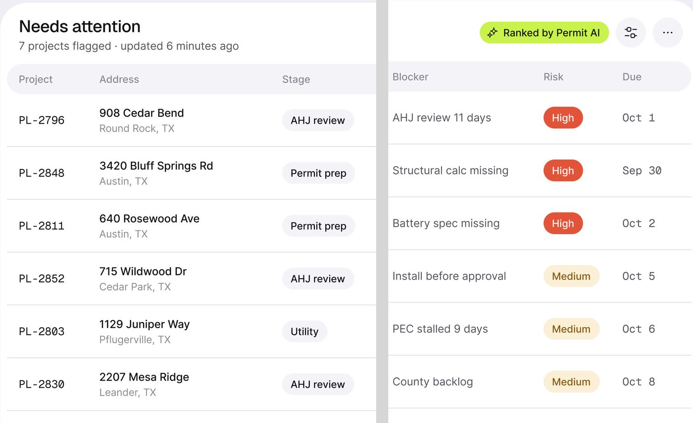
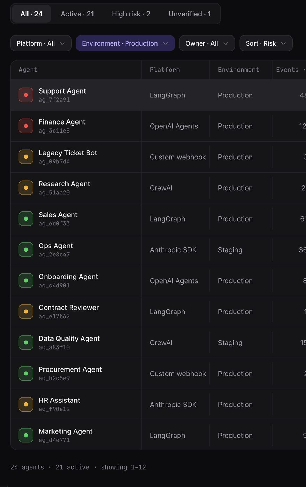
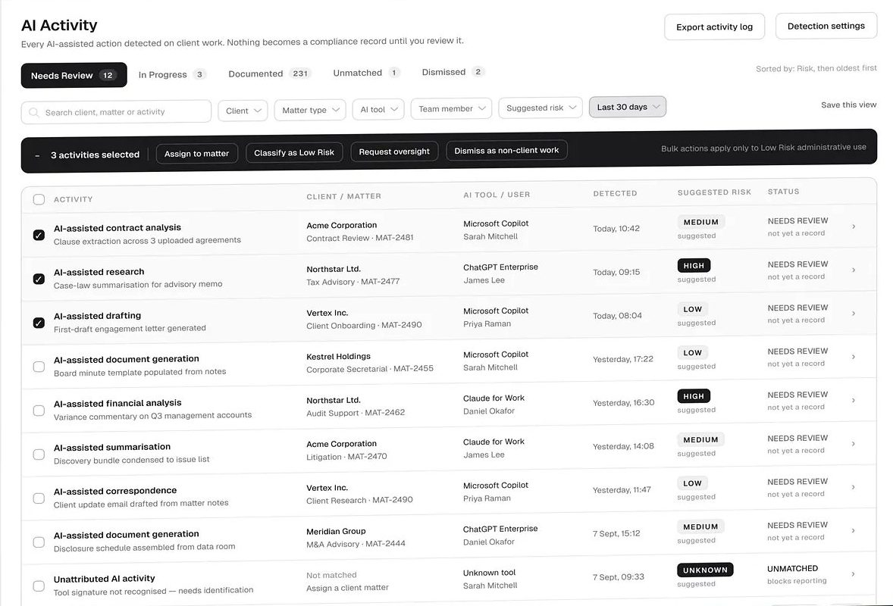
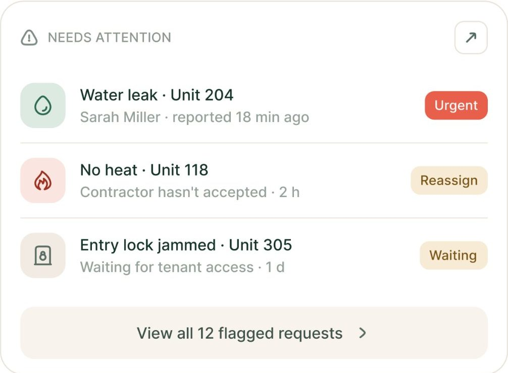
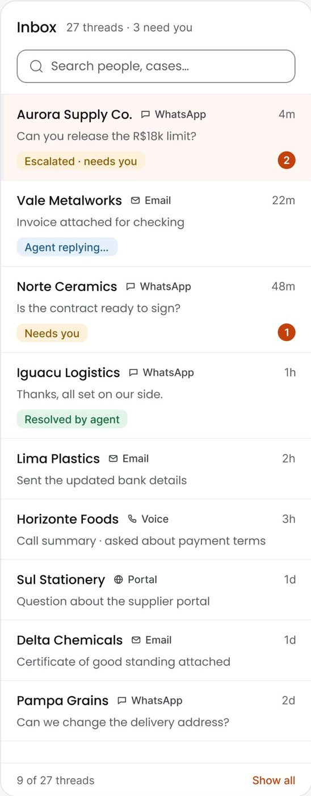
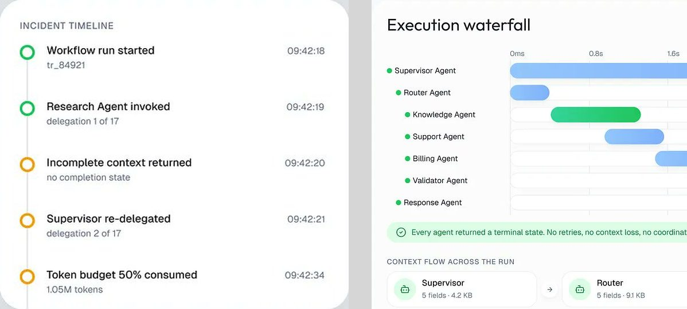
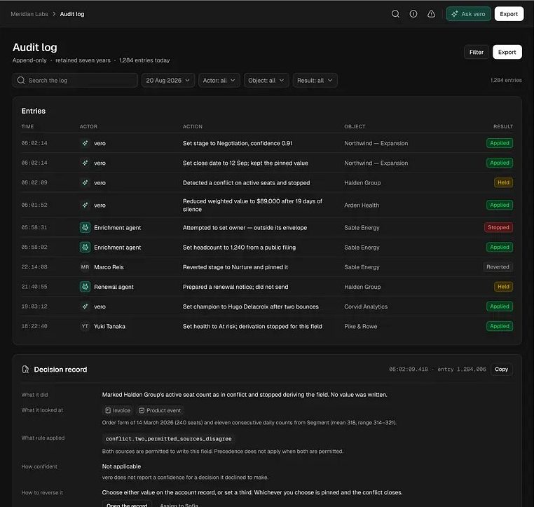

# Listas e tabelas

Sete componentes para mostrar muitas coisas em fila: tabela densa, linha com status, fila de decisão
(queue), lista com avatar, lista "precisa de você" (needs attention), linha do tempo vertical e log de
auditoria.

Escala e método: [README](README.md#escala-e-método). Tokens oficiais:
[design-system-publicado.md](../01-sistema-visual/design-system-publicado.md).

---

## 1. Tabela densa

**O que é.** Linhas e colunas de dados operacionais, com cabeçalho discreto e uma coluna de estado no fim.
14 telas **[OBSERVADO]**.



### Anatomia (Permitly, fator 3,0)

1. **Cabeçalho em faixa**: faixa cinza `#f5f5f7` (≈ `bg/card` `#F4F4F8`) de 36 px de altura com raio 12
   (token `r-12`; medido 13), que NÃO toca as bordas do
   cartão (tem recuo de 4 px). Rótulos em 14 px cinza médio, caixa de frase **[MEDIDO]**.
2. **Linha**: 63 px de passo, separador de 1 px `#e5e4ec` (= `line/soft` `#E3E2EC`) **[MEDIDO]**.
3. **Coluna de ID**: "PL-2796" em **Geist Mono** (token `mono/13`), cor `text/secondary`.
4. **Célula de duas linhas**: principal 15 px preto + secundária 13 px cinza ("908 Cedar Bend / Round Rock,
   TX").
5. **Chip de etapa**: pílula cinza `#f2f1f6` (≈ `bg/card`), 86 × 26 px, raio total ("pills full") **[MEDIDO]**.
6. **Selo de risco**: "High" pílula cheia `clay/500` `#E1543A` com texto branco (47 × 26 px); "Medium"
   pílula `amber/tint` `#FCEFD8` com texto `amber/700` `#8A5A05` (67 × 26 px) **[MEDIDO, confere com o
   token]**. O sólido fica para o nível mais alto; o resto usa o par tint + 700.
7. **Prazo** em Geist Mono ("Oct 1", "Sep 30").
8. **Ações do cartão** no topo direito: chip lima "✦ Ranked by Permit AI", botão redondo de filtro, botão
   redondo "…".

### Variantes

**a) Linhas em cápsula** (PriorAuth, OrchestrateIQ). Cada linha é
um cartão próprio, sem separador: PriorAuth 1016 × 64 px, raio 24, fundo `#f2f1ed`, 10 px entre linhas
**[MEDIDO]**; OrchestrateIQ linha branca com borda de 36 px de altura e raio ~10, e a linha que interessa em
tint verde `#eaf7ee`.

**b) Tabela escura com colunas divididas** (AgentTrail). Contêiner com borda de 1 px
e raio ~12; cabeçalho em monoespaçada cinza; divisórias VERTICAIS de 1 px entre colunas (é a única família em
que a divisória é vertical); linha selecionada um tom mais clara (`#222226`); primeira coluna com um
quadrado de estado de 36 px, raio 8, borda e fundo tint da cor do risco e ponto no meio.



**c) Tabela com seleção e ação em lote** (ComplianceFlow, Rillo ledger). Checkbox de 16 px preto com raio 4; quando há seleção, aparece por cima da tabela
uma barra PRETA de largura total, raio ~10, com "– 3 activities selected" e botões contornados escuros
("Assign to matter", "Classify as Low Risk"), e à direita um texto de regra ("Bulk actions apply only to Low
Risk administrative use").



**d) Fluxo de decisões do agente** (AgentPay). Tabela
escura dentro de um cartão `bg/panel` "Agent activity · Live decision stream across every wallet".
Cabeçalho em faixa rebaixada (`bg/canvas`, raio 8) com rótulos Inter 12 `text/muted`. Colunas: ladrilho de
ícone do agente + nome Inter 14 + política em Geist Mono 12 cinza ("Marketing Spend v3"); comerciante com o
logotipo da marca real (Meta, AWS, OpenAI, HubSpot) em 16 px; valor em **Geist Mono alinhado à direita**
("$1,840.00"); decisão em selo com ponto e borda (Auto approved verde, Needs approval âmbar, Blocked
vermelho); tempo em Geist Mono cinza ("2 min"). É a regra escrita na folha: *"Geist Mono for money,
IDs and time"*.

### Como reproduzir

```html
<table class="w-full text-[15px]">
  <thead><tr class="[&>th]:bg-[#f5f5f7] [&>th]:h-9 [&>th]:font-normal [&>th]:text-neutral-500 [&>th]:text-left
      [&>th:first-child]:rounded-l-[13px] [&>th:last-child]:rounded-r-[13px]">
    <th class="pl-5">Project</th><th>Address</th><th>Stage</th></tr></thead>
  <tbody class="[&>tr]:h-[63px] [&>tr]:border-b [&>tr]:border-[#e5e4ec]">
    <tr><td class="pl-5 tracking-wider">PL-2796</td>
        <td>908 Cedar Bend<br><span class="text-[13px] text-neutral-500">Round Rock, TX</span></td>
        <td><span class="h-[26px] px-3 rounded-xl bg-[#f2f1f6] inline-grid place-items-center">AHJ review</span></td></tr>
  </tbody>
</table>
```

---

## 2. Linha com status

**O que é.** A linha de lista mais comum do método: ícone ou avatar à esquerda, duas linhas de texto no meio,
um selo de estado à direita. 30 telas **[OBSERVADO]**.



### Anatomia (FixTrack, fator 2,49)

1. **Ladrilho de ícone** 36 × 36 px, raio 11, fundo tint da categoria (verde `#d8e9df`, rosa `#fce1e6`,
   bege `#f0ece3`) e ícone de traço na cor escura da mesma família **[MEDIDO]**.
2. **Título** 14 px preto ("Water leak · Unit 204"). Separador de meio-ponto "·" entre partes, nunca traço.
3. **Linha secundária** 13 px cinza ("Sarah Miller · reported 18 min ago").
4. **Selo à direita**: ver [selos](selos-chips-e-botoes.md#1-selo-de-status).
5. **Separador** de 1 px entre linhas; passo ~51 px.
6. **Rodapé de lista**: faixa bege `#f8f5f0` de 371 × 41 px, raio 11, "View all 12 flagged requests ›"
   centralizado **[MEDIDO]**.

---

## 3. Fila de decisão (queue)

**O que é.** Uma lista de itens que esperam decisão de um humano, com contador no título e um painel de
detalhe ao lado. 5 telas: Ergond Conversations, Rillo Queue, ComplianceFlow, Haulsight "Critical now",
OrchestrateIQ "Next steps" **[OBSERVADO]**.



### Anatomia (Ergond, fator 2,55)

1. **Cabeçalho**: "Inbox" 16 px + "27 threads · 3 need you" 13 px cinza.
2. **Busca** em caixa retangular com borda (raio ~8), 36 px de altura.
3. **Item**: nome 14 px em peso médio + ícone e nome do canal ("WhatsApp", "Email") em 11 px cinza + tempo à
   direita ("4m", "22m").
4. **Prévia** da mensagem em 13 px cinza, uma linha.
5. **Etiqueta de estado** retangular de 20 px, raio ~4, tint: "Escalated · needs you" (âmbar), "Agent
   replying…" (azul), "Needs you" (âmbar), "Resolved by agent" (verde).
6. **Contador** em círculo laranja-avermelhado de 18 px com número branco, à direita.
7. **Item selecionado**: fundo pêssego `#fdf0ec`, sem borda.
8. **Rodapé**: "9 of 27 threads" + link "Show all" em laranja.

### Variante com força da evidência (Rillo)

Cada item traz o valor à direita ("−$14,280.00"), uma etiqueta com ponto e tint (vermelho "Synthetic
receipt", amarelo "Seat count +42%", azul "Agent spend +38% w/w", verde "Refund matched to charge") e um
mini-medidor de barrinhas "|||| 4/5" que diz quantas fontes confirmaram o gasto.

---

## 4. Lista com avatar

**O que é.** Pessoas ou agentes em linha, com foto ou monograma. 10 telas **[OBSERVADO]**.

Variações:
- **Foto redonda + barra de carga** (FixTrack "Contractor load", medspa "Provider utilisation"): avatar 28 a
  32 px, nome 14 px, barra horizontal de 6 px embaixo ou ao lado, porcentagem à direita.
- **Foto em cartão escuro** (ctrl.ai "Agent map"): avatar 28 px + "Sarah Chen ·
  RevOps" + "Medium risk · 2 systems" + ponto de risco à direita.
- **Monograma** (Torin, Vero, Ergond): círculo com duas letras ("GPT", "Px", "A1", "Ma") em cor da marca do
  serviço.
- **Avatar ilustrado** (Lepo): círculo com personagem flat em cor, 44 pt.
- **Avatares à direita** (Mortgage "Case activity"): a pessoa responsável vem no fim da linha, 24 px.

---

## 5. Lista "precisa de você" (needs attention)

**O que é.** A seção que separa o que exige ação humana do resto. O nome muda ("Needs attention",
"Attention required", "Action required", "Needs you", "What we noticed", "Critical now"), mas aparece em 11
telas **[OBSERVADO]**.

### Anatomia comum

1. **Título + contador em selo**: "Attention required · 3 open" (selo cinza), "● 8 cases need action"
   (pílula laranja cheia), "● 2 open" (pílula rosa-salmão).
2. **Frase de contexto**: "Two things need your attention. Everything else is with Michael." (Mortgage),
   "7 projects flagged · updated 6 minutes ago" (Permitly). A frase sempre diz o que NÃO precisa de
   atenção também.
3. **Itens** com ícone de categoria colorido, título, origem e selo de estado.
4. **Botão de seta ↗** no canto do cartão para ver tudo.

### Variações

- **Com ação inline**: PriorAuth "Review case" (pílula branca 111 × 37 px) em cada linha; Mortgage "Upload"
  (pílula roxa cheia no primeiro item, contornada no segundo).
- **Com barra de pergunta à IA** no pé: Mortgage ("✦ Ask what a mortgage term means…" com botão roxo de
  enviar).
- **Escuro com ícone em ladrilho colorido** (ctrl.ai): ladrilho de 40 px com borda e fundo tint vermelho,
  âmbar ou amarelo, e selo "● Blocked automatically" verde na mesma linha do título.

---

## 6. Linha do tempo vertical

**O que é.** Eventos em ordem, ligados por uma linha. 8 telas **[OBSERVADO]**.



### Anatomia (OrchestrateIQ "Incident timeline")

1. **Rótulo de seção** em caixa alta cinza ("INCIDENT TIMELINE").
2. **Marcador**: anel vazado de ~18 px com traço de ~2,5 px; verde `#2abf61` = aconteceu bem; âmbar
   `#da9919` = aviso **[MEDIDO]**.
3. **Linha de ligação**: 2 px cinza claro, do centro de um anel ao próximo.
4. **Título** 15 px + detalhe 13 px cinza ("delegation 1 of 17").
5. **Hora** à direita em 14 px com algarismos tabulares ("09:42:18").

### Variações

- **Jornada com etapa atual** (medspa celular): etapas feitas com círculo cheio lima
  e check; a etapa atual vira uma linha inteira em tint lilás com círculo preto e selo preto "Now"; a
  etapa futura aparece a 40% de opacidade com "Tips unlock after your visit".
- **Passos numerados** (Torin): círculos de 26 pt com número; o atual em laranja
  cheio, os outros cinza; a linha liga só os círculos.
- **Histórico financeiro** (Fino): pontos pretos pequenos, o último em âmbar com a ação desfazível.

---

## 7. Log de auditoria

**O que é.** O registro imutável do que humanos e agentes fizeram. Central nos produtos de governança.
5 telas **[OBSERVADO]**.



### Anatomia (Vero, imagem de 1024 px para 1440 de tela)

1. **Cabeçalho da página**: "Audit log" + "Append-only · retained seven years · 1,284 entries today".
   A promessa de imutabilidade vem escrita no subtítulo.
2. **Filtros** em fila: busca + seletores com chevron ("20 Aug 2026", "Actor: all", "Object: all",
   "Result: all") + contagem à direita.
3. **Colunas**: TIME (monoespaçada), ACTOR (ícone do agente em ladrilho verde ou monograma de pessoa), ACTION
   (frase completa: "Set stage to Negotiation, confidence 0.91"), OBJECT, RESULT.
4. **Resultado** em selo retangular pequeno com borda e tint: Applied (verde), Held (âmbar), Stopped
   (vermelho), Reverted (cinza).
5. **Registro de decisão** abaixo da tabela: pares rótulo/valor em duas colunas ("What it did", "What it
   looked at", "What rule applied", "How confident", "How to reverse it"), com chips de fonte ("Invoice",
   "Product event") e a regra em chip monoespaçado (`conflict.two_permitted_sources_disagree`).

### Variações

- **AgentTrail Activity**: timestamps com milissegundos em monoespaçada, IDs
  "AT-849294" em azul `#58a9e1` monoespaçado **[MEDIDO]**, linhas de 44 px alternando fundo.
- **Eventos da mesma cadeia** (AgentTrail integridade): lista curta com ID azul,
  ação, e selo "CHAIN OK" (verde) ou "FAILED" (vermelho) em caixa alta.

### Como reproduzir (linha)

```html
<tr class="h-11 border-b border-white/5 text-[13px]">
  <td class="font-mono text-neutral-400">06:02:14</td>
  <td><span class="inline-flex items-center gap-2"><i class="size-5 rounded bg-emerald-900/40"></i>vero</span></td>
  <td>Set stage to Negotiation, confidence 0.91</td>
  <td class="text-neutral-400">Northwind · Expansion</td>
  <td class="text-right"><span class="px-1.5 py-0.5 rounded border border-emerald-500/40 bg-emerald-500/[.14] text-emerald-400 text-[11px]">Applied</span></td>
</tr>
```
