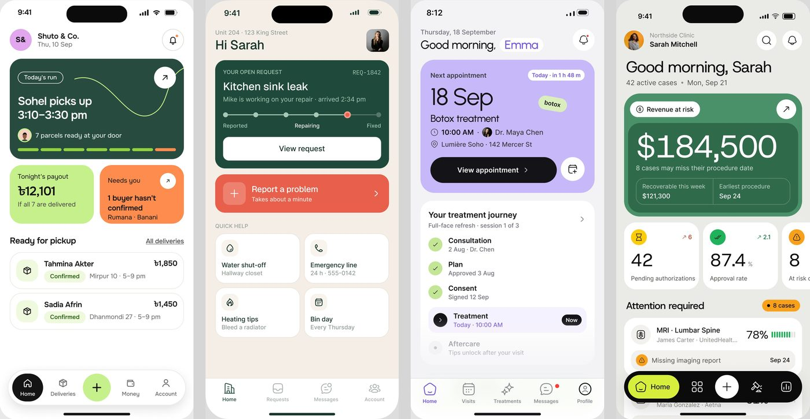
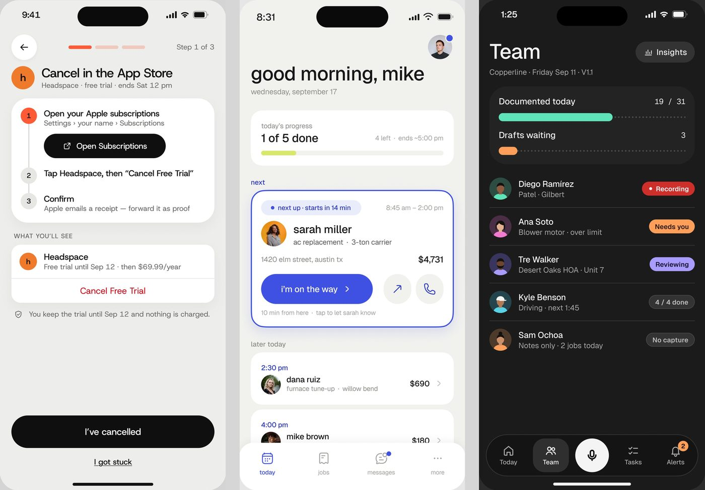

# Mobile

Os componentes dos apps de celular: cabeçalho com saudação, cartão hero colorido, par de cartões, lista de
próximos, grade de atalhos, stepper, folha inferior (bottom sheet), barra de progresso e botão de largura
total. A barra inferior está em [navegação](navegacao.md#6-barra-inferior-do-celular-bottom-nav).

**Escala.** Todos os celulares de referência são quadros de iPhone de **393 × 852 pt** (confere nas 13 telas medidas),
exportados a ~3x. Medidas em pt. O respiro lateral é **20 pt** em todos **[MEDIDO: Mongi 19,5; FixTrack 20;
medspa 20; contractor 20]**.



---

## 1. Cabeçalho com saudação ("Good morning")

**O que é.** A primeira linha da tela inicial fala com a pessoa pelo nome e diz o dia. 4 apps de celular e 8
painéis de desktop **[OBSERVADO]**.

### Anatomia

1. **Linha de identidade**: avatar (foto 40 a 44 pt ou monograma em círculo tint) + nome da empresa ou
   pessoa + data em cinza. À direita, 1 ou 2 botões redondos de 40 a 44 pt (sino, busca), com ponto de
   notificação.
2. **Saudação**: Geist ~30 a 32 pt (o token do Permitly é `display/32` para "Good morning, Sarah"
   **[CONFIRMADO]**).
3. **Linha de contexto** em 15 pt cinza: "42 active cases • Mon, Sep 21", "wednesday, september 17".

### Variações

| App | Receita |
|---|---|
| PriorAuth | avatar + "Northside Clinic / Sarah Mitchell" em cima, saudação grande embaixo |
| medspa | data em cima; o NOME em lilás dentro de uma pílula branca ("Good morning, [Emma]") |
| Contractor | tudo em minúsculas ("good morning, mike"), avatar sozinho à direita com ponto azul |
| FixTrack | endereço da unidade em cima ("Unit 204 · 123 King Street"), "Hi Sarah", foto quadrada de cantos arredondados |
| Mongi | sem saudação: monograma "S&" em círculo lilás + "Shuto & Co. / Thu, 10 Sep" |
| Bem-estar | pílula com menu + avatar "Sam", pílula verde "🔒 Only you" (privacidade à vista), sino; título "Your trends" |

---

## 2. Cartão hero colorido

**O que é.** O primeiro cartão da tela, em cor saturada, com a informação do dia. 7 apps **[OBSERVADO]**.

| App | Cor | Tamanho (pt) | Raio | Conteúdo |
|---|---|---|---|---|
| Mongi | verde escuro `#274b3f` | 353 × 204 | 23 | chip contornado "Today's run", manchete em 2 linhas, curva lima decorativa, botão ↗ branco 44, avatar + "7 parcels ready", barra de 7 segmentos |
| FixTrack | verde `#1f493b` | 354 × 220 | 20 | "YOUR OPEN REQUEST" + "REQ-1842" em mono, título, stepper de 5 pontos, botão branco "View request" |
| medspa | lilás `#c6b8f6` | 353 × 271 | 26 | "Next appointment" + pílula "Today · in 1 h 48 m", data gigante "18 Sep", etiqueta inclinada "botox", botão preto + botão redondo de calendário |
| PriorAuth | verde `#4a9169` + interno `#2f6a4a` | ~360 × 250 | ~28 | cartão aninhado, "$184,500" gigante, duas colunas de sub-dado |
| Fino | escuro | | | valor da fatura + selo "22 days overdue" |

Todos **[MEDIDO]** por varredura, com o fator de cada imagem (~2,97 a 3,0 px/pt).

**A regra.** Um hero por tela, com UMA ação principal dentro dele. O que vem abaixo é neutro (branco ou
cinza), com no máximo um segundo cartão colorido pequeno para o alerta (Mongi "Needs you" laranja, FixTrack
"Report a problem" coral).

---

## 3. Par de cartões (2 colunas)

Mongi: dois cartões de 170 × 118 pt, raio 25, 13 pt de vão: lima `#c8ed90` ("Tonight's payout ৳12,101") e
laranja `#fe8c4e` ("Needs you · 1 buyer hasn't confirmed" com ↗ branco) **[MEDIDO]**. PriorAuth faz o mesmo
com três ladrilhos brancos em rolagem horizontal (o terceiro cortado pela borda para sugerir que há mais).

---

## 4. Lista de próximos

**O que é.** O que vem a seguir no dia. 6 apps **[OBSERVADO]**.

- **Mongi "Ready for pickup"**: título 18 pt + link sublinhado "All deliveries"; linhas-cartão brancas com
  borda, 353 × 73 pt, raio ~20; ladrilho de ícone lima tint de 44 pt (raio 16); nome 16 pt, selo verde
  "Confirmed" e horário cinza; valor à direita.
- **Contractor "next"**: um cartão destacado com borda azul de 2 pt, selo tint azul "● next up · starts in
  14 min", foto 44 pt, nome, serviço, endereço, valor; botão azul em pílula de 195 × 52 pt "i'm on the way ›"
  + dois botões redondos cinza de 50 pt (↗ e telefone) **[MEDIDO]**. Abaixo, "later today" com cartões
  simples (hora em azul, avatar, valor, chevron).
- **Caregiver "Today's tasks"**: checkboxes redondos + hora à direita + monograma de quem faz.

---

## 5. Grade de atalhos

FixTrack "QUICK HELP": grade 2 × 2 de cartões brancos com borda, 170 × 100 pt, raio 19, ladrilho de ícone
bege de 36 pt, título 16 pt + detalhe cinza ("Water shut-off / Hallway closet") **[MEDIDO]**. Bem-estar: grade
2 × 2 de mini-gráficos (Energy, Stress, Workload, Journal), cada um com rótulo, frase de estado colorida
("High 3 weeks" em rosa) e sparkline com faixa do normal.

---

## 6. Stepper

**O que é.** Em que passo a pessoa está. 5 apps **[OBSERVADO]**.



| Forma | Onde | Receita |
|---|---|---|
| Segmentos no topo | Torin | 3 traços de ~41 × 5 pt no cabeçalho, o atual laranja e os outros laranja claro; "Step 1 of 3" à direita; botão voltar redondo branco de 45 pt |
| Passos numerados | Torin | círculos de 26 pt com número, o atual laranja cheio; o passo atual expande e mostra o botão ("Open Subscriptions") |
| Pontos em linha | FixTrack hero | 5 pontos de ~10 pt ligados por linha, o atual coral com anel, rótulos só em 3 pontos (Reported, Repairing, Fixed) |
| Jornada | medspa "Your treatment journey" | ver [linha do tempo](listas-e-tabelas.md#6-linha-do-tempo-vertical) |

---

## 7. Folha inferior (bottom sheet)

**O que é.** Um painel que sobe do pé da tela por cima do conteúdo, que fica escurecido ou desfocado. 2 apps
**[OBSERVADO]**.

- **Lepo "Where Lepo heard it"** (escuro): cantos superiores de ~28 pt, pegador de
  36 × 5 pt, título 18 pt + chip lilás com o intervalo em Geist Mono ("08:05 - 08:19"), cartão do fato,
  forma de onda, player, transcrição, etiquetas de evidência e o par "Correct / Confirm" no pé.
- **Bem-estar "How 'your usual' works"**: a tela de trás fica
  desfocada; folha clara com botão de fechar redondo, um mini-gráfico explicativo, três passos numerados em
  círculos rosa e o botão "Got it" em pílula com degradê rosa-lilás de largura total. É uma folha que EXPLICA
  como o app calcula algo, em linguagem simples ("Only you see it. It's never compared with anyone.").

---

## 8. Barra de progresso no celular

- Contractor "today's progress / 1 of 5 done": cartão branco 354 × 96 pt, raio 20, barra lima de 6 pt sobre
  trilho cinza, "4 left · ends ~5:00 pm" à direita **[MEDIDO]**.
- Lepo "Documented today 19 / 31": barra verde-água sólida e o restante em linha pontilhada; embaixo "Drafts
  waiting 3" com barra laranja curta.
- Mongi: 7 segmentos no hero, um por encomenda.

---

## 9. Botão de largura total

O botão principal do celular ocupa a largura útil (353 pt), tem 52 a 56 pt de altura e é pílula: Torin "I've
cancelled" preto 56 pt; medspa "View appointment ›" preto 52 pt (com um botão redondo branco ao lado);
FixTrack "View request" branco sobre o verde, 48 pt, raio 11 (a exceção retangular) **[MEDIDO]**. Embaixo do
botão, quando existe saída alternativa, vem um link sublinhado ("I got stuck", "Wrong job? Move this to
another job").

### Como reproduzir (cartão hero, Mongi)

```html
<section class="mx-5 rounded-[23px] bg-[#274b3f] p-5 text-white relative overflow-hidden">
  <span class="inline-flex h-7 px-3 rounded-full border border-white/70 text-[13px] items-center">Today's run</span>
  <button class="absolute right-5 top-5 size-11 rounded-full bg-white text-black grid place-items-center">↗</button>
  <h2 class="mt-4 font-[Geist] text-[26px] leading-[1.15]">Sohel picks up<br>3:10–3:30 pm</h2>
  <p class="mt-3 text-[15px] text-white/85">7 parcels ready at your door</p>
  <div class="mt-4 grid grid-cols-7 gap-1.5">
    <i class="h-1.5 rounded-full bg-[#9ad65a]"></i><!-- ×6 --><i class="h-1.5 rounded-full bg-[#fe8c4e]"></i>
  </div>
</section>
```
