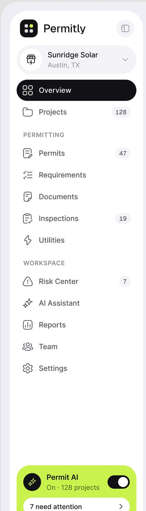
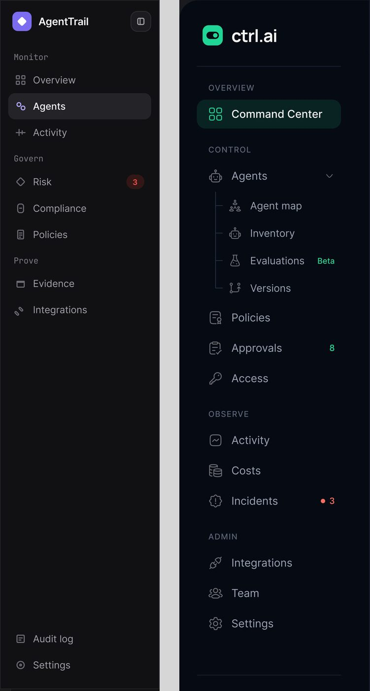
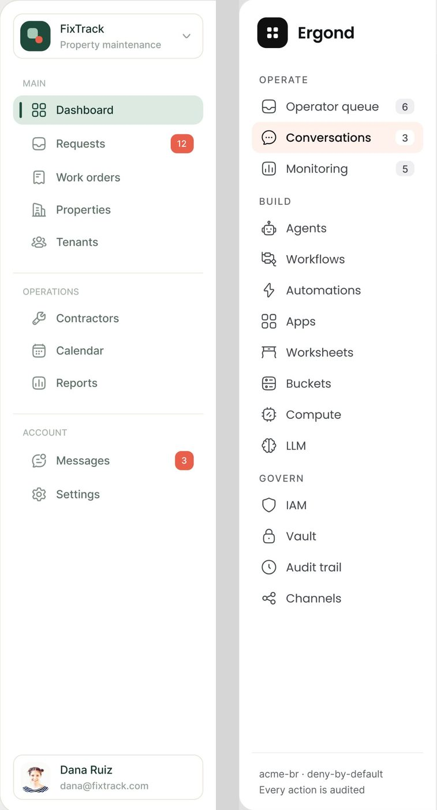
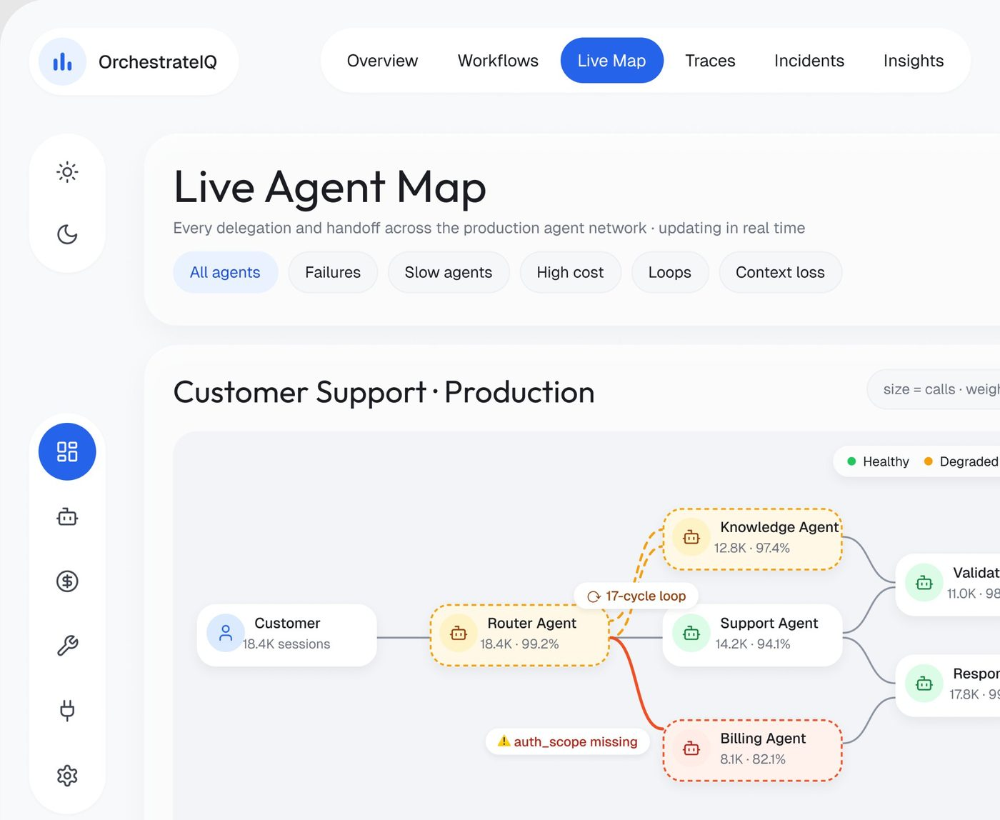
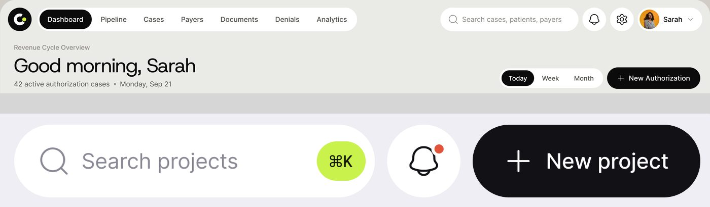
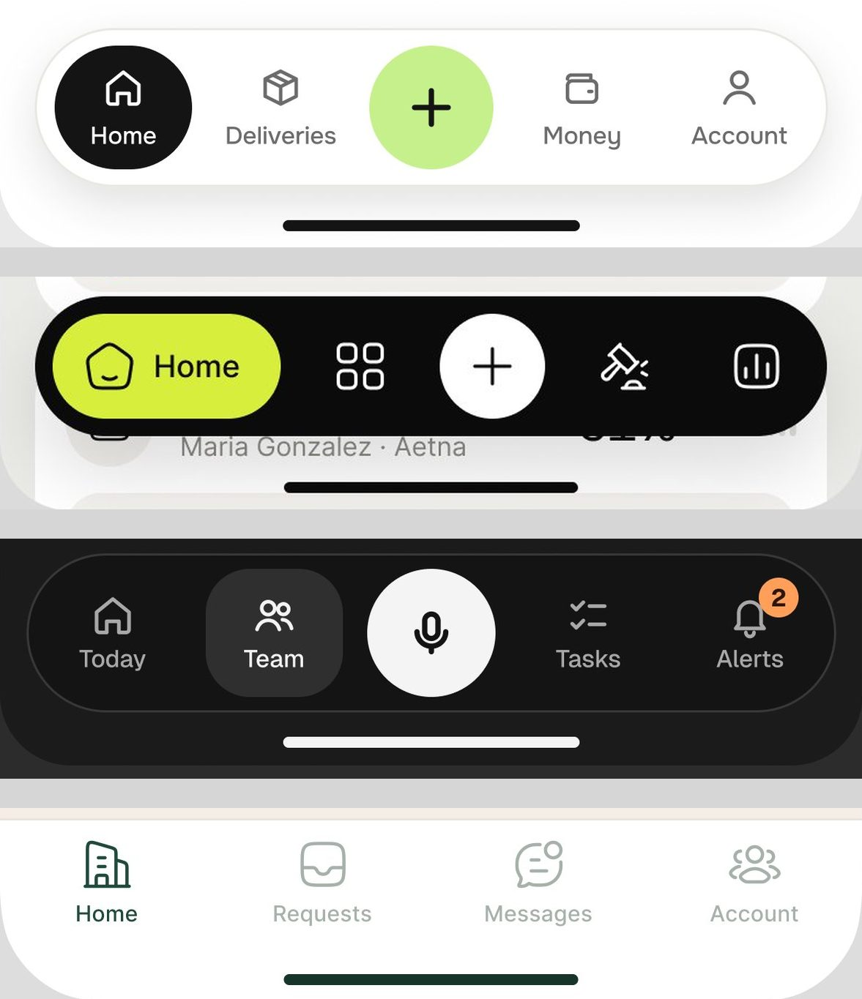

# Navegação

Como levar a pessoa de um lugar a outro dentro do produto, no estilo do método. São sete componentes:
barra lateral (sidebar), trilho de ícones (rail), abas de topo em pílula, abas segmentadas, trilha de
navegação (breadcrumb), barra inferior do celular e busca com atalho.

Escala e método estão no [README](README.md#escala-e-método). Resumo: as telas de desktop são quadros de
1440 px exportados a ~2,5x; toda medida abaixo já está convertida para px da tela original.

> **Fonte que manda.** O design system publicado do Permitly (claro) e do AgentPay (escuro): ver
> [design-system-publicado.md](../01-sistema-visual/design-system-publicado.md). Onde uma medida daqui bate
> com um token da folha, o token vem escrito ao lado; onde divergia, foi corrigida para o token.
> Tipografia confirmada: **Geist** em título e número, **Inter** no corpo até 16 px, **Geist Mono** em ID,
> hora e unidade.

---

## 1. Barra lateral (sidebar)

**O que é.** A coluna fixa à esquerda com a marca, o seletor de conta, os grupos de itens e um rodapé. É o
componente de navegação mais frequente do método: aparece em 28 das 61 telas examinadas **[OBSERVADO]**.

### Anatomia



1. **Marca**: ladrilho quadrado escuro com o símbolo + nome do produto em 18 a 20 px. À direita, às vezes um
   botão redondo de recolher a barra (Permitly, AgentTrail).
2. **Seletor de conta ou workspace**: cartão com ícone, nome em duas linhas (nome + cidade ou papel) e
   chevron para baixo.
3. **Rótulo de grupo**: texto pequeno em caixa alta e espaçado (OPERATE, BUILD, GOVERN), cinza médio. No
   Permitly é o token `label/11`: Inter Semi Bold 11 px, caixa alta, cor `text/muted` `#8A8996`.
4. **Item**: ícone de traço de 20 px + rótulo em Inter 13 a 14 px, peso médio (no Permitly o token é
   `medium/13`).
5. **Item ativo**: fundo preenchido (pílula preta, tint da cor da marca ou cinza no escuro).
6. **Contador**: número dentro de uma pílula ou quadradinho à direita do item.
7. **Rodapé**: usuário (avatar + nome + e-mail), um cartão de IA com toggle, ou uma linha de status.

### Medidas (px de tela)

| Parte | Permitly (fator 3,0) | FixTrack (fator 2,49) | Ergond (fator 2,55) | AgentTrail escuro (fator ~3,0) |
|---|---|---|---|---|
| Largura da coluna | 241 (painel `bg/panel` branco, raio 32, sobre `bg/canvas` `#EFEEF4`) | 257 (coluna, borda 1 px à direita) | 220 | 230 |
| Respiro lateral interno | 12 | 15 | 14 | 12 |
| Item ativo (L × A) | 216 × 38 **[MEDIDO]** | 226 × 34 **[MEDIDO]** | 190 × 35 **[MEDIDO]** | 208 × 38 **[MEDIDO]** |
| Raio do ativo | 19 (pílula inteira) | 12 | 8 | 10 |
| Passo entre itens | 39 | 40 | 34 | 37 |
| Cor do ativo | `#151517` (≈ `text/primary` `#111116` usado como fundo) texto branco | `#dcebe2` texto verde escuro | `#fdf2ee` (pêssego) | `#242328` |
| Contador | pílula `#f0eff4` (≈ `bg/card` `#F4F4F8`), 34 × 19, raio total | pílula vermelha `#e0533f`, 27 × 22, raio 6 | quadradinho `#f1f1f3`, 20 × 17, raio 5 | círculo `#331716` com número vermelho |

Fontes: Permitly, FixTrack, Ergond e
AgentTrail (duas telas). Todas **[MEDIDO]** por varredura de pixel, com o
fator de cada imagem calculado pela largura da janela (1440 px).

### Variações vistas

**a) Estado ativo.** Quatro receitas, em ordem de frequência **[OBSERVADO]**:

| Receita | Onde | Telas |
|---|---|---|
| Tint claro da cor do produto | Ergond (pêssego), FixTrack (verde), medspa (lilás `#ddd2fc`, 216 × 42, raio 13), ComplianceFlow, Sales Ask | 12 |
| Cinza sobre fundo escuro | AgentTrail (`#242328`), Vero, ctrl.ai (verde escuro `#0f2a24` com ícone verde) | 10 |
| Pílula preta com texto branco | Permitly, Mongi desktop, Edu.ai | 3 |
| Sólido na cor da marca | Haulsight (verde `#185833`, 208 × 36, raio 13), Automax, Castle | 3 |

**b) Barra vertical no ativo.** Só no FixTrack: traço de 2 × 17 px em `#1f4a39`, a 8 px da borda esquerda do
item, somado ao tint **[MEDIDO]**. Nas outras 25 telas o ativo é só o fundo.

**c) Rótulo de grupo.** Três estilos:
- caixa alta espaçada, 10 a 11 px, `letter-spacing` ~0,08em (Permitly, Ergond, FixTrack, ctrl.ai, medspa,
  Vero): 14 telas;
- monoespaçada em caixa de frase ("Monitor", "Govern", "Prove") no AgentTrail: 7 telas. É o traço que dá a
  cara "de ferramenta técnica" ao produto escuro;
- caixa de frase simples cinza (Haulsight, Mongi, ComplianceFlow): 4 telas.

**d) Sub-itens em árvore.** ctrl.ai: "Agents" abre filhos (Agent map, Inventory,
Evaluations, Versions) ligados por uma linha vertical fina com cotovelos, recuados ~24 px, e um selo de texto
verde "Beta" à direita.





**g) Sidebar do AgentPay**. É a versão escura que segue o
design system publicado: fundo `bg/shell` `#0E1013` sobre `bg/canvas` `#08090B`, rótulos de grupo em caixa
alta (AGENTS, MONEY, RULES, RECORD), ativo "Overview" em `bg/raised` com borda `line/soft`, contador
"7" em círculo azul `blue/500` `#2F6BFF`, e no rodapé um botão contornado vermelho "Emergency controls"
(a única ação destrutiva fica fixa no pé da navegação, à vista, e nunca no meio da lista).

**e) Rodapé.** Quatro tipos:
- cartão de usuário com borda (avatar 32 px, nome 14 px, e-mail 12 px): FixTrack, medspa, Mongi, Rillo,
  Castle (8 telas);
- cartão de IA colorido: Permitly ("Permit AI · On · 128 projects" com toggle preto, fundo lima `#cbf04c`),
  medspa ("Flow Assist" lima com botão "Review list"), Automax ("Upgrade Pro Plan") (3 telas);
- linha de status em texto: Ergond ("acme-br · deny-by-default / Every action is audited"), Haulsight
  (ponto verde "AI monitoring live · 2,481 shipments · synced 12s ago") (5 telas);
- dois links soltos (Audit log, Settings) colados no pé: AgentTrail, Vero.

**f) Divisores.** FixTrack e ctrl.ai separam grupos com uma linha de 1 px; Permitly, Ergond e AgentTrail
separam só com espaço (~22 px acima do rótulo).

### Quando usar

Produto com mais de 6 destinos e uso diário (governança, operação, CRM). Quando o produto tem 5 ou 6
destinos, troque a sidebar por abas de topo em pílula (OrchestrateIQ, PriorAuth, ResolveAI).

### Como reproduzir

```html
<aside class="w-[240px] shrink-0 bg-white rounded-[32px] p-3 flex flex-col gap-1 font-[Inter]">
  <div class="flex items-center gap-2 px-2 h-12">
    <div class="size-8 rounded-[9px] bg-neutral-900 grid place-items-center"><!-- símbolo --></div>
    <span class="text-[18px] font-medium font-[Geist]">Permitly</span>
  </div>
  <button class="flex items-center gap-3 h-[52px] px-2 rounded-full bg-[#E9E8F0] mb-2">
    <span class="size-9 rounded-full bg-white grid place-items-center"><!-- ícone --></span>
    <span class="text-left leading-tight"><b class="block text-[14px] font-medium">Sunridge Solar</b>
      <span class="text-[13px] text-neutral-500">Austin, TX</span></span>
  </button>
  <a class="flex items-center gap-3 h-[38px] px-3 rounded-full bg-[#151517] text-white text-[13px] font-medium">Overview</a>
  <a class="flex items-center gap-3 h-[38px] px-3 rounded-full text-[#55545F] text-[13px] font-medium">Projects
    <span class="ml-auto px-2 h-[19px] rounded-full bg-[#F4F4F8] font-[Geist_Mono] text-[11px] text-[#8A8996]">128</span></a>
  <p class="mt-5 mb-1 px-3 text-[11px] font-semibold tracking-[0.08em] uppercase text-[#8A8996]">Permitting</p>
  <!-- ... -->
</aside>
```

Regras que fecham a receita: ícone de traço 1,5 px em 20 px, sempre à esquerda e alinhado com o rótulo;
contador cinza neutro, e vermelho só quando o número é alerta (Requests 12, Messages 3 no FixTrack).

---

## 2. Trilho de ícones (rail)

**O que é.** Uma coluna estreita só com ícones, sem rótulo. Aparece em 9 telas: todas as do OrchestrateIQ
(7), Mortgage Flow e Fino **[OBSERVADO]**.



### Anatomia (OrchestrateIQ, fator 2,475)

1. **Cápsula de tema**: dois ícones (sol, lua) dentro de uma cápsula branca separada.
2. **Cápsula de navegação**: 6 ícones empilhados.
3. **Ativo**: círculo cheio azul `#2563ea` de 49 px com ícone branco **[MEDIDO]**.
4. **Cápsula de rodapé**: ajuda e sair, separada no pé da tela.

### Medidas

- Largura das cápsulas: 64 px; passo entre ícones: ~55 px; ícone 20 px, traço cinza escuro **[MEDIDO ±2 px]**.
- As cápsulas são brancas sobre o fundo `#f4f5f7` do app, com raio igual à metade da largura (32 px).

### Variações

- **Mortgage Flow**: um só trilho branco de canto a canto, ativo em quadrado roxo
  `#3a0dcc` de 52 px com raio 14 **[MEDIDO]**, pontinhos vermelhos de notificação sobre dois ícones, e o monograma
  "M" em círculo lilás no topo.
- **Fino**: trilho verde muito escuro, ativo em quadrado verde vivo com ícone
  branco, logotipo verde no topo.

### Como reproduzir

```html
<nav class="flex flex-col gap-4 w-16">
  <div class="rounded-full bg-white py-3 flex flex-col items-center gap-4"><!-- sol / lua --></div>
  <div class="rounded-full bg-white py-2 flex flex-col items-center gap-[14px]">
    <a class="size-[49px] rounded-full bg-[#2563eb] text-white grid place-items-center"><!-- ícone --></a>
    <a class="size-10 grid place-items-center text-neutral-700"><!-- ícone --></a>
  </div>
</nav>
```

---

## 3. Abas de topo em pílula

**O que é.** A navegação principal do produto em uma fileira horizontal, dentro de uma cápsula branca, com o
item ativo em pílula preenchida. Substitui a sidebar em produtos com poucos destinos. 9 telas
(OrchestrateIQ ×7, PriorAuth, ResolveAI) **[OBSERVADO]**.



### Anatomia

1. **Cápsula do logotipo** isolada à esquerda (OrchestrateIQ: ícone em círculo azul claro + nome, 180 × 55 px).
2. **Cápsula de abas**: fundo branco, raio inteiro, 5 a 7 rótulos em 14 px.
3. **Aba ativa**: pílula cheia. OrchestrateIQ azul `#2563ea`, 88 × 39 px **[MEDIDO]**; PriorAuth preta
   `#0a0a0a`, 106 × 40 px **[MEDIDO]**; ResolveAI preta.
4. **Grupo da direita** em cápsulas separadas: selo "Live" verde, seletor de período com ícone de
   calendário, botões redondos de busca e sino, cartão do usuário com avatar redondo, nome em duas linhas e
   chevron.

### Regra de composição

Cada grupo de controles é sua própria cápsula branca com o fundo do app aparecendo entre elas. A barra de topo
não é uma faixa contínua: é uma fila de ilhas **[OBSERVADO em 9 telas]**. Isso vale também para o trilho.

### Como reproduzir

```html
<header class="flex items-center gap-3">
  <div class="h-[55px] px-4 rounded-full bg-white flex items-center gap-2">…</div>
  <nav class="h-[55px] px-2 rounded-full bg-white flex items-center gap-1 text-[14px]">
    <a class="h-[39px] px-4 rounded-full bg-[#2563eb] text-white grid place-items-center">Live Map</a>
    <a class="h-[39px] px-4 rounded-full text-neutral-800 grid place-items-center">Traces</a>
  </nav>
  <div class="ml-auto flex gap-2">…</div>
</header>
```

---

## 4. Abas segmentadas (segmented control)

**O que é.** Troca de visão ou período dentro de um cartão ou página: "Today / 7 days / 30 days",
"Overview / Decision graph / Integrity", "Both of you / Sarah / James". É o controle de aba mais comum do método:
22 telas **[OBSERVADO]**.

### Anatomia

1. **Trilho**: cápsula de fundo levemente mais escuro que o cartão (claro: `#f0f0f4`; escuro: `#151518` com
   borda `#2a2a2e`).
2. **Segmento ativo**: pílula preta com texto branco (claro) ou cinza `#242328` com texto branco (escuro).
3. **Segmentos inativos**: texto cinza médio, sem borda.
4. **Contagem opcional** dentro do rótulo: "Active 16", "Exceptions · 2", "Needs Review 12".

### Medidas

- Permitly: segmento ativo 69 × 32 px, pílula inteira **[MEDIDO]**.
- PriorAuth: ativo 66 × 32 px, pílula **[MEDIDO]**.
- AgentTrail: trilho com borda de 1 px, raio ~10, ativo retangular arredondado
  (não pílula), altura ~33 px **[MEDIDO ±2 px]**.

### Variações

- Claro com ativo preto: Permitly, PriorAuth, Mortgage, Edu.ai, medspa, ComplianceFlow, Torin.
- Escuro com ativo cinza: AgentTrail (todas), Lepo.
- Chips soltos em vez de trilho: Ergond ("All channels" preto + "WhatsApp 18", "Email 7" contornados).

---

## 5. Trilha de navegação (breadcrumb)

**O que é.** Mostra onde a pessoa está e deixa voltar um nível. 19 telas **[OBSERVADO]**.

### Anatomia

1. **Botão de painel** (ícone de sidebar) à esquerda, no AgentTrail.
2. **Níveis anteriores** em cinza, 14 a 16 px.
3. **Separador**: chevron `›` (AgentTrail, Vero, OrchestrateIQ, ComplianceFlow) ou barra `/` (Ergond,
   ctrl.ai, Rillo).
4. **Nível atual** em branco/preto e peso médio.
5. **Selo de estado** colado ao nível atual: "Blocked" vermelho, "Monitor" âmbar, "Live" verde, "3 overdue"
   vermelho; ou um chip monoespaçado azul "v3 draft · v2 live" (Ergond).
6. **Contexto à direita** da barra: "Northwind Ltd · Production", "Support Agent · ag_7f2a91".

### Variações

- **Breadcrumb acima do título** (OrchestrateIQ trace e handoff: "Traces › tr_84926 › Handoff" em 12 px
  cinza, título grande logo abaixo).
- **Voltar + nome** (FixTrack Contractors, Mongi desktop): botão redondo com seta à esquerda e o nome da
  entidade como título.

---

## 6. Barra inferior do celular (bottom nav)

**O que é.** A navegação principal nos apps. 12 telas de celular, 5 com botão central de ação
**[OBSERVADO]**.



### Anatomia (Mongi, fator 2,97 pt/px)

1. **Cápsula flutuante** branca com sombra suave, 360 × 70 pt, a 16 pt das bordas laterais **[MEDIDO]**.
2. **Item ativo**: bloco preto de 63 × 57 pt, quase círculo, com ícone e rótulo brancos **[MEDIDO]**.
3. **Itens inativos**: ícone 22 pt sobre rótulo 13 pt, cinza escuro.
4. **Botão central de ação**: círculo lima `#c6ee8a` de 56 pt com "+" preto **[MEDIDO]**.

### Variações

| Variante | Onde | Receita |
|---|---|---|
| Cápsula clara, ativo preto, "+" lima no meio | Mongi (3 telas) | acima |
| Cápsula preta, ativo lima em pílula com rótulo, "+" em círculo branco | PriorAuth mobile | cápsula 360 × 65 pt; ativo 103 × 47 pt; "+" 48 pt **[MEDIDO ±2]** |
| Cápsula escura com borda, ativo cinza, microfone em círculo branco no meio | Lepo | o botão central é a ação principal do produto (gravar) |
| Barra de abas clássica, colada no pé, sem cápsula | FixTrack mobile, medspa, contractor, caregiver | ícone + rótulo; ativo só muda a cor (verde escuro, roxo, azul) |
| Cápsula clara, ativo em pílula com rótulo, "+" rosa à direita | Mental health | "+" fora do grupo |

### Regra

O botão central aparece quando o app tem uma ação dominante (criar entrega, criar autorização, gravar nota).
Quando não tem, vale a barra clássica **[INFERIDO]** a partir dos 12 casos.

---

## 7. Busca com atalho

**O que é.** Campo de busca em pílula com a dica do atalho de teclado dentro. 7 telas com atalho, 8 sem
**[OBSERVADO]**.

### Anatomia (Permitly, fator 3,0)

1. **Cápsula** branca, ~210 × 44 px, raio inteiro.
2. **Lupa** de traço, 20 px, cinza.
3. **Placeholder** "Search projects" em 15 px, cinza médio.
4. **Chip do atalho** "⌘K": pílula de 32 × 26 px **[MEDIDO]**. No Permitly vem em `lime/500` `#C9F24C`
   com texto `text/on-accent` `#141805` (a cor da marca); no Haulsight, medspa, Mortgage, Edu.ai e ComplianceFlow vem em cinza claro com borda.

Ao lado da busca vem quase sempre um botão redondo de sino (44 px, ponto vermelho de notificação) e o
botão primário da página ("New project", "New request", "Export report").

### Como reproduzir

```html
<label class="h-11 w-[300px] px-4 rounded-full bg-white flex items-center gap-2 text-[15px] text-neutral-400">
  <svg class="size-5">…</svg> Search projects
  <kbd class="ml-auto h-[26px] px-2 rounded-full bg-[#c9f24c] text-neutral-900 text-[12px] grid place-items-center">⌘K</kbd>
</label>
```
