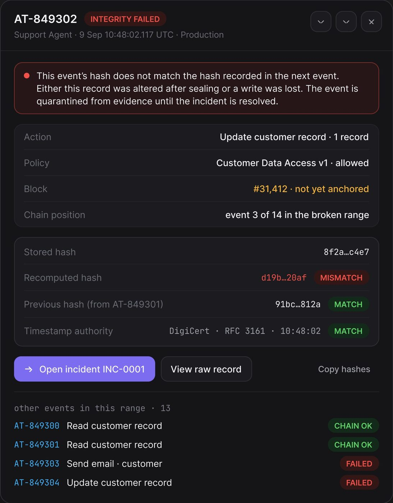
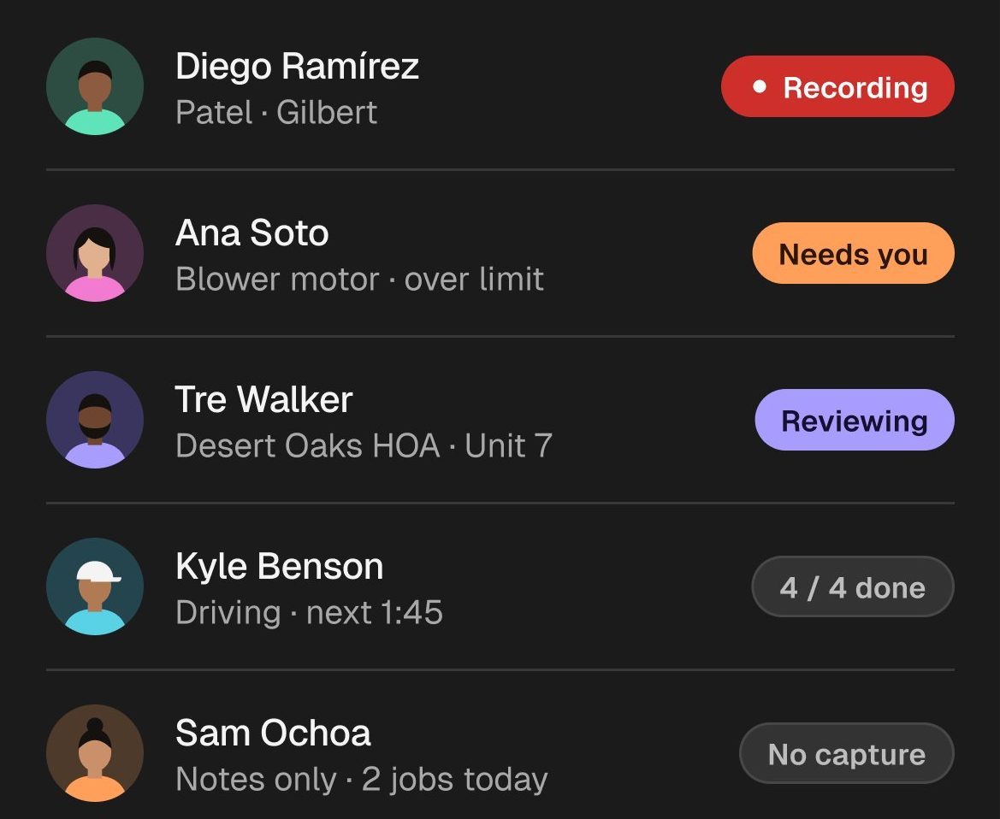
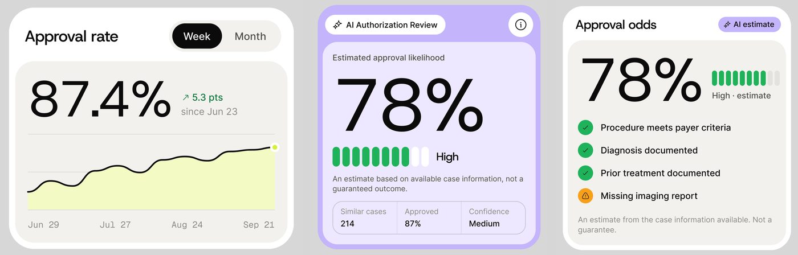
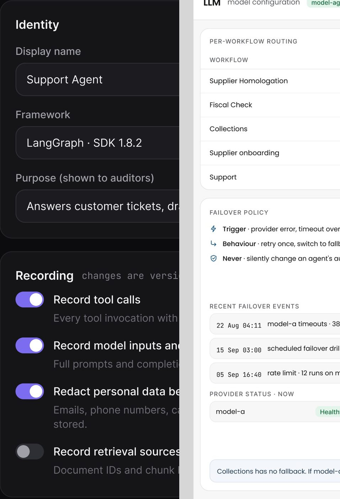

# Selos, chips e botões

Os componentes pequenos que carregam estado e ação: selo de status, tints por severidade, chip de metadado,
chip de filtro, botões (primário, secundário, fantasma, ícone ↗, destrutivo, par de decisão), toggle e
avatares empilhados.

Escala e método: [README](README.md#escala-e-método). Tokens oficiais:
[design-system-publicado.md](../01-sistema-visual/design-system-publicado.md). **Onde os dois divergem,
vale o token.**

---

## 1. Selo de status

**O que é.** A palavra curta que diz em que pé a coisa está ("Completed", "Needs you", "Blocked"). É o
componente mais frequente de todo o material: aparece em 35 das 61 telas **[OBSERVADO]**.



### A regra, escrita na folha **[CONFIRMADO]**

- **Tema claro** (Permitly): cada cor de estado é um trio `500` (sólido) / `tint` (fundo) / `700` (texto).
  **Selo = fundo `tint` + texto `700`, sem borda, pílula inteira.**
- **Tema escuro** (AgentPay): fundo `tint-14`, que a folha marca "alpha" (a cor a 14%), **borda de 1 px
  `border-40`** e texto na cor `400` sólida. *"Tints and lines carry their own alpha so binding never turns
  them solid."* A frase vale para os tints e as linhas; a borda do selo, não: o NOME diz 40, a folha marca
  "solid", e o hex medido (`#25614A`, `#6D552D`) equivale à cor a 40% sobre o painel **[MEDIDO]**.

| Estado | Claro (fundo / texto) | Escuro (fundo / borda / texto) |
|---|---|---|
| Atenção | `amber/tint` `#FCEFD8` / `amber/700` `#8A5A05` | `amber/tint-14` `#332D22` / `amber/border-40` `#6D552D` / `amber/400` `#F2B347` |
| Erro | `clay/tint` `#FBE3DE` / `clay/700` `#A33420` | grupo `red` existe, hex cortado no post |
| Marca / IA | `lime/tint` `#F0FBCD` / `lime/700` `#5F7A0E` | não se aplica |
| Sucesso | não impresso na folha clara | `green/tint-14` `#1A312C` / `green/border-40` `#25614A` / `green/400` `#3FCF8E` |

### Anatomia

1. **Ponto** de 6 px na cor do estado, opcional (em ~60% dos selos observados).
2. **Texto** Inter 12, peso médio, caixa de frase. Em produto técnico escuro vira CAIXA ALTA 11 px com
   espaçamento ("INTEGRITY FAILED", "CHAIN OK", "VERIFIED").
3. **Cápsula**: raio total, altura 22 a 26 px, respiro horizontal 10 px (`padding:4px 10px` na reconstrução em CSS desta biblioteca; a folha não traz CSS).

### Medidas observadas **[MEDIDO]**

| Onde | Selo | Tamanho | Cores |
|---|---|---|---|
| OrchestrateIQ, handoffs | "● Completed" | 92 × 23, pílula | `#dbfce7` / `#1a7740` (verde-100 / verde-700 do Tailwind) |
| OrchestrateIQ, handoffs | "● Slow" | pílula | `#ffeec2` fundo |
| Permitly, tabela | "High" | 47 × 26, pílula | sólido `clay/500` `#E1543A`, texto branco |
| Permitly, foto | "● Under review" | 110 × 25, pílula | sólido `amber/500` `#EDA122` (medido `#eba222`), ponto preto |
| AgentPay, decisões | "● Auto approved" | ~126 × 24, pílula | tint-14 + border-40 verde |
| FixTrack, needs attention | "Urgent" | 49 × 22, raio 8 | sólido `#e0533f`, texto branco |

### Variações

- **Sólido só no nível mais alto.** Permitly "High", FixTrack "Urgent", Lepo "Recording": o sólido marca
  o único item que não pode esperar; os demais usam tint **[OBSERVADO em 9 telas]**.
- **Retangular em vez de pílula** nos produtos anteriores ao design system publicado: FixTrack (raio 8),
  Ergond (raio ~4), Vero (raio ~3). Nos produtos mais recentes, com o sistema publicado, é pílula.
- **Contornado neutro** para estado sem cor: Lepo "4 / 4 done", "No capture"; PriorAuth "Review case".
- **Colado ao título** (breadcrumb ou cabeçalho): "Blocked", "Monitor", "Live", "3 overdue", "Context
  complete".



### Como reproduzir (CSS do próprio design system)

```css
.badge { background:var(--amber-tint); color:var(--amber-700); border-radius:999px;
         font:500 12px/1 "Inter"; padding:4px 10px; display:inline-flex; align-items:center; gap:6px; }
.badge::before { content:""; width:6px; height:6px; border-radius:50%; background:currentColor; }
[data-theme="dark"] .badge { background:rgb(242 179 71 / .14); color:#F2B347;
                             border:1px solid rgb(242 179 71 / .40); }
```

---

## 2. Tints por severidade

**O que é.** O mesmo trio de cor aplicado em tudo que carrega gravidade: selo, ladrilho de ícone, fundo de
linha, célula de mapa de calor, faixa de alerta. 35 telas **[OBSERVADO]**.

| Uso | Exemplo | Receita |
|---|---|---|
| Ladrilho de ícone | FixTrack needs attention | fundo tint (verde `#d8e9df`, rosa `#fce1e6`, bege `#f0ece3`), ícone no tom escuro da mesma cor |
| Linha inteira | Ergond, item escalado | fundo pêssego `#fdf0ec`, sem borda |
| Faixa de alerta | Ergond "Out of authority…"; AgentTrail "This event's hash does not match…" | fundo tint, borda 1 px na cor a 40%, ponto ou ícone de alerta, texto de frase inteira |
| Célula de heatmap | AgentTrail risco | fundo `#423219` a `#503c1b` (âmbar) e `#4d2525` a `#5a2827` (vermelho) com borda na mesma cor mais clara |
| Nó de grafo | OrchestrateIQ Live Map | nó degradado `#fff6d9` com borda tracejada âmbar; nó em falha `#fff2ec` com borda tracejada vermelha |

A regra que amarra tudo: **a cor da gravidade nunca aparece sozinha em área grande.** Área grande recebe o
tint; o sólido fica para o ponto, o ícone ou o selo mais alto **[OBSERVADO]**.

---

## 3. Chip de metadado com ícone

**O que é.** Um fato curto sobre o item, com ícone: tempo estimado, quantidade, credencial, fonte. 9 telas
**[OBSERVADO]**.

| Variante | Onde | Receita |
|---|---|---|
| Branco sobre cor | OrchestrateIQ "Do first" | pílula branca 32 px, ícone 16 + "2 workflows", "~2 min" |
| Contornado sobre branco | OrchestrateIQ cartões seguintes | pílula com borda 1 px, mesmo tamanho |
| Confiança | OrchestrateIQ "Detected" | pílula cinza clara de ~18 px, ícone de check em quadrado + "92% confidence" |
| Credencial | FixTrack Contractors | pílula com borda verde clara, ícone de check em círculo + "Licensed", "Insured to $2m", "W-9 on file" |
| Fonte da decisão | Vero, registro de decisão | chip cinza pequeno com ícone de documento + "Invoice", "Product event" |
| Identificador | Permitly, cartão com foto | pílula branca com ícone + "PL-2841" em Geist Mono |
| Tag contável | App de bem-estar | pílula contornada rosa com texto rosa: "Deadlines · 3", "Customer escalations · 2", "Sleep · 2" |

---

## 4. Chip de filtro e seletor

**O que é.** O controle que recorta a lista. 15 telas **[OBSERVADO]**.

- **Chips de alternância** (OrchestrateIQ Live Map): "All agents" ativo em tint azul `#eaf4ff` com texto
  azul, os outros ("Failures", "Slow agents", "High cost", "Loops", "Context loss") em branco com borda;
  pílula de 35 px **[MEDIDO ±2]**.
- **Seletor com chevron** (Vero, FixTrack, medspa, AgentPay "This month ⌄"): rótulo + valor + chevron, com
  ícone de calendário quando é data. No escuro: fundo `bg/panel`, borda `line/soft`, raio 8 a 10 (controle).
- **Seletor "chave · valor"** (AgentTrail): "Platform · All ⌄", "Owner · All ⌄"; o que está aplicado vira
  roxo tint ("Environment · Production ⌄").
- **Chip com contagem e ponto** (Haulsight): "● On schedule 2,444", "● At risk 29", "● Critical 8" em
  pílulas contornadas sobre o mapa.

---

## 5. Botões



### 5.1 Primário

**Receita.** Cápsula cheia, ícone de 16 a 20 px à esquerda, texto Inter 14 a 15 peso médio. 40 a 48 px de
altura no desktop, 48 a 56 pt no celular.

| Produto | Cor | Tamanho | Raio |
|---|---|---|---|
| Permitly "+ New project" | preto `#111113` | 149 × 48 | total **[MEDIDO]** |
| PriorAuth "+ New Authorization" | preto `#0d0d0d` | 189 × 43 | total **[MEDIDO]** |
| OrchestrateIQ "Open Agent Detail" | azul `#2563ea` | 285 × 49 (largura do painel) | total **[MEDIDO]** |
| AgentPay "+ New agent" | `blue/500` `#2F6BFF` | ~133 × 41 | ~10 (controle: *"controls 8 to 12"*) **[MEDIDO]** |
| FixTrack "+ New request" | verde `#1c4b3b` | 132 × 41 | 10,5 **[MEDIDO]** |
| AgentTrail "+ Log risk", "Open incident" | roxo `#7d70dc` | ~40 de altura | ~8 |
| Permitly "Review risks" (dentro do cartão preto) | `lime/500` | 114 × 39 | total |

**Regra de raio.** Produto leve e claro usa botão em pílula; produto denso e escuro usa retângulo de raio 8 a
12. Está escrito nas duas folhas **[CONFIRMADO]** e as telas confirmam **[OBSERVADO em 14 telas]**.

### 5.2 Secundário

Mesma forma do primário, fundo neutro: cinza `#f3f4f6` com ícone (OrchestrateIQ "↶ Back to trace",
"Export snapshot"), branco com borda (PriorAuth "Review case", 111 × 37 px; FixTrack "Filter"), escuro com
borda `line/soft` (AgentPay "Export", AgentTrail "Export register"). Fica sempre à esquerda do primário.

### 5.3 Fantasma e link

- "↗ View all" em pílula cinza clara sem borda (OrchestrateIQ, 90 × 32 px aprox.).
- Link de texto com chevron: "Open approval center ›" em azul (AgentPay), "View all 8 in Exceptions"
  sublinhado (Haulsight), "View all activity ↗" (Mortgage).
- Texto puro no canto: "Copy hashes" (AgentTrail), "I got stuck" sublinhado (Torin).

### 5.4 Botão de ícone ↗

O botão que leva ao detalhe. Três formas **[MEDIDO]**:
- quadrado com borda, 26 px, raio 5 (FixTrack, em todos os cartões);
- círculo branco de 36 px sobre cartão colorido (PriorAuth, Mongi, Permitly);
- círculo com borda de 36 px (Mortgage "Action required", "Case activity").

Botões de ícone da barra de topo (sino, busca, "…") são círculos de 40 a 44 px, com ponto vermelho de 8 px
no sino quando há notificação.

### 5.5 Destrutivo

Nunca cheio de vermelho. É contorno vermelho com texto vermelho: Mongi "Suspend rider", AgentPay
"Emergency controls" (fixo no rodapé da sidebar), ou texto vermelho centralizado numa linha de lista (Torin
"Cancel Free Trial") **[OBSERVADO em 4 telas]**.

### 5.6 Par de decisão

Dois botões de largura parecida lado a lado no pé da tela ou do cartão, o que confirma em destaque:
- Lepo: "✎ Correct" (cinza escuro com borda) + "Confirm" (branco), 56 pt de altura, pílula.
- Torin: "Home" (branco) + "Review 3 charges" (preto).
- Bem-estar: "Try Box breathing" (pílula em degradê rosa-lilás) + "See pattern" (branca).
- Ergond: "Hand back to agent" (cinza) + "Send" (preto), dentro do campo de mensagem.

---

## 6. Toggle

**O que é.** Liga e desliga uma regra. 5 telas **[OBSERVADO]**.



| Onde | Ligado | Desligado | Tamanho |
|---|---|---|---|
| AgentTrail, Recording | trilho `#7c6cf0`, botão branco | trilho `#2e2f34`, botão `#a1a1a9` | 36 × 19 px, pílula **[MEDIDO]** |
| Permitly, cartão Permit AI | trilho preto, botão branco, sobre `lime/500` | não visto | ~40 × 24 |
| Automax, cartões de fluxo | trilho roxo | trilho cinza | pequeno, no rodapé do cartão |

Regra de uso: o toggle vem SEMPRE com título + frase que explica a consequência embaixo ("Record tool calls
/ Every tool invocation with arguments and result summary"), e o grupo mostra quantas mudanças ainda não
foram salvas ("unsaved changes · 2" em Geist Mono âmbar).

---

## 7. Avatares empilhados

**O que é.** Quem está envolvido, sem ocupar uma lista. 5 telas **[OBSERVADO]**.

- **Barra de topo** (FixTrack): 4 fotos de ~33 px com anel branco de 2 px,
  sobrepostas ~7 px, seguidas de um círculo verde escuro com "+" **[MEDIDO ±2]**.
- **Agentes** (OrchestrateIQ "Do first"): ícones de agente em círculos tint sobrepostos + círculo branco com
  a contagem ("6").
- **Conta conjunta** (Mortgage): duas fotos sobrepostas + "Sarah Carter / Joint with James".
- **Cartão de tarefa** (Smart Task Boards): 2 a 3 avatares minúsculos + contador.

```html
<div class="flex -space-x-[7px]">
  
  <button class="size-[33px] rounded-full ring-2 ring-white bg-[#1c4b3b] text-white grid place-items-center">+</button>
</div>
```
