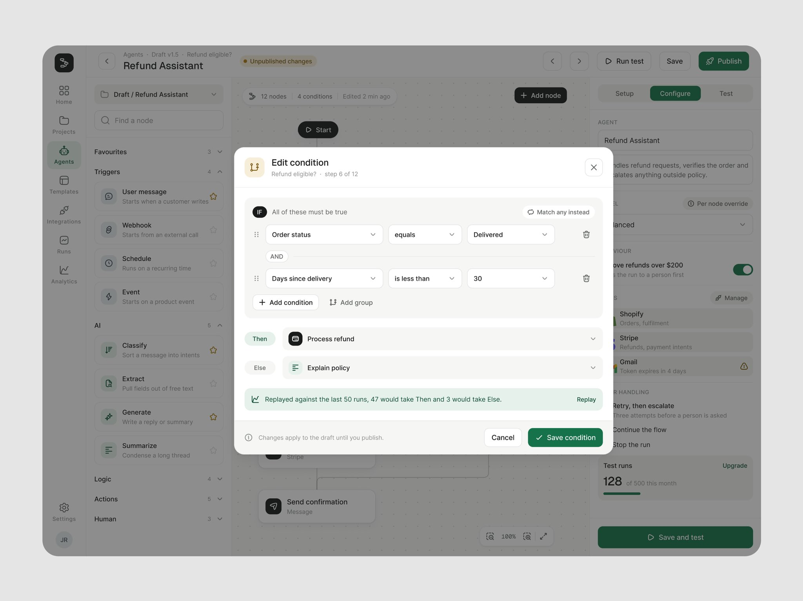
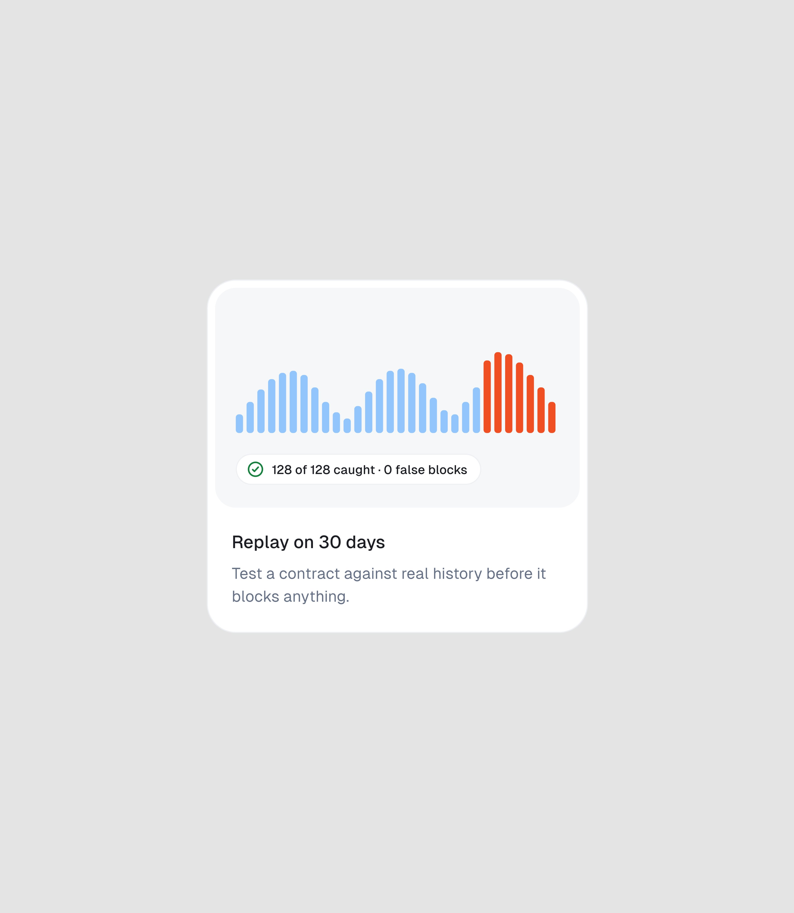
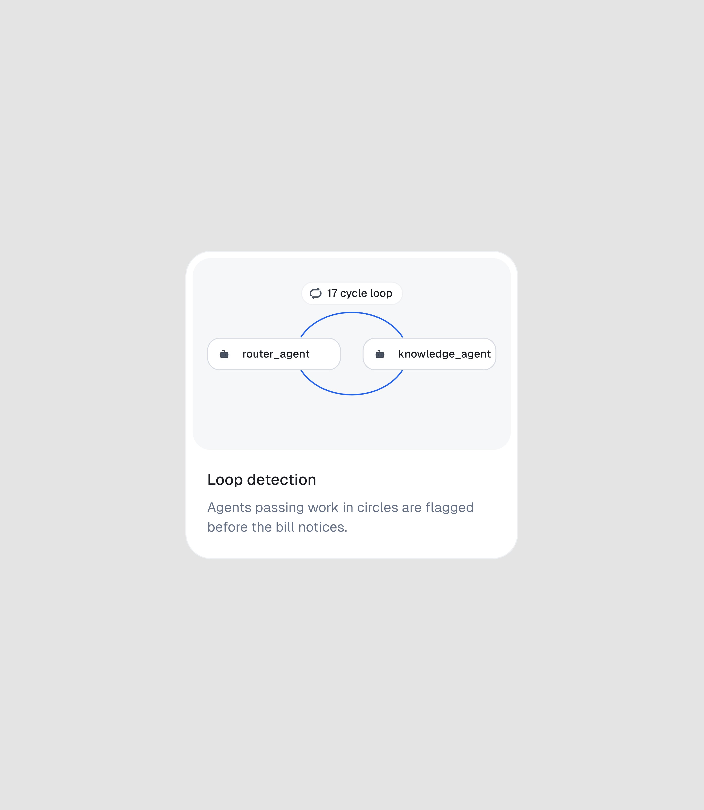
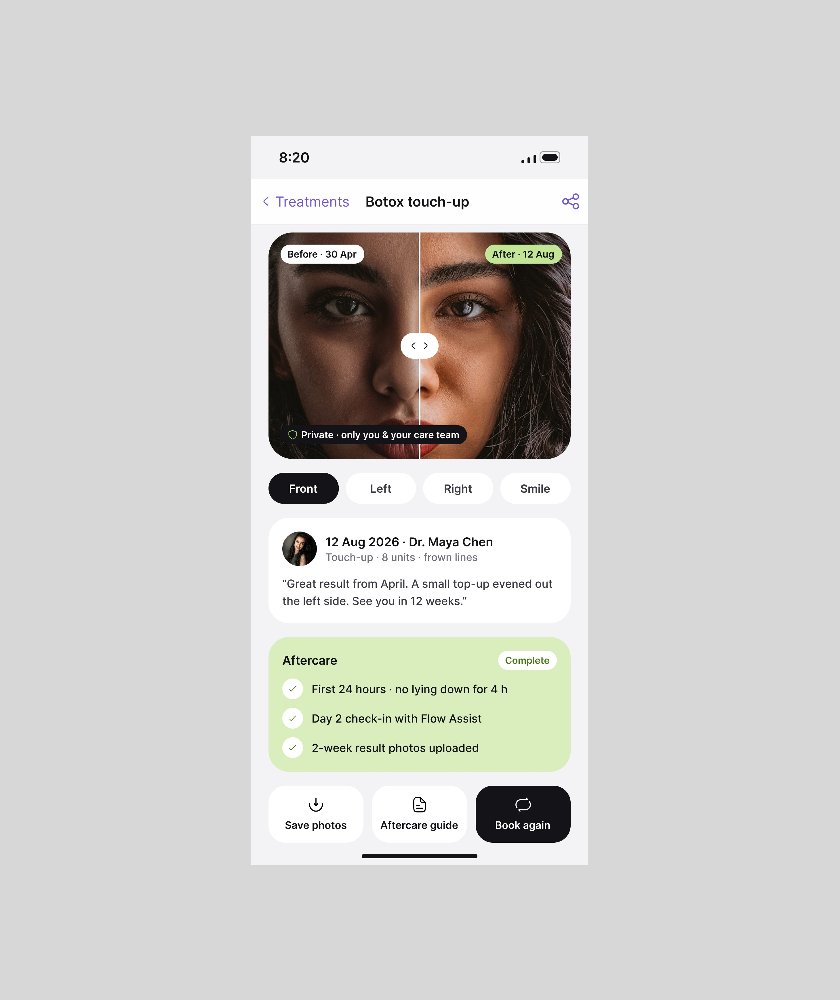
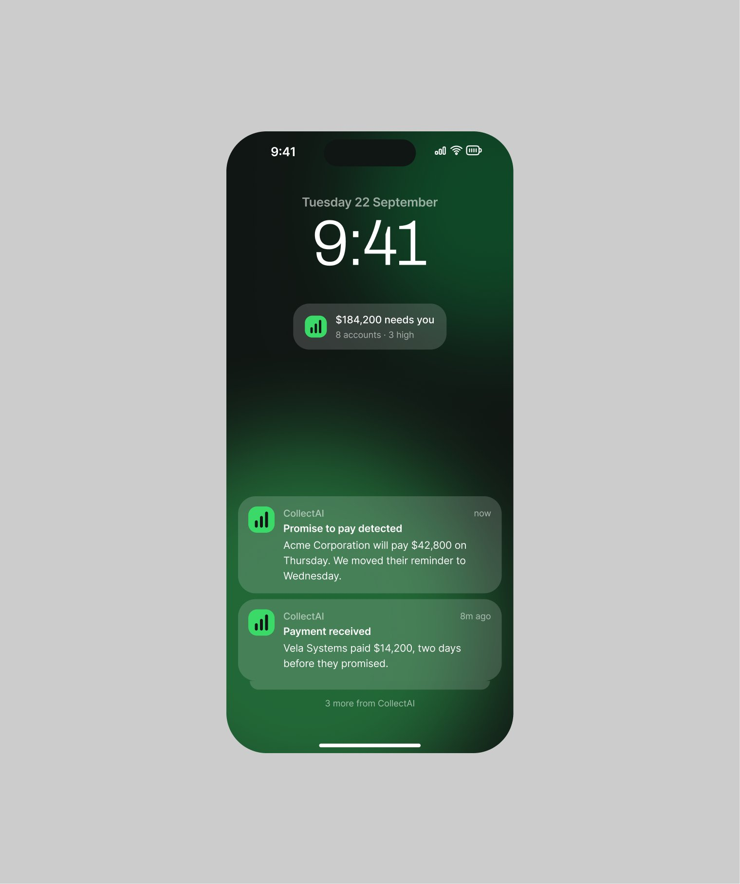

# Sobreposições, cartões isolados e outras peças

Componentes que aparecem nas séries mais recentes e completam o catálogo. Cada um com anatomia,
onde aparece e como reproduzir. Medidas em proporção da peça quando a imagem é recorte e não dá
fator confiável. **[OBSERVADO nas telas citadas]**

## 1. Popup de decisão centralizado

Modal branco de raio do nível de cartão, centrado sobre a tela inteira **escurecida** (véu cinza
uniforme, sem desfoque), com: ícone em ladrilho no canto superior esquerdo, título em frase, uma
linha de contexto, o conteúdo da decisão, e o rodapé com o cancelar fantasma à esquerda do botão
principal na cor do produto. Cinco deles renderam como peça própria
(*"How clean is this popup ui design?"*, 30.865 views; *"Popup design!"*, 14.939; *"Clean popup design
and easy decision-making."*; *"Popup design, dark UI!"*; *"Logic builder popup design..."*).

| Onde | O que decide | O que tem de próprio |
|---|---|---|
| "Refund Assistant" — Edit condition | a regra de um ramo | o replay "47 would take Then and 3 would take Else" logo acima do rodapé |
| Clawback — Invite teammate | quem entra e com que papel | papéis em rádio com a frase do que cada um faz; filial e limite de envio |
| CaseDraft — Demand letter finalized | (sucesso) o que foi gerado | lista do que saiu e dois caminhos: Download PDF / Send to adjuster |
| AgentPay — New wallet (escuro) | o limite de um agente | de onde sai o dinheiro e quanto sobra, escritos antes de criar |
| FixTrack — Send the job to Mike's Plumbing | o envio ao prestador | o que cada um recebe, escrito pelo sistema e editável |

**Como reproduzir:** véu `rgba` do texto principal a cerca de 40% sobre a tela; modal com largura de
480 a 560 px em tela 1440; padding da escala grande; o botão principal é o único colorido.

## 2. Popup de notificações ancorado

Painel suspenso que sai do sino, com abas em pílula (All, Incidents, Fixes, System), cada aviso
em uma linha com ícone de estado, título, uma linha de contexto e a hora à direita, e no pé
"Notification settings" e "View all activity". O fundo da página fica escurecido como no popup de
decisão. Peça própria: *"Not an overwhelming notification pop-up design, right?"* (OrchestrateIQ,
7.501 views). 

## 3. Barra flutuante de seleção

Barra preta em pílula que aparece no pé da tabela quando há linhas marcadas: contagem e soma ("2
selected · $4,670 · both Carrier"), a ação em lote em botão branco ("Submit to Carrier") e o fechar.
É a única peça escura da tela. (Clawback, Claims.)

## 4. Cartão de recurso (ilustração + título + frase)

Cartão branco de cantos grandes com uma **ilustração feita da própria interface** na metade de cima
(barras de custo, barras de replay com o trecho final em vermelho, dois nós em loop) sobre fundo
cinza-claro, e embaixo um título curto e uma frase de uma linha e meia. Serve a landing e a peça de vitrine:
*"Card design with clear description! Isn't it?"* (8.913 views, 181 salvos); um deles virou vídeo de
4:5 que abre o detalhe no lugar.

## 5. Cartão isolado como peça

Um único cartão do produto, recortado com a sombra e a borda, centrado num quadro de retrato cinza
ou preto. Publique em trios: três cartões, três decisões (CaseDraft: exportar, revisão final,
visitas; PriorAuth: taxa de aprovação, revisão da IA, chance de aprovação; AgentTrail: pesos,
evidências, integração; Rillo: autonomia, extrato, empresa). Ver o formato em
[../05-apresentacao/sequencia-do-post.md](../05-apresentacao/sequencia-do-post.md).

## 6. Seletor de quantidade (−/+)

Linha com o nome da etapa e o guia embaixo ("Guide: up to 1.0 h"), e à direita um grupo de três
peças: botão −, valor em mono ("0.5 h"), botão +. O total fica num bloco no fim da lista. (Clawback,
detalhamento de mão de obra.) 

## 7. Comparador antes e depois

Foto partida ao meio com a alça circular no centro, rótulos "Before · 30 Apr" e "After · 12 Aug" nos
cantos, seletor de ângulo em pílulas embaixo (Front, Left, Right, Smile) e o aviso de privacidade.
(Medspa, perfil da cliente e app do paciente.)

## 8. Tela de bloqueio com widget e notificação acionável

O produto aparece fora dele: widget na tela de bloqueio com o número do dia ("$184,200 needs you",
"Dog Cap launch · ROAS 4.2x") e notificações com dois botões de resposta ("All good" / "Reply",
"Dismiss" / "Open chat"). Primeira tela do trio de celulares em CollectAI, AdStudio, Medspa, Permitly
e AgentPay. 

## 9. Cartão de kanban

Cartão branco numa coluna de etapa: título do pedido, quem, o logo do terceiro (plano de saúde), o
número que decide (chance de aprovação "78%" com barrinhas coloridas pela faixa) e duas células no
pé (o que falta, o prazo). Em Bolton: selo de área colorido, frase do problema, prazo, valor por ano
em mono e avatares.

## 10. Cabeçalho com foto do objeto

O topo do detalhe leva a foto real do objeto (o prédio, o imóvel) com o nome grande e os números
dele numa linha. Em FacilityOS o nome vem também em árabe. Em LeaseFlow, a grade de imóveis usa a
mesma foto como capa do cartão.

