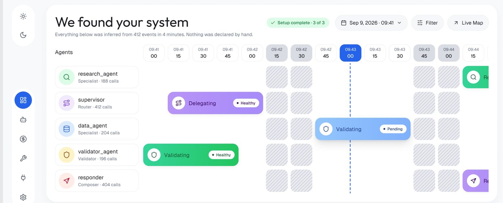
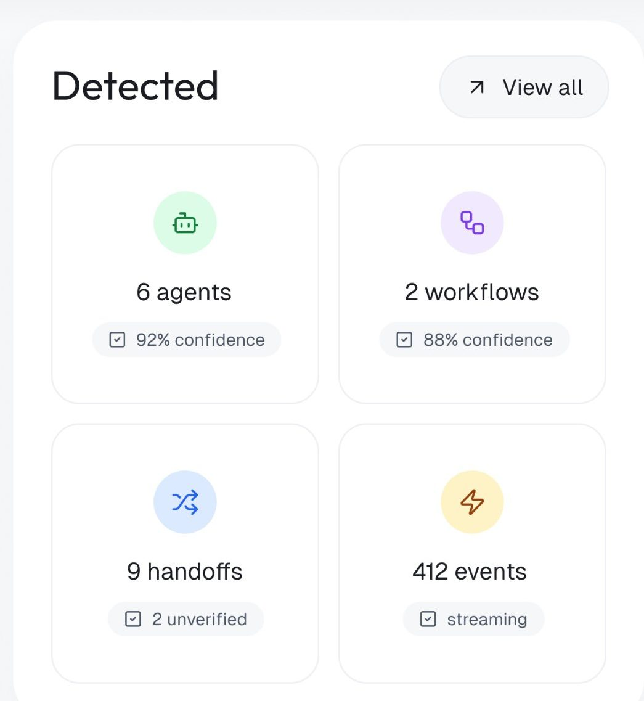
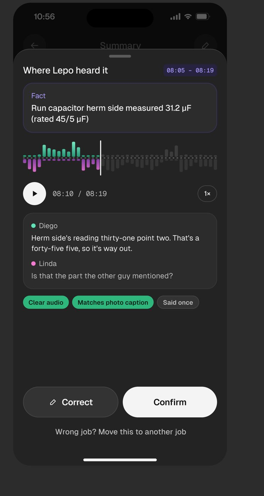
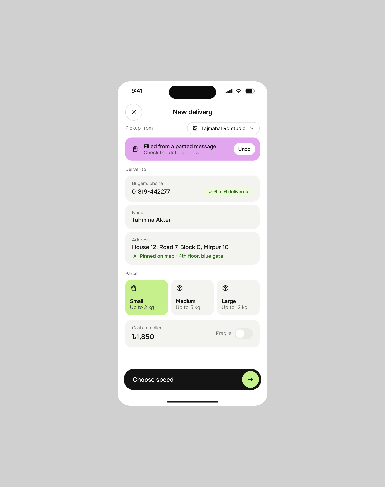
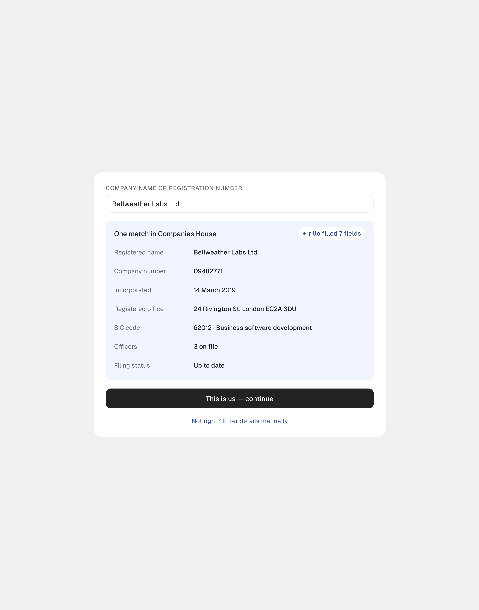
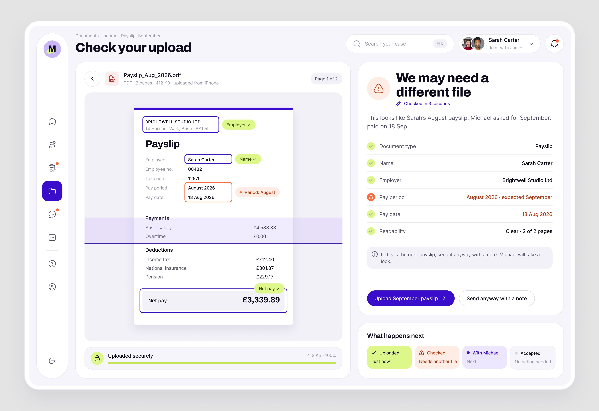

# 01 · A IA descobre, o humano confirma

## O que é

Em vez de pedir que a pessoa configure o sistema (cadastre agentes, declare fluxos, preencha
campos), a IA **observa, infere e apresenta o resultado pronto**, dizendo de onde tirou e quanto
confia. A pessoa só confirma, corrige ou dá nome.

## Problema que resolve

O onboarding de ferramenta técnica costuma ser um formulário longo antes de qualquer valor. É o
oposto da regra de onboarding do método: "users experience
success before they experience confusion". Aqui a primeira tela já é o sucesso: "We found your
system".

## Anatomia (OrchestrateIQ, 78.682 views, 865 salvos)



1. **Título que narra o feito da IA, na primeira pessoa do plural:** "We found your system".
2. **Subtítulo que dá a prova e a regra do jogo:** "Everything below was inferred from 412
   events in 4 minutes. Nothing was declared by hand." Três números concretos (412 eventos,
   4 minutos) e uma frase que diz o que o usuário **não** precisou fazer.
3. **Selo de progresso de setup, já concluído:** chip verde "✓ Setup complete · 3 of 3".
4. **A descoberta mostrada como dado, não como texto:** linha do tempo por agente (colunas de
   15 s, "09:41 00" a "09:44 15"), com blocos de atividade ("Delegating · Healthy",
   "Validating · Pending") e um marcador vertical azul no "agora" (09:43 00).
5. **Cada entidade descoberta com o papel inferido e a evidência:** "supervisor · Router · 412
   calls", "validator_agent · Validator · 196 calls". O papel (Router, Specialist, Validator,
   Composer) foi deduzido, e o número de chamadas é a prova.
6. **Card "Detected"** com a contagem por tipo e a confiança de cada uma (ver padrão 03):
   "6 agents · 92% confidence", "2 workflows · 88% confidence", "9 handoffs · 2 unverified",
   "412 events · streaming".
7. **Card "Next steps"** com o que só o humano pode fazer (ver padrão 02): dar nome aos
   workflows, definir orçamento, convidar o plantão.



## Medidas **[MEDIDO, fator ~2,47]**

- Título "We found your system": altura de tinta de 88 px no 4096 (inclui descendente de "y"),
  o que dá **~36 px de corpo** na tela original.
- Subtítulo: tinta de 28 px, **~12 px de corpo**, cinza médio.
- Chip de confiança "92% confidence": 307 × 56 px no 4096, ou **~124 × 23 px**; fundo
  `#EFF7FA`, ícone de checkbox pequeno à esquerda, texto ~12 px.
- Azul primário da navegação: `#2866ED`. Chip "Live": fundo `#E2FAEA`.

## Variações

| Produto | Como a IA "descobre" | Como o humano confirma |
|---|---|---|
| OrchestrateIQ | infere agentes, papéis e handoffs a partir de eventos | dá nome aos workflows ("Name workflows"), confirma pelo assistente ("Explain graph") |
| Lepo | extrai um "Fact" da gravação: "Run capacitor herm side measured 31.2 µF (rated 45/5 µF)" | botões **"Correct"** e **"Confirm"**, mais "Wrong job? Move this to another job" |
| Vero | deriva oito campos do lead a partir de e-mail, reunião e ligação | "Pinned · Marco, 4 Aug": o humano fixa um valor e a IA para de derivar aquele campo |
| Torin | "Your first audit · Fri, Sep 11": acha 16 assinaturas em Chase + PayPal | "Review 3 charges" (as que ela não tem certeza) |
| Rillo | "rillo cleared 148 on its own today and held 3 it could not corroborate" | a fila de 12 decisões (padrão 07) |



## Quando usar

Na **primeira tela** de um produto de agentes (OrchestrateIQ), no **primeiro uso** de um app de
consumo (Torin, "Your first audit"), e em **cada fato extraído** quando o fato vai virar registro
oficial (Lepo, Vero). **[OBSERVADO em 5 produtos]**

## Como reproduzir

1. Título no passado, com a IA como sujeito coletivo: "We found…", "We noticed…", "What we
   noticed" (Torin).
2. Subtítulo com **a fonte + o tempo + o que o usuário não precisou fazer**. Molde:
   `Everything below was inferred from {N} {fonte} in {tempo}. Nothing was declared by hand.`
3. Cada item descoberto: nome · papel inferido · evidência numérica (`Router · 412 calls`).
4. Cada grupo descoberto com um chip de confiança ou de verificação (padrão 03).
5. Um par de ações por fato quando o fato vira registro: **Confirm** (primário, claro sobre
   escuro) e **Correct** (secundário, com ícone de lápis). Nunca só "OK".
6. Deixar o humano **fixar** um valor ("Pinned") e mostrar quem fixou e quando. Valor fixado
   sai do alcance da IA.

```html
<header class="found">
  <h1>We found your system</h1>
  <p>Everything below was inferred from <b>412 events</b> in <b>4 minutes</b>. Nothing was declared by hand.</p>
  <span class="chip chip--ok">✓ Setup complete · 3 of 3</span>
</header>
<!-- .chip--ok { background:#E2FAEA; color:#157A3C; border-radius:999px; padding:4px 10px; font-size:12px } -->
```

## Mais exemplos

Telas de outras séries que repetem ou estendem o padrão (fichas em [../06-produtos/](../06-produtos/README.md)).

- **Mongi, nova entrega** — a faixa lilás "Filled from a pasted message · Check the details below" com **Undo**: a IA preencheu o pedido a partir da mensagem colada pelo vendedor e a pessoa só confere.
  
- **Rillo, onboarding** — "One match in Companies House" com "rillo filled 7 fields" e "This is us — continue"; o extrato lido com os campos em mono e "Confirm and continue".
  
- **Mortgage Flow, "Check your upload"** — a conferência do holerite "Checked in 3 seconds": o que bate em verde, o que não bate em laranja (período de agosto, não setembro), e a escolha entre mandar o certo ou "Send anyway with a note".
  
- **Clawback, detalhe do claim** — "88% Claim readiness · 2 items block submission" com cada evidência ligada ao arquivo que a prova e o "1 mismatch" marcado na prévia da fatura.
  
