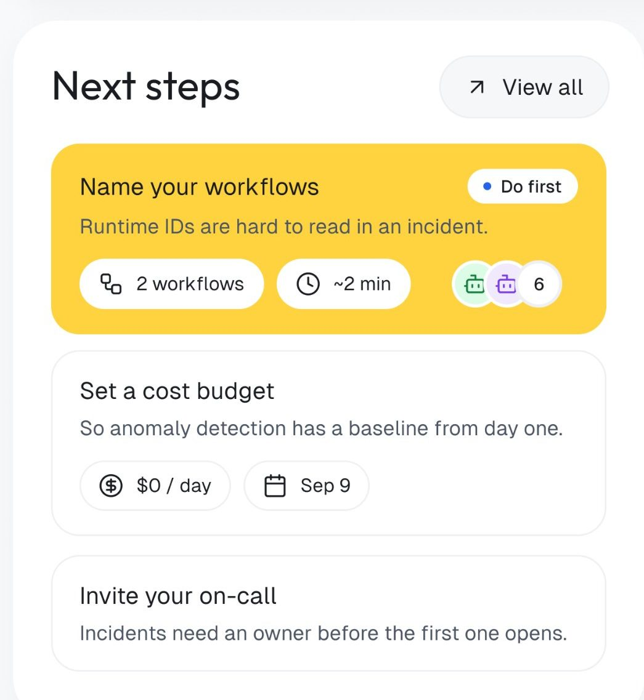
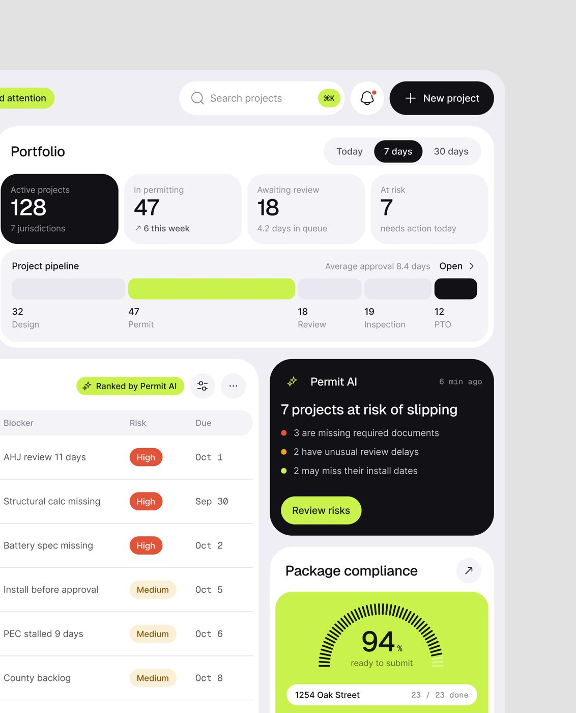
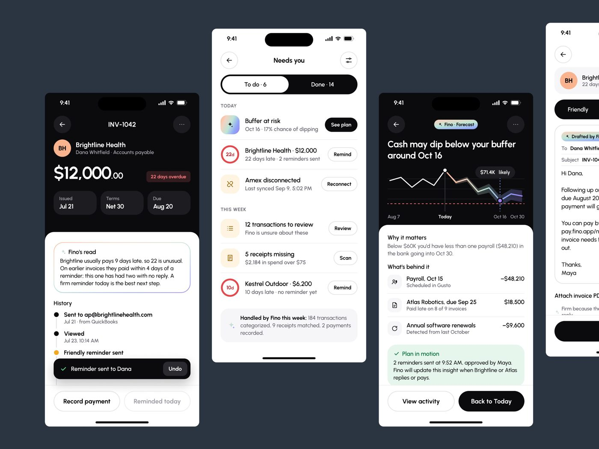
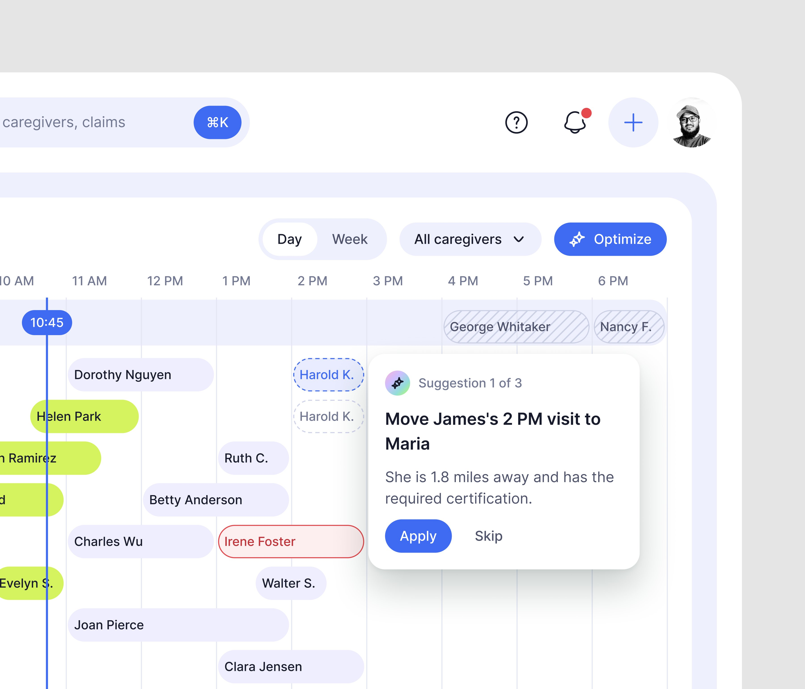

# 02 · Próximo passo priorizado

## O que é

Uma lista curta de ações que **só o humano pode fazer**, ordenada, com a primeira destacada
("Do first") e cada item explicando **por que** importa e **quanto custa** fazer. A IA já fez o
resto; esta lista é o que sobrou para a pessoa.

## Problema que resolve

Painel de dados responde "o que está acontecendo?", mas a pessoa quer saber "o que eu faço
agora?". Em uma linha: "Good dashboards don't show more data. They help you make better
decisions." O próximo passo transforma o painel em lista de
decisões.

## Anatomia (OrchestrateIQ)



- **Título do card:** "Next steps" + botão "↗ View all".
- **Item 1 em destaque total:** fundo amarelo `#FFD33F` (medido), título "Name your workflows",
  razão "Runtime IDs are hard to read in an incident.", pílula "● Do first" no canto.
- **Metadado de esforço em pílulas brancas:** "2 workflows" (escopo) e "~2 min" (tempo), mais
  um grupo de avatares de agentes afetados com contador "6".
- **Itens 2 e 3 em card branco com borda:** "Set a cost budget · So anomaly detection has a
  baseline from day one." com pílulas "$0 / day" e "Sep 9"; "Invite your on-call · Incidents
  need an owner before the first one opens."

Repare na estrutura de cada item: **verbo no imperativo + objeto** no título, e **"so / because"
implícito** no subtítulo (o motivo, nunca a descrição).

## Medidas **[MEDIDO, fator ~2,47]**

- Card "Do first": 898 × 307 px no 4096, **~363 × 124 px**. Raio: o primeiro pixel amarelo da
  borda superior começa 35 px para dentro, o que corresponde a um raio de ~45 px no 4096,
  **~18 px** na tela.
- Cor do destaque: `#FFD33F` (amostra) e `#FCD23C` (cor dominante saturada da imagem, 10.141
  amostras). É a única área amarela da tela: o destaque vale por ser único.

## Variações (o mesmo padrão em cada vertical)

| Produto | Nome do bloco | Como prioriza | Ação |
|---|---|---|---|
| OrchestrateIQ | "Next steps" | pílula "Do first" | título é a ação |
| Permitly | "Needs attention · 7 projects flagged · updated 6 minutes ago" | chip "✦ Ranked by Permit AI" na tabela, colunas Blocker / Risk / Due | "Review risks" |
| PriorAuth | "Attention required · Sorted by procedure date, then approval odds" | critério de ordenação escrito no subtítulo | "Review case" por linha |
| CollectAI | "Today's collection plan · 8 actions" | valor + risco (High / Medium) | a ação muda por linha: "Send escalation", "Call and confirm", "Send reminder" |
| Haulsight | "Critical now · 8 shipments" | score de risco 0 a 100 com barras | "Review action" (amarelo) + "Open" |
| FixTrack | "Needs attention" | Urgent / Reassign / Waiting | o selo já é a ação ("Reassign") |
| Mortgage Flow | "Action required · 2 open · Two things need your attention. Everything else is with Michael." | só o que depende do cliente | "Upload" |
| Mongi | card laranja "Needs you · 1 buyer hasn't confirmed · Rumana · Banani" | um item só, em cor quente | seta ↗ |
| Fino | tela inteira "Needs you" com "To do · 6 / Done · 14", agrupada em TODAY e THIS WEEK | tempo | "See plan", "Remind", "Reconnect", "Scan" |




## Quando usar

Em **toda tela inicial** de produto com IA que foi examinada. Na tela inicial aparece
como card; em app móvel vira a tela inteira (Fino) ou um card de cor quente (Mongi).
**[OBSERVADO em 9 produtos]**

## Regras que se repetem

1. **O critério de ordenação é escrito**, não fica implícito: "Sorted by procedure date, then
   approval odds" (PriorAuth), "Ranked by Permit AI" (Permitly), "Confidence first, then monthly
   saving" (OrchestrateIQ Insights).
2. **Um destaque por tela.** O item 1 ganha a cor de marca mais quente; os outros ficam neutros.
3. **O que não depende do usuário é dito como fora da lista:** "Everything else is with Michael"
   (Mortgage Flow).
4. **A ação é específica da linha.** CollectAI troca o verbo do botão conforme o caso; nunca
   "Take action" genérico.
5. **Cada item tem custo de esforço visível** quando a ação é do usuário ("~2 min",
   "2 workflows") e **custo de não agir** quando o risco é de negócio ("$2,400 exposure",
   "Revenue at risk $184,500").

## Como reproduzir

```html
<section class="card">
  <header><h2>Next steps</h2><a class="btn-ghost">↗ View all</a></header>
  <article class="step step--first">              <!-- fundo de destaque único -->
    <span class="pill">● Do first</span>
    <h3>Name your workflows</h3>                    <!-- imperativo + objeto -->
    <p>Runtime IDs are hard to read in an incident.</p>  <!-- o motivo -->
    <ul class="meta"><li>2 workflows</li><li>~2 min</li></ul>  <!-- escopo e tempo -->
  </article>
  <article class="step"> … </article>              <!-- 2 a 3 itens no máximo -->
</section>
```

Tailwind: `rounded-[18px] bg-[#FFD33F] p-5` no item 1; `rounded-[18px] border border-zinc-200
bg-white p-5` nos demais; pílulas `rounded-full bg-white px-3 py-1.5 text-sm`.

## Mais exemplos

Telas de outras séries que repetem ou estendem o padrão (fichas em [../06-produtos/](../06-produtos/README.md)).

- **PriorAuth, detalhe do caso** — o cartão lima "Next best action · Request the imaging report from Dr. Wilson's office" com o botão do pedido, ao lado da chance de aprovação que esse documento destrava.
  
- **CareOps, agenda** — "AI Copilot · 2 suggestions ready · Save 1.5 overtime hours and fill 1 open shift" e, aberta na grade, "Suggestion 1 of 3 · Move James's 2 PM visit to Maria" com o porquê e Apply / Skip.
  
- **Callbacks, causa raiz** — "Suggested action · Built from the 48 callbacks" com a ação em uma frase e o valor estimado.
  
- **LeaseFlow, contexto da conversa** — o cartão preto "Recommended action · Schedule Tour" com o horário já escolhido e o botão amarelo.
  
