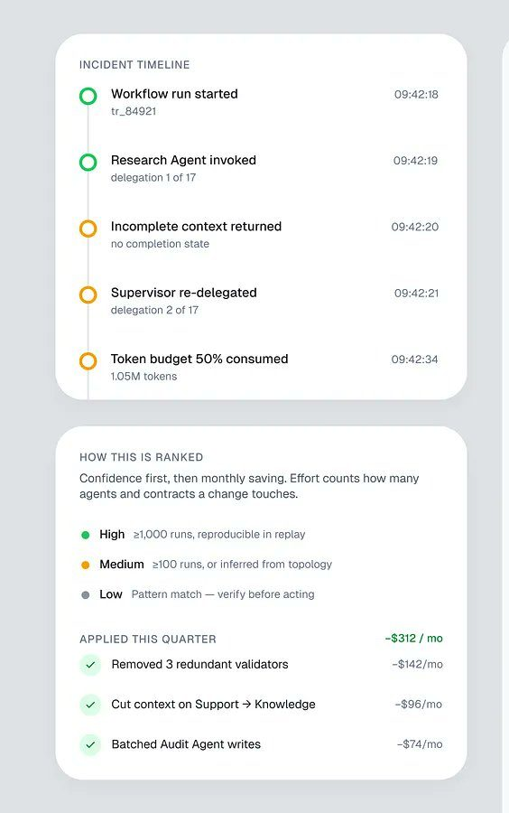
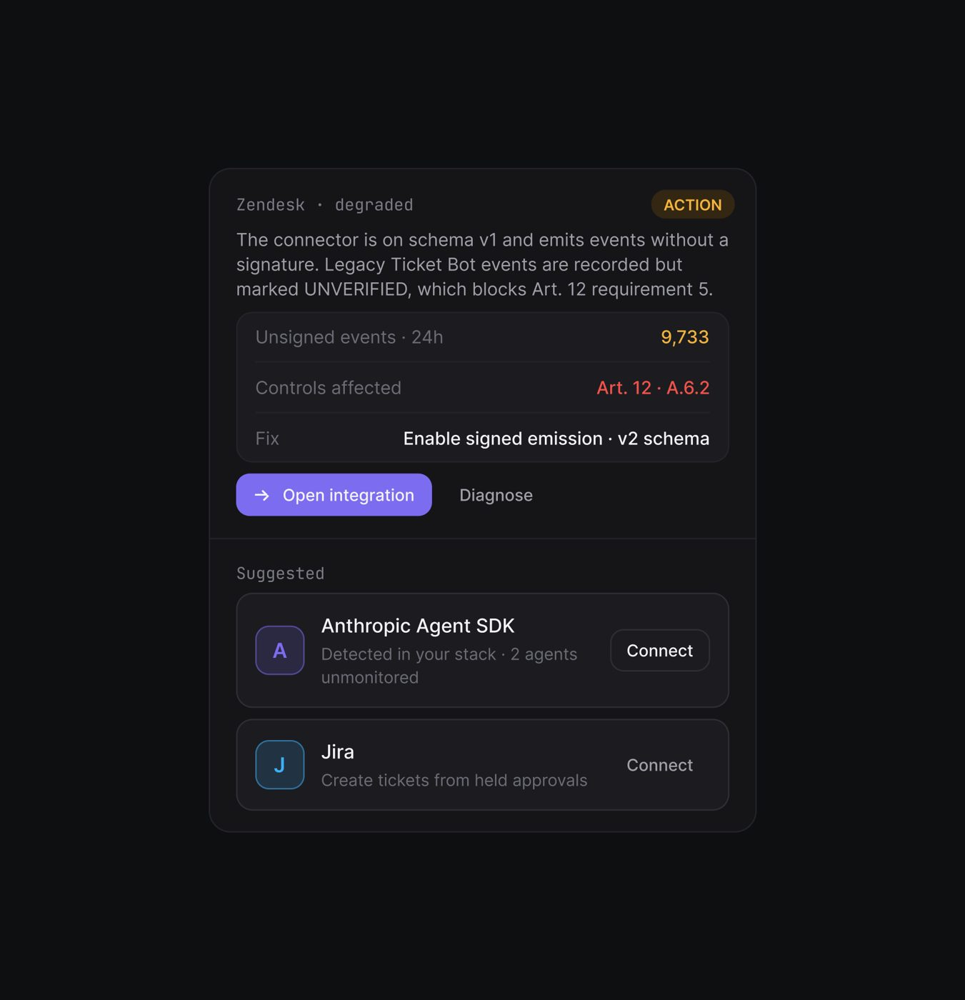
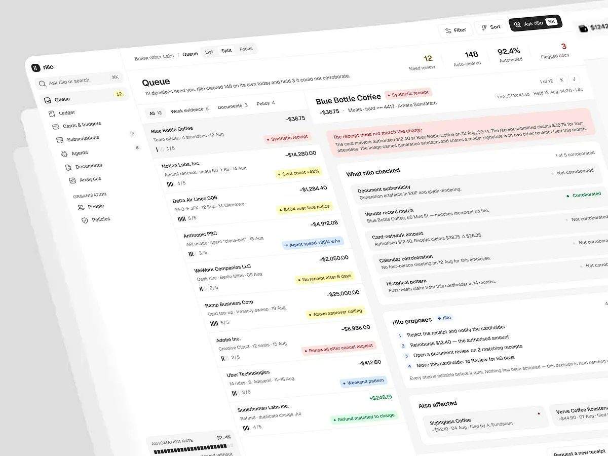
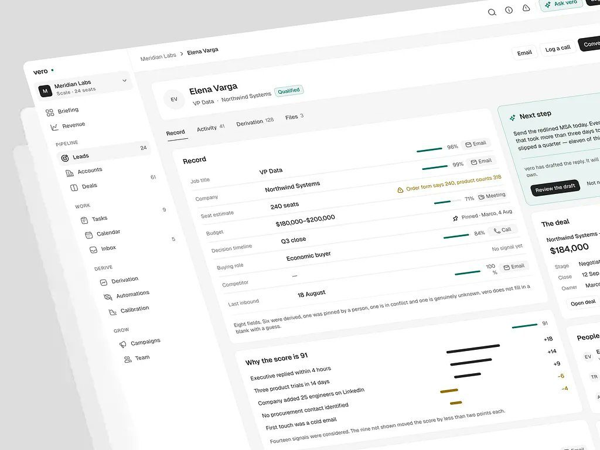
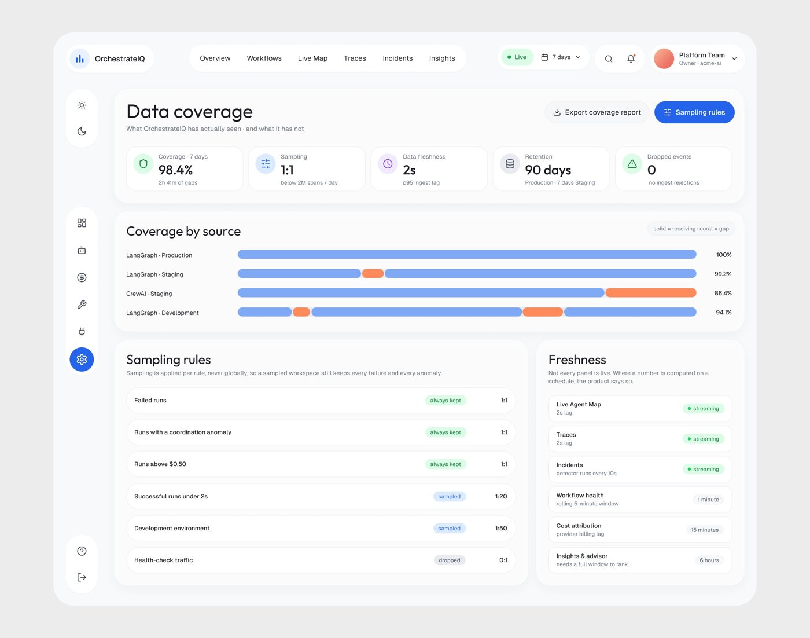
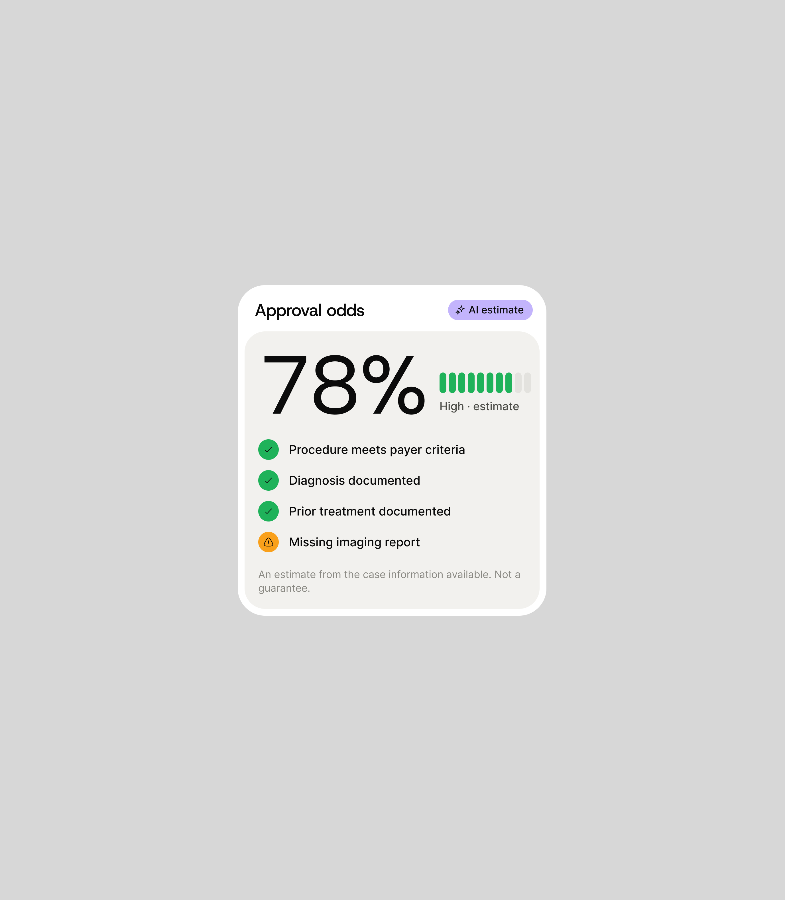
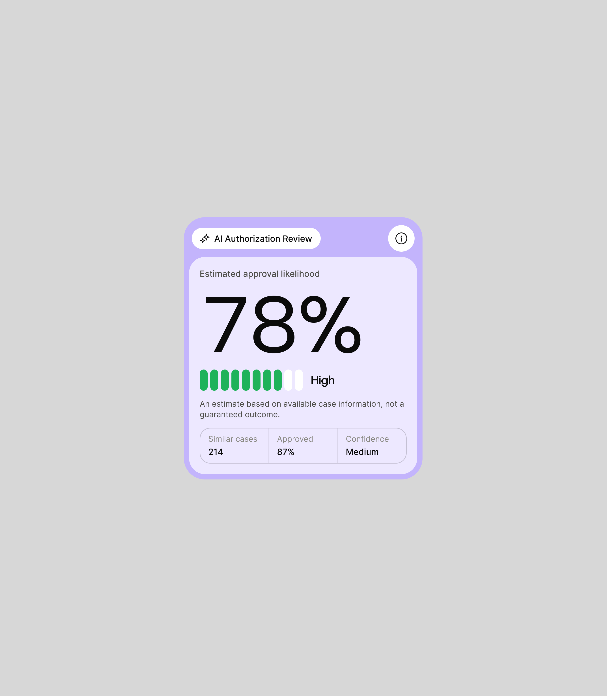
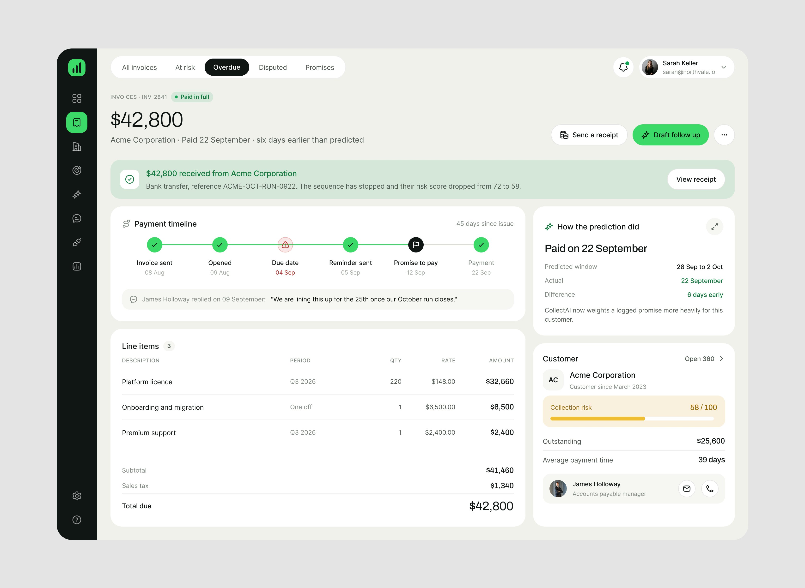
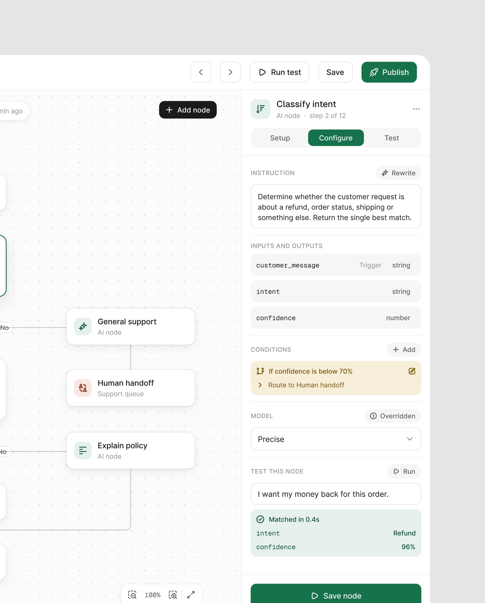

# 03 · Confiança, verificação, cobertura e frescor explícitos

## O que é

Toda saída da IA vem acompanhada de **quanto ela tem certeza**, **o que ela checou**, **o que
ela não viu** e **de quando é o número**. Nenhum dado gerado por IA aparece "limpo", como se
fosse fato.

## Problema que resolve

O usuário não sabe distinguir o que a IA sabe do que a IA chutou. Sem isso, ou ele confia em
tudo (e erra) ou em nada (e refaz o trabalho). A resposta do método é tornar a incerteza um
**elemento de interface**, com a mesma hierarquia do dado.

## As quatro camadas, com exemplos reais

### 1. Confiança numérica ou em faixa

- "6 agents · **92% confidence**", "2 workflows · **88% confidence**" (OrchestrateIQ).
- Régua escrita de como a confiança é medida (Insights do OrchestrateIQ):
  > "HOW THIS IS RANKED · Confidence first, then monthly saving. Effort counts how many agents
  > and contracts a change touches."
  > "● High ≥1,000 runs, reproducible in replay · ● Medium ≥100 runs, or inferred from
  > topology · ● Low Pattern match — verify before acting"
- Vero ao lado de cada campo derivado: barra curta + percentual ("96%", "99%", "71%", "84%")
  + a fonte ("Email", "Meeting", "Call").
- Ergond: regra de escalonamento "Confidence below 0.7 → human review".
- PriorAuth: "Approval odds" por caso, 78% / 61% / 47% / 66% / 54%, com barra segmentada em
  cor (verde, amarelo, laranja).
- Fino: "Buffer at risk · Oct 16 · **17% chance** of dipping"; gráfico com "$71.4K likely"
 .



### 2. Estado de verificação (qualitativo)

- "9 handoffs · **2 unverified**" (OrchestrateIQ).
- "What rillo checked": cinco verificações com estado individual, "Corroborated" em verde e
  "Not corroborated" em cinza, e o total "1 of 5 corroborated" (Rillo).
- Lepo: selos "Clear audio", "Matches photo caption" (verdes) e "Said once" (cinza)
 . O "Said once" é o aviso de fonte única, sem alarme.
- AgentTrail: eventos "marked **UNVERIFIED**, which blocks Art. 12 requirement 5"
 ; manual evidence mostrado aos auditores "as 'supplied by
  workspace', never as automatic evidence".
- Torin: "3 charges we're not sure about · $47.99 a month · **not counted above**"
 . O que a IA não tem certeza fica fora do total.





### 3. O que a IA não sabe e se recusa a inventar

- Vero, embaixo do registro do lead:
  > "Eight fields. Six were derived, one was pinned by a person, one is in conflict and one is
  > genuinely unknown. **vero does not fill in a blank with a guess.**"
- Vero, no decision record: "How confident · Not applicable · vero does not report a confidence
  for a decision it declined to make."
- Vero, campo "Competitor: —" com "No signal yet" à direita.
- Explicação do score: "Why the score is 91" lista os sinais com peso (+18, +14, +9, −6, −4) e
  fecha com "Fourteen signals were considered. The nine not shown moved the score by less than
  two points each."



### 4. Cobertura e frescor do dado

A tela inteira de "Data coverage" do OrchestrateIQ existe para isso:

- Título "Data coverage", subtítulo "**What OrchestrateIQ has actually seen · and what it has
  not**".
- KPIs: "Coverage · 7 days 98.4% · 2h 41m of gaps", "Sampling 1:1 · below 2M spans / day",
  "Data freshness 2s · p95 ingest".
- "Coverage by source": barras por fonte (LangGraph · Production, CrewAI · Staging) com as
  lacunas em laranja.
- "Sampling rules · Sampling is applied per rule, never globally, so a sampled workspace still
  keeps every failure and every anomaly." Linhas "Failed runs · always kept · 1:1",
  "Successful runs under 2s · sampled · 1:20", "Health-check traffic · dropped · 0:1".
- "Freshness · **Not every panel is live. Where a number is computed on a schedule, the product
  says so.**" Linhas "Live Agent Map · 2s lag · streaming", "Cost attribution · provider
  billing lag · 15 minutes", "Insights & advisor · needs a full window to rank · 6 hours".



E, em escala menor, o frescor aparece em quase todo cabeçalho: "updated 6 minutes ago"
(Permitly), "Permit AI · 6 min ago", "synced 12s ago" (Haulsight), "Last updated 2 min ago"
(Ctrl.ai), "Last synced Sep 9, 5:02 PM" (Fino), "streaming · last 60 s" (OrchestrateIQ Live Map).

## Comparar com o normal daquela entidade

A confiança no método quase nunca é abstrata: a IA compara o caso com **o histórico do próprio caso**.

- "Delay is 2.2x their normal pattern" / "Third missed promise this quarter" (CollectAI).
- "Brightline usually pays 9 days late, so 22 is unusual." (Fino's read).
- "Days late, last 9 paid + this one · Dashed = expected" com a barra tracejada da previsão
  (Fino, tela do cliente Atlas Robotics).
- "First meals claim from this cardholder in 14 months." (Rillo, "Historical pattern").
- "Usage is healthy. The silence is not about the product." (Vero, Halden Group,
 , leitura parcial em imagem de 1024 px). **[OBSERVADO]**

## Medidas e cores **[MEDIDO]**

- Chip de confiança do OrchestrateIQ: **~124 × 23 px**, fundo `#EFF7FA`, texto ~12 px, ícone
  de checkbox antes do número.
- Rillo: estado "Corroborated" com ponto verde + texto verde; "Not corroborated" em cinza, sem
  ponto vermelho. **A falta de prova não é pintada como erro**, é neutra. **[OBSERVADO]**
- Lepo: selos verdes sólidos para prova positiva, contorno cinza para prova fraca.

## Quando usar

Sempre que um número foi **derivado, previsto ou classificado** pela IA. Dado que veio pronto de
um sistema (valor de fatura, data de emissão) não leva chip de confiança. **[OBSERVADO em
8 produtos]**

## Como reproduzir

1. Ao lado de todo dado derivado: `{valor} · {confiança}` ou um selo de verificação.
2. Se houver faixas, **escreva a régua** uma vez na tela ("High ≥1,000 runs…").
3. Quando a IA não sabe, mostre "—" e uma frase: "No signal yet". Nunca preencha com palpite.
4. Diga o que ficou **fora da conta** ("not counted above").
5. Explique scores com a lista de sinais e pesos, e diga quantos sinais ficaram de fora e por
   quê.
6. Todo painel que não é ao vivo diz a idade do número e a cadência de atualização.
7. Compare com o padrão da própria entidade ("2.2x their normal pattern") antes de comparar com
   a média geral.

```html
<span class="conf" title="6 of 6 agents seen in ≥100 runs">
  <svg class="i-check-square"/> 92% confidence
</span>
<!-- .conf{display:inline-flex;gap:6px;align-items:center;height:23px;padding:0 10px;
          border-radius:999px;background:#EFF7FA;color:#475467;font-size:12px} -->
```

## Mais exemplos

Telas de outras séries que repetem ou estendem o padrão (fichas em [../06-produtos/](../06-produtos/README.md)).

- **PriorAuth, chance de aprovação** — "Approval odds 78%" com régua de barrinhas, "AI estimate", o checklist de critérios e a ressalva *"An estimate from the case information available. Not a guarantee."*; na versão em moldura lilás, a base: 214 casos semelhantes, 87% aprovados, confiança Medium.
  
- **PriorAuth, revisão da IA** — a estimativa com a base de casos semelhantes e o nível de confiança escrito.
  
- **CollectAI, fatura paga** — o cartão "How the prediction did": janela prevista, data real, diferença ("6 days early") e o que o modelo passou a pesar mais. A previsão presta contas depois do fato.
  
- **"Refund Assistant", nó de classificação** — a confiança como regra: "if confidence is below 70% → Route to Human handoff", e o teste do nó com "intent Refund, confidence 96%".
  
