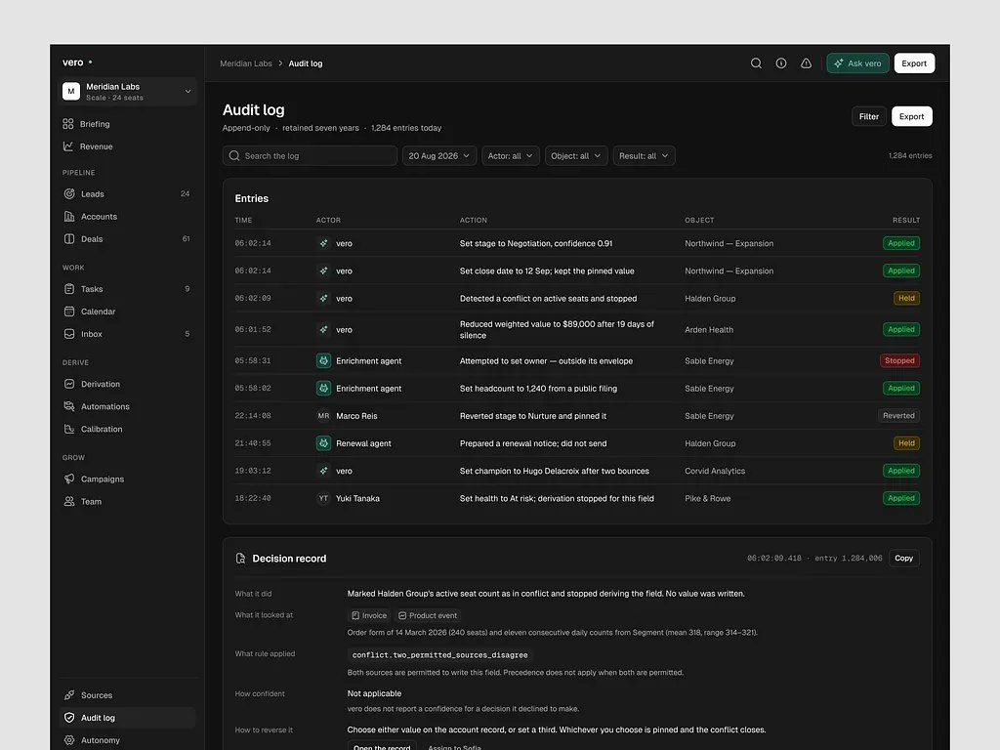
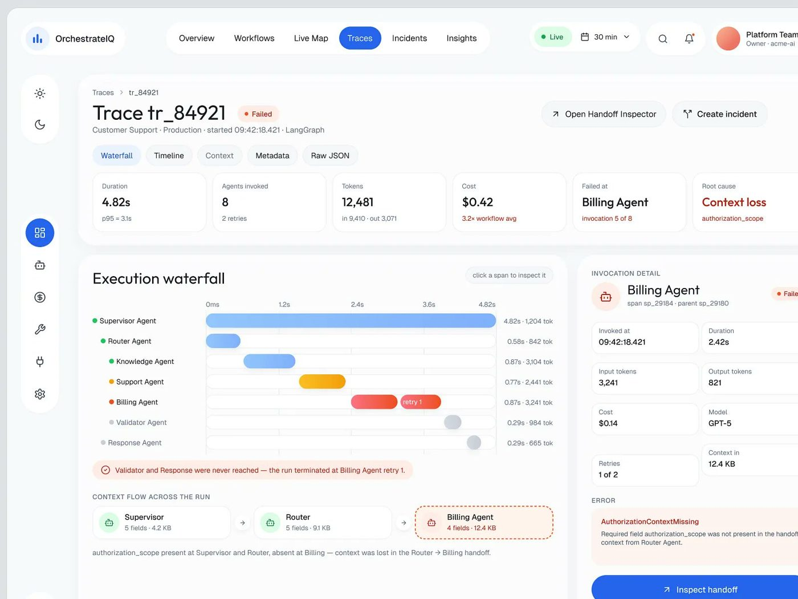
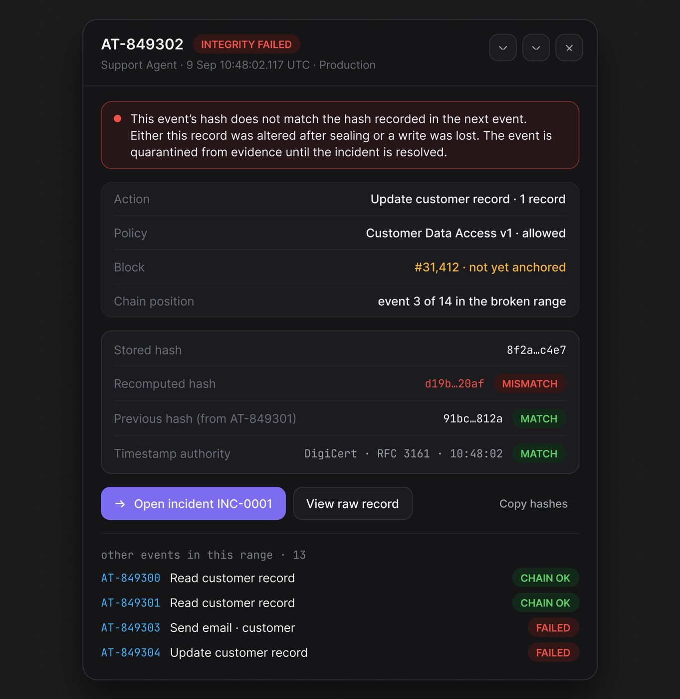
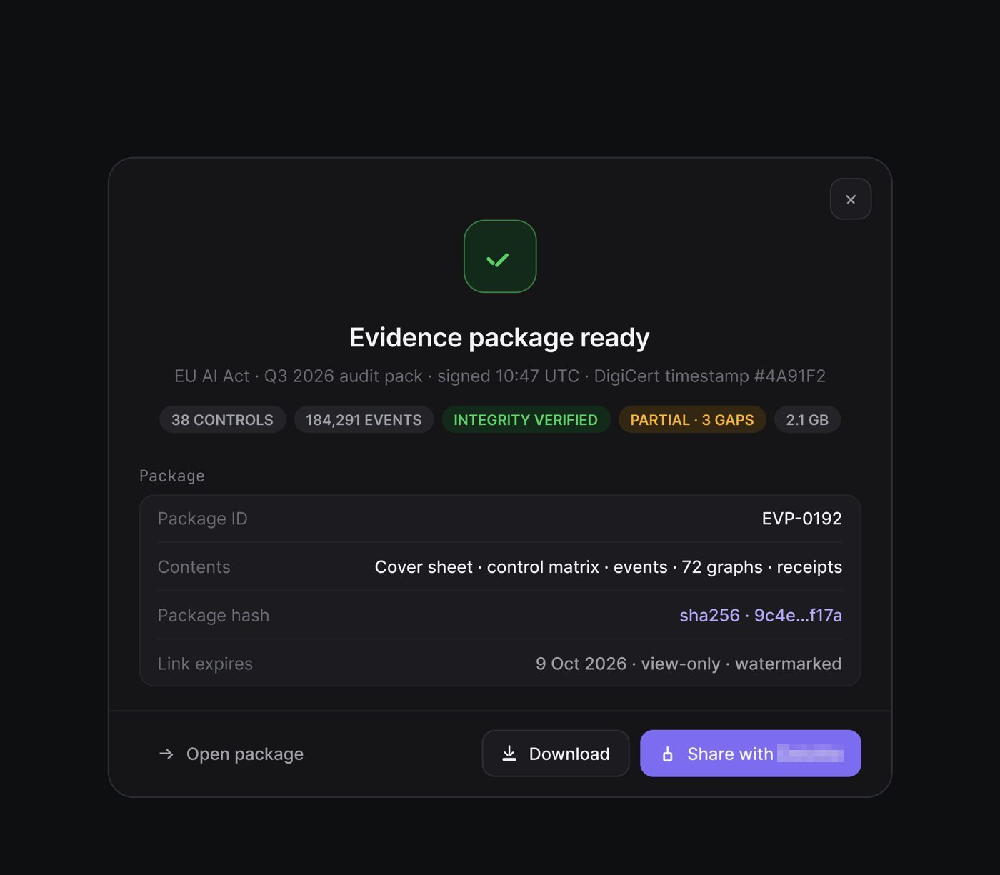
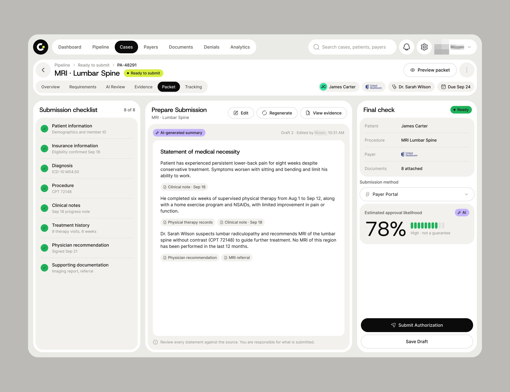
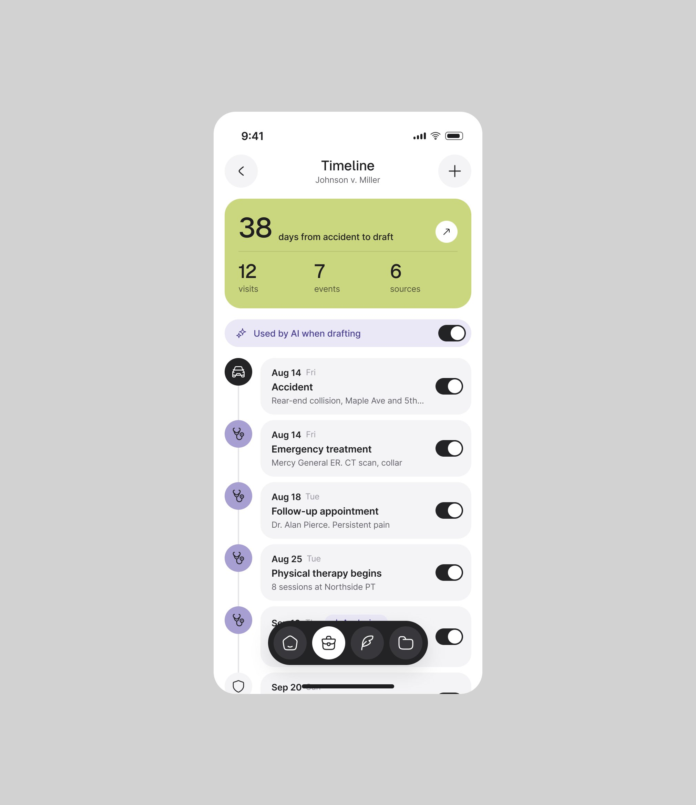
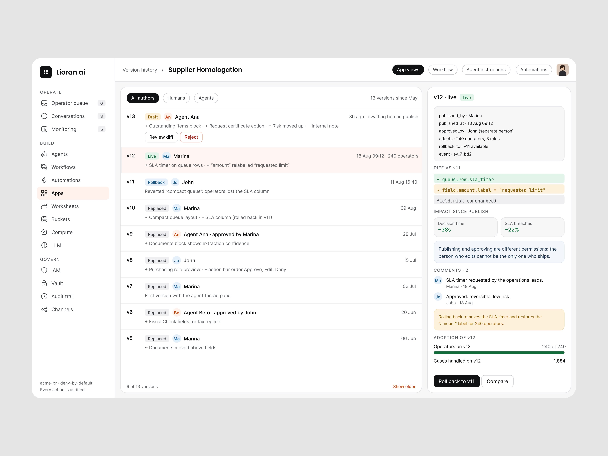
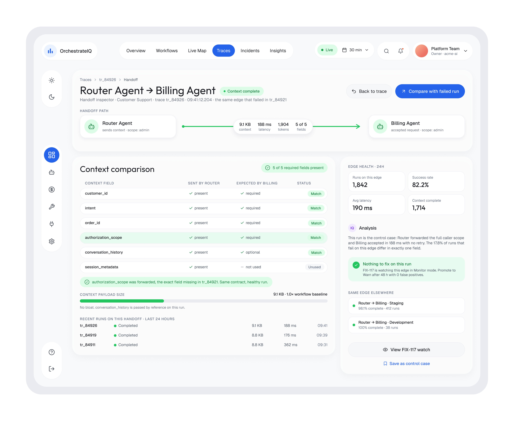
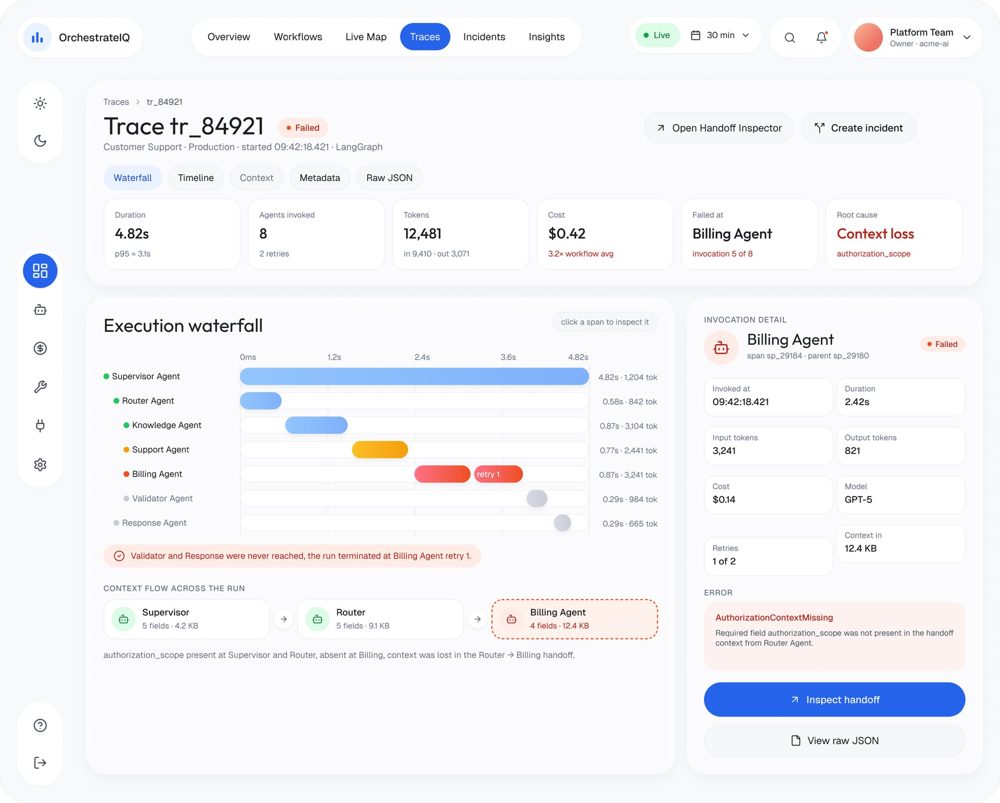
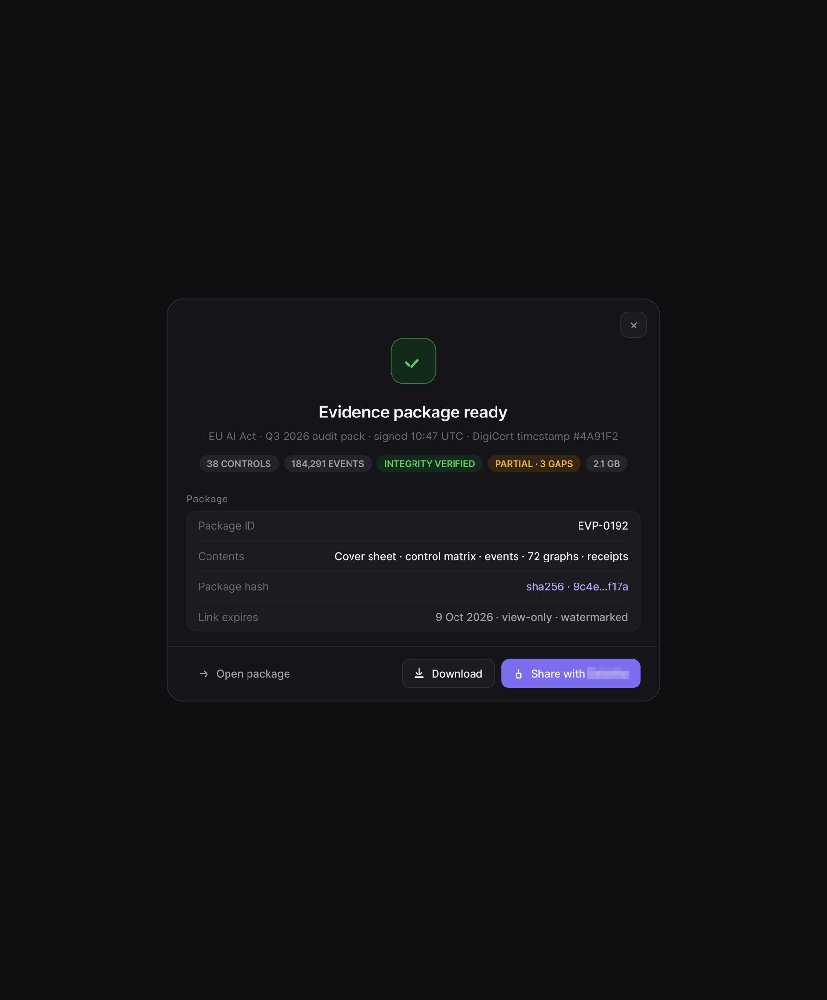

# 04 · Rastreabilidade: trace, linha do tempo, audit log, hash, evidência

## O que é

Todo ato da IA é um **evento endereçável** (id próprio, hora ao milissegundo, ator, regra), e
existe uma tela para cada zoom: o log com todas as linhas, o registro de uma decisão, a cadeia
de causa de uma falha, e a prova criptográfica de que o registro não foi alterado.

## Problema que resolve

"Por que o agente fez isso?" é a pergunta que derruba a confiança num produto de IA. Responda
com três perguntas que qualquer pessoa entende, antes da parte técnica: **o que fez, com base em
quê, e como desfaz**.

## As cinco formas

### 1. Decision record (Vero)

A forma mais legível de todas. Embaixo do "Audit log · Append-only · retained seven years ·
1,284 entries today", um card "Decision record" com cinco linhas rotuladas em linguagem comum:

| Rótulo | Conteúdo (transcrito) |
|---|---|
| What it did | "Marked Halden Group's active seat count as in conflict and stopped deriving the field. No value was written." |
| What it looked at | chips "Invoice", "Product event" + "Order form of 14 March 2026 (240 seats) and eleven consecutive daily counts from Segment (mean 318, range 314–321)." |
| What rule applied | `conflict.two_permitted_sources_disagree` (código) + "Both sources are permitted to write this field. Precedence does not apply when both are permitted." |
| How confident | "Not applicable · vero does not report a confidence for a decision it declined to make." |
| How to reverse it | "Choose either value on the account record, or set a third. Whichever you choose is pinned and the conflict closes." + botões "Open the record", "Assign to Sofia" |

No log acima, a coluna **Actor** mistura IA e pessoas na mesma lista ("vero", "Enrichment
agent", "Marco Reis", "Renewal agent", "Yuki Tanaka"), e a coluna **Result** usa cinco estados:
Applied (verde), Held (amarelo), Stopped (vermelho), Reverted (cinza). Exemplo de linha:
"Enrichment agent · Attempted to set owner — outside its envelope · Sable Energy · Stopped".

### 2. Trace com waterfall (OrchestrateIQ e vídeo)

- Cabeçalho "Trace tr_84921 · Failed", abas Waterfall / Timeline / Context / Metadata / Raw JSON.
- KPIs do trace: Duration 4.82s, Agents invoked 8, Tokens 12,481, Cost $0.42, "Failed at
  Billing Agent", "Root cause Context loss".
- "Execution waterfall": uma barra por agente no eixo de tempo, com `{segundos} · {tokens} tok`
  à direita ("4.82s · 1,204 tok"); a tentativa repetida aparece como barra vermelha com rótulo
  "retry 1".
- Painel lateral do span selecionado: "Billing Agent · span sp_29184 · parent sp_29180 ·
  Failed", grade de 8 KPIs (Invoked at 09:42:18.421, Duration 2.42s, Input tokens 3,241,
  Output tokens 821, Cost $0.14, Model GPT-5, Retries 1 of 2, Context in 12.4 KB), e o erro
  com nome de exceção e frase humana: "AuthorizationContextMissing · Required field
  authorization_scope was not present in the handoff context from Router Agent."
- CTA "↗ Inspect handoff" (azul) e "View raw JSON" (secundário).

### 3. Linha do tempo do incidente (OrchestrateIQ)

"INCIDENT TIMELINE": cada evento com círculo de estado (verde ok, laranja atenção), título em
linguagem de negócio e subtítulo técnico, hora à direita:
"Workflow run started · tr_84921 · 09:42:18", "Research Agent invoked · delegation 1 of 17",
"Incomplete context returned · no completion state", "Supervisor re-delegated · delegation 2 of
17", "Token budget 50% consumed · 1.05M tokens".

### 4. Cadeia de hash e evidência (AgentTrail)

- Evento com id "AT-849302", selo "INTEGRITY FAILED" e a explicação inteira em uma caixa
  vermelha: "This event's hash does not match the hash recorded in the next event. Either this
  record was altered after sealing or a write was lost. The event is quarantined from evidence
  until the incident is resolved."
- Tabela de prova: Stored hash `8f2a…c4e7`, Recomputed hash `d19b…20af` **MISMATCH**, Previous
  hash (from AT-849301) **MATCH**, Timestamp authority "DigiCert · RFC 3161 · 10:48:02"
  **MATCH**. Hash sempre abreviado com reticências no meio.
- "other events in this range · 13" com CHAIN OK / FAILED por linha.
- Grafo de decisão de um evento bloqueado: Trigger → Agent decision ("Plan: query CRM →
  assemble batch…") → Policy evaluation ("PII Export Policy · v3") → Risk classification
  ("High — PII leaving the approved b…"), com o painel de integridade ao lado (Event hash,
  Previous hash, Block "#31,398 · anchored 9 Sep 00:00") e "Mapped controls · Art. 12 — Record
  keeping · EU AI Act".
- Pacote de evidência pronto: "Evidence package ready · EU AI Act · Q3 2026 audit pack · signed
  10:47 UTC · DigiCert timestamp #4A91F2", chips "38 CONTROLS", "184,291 EVENTS", "INTEGRITY
  VERIFIED", "PARTIAL · 3 GAPS", "2.1 GB"; "Link expires · 9 Oct 2026 · view-only ·
  watermarked"; CTA "Share with [auditoria]".

### 5. A fonte do fato, na mídia original (Lepo)

Folha inferior "Where Lepo heard it" com o intervalo "08:05 - 08:19", o "Fact" extraído, a onda
de áudio com o cursor no trecho, o player "08:10 / 08:19", a transcrição com os falantes
("Diego: Herm side's reading thirty-one point two. That's a forty-five five, so it's way out."
e "Linda: Is that the part the other guy mentioned?") e os selos de verificação.

## No produto de cliente final, o rastro vira histórico simples

- Ergond: "Agent action · OCR insurance-2026.pdf · 4 fields extracted", "Agent action · moved
  #4821 to Risk Analysis", "Full trail" e, no contexto, "Agent activity on this thread · 6
  actions · 5 within authority · Open audit log". Rodapé da sidebar: "acme-br ·
  deny-by-default · **Every action is audited**".
- Fino: "History · Sent to ap@brightlinehealth.com · Jul 21 · from QuickBooks · Viewed · Jul 23,
  10:14 AM · Friendly reminder sent".
- PriorAuth: "Recent activity" com "AI review completed · Knee Arthroscopy · Maria Gonzalez"
  entre os eventos humanos, com ícone de brilho em fundo lilás.

## Tipografia do rastro **[OBSERVADO]**

Ids, horários, hashes, versões de política e nomes de campo vão em **monoespaçada** (AgentTrail
inteiro: rótulos de seção "Monitor", "Govern", "Prove", "evaluations_30d", "decision chain";
Rillo e Vero: horários e ids de transação; Ergond: "R$ 5,000", "v3 draft · v2 live"). O texto
humano ao lado continua na sans. **A fonte muda quando o texto é da máquina.**

## Como reproduzir

1. Todo evento tem: `id` monoespaçado, hora com segundos (ou milissegundos no técnico), ator
   (IA ou pessoa, na mesma coluna), ação em frase, objeto, resultado com cor.
2. Registro de decisão com os cinco rótulos: **What it did / What it looked at / What rule
   applied / How confident / How to reverse it**.
3. Erro técnico sempre em dupla: nome da exceção em cor de erro + frase humana que diz o campo
   e a origem.
4. Hash abreviado `8f2a…c4e7`, com ação "Copy hashes" e "View raw record".
5. O CTA do rastro leva ao próximo nível de zoom ("Inspect handoff", "Open incident INC-0001",
   "Open audit log").

## Mais exemplos

Telas de outras séries que repetem ou estendem o padrão (fichas em [../06-produtos/](../06-produtos/README.md)).

- **PriorAuth, resumo gerado** — o resumo médico "AI-generated summary" em que **cada frase leva a etiqueta da fonte** (nota clínica de 18/09, registros de fisioterapia, recomendação médica) e a nota *"Review every statement against the source. You are responsible for what is submitted."*.
  
- **CaseDraft, linha do tempo** — uma chave "Used by AI when drafting" em cada evento do caso: a pessoa escolhe o que a IA pode usar, e a carta mostra "87% evidence-supported".
  
- **Lioran.ai, histórico de versões** — cada versão com autor (pessoa ou agente), quem aprovou, o diff em mono e "Roll back to v11".
  
- **OrchestrateIQ, handoff** — "Context comparison" campo a campo (enviado × esperado) e o trace com a cascata e a causa raiz "Context loss".
  
- **OrchestrateIQ, trace** — a cascata de execução com o trecho em vermelho e o erro "AuthorizationContextMissing" explicado em frase.
  
- **AgentTrail, pacote de evidências** — "Evidence package ready" com controles, eventos, "INTEGRITY VERIFIED", lacunas, hash e validade do link.
  
