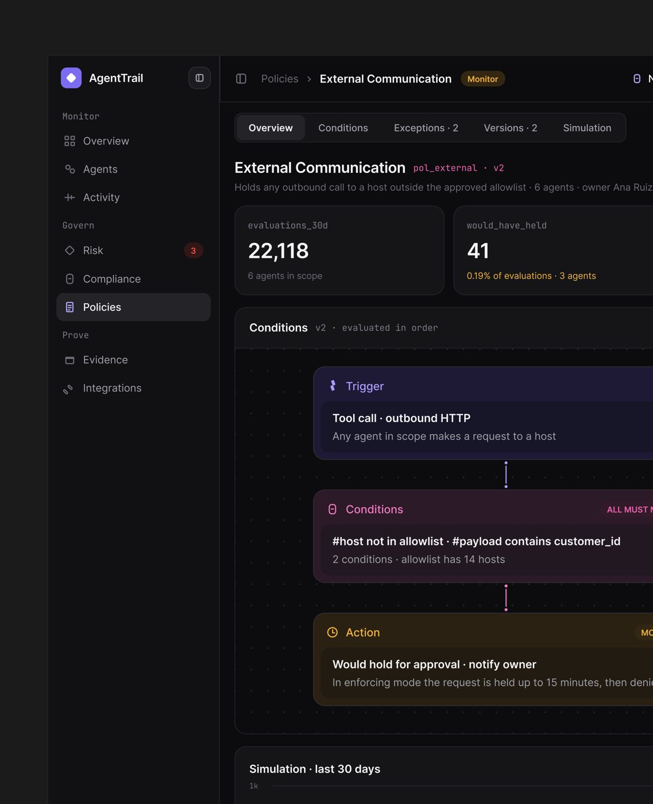
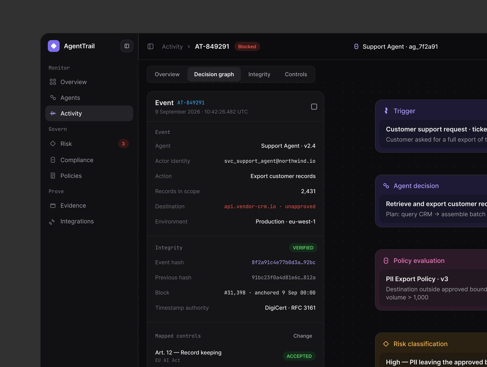
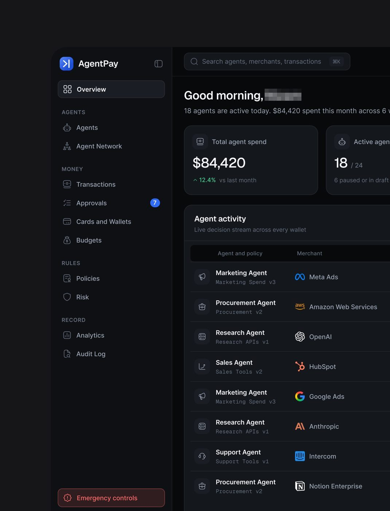

# 05 · Governança: política Trigger → Conditions → Action, modo monitor e simulação

## O que é

A regra que limita o agente é desenhada como um **objeto de primeira classe**, com nome, versão,
dono, escopo e histórico, e lida como uma frase de três partes: **quando** acontece
(Trigger), **se** (Conditions), **então** (Action). Antes de valer, a regra roda em **modo
monitor** e a tela mostra o que ela **teria feito** ("would have held").

## Problema que resolve

Quem governa agente não é engenheiro: é compliance, jurídico, financeiro. Regra escrita em
código ou YAML não é auditável por essas pessoas. E ligar uma regra nova direto em produção
quebra fluxo que funcionava. A simulação responde "o que muda se eu ligar isso?" antes de ligar.

## Anatomia (AgentTrail, "Tell me whats wrong here?")

1. **Breadcrumb e estado:** "Policies › External Communication" + selo âmbar **"Monitor"**.
2. **Abas do objeto política:** Overview · Conditions · Exceptions · 2 · Versions · 2 ·
   Simulation. O contador vai na própria aba.
3. **Título + identificador de máquina:** "External Communication" + `pol_external · v2` em
   monoespaçada rosa.
4. **Frase-resumo com escopo e dono:** "Holds any outbound call to a host outside the approved
   allowlist · 6 agents · owner Ana Ruiz".
5. **Dois KPIs de impacto**, com rótulo em estilo de variável (`evaluations_30d`,
   `would_have_held`): "22,118 · 6 agents in scope" e "41 · 0.19% of evaluations · 3 agents"
   (o segundo em âmbar, a cor do modo monitor).
6. **O canvas da regra**, com fundo pontilhado e três blocos ligados por um conector
   vertical curto (ponto, linha, ponto):
   - **Trigger** (roxo): "Tool call · outbound HTTP · Any agent in scope makes a request to a
     host".
   - **Conditions** (rosa) com o modo de combinação em selo à direita "ALL MUST M[ATCH]":
     "#host not in allowlist · #payload contains customer_id · 2 conditions · allowlist has
     14 hosts".
   - **Action** (âmbar) com selo "MO[NITOR]": "**Would** hold for approval · notify owner ·
     In enforcing mode the request is held up to 15 minutes, then denie[d]".
7. **"Simulation · last 30 days"** com gráfico de volume logo abaixo.

Note o verbo condicional no bloco de ação. Enquanto a política está em monitor, **a interface
fala no condicional** ("Would hold", "would_have_held"). É o mesmo recurso do test console do
Ergond ("Would act · within authority", "Would escalate").

## Cores do canvas **[MEDIDO]**

Cor saturada dominante do violeta de marca: `#786CF0`. O âmbar do monitor: família `#96722A`
a `#A87E30` nas bordas e fundos escuros. Cada bloco tem fundo tingido da própria cor (roxo
escuro, bordô, marrom) e um sub-card interno mais escuro com o texto branco. **[OBSERVADO]**

## A mesma regra, vista no evento (cadeia de decisão)

Quando a política dispara, o evento mostra a cadeia na mesma gramática de três cores
(AgentTrail):

> "decision chain · ● Trigger · Customer requested refund · order #88213 · ● Policy ·
> Financial Action v2 · amount > €250 · ● Outcome · Held · waiting for approver"

E no grafo de decisão de um evento bloqueado: Trigger → Agent decision
→ Policy evaluation ("PII Export Policy · v3 · Destination outside approved bound[ary] ·
volume > 1,000") → Risk classification ("High — PII leaving the approved b[oundary]"), com
"Mapped controls · Art. 12 — Record keeping · EU AI Act".

## Variações

| Produto | Onde a política aparece | Linguagem |
|---|---|---|
| AgentTrail | objeto próprio (Policies), com Versions, Exceptions e Simulation | Trigger / Conditions / Action |
| Ergond | dentro da ficha do agente: "INSTRUCTIONS / POLICY · v3 draft · 1 line changed" com a linha nova em verde ("+ Don't: negotiate price, approve limits, share internal scoring.") | Tone / Do / Don't + "Authority ceiling by phase" + "Escalation rules · 4" |
| Ctrl.ai | Command Center: "Attempted restricted action · Blocked automatically · Sales Agent › Salesforce · 10:44 AM"; gráfico "Agent actions" com tooltip "Allowed 5,392 · Held 61 · Blocked 27" | três resultados fixos: Allowed, Held, Blocked |
| AgentPay | "Agent and policy" como coluna da tabela (cada agente mostra a política que o rege: "Marketing Agent · Marketing Spend v3", "Research Agent · Research APIs v1") | "Approved autonomously / Sent for human approval / Blocked by policy" |
| ComplianceFlow | "AI Activity · Every AI-assisted action detected on client work. Nothing becomes a compliance record…" com abas Needs Review 12 · In Progress 3 · Documented 231 · Unmatched | classificação em massa: "Classify as Low Risk", "Assign to matter" |
| Vero | a regra aparece no decision record como código: `conflict.two_permitted_sources_disagree` | regra com nome legível por máquina + explicação humana |

## Autonomy with boundaries (AgentPay)

Na folha de tipografia do design system do AgentPay a frase de amostra
em todos os tamanhos é **"Autonomy with boundaries"**. É texto de amostra, não uma regra escrita;
a leitura de que ela resume os padrões 05 e 06 é **[INFERIDO]**. O produto que acompanha ("AgentPay is a control layer between AI
agents and the payment network") mostra a fronteira em números: "Decision split · Today, so far
· 892 payments through the policy engine" dividido em **Approved autonomously 696 · 78%**,
**Sent for human approval 134 · 15%**, **Blocked by policy 62 · 7%**, numa barra de três
segmentos (azul, cinza escuro, vermelho). Ver padrão 06 para o detalhe.

## Quando usar

Em todo produto de **governança de agentes** (AgentTrail, Ctrl.ai, AgentPay, ComplianceFlow) a
política é objeto próprio. Em produto de **operação** (Ergond, Vero) a política mora dentro da
ficha do agente ou do registro. **[OBSERVADO em 6 produtos]**

## Como reproduzir

1. Três blocos empilhados, cada um com cor fixa: Trigger (violeta), Conditions (rosa),
   Action (âmbar). Conector curto de ponto a ponto entre eles.
2. Cada bloco: rótulo com ícone na cor + sub-card com **frase em negrito** (a regra) e
   **frase cinza** (o escopo ou a consequência).
3. Selo de combinação nas condições ("ALL MUST MATCH" / "ANY").
4. Estado da política no topo: **Monitor** (âmbar) ou **Enforcing**. Em monitor, verbos no
   condicional.
5. Mostre o impacto antes de ligar: avaliações no período + quantas **teriam** sido retidas,
   em número e em percentual, e quantos agentes seriam afetados.
6. Identificador de máquina (`pol_external · v2`) ao lado do nome humano, sempre.
7. Dono nomeado ("owner Ana Ruiz"). Política sem dono não existe na interface.

## Mais exemplos

Telas de outras séries que repetem ou estendem o padrão (fichas em [../06-produtos/](../06-produtos/README.md)).

- **"Refund Assistant", condição** — o popup de condição com a faixa *"Replayed against the last 50 runs, 47 would take Then and 3 would take Else"*: o efeito da regra aparece antes de salvar.
  
- **Lioran.ai, publicar** — "Dry run · last 20 events" e a checagem antes de publicar ("1 of 5 blocking").
  
- **AgentTrail, política** — Trigger, condições e ação em blocos, com a simulação "7 events would have been held" nos últimos 30 dias.
  
- **OrchestrateIQ, padrão de loop** — a regra de detecção em mono ("(caller → callee) pair repeats… total tokens > 50,000"), o limiar em slider (3 cycles) e "What changing it would have caught · last 7 days": 19 detecções e 11 falsos positivos num limiar, 4 e 0 no escolhido, 2 com o incidente INC-2479 perdido, 1 com 3 perdidos.
  
- **Cartão de recurso "Replay on 30 days"** — "128 of 128 caught · 0 false blocks" e a frase "Test a contract against real history before it blocks anything.".
  
- **Ergond, IAM** — a matriz de permissões com a regra explicada, quem tem a permissão e a simulação "What if".
  
