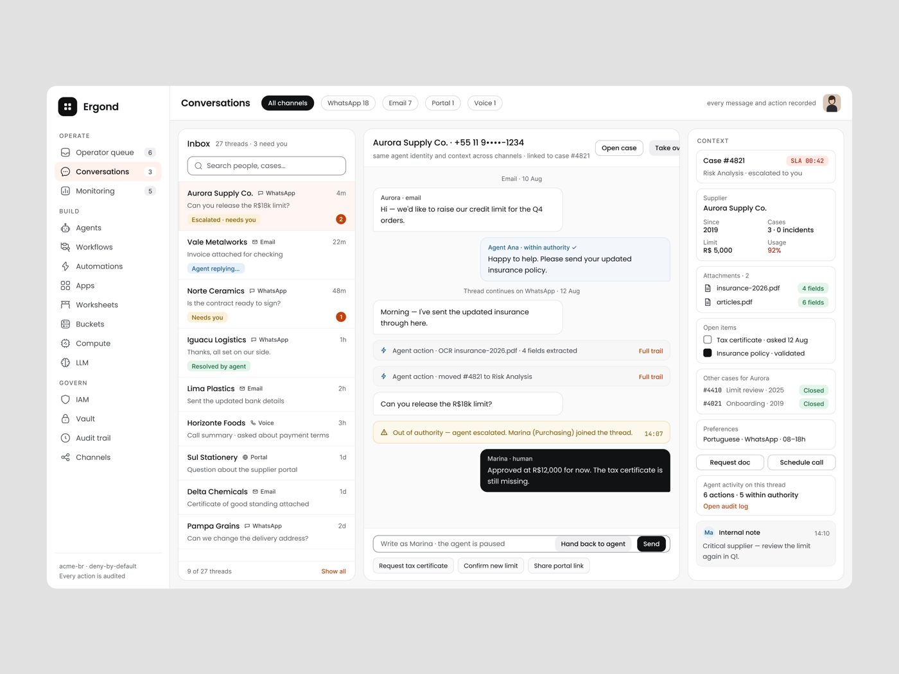
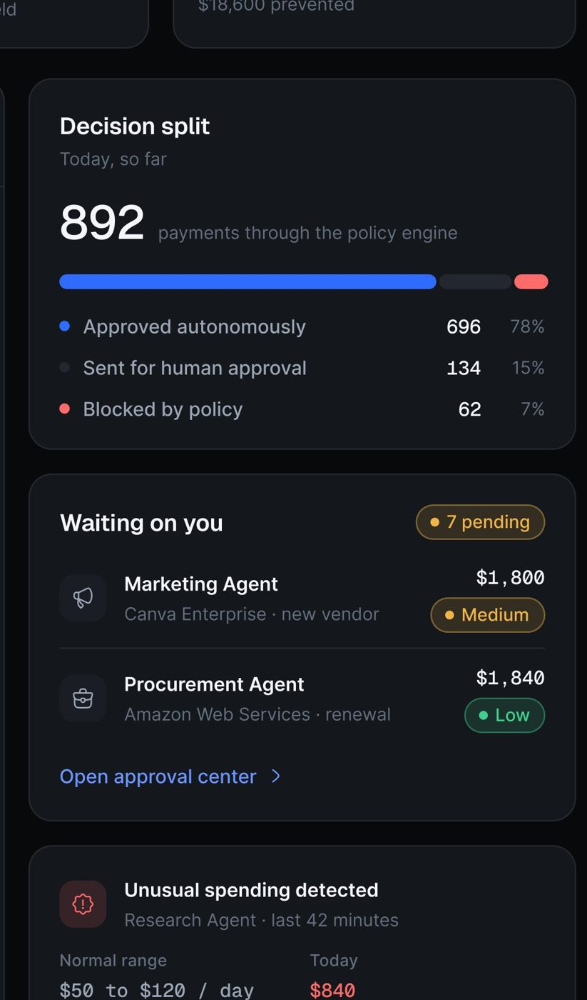
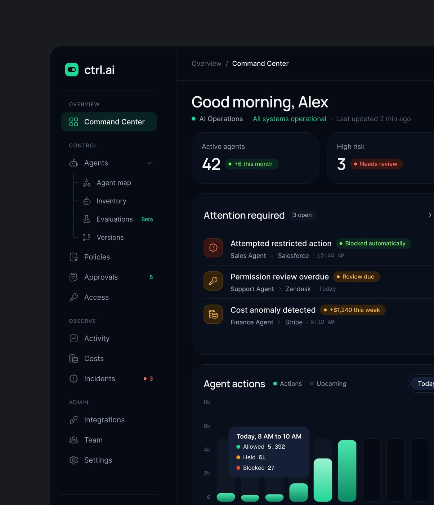
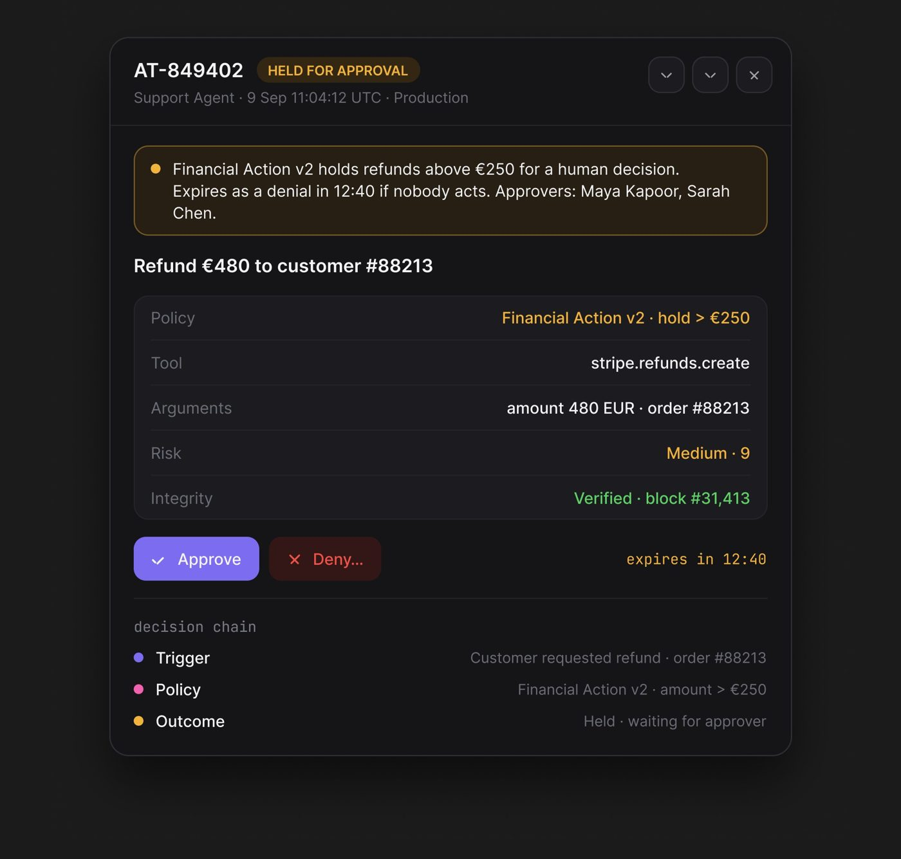
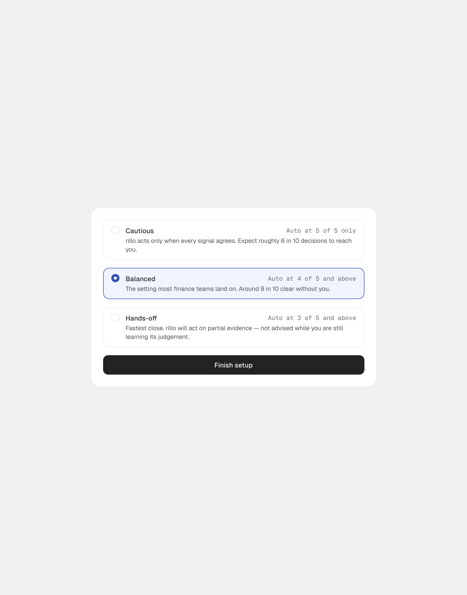
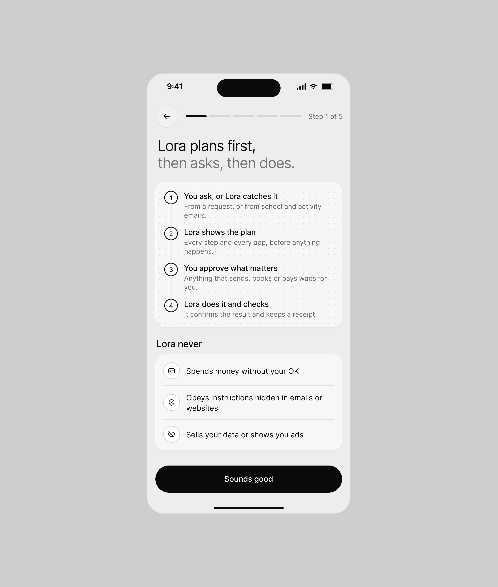
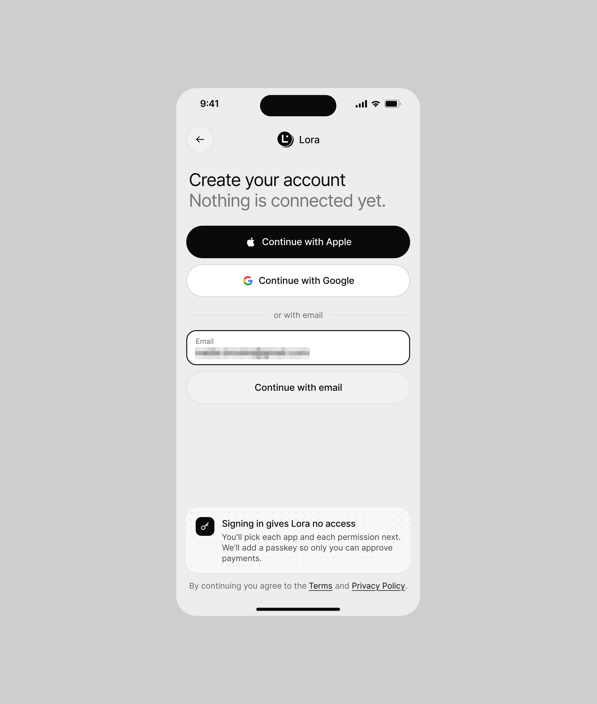
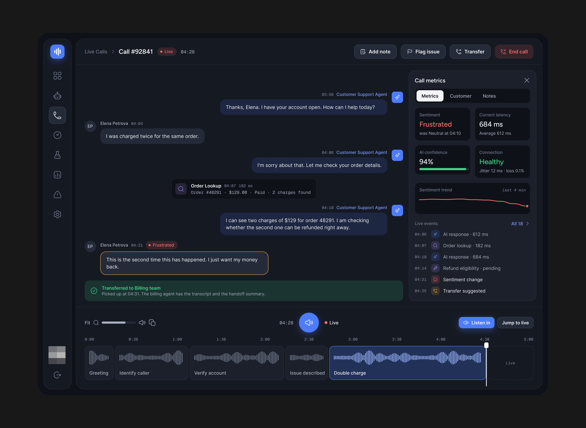
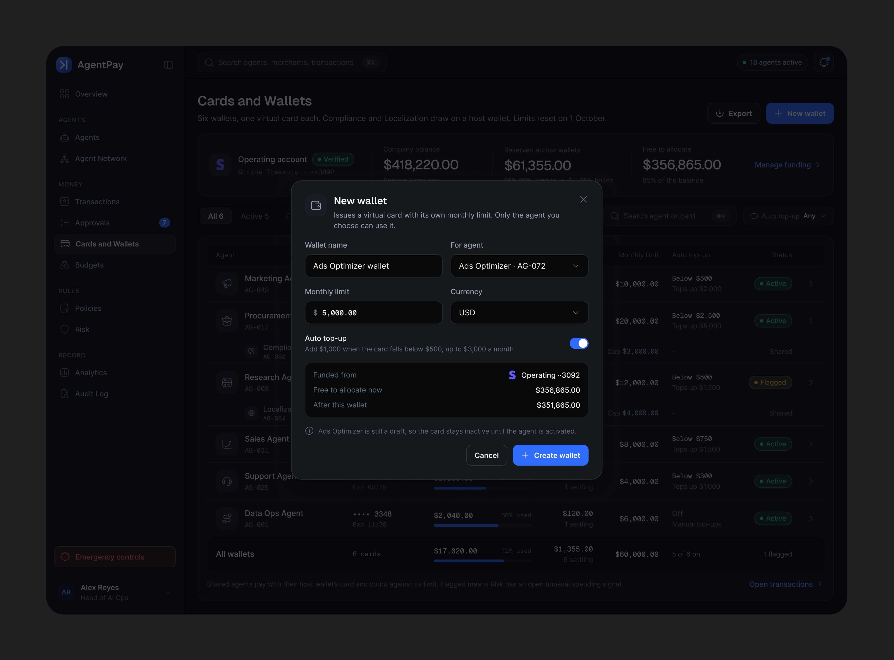

# 06 · A IA age dentro de um limite: autoridade, escalonamento e handoff

## O que é

Cada ação do agente é marcada na interface como **dentro** ou **fora** da autoridade dele. Dentro,
ela executa e registra. Fora, ela para, chama um humano nomeado, e a conversa ou o caso muda de
dono na frente de todo mundo. Depois, o humano **devolve** ao agente.

## Problema que resolve

É a frase da seção: "The real test is knowing when the agent should act on its own and when it
should ask for confirmation". A interface precisa mostrar essa
fronteira em três lugares: na configuração (qual é o limite), na execução (este ato estava dentro
ou fora) e no agregado (quanto do trabalho ficou dentro).

## Anatomia 1: a configuração do limite (Ergond, 46.261 views)

- **Identidade do agente:** "Ana · Supplier homologation analyst · **own identity, never a
  person's**", chips "Owner · Marina" e "Since 02 Jul". O agente tem nome de gente, mas a tela
  diz que ele não se passa por gente.
- **MANDATE & SCOPE:** chips verdes (Homologation, Fiscal Check) e vermelhos (Collections,
  Contracts). Verde é o que pode, vermelho é o que não pode.
- **AUTHORITY CEILING BY PHASE** em tabela com valores monoespaçados: "Triage · R$ 0 · read only",
  "Fiscal Check · R$ 2,000", "Risk Analysis · R$ 5,000".
- **ESCALATION RULES · 4 rules**, cada uma `condição → destino`: "Value above ceiling → case
  owner", "Certificate missing 48h → supervisor", "Confidence below 0.7 → human review",
  "Supplier asks for a person → Purchasing", + "Add rule" tracejado.
- **PERMISSIONS · FROM IAM:** "Role analyst-agent · deny-by-default · **Cannot** approve limits,
  edit IAM, read Vault" ("Cannot" em vermelho).
- **CHANNELS:** WhatsApp, Email (ativos, pretos), Portal, Voice (contorno).
- **Test console · sandbox · no side-effects** (ver padrão 12): a pessoa testa o limite antes de
  publicar.
- **PERFORMANCE · LAST 30 DAYS:** "Actions / day 38 · +12% vs prior 30d", "Escalation rate 7.1% ·
  −1.8 pts fewer handoffs", "Human overrides 4.1% · **honest quality signal**".

## Anatomia 2: a execução, dentro da conversa (Ergond, 35.004 views, 416 salvos)

1. Mensagem do agente com rótulo **"Agent Ana · within authority ✓"** (azul) em cima do balão.
2. Ações do agente como linhas de sistema, não como balão: "⚡ Agent action · OCR
   insurance-2026.pdf · 4 fields extracted".
3. Pedido do cliente que passa do limite: "Can you release the R$18k limit?"
4. Faixa âmbar de largura total: **"⚠ Out of authority — agent escalated. Marina (Purchasing)
   joined the thread. 14:07"**.
5. Balão preto do humano: "Marina · human · Approved at R$12,000 for now. The tax certificate is
   still missing."
6. Campo de resposta muda de dono: "Write as Marina · the agent is paused" + botão **"Hand back
   to agent"** + "Send".
7. Respostas rápidas contextuais: "Request tax certificate", "Confirm new limit", "Share portal
   link".
8. Painel de contexto: "Case #4821 · SLA 00:42 · Risk Analysis · escalated to you", e o recibo
   do agente "6 actions · 5 within authority · Open audit log".

No inbox, os estados da conversa dizem quem está com ela: "Escalated · needs you", "Agent
replying…", "Needs you". Cabeçalho: "Inbox · 27 threads · 3 need you". E, no topo da thread:
"same agent identity and context across channels · linked to case #4821".

## Anatomia 3: o agregado (AgentPay, e Ctrl.ai)

- **Decision split · Today, so far:** "892 payments through the policy engine", barra em três
  segmentos e legenda "Approved autonomously 696 · 78%", "Sent for human approval 134 · 15%",
  "Blocked by policy 62 · 7%".
- **KPIs no topo:** "Pending approvals 7 · ● Needs you · $9,240 held", "Blocked this month 23 ·
  $18,600 prevented". O bloqueio é contado como **dinheiro evitado**, não como erro.
- **Stream com a decisão por linha:** "Auto approved" (verde), "Needs approval" (âmbar),
  "Blocked" (vermelho), e "When" relativo em mono ("2 min", "8 min").
- **Waiting on you · 7 pending:** "Marketing Agent · Canva Enterprise · new vendor · $1,800 ·
  Medium", "Procurement Agent · Amazon Web Services · renewal · $1,840 · Low", "Open approval
  center ›". O motivo da retenção está no subtítulo ("new vendor", "renewal").
- **Unusual spending detected · Research Agent · last 42 minutes · Normal range $50 to $120 / day
  · Today $840** (em vermelho). A anomalia é mostrada contra a faixa normal do próprio agente.
- **Emergency controls:** botão vermelho fixo no pé da sidebar, com contorno e fundo tingido.
  É o "freio" sempre visível. **[OBSERVADO]**
- Ctrl.ai repete a gramática: "Allowed 5,392 · Held 61 · Blocked 27" no tooltip, "Run security
  check" como ação de topo, e "Approval queue · 8 waiting" com risco por linha.

## Variações do handoff

| Produto | Gatilho do handoff | Como aparece |
|---|---|---|
| Ergond | valor acima do teto, confiança < 0,7, cliente pede pessoa | faixa âmbar na thread + humano entra nomeado |
| AgentTrail | "Financial Action v2 holds refunds above €250 for a human decision." | card "HELD FOR APPROVAL" com "Expires as a denial in 12:40 if nobody acts. Approvers: Maya Kapoor, Sarah Chen." e botões "Approve" / "Deny…" |
| Rillo | teto do envelope do agente | barra de ação em massa: "Anthropic PBC · close-bot would exceed its $6,000 envelope. This always escalates." e "Approve 2 of 3" |
| ResolveAI | "Handoff reasons": Customer requested human, Missing knowledge, AI uncertainty, Complex issue, Action unavailable, com a legenda "Fixable" | o handoff vira métrica para reduzir ("Human handoff 27% › 20%") |
| Vero | "Attempted to set owner — outside its envelope" | linha do audit log com resultado "Stopped" |

## Regras que se repetem

1. **O limite tem número e unidade** (R$ 5,000, €250, $6,000 envelope, 15 minutes). Nunca
   "limite alto".
2. **Quem decide é nomeado** (Marina, Maya Kapoor, Sarah Chen). Nunca "um administrador".
3. **Toda retenção tem prazo e o padrão do silêncio é negar**: "Expires as a denial in 12:40 if
   nobody acts", "held up to 15 minutes, then denied". Deny-by-default é regra de produto, e
   aparece escrita na sidebar do Ergond.
4. **O agente tem identidade própria**: "own identity, never a person's"; rótulo "Agent Ana" x
   "Marina · human".
5. **O handoff tem volta**: "Hand back to agent".
6. **A taxa de intervenção humana é métrica de qualidade**, não vergonha: "Human overrides 4.1% ·
   honest quality signal", "In authority 94% · Escalated to humans 9".

## Como reproduzir

- Rótulo de autoridade acima de cada mensagem ou ação do agente: `Agent {nome} · within
  authority ✓` (cor de marca) ou faixa âmbar `Out of authority · agent escalated. {Pessoa}
  ({área}) joined the thread.`
- Tabela de teto por fase com valores em mono, alinhados à direita.
- Regras de escalonamento como lista `condição → destino`.
- No agregado: barra de três segmentos (autônomo / humano / bloqueado) com contagem e %.
- Botão de emergência sempre visível, em vermelho contido (contorno + tint), longe do CTA
  primário.

## Mais exemplos

Telas de outras séries que repetem ou estendem o padrão (fichas em [../06-produtos/](../06-produtos/README.md)).

- **Rillo, nível de autonomia** — três níveis na entrada (Cautious, Balanced, Hands-off), cada um com a regra em mono ("Auto at 4 of 5 and above") e uma frase do que acontece.
  
- **Lora, a regra do agente** — *"Lora plans first, then asks, then does."* em quatro passos e a lista "Lora never" (gasta sem seu ok, obedece instrução escondida em e-mail ou site, vende seus dados); na criação de conta, *"Signing in gives Lora no access"*.
  
- **Lora, criar conta** — o cartão de que entrar não dá acesso a nada: cada app e cada permissão se escolhem depois.
  
- **Agentes de voz, transferência** — a mesma chamada antes ("Transfer suggested · Sentiment dropped", âmbar) e depois ("Transferred to Billing team · the billing agent has the transcript and the handoff summary", verde).
  
- **AgentPay, carteira do agente** — o modal "New wallet": cartão virtual por agente, limite mensal, recarga automática e de onde sai o dinheiro.
  
