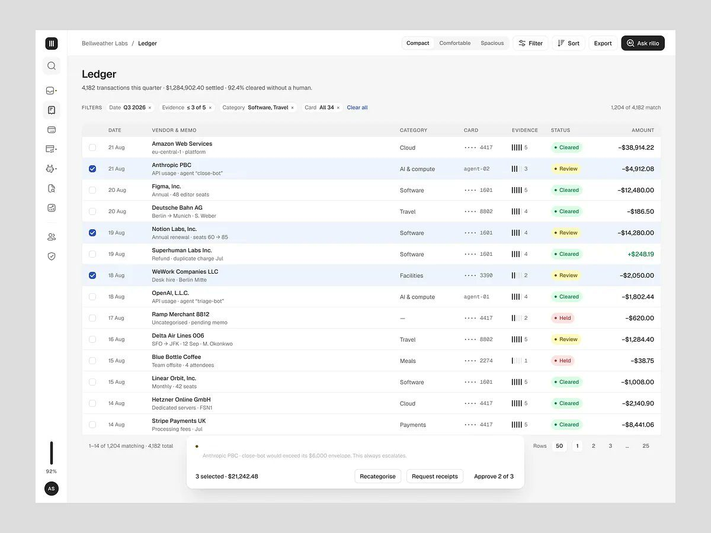

# 07 · Fila de revisão ("Needs you") e o recibo do que a IA fez sozinha

## O que é

Duas coisas que se desenham sempre juntas:

- **A fila:** a lista das decisões que a IA não tomou sozinha e que esperam uma pessoa, cada uma
  com o motivo da retenção, a evidência e a proposta da IA.
- **O recibo:** a frase ou o número que diz quanto trabalho a IA resolveu **sem** a pessoa.

## Problema que resolve

Sem o recibo, a fila parece o produto inteiro, e a pessoa conclui que a IA não faz nada. Sem a
fila, o recibo parece mágica, e a pessoa não confia. Com os dois, a proporção fica visível:
"12 decisões precisam de você, 148 eu resolvi".

## Anatomia (Rillo, em duas telas)

- **Cabeçalho com o recibo embutido:** "Queue · 12 decisions need you. rillo cleared 148 on its
  own today and held 3 it could not corroborate."
- **KPIs no canto:** "12 Need review" (âmbar), "148 Auto-cleared", "92.4% Automated",
  "3 Flagged docs" (vermelho).
- **Modos de leitura:** List · Split · Focus; navegação por teclado "1 of 12" com teclas **K**
  e **J**.
- **Filtros por motivo:** All 12 · Weak evidence 5 · Documents 3 · Policy 4.
- **Cada linha da fila:** fornecedor, valor, contexto ("Team offsite · 4 attendees · 12 Aug"),
  **medidor de evidência** em barrinhas (1/5 a 5/5) e **selo do motivo** em cor
  ("Synthetic receipt", "Seat count +42%", "$404 over fare policy", "Agent spend +38% w/w",
  "No receipt after 6 days", "Above approver ceiling", "Renewed after cancel request", "Weekend
  pattern", "Refund matched to charge" em verde).
- **Painel do item:** título + selo, id da transação em mono "txn_9f2c41ab · Held 12 Aug,
  14:20 · 1.4s", caixa vermelha com a razão ("The receipt does not match the charge"), "What
  rillo checked" (padrão 03), **"rillo proposes"** com quatro passos numerados e o rodapé
  "Every step is editable before it runs. Nothing has been actioned — this decision is held
  pending…", "Also affected" com outros itens do mesmo padrão, e "Request a new receipt".
- **Rodapé da sidebar:** "AUTOMATION RATE 92.4%" com barra segmentada.

## O recibo, em cada produto

| Produto | Frase ou número do recibo |
|---|---|
| Rillo ledger | "4,182 transactions this quarter · $1,284,902.40 settled · 92.4% cleared without a human." |
| Fino | "Handled by Fino this week: 184 transactions categorized, 9 receipts matched, 2 payments recorded." |
| Ergond | "FLEET · TODAY · Actions 250 · In authority 94% · Escalated to humans 9" |
| AgentPay | "Approved autonomously 696 · 78%" |
| Edu.ai | "You've saved 3h 42m this week." + card "Planning time saved 3h 42m · ↑ 41% vs last week" |
| Lepo | "118 jobs documented · 12 corrections" e "Where it paid · Invoice ≤ 15 min 86% · Drafts accepted 91% · Facts corrected 7%" |
| OrchestrateIQ | "APPLIED THIS QUARTER −$312 / mo": "Removed 3 redundant validators −$142/mo", "Cut context on Support → Knowledge −$96/mo" |

## Variações da fila

| Produto | Nome | Particularidade |
|---|---|---|
| Fino | "Needs you" com segmentado "To do · 6 / Done · 14" | agrupada por tempo (TODAY, THIS WEEK), um botão de ação por linha ("See plan", "Remind", "Reconnect", "Review", "Scan"); "12 transactions to review · Fino is unsure about these" |
| Ctrl.ai / AgentPay | "Approval queue · 8 waiting" / "Waiting on you · 7 pending" | risco por linha (Low / Medium / High) e "Open approval center" |
| ComplianceFlow | "Needs Review 12" | seleção em massa com barra preta: "3 activities selected · Assign to matter · Classify as Low Risk · Reque[st]…" |
| Ergond | "Operator queue 6" na sidebar (a primeira seção se chama OPERATE) | a fila é o primeiro item da navegação |
| Edu.ai | "Feedback queue · 36 waiting" | fila ao lado da sugestão da IA |
| Rillo ledger | seleção em massa: "3 selected · $21,242.48 · Recategorise · Request receipts · Approve 2 of 3" | o botão diz **quantos** vai aprovar, porque um dos três escala sempre |

## Quando usar

Em todo produto em que a IA toma decisão com dinheiro, dado pessoal ou compromisso externo.
A fila aparece como **primeiro item da navegação** (Rillo "Queue 12", Ergond "Operator queue 6")
ou como card fixo na tela inicial. **[OBSERVADO em 8 produtos]**

## Como reproduzir

1. Cabeçalho da fila = recibo + fila na mesma frase: `{N} decisions need you. {IA} cleared {M}
   on its own today and held {K} it could not corroborate.`
2. Cada linha: entidade · valor · contexto curto · **selo do motivo específico** · medidor de
   evidência.
3. Filtros pelos motivos, com contagem.
4. Painel lateral com: razão em destaque, o que foi checado, proposta numerada da IA, "nada foi
   executado ainda", itens afetados pelo mesmo padrão.
5. Atalhos de teclado para percorrer (K/J) e contador "1 of 12".
6. Em massa, o botão diz o que vai acontecer de fato ("Approve 2 of 3") e a barra explica a
   exceção.

## Mais exemplos

Telas de outras séries que repetem ou estendem o padrão (fichas em [../06-produtos/](../06-produtos/README.md)).

- **LeaseFlow, inbox** — abas "Review / AI handling / Mine": a fila do humano separada do que a IA está tocando, cada conversa com o que a IA quer fazer ("Approve reply", "Wants a person").
  
