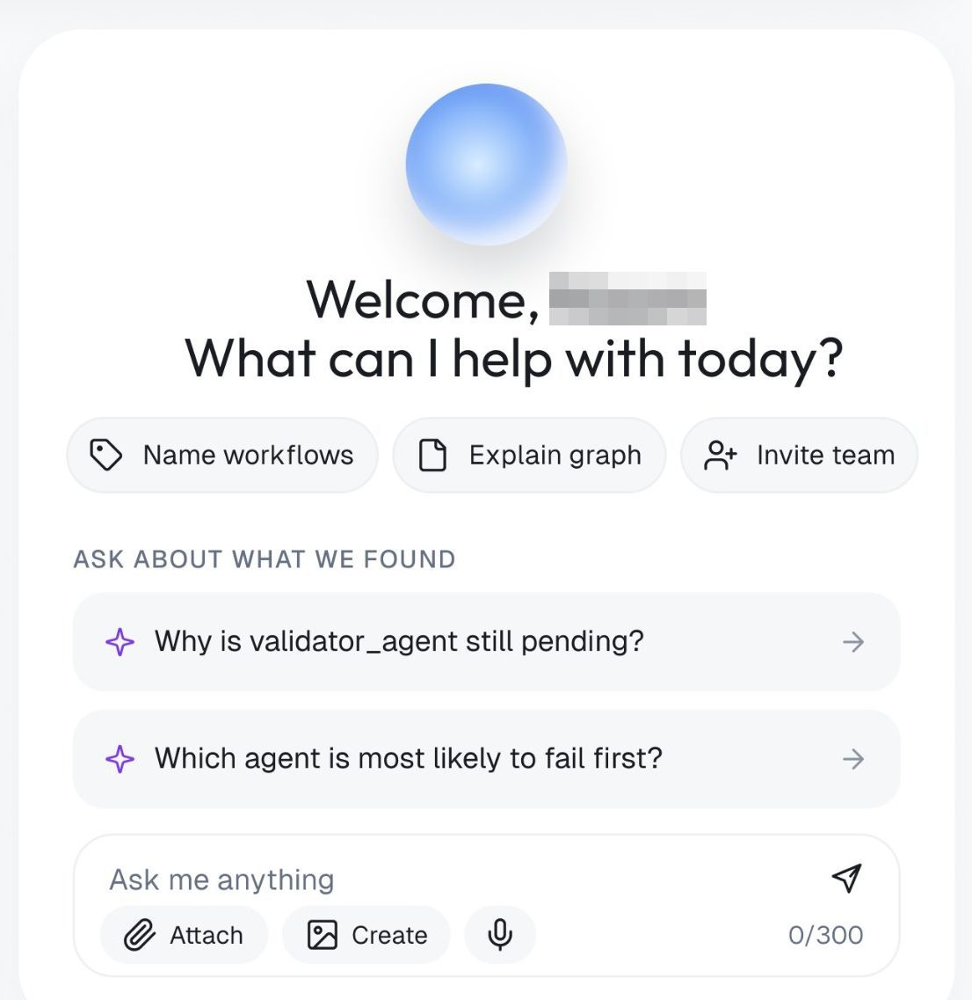
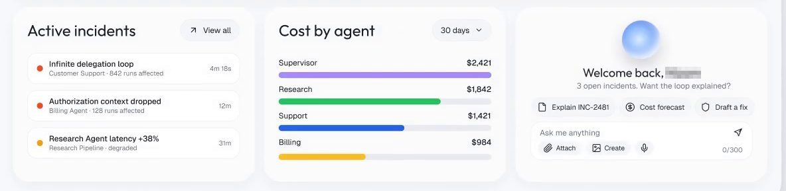
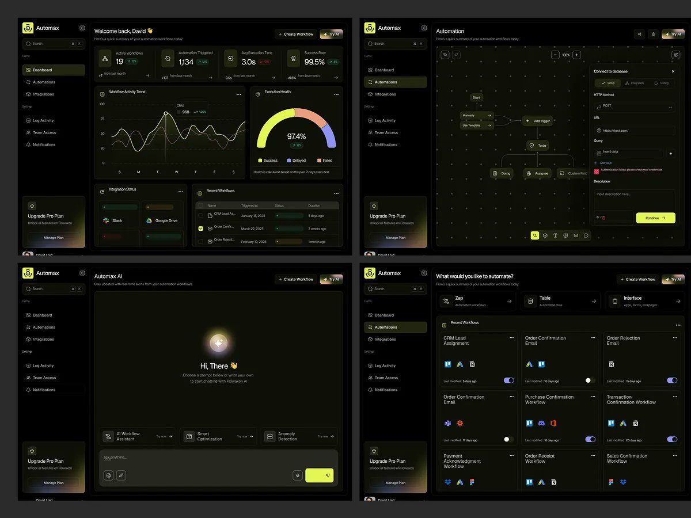

# 08 · Assistente contextual com perguntas sugeridas sobre o que está na tela

## O que é

Um bloco de assistente **dentro** da tela (card, botão no topo ou campo no pé de um card), que já
sabe o que a pessoa está vendo e abre com **perguntas prontas sobre aquele dado**, e não com
"Como posso ajudar?".

## Problema que resolve

O campo de chat vazio obriga a pessoa a saber o que perguntar. Troque isso por perguntas
escritas a partir do estado da tela, que funcionam como atalho para a explicação que a pessoa
provavelmente quer.

## Anatomia (OrchestrateIQ e vídeo)

1. **Orbe** azul em gradiente radial (única ilustração da tela, ~60 px), no topo do card.
2. **Saudação em duas linhas, centralizada:** "Welcome, [nome] / What can I help with today?"
3. **Três ações rápidas** em pílulas com ícone: "Name workflows", "Explain graph", "Invite team".
   São as mesmas tarefas do card "Next steps" (padrão 02), agora executáveis pelo assistente.
4. **Rótulo de seção em caixa-alta pequena:** "ASK ABOUT WHAT WE FOUND".
5. **Duas perguntas sugeridas** em linhas com ícone de brilho e seta: "Why is validator_agent
   still pending?", "Which agent is most likely to fail first?". Ambas citam **uma entidade
   que está na tela** (validator_agent está "Pending" na linha do tempo acima).
6. **Campo "Ask me anything"** com "Attach", "Create", microfone, envio, e contador **"0/300"**.

Na versão de incidentes (quadro do vídeo), o assistente muda com o estado:

> "Welcome back, [nome] · **3 open incidents. Want the loop explained?**" com ações
> "Explain INC-2481", "Cost forecast", "Draft a fix".

A saudação deixa de ser genérica e **resume o estado e oferece a próxima explicação**.

## Variações

| Produto | Forma | Texto |
|---|---|---|
| Mortgage Flow | campo no pé do card "Action required" | placeholder "Ask what a mortgage term means…" (o assistente explica jargão, no lugar exato em que a pessoa trava) |
| Haulsight | botão de destaque no topo, gradiente azul → verde | "✦ Ask Haulsight" |
| Vero, Rillo, Ctrl.ai | botão no topo, ao lado de busca | "Ask vero", "Ask rillo ⌘K", "Ask Ctrl" |
| Salestrain (série anterior) | botão com persona | "Ask Coach Dean" |
| Rillo | busca e assistente fundidos | "Ask rillo or search ⌘K" |
| Edu.ai | card de sugestão com "Why this?" sublinhado | a explicação é um link no próprio card |
| medspa | card no pé da sidebar | "Flow Assist · 6 clients are due to rebook this week. Draft reminders? · Review list" (o assistente pergunta, não espera ser perguntado) |

## A regra por trás

O assistente quase nunca é a primeira coisa da tela. Ele vem **depois** do dado e do
próximo passo, na terceira coluna ou no topo direito. Quando ocupa a tela inteira (Automax:
"Hi, There 👋 Choose a prompt below or write your own"), rende abaixo do
típico da semana: 1.378 views, índice 0,72, contra 78.682 do OrchestrateIQ, em que o assistente vem
depois do dado. Não é o pior do lote de produtos de IA (a Lora teve 623 views, índice 0,26).
**[OBSERVADO; desempenho MEDIDO]**

## Como reproduzir

1. Nunca abrir com o campo vazio sozinho. Abrir com: saudação curta + estado resumido em uma
   frase + 2 ou 3 ações + 2 perguntas sobre entidades visíveis.
2. As perguntas citam nome de coisa da tela (`validator_agent`, `INC-2481`) e terminam com "?".
3. Ícone de brilho (✦) nas perguntas e nas ações da IA, em toda a interface: é o marcador de
   "isto é IA".
4. Limite de caracteres visível ("0/300") no campo.
5. Nome do botão = "Ask" + nome do produto. Atalho ⌘K ao lado quando for global.

## Mais exemplos

Telas de outras séries que repetem ou estendem o padrão (fichas em [../06-produtos/](../06-produtos/README.md)).

- **Mortgage Flow, linguagem simples** — o cartão "In plain English · What is underwriting?" com a explicação e um campo para perguntar outro termo, ao lado da etapa em que o termo aparece.
  
