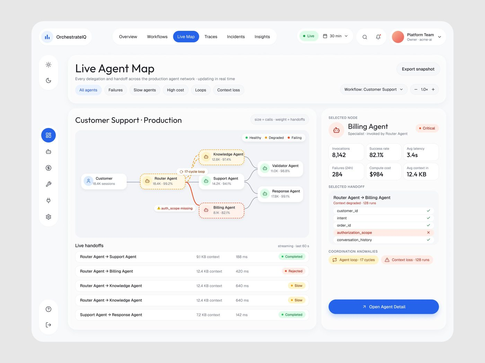
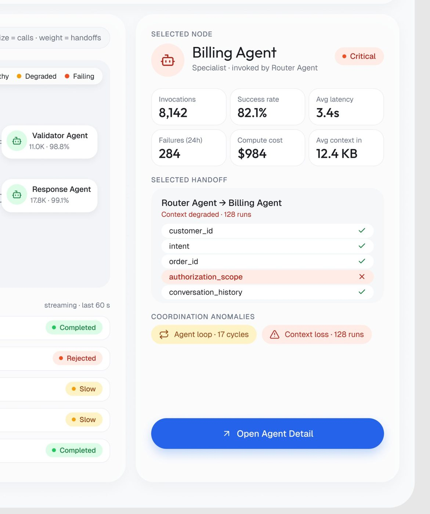
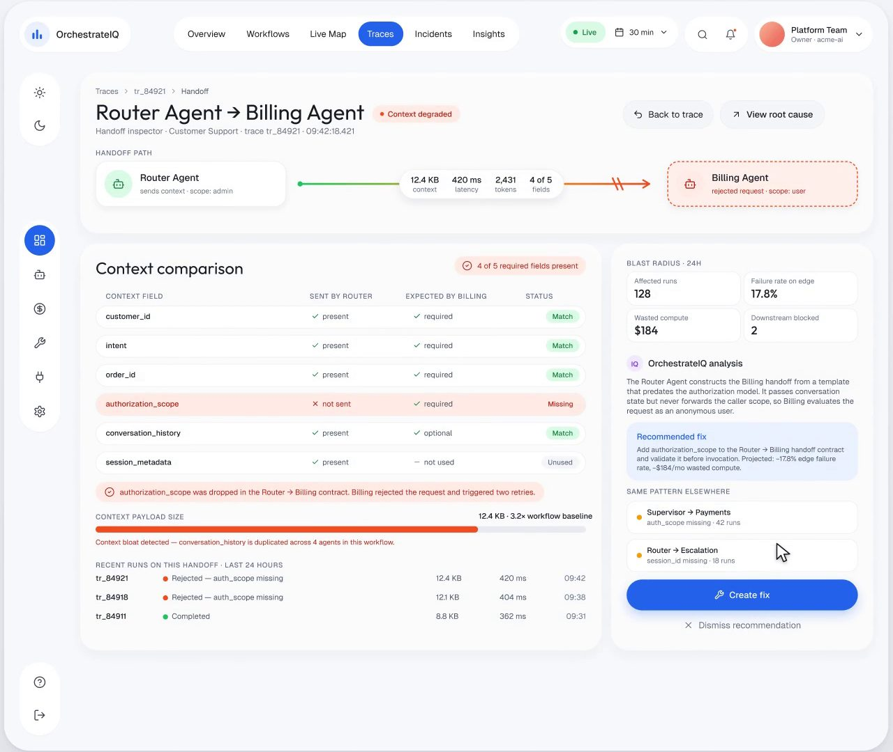

# 09 · Mapa vivo de agentes e inspetor de handoff

## O que é

Um grafo que mostra **quem chama quem** entre os agentes, ao vivo, com cor de saúde em cada nó e
em cada aresta, e um painel lateral que abre o nó ou o handoff selecionado. Do grafo se desce
até o campo exato que se perdeu entre dois agentes.

## Problema que resolve

Em sistema multiagente, a falha raramente está num agente: está **entre** dois deles (contexto
perdido, loop de delegação). Lista e tabela escondem isso. O grafo mostra a aresta doente.

## Anatomia (OrchestrateIQ, "Live agent Map", 21.452 views, 375 salvos)

- **Título e subtítulo:** "Live Agent Map · Every delegation and handoff across the production
  agent network · updating in real time".
- **Filtros por tipo de problema** (chips): All agents, Failures, Slow agents, High cost,
  Loops, Context loss. Os filtros são os **modos de falha** de sistema multiagente, não campos
  de banco.
- **Contexto do grafo:** "Customer Support · Production", seletor "Workflow: Customer Support",
  zoom "− 1.0× +", "Export snapshot".
- **Legenda da codificação:** "size = calls · weight = handoffs" e "● Healthy ● Degraded
  ● Failing". A legenda diz o que o tamanho e a espessura significam.
- **Nós** como cards brancos com ícone de robô, nome e `{volume} · {taxa}` ("Router Agent ·
  18.4K · 99.2%"). Nó degradado: borda **tracejada** âmbar e fundo creme; nó falhando: borda
  tracejada vermelha e fundo rosado.
- **Anotação na aresta:** pílula "⟳ 17-cycle loop" sobre a aresta em loop.
- **Stream abaixo:** "streaming · last 60 s" com latência e estado por linha (Completed,
  Rejected, Slow).
- **Painel lateral:**
  - "SELECTED NODE · Billing Agent · Specialist · invoked by Router Agent · ● Critical", grade
    de 6 KPIs (Invocations 8,142, Success rate 82.1%, Avg latency 3.4s, Failures (24h) 284,
    Compute cost $984, Avg context in 12.4 KB).
  - "SELECTED HANDOFF · Router Agent → Billing Agent · Context degraded · 128 runs", lista dos
    campos passados com ✓ e o faltante em linha vermelha ("authorization_scope ✕").
  - "COORDINATION ANOMALIES": "⟳ Agent loop · 17 cycles" (âmbar), "⚠ Context loss · 128 runs"
    (vermelho).
  - CTA "↗ Open Agent Detail" em azul, largura total.

## O inspetor de handoff (um nível abaixo)

Do mapa se chega a "Router Agent → Billing Agent · ● Context degraded" (quadro do vídeo
, ~6,8 s):

- **HANDOFF PATH:** card do emissor ("Router Agent · sends context · scope: admin") → linha
  verde que vira vermelha e é **cortada** com duas barras "//" → card do receptor tracejado em
  vermelho ("Billing Agent · rejected request · scope: user"). No meio da linha, a pílula com
  "12.4 KB context · 420 ms latency · 2,431 tokens · 4 of 5 fields".
- **Context comparison:** tabela CONTEXT FIELD / SENT BY ROUTER / EXPECTED BY BILLING / STATUS
  (Match, Missing, Unused), com a linha faltante em fundo rosa.
- Frase de diagnóstico em pílula vermelha: "authorization_scope was dropped in the Router →
  Billing contract. Billing rejected the request and triggered two retries."
- "CONTEXT PAYLOAD SIZE · 12.4 KB · 3.2× workflow baseline" + "Context bloat detected —
  conversation_history is duplicated across 4 agents in this workflow."
- Coluna direita: "BLAST RADIUS · 24H" (Affected runs 128, Failure rate on edge 17.8%, Wasted
  compute $184, Downstream blocked 2), "OrchestrateIQ analysis" em parágrafo, "Recommended fix"
  em caixa azul clara com o ganho projetado ("Projected: −17.8% edge failure rate, −$184/mo
  wasted compute"), "SAME PATTERN ELSEWHERE" e o par "Create fix" / "Dismiss recommendation".
- **Caso de controle**: a mesma aresta num run saudável, "Context
  complete · the same edge that failed in tr_84921", "Compare wit[h]…", e a análise "This run is
  the control case… The 1[7] that fail on this edge differ in exactly one field." com "Nothing to
  fix on this run · FIX-117 is watching this edge in Monitor mode. Warn after 48 h with 0 false
  positives."

## Variações

- **Na tela inicial** o mapa aparece compacto ("Live agent network · 42 workflows · 186 agents ·
  1 degraded node · updating in real time") com os mesmos códigos de borda.
- **Ctrl.ai** faz o mapa em outra direção: **agentes à esquerda,
  sistemas conectados à direita** (Salesforce "4 agents connected", Gmail, Slack, Google Drive,
  Zendesk, Stripe, NetSuite), fundo escuro pontilhado, alternância Map / List e rodapé de
  filtro "Low · Medium · High · 5 of 42 shown · Show all".
- **AgentTrail** usa o mesmo canvas pontilhado para a cadeia de decisão de um evento (padrão
  05).
- **OrchestrateIQ "We found your system"** troca o grafo por uma **linha do tempo por agente**
  (padrão 01) quando o objetivo é mostrar descoberta, não topologia.

## Como reproduzir

1. Nó = card com ícone, nome, `{volume} · {taxa de sucesso}`. Estado pela **borda** (sólida ok,
   tracejada âmbar degradado, tracejada vermelha falhando) e fundo levemente tingido.
2. Aresta com espessura = volume; anomalia escrita em pílula sobre a aresta.
3. Legenda da codificação sempre visível ("size = calls · weight = handoffs").
4. Filtros = modos de falha.
5. Clique no nó abre painel com KPIs; clique na aresta abre o contrato de contexto campo a
   campo.
6. Diagnóstico sempre fecha com: impacto (blast radius), análise em prosa, correção recomendada
   com ganho projetado, onde mais o padrão acontece, e o par criar / dispensar.
