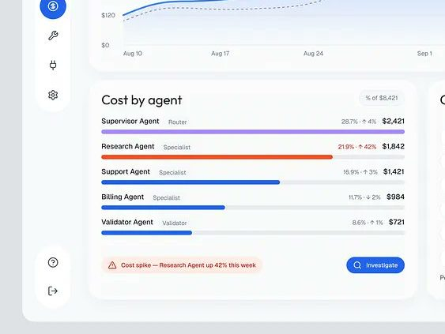
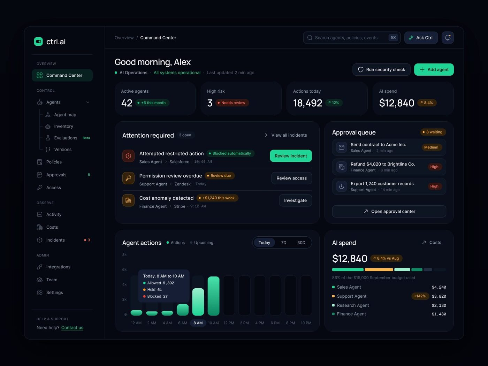
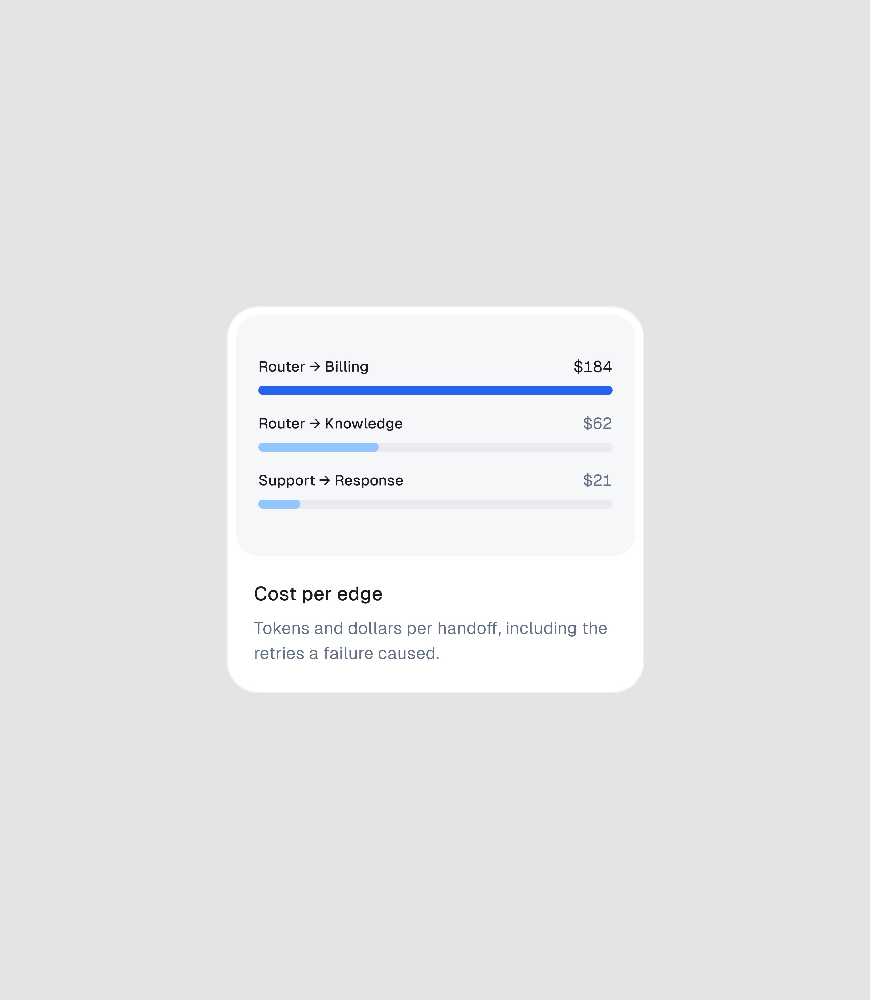
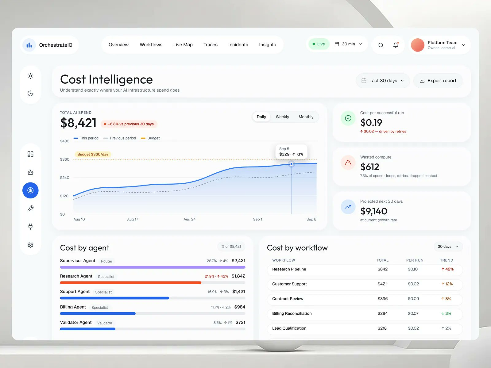

# 10 · Custo por agente, tokens e desperdício

## O que é

O gasto com IA tratado como linha de operação: **quanto cada agente e cada workflow custa**,
**por que subiu**, **quanto foi desperdiçado** e **quanto uma correção economiza**. Tokens
aparecem no nível técnico (trace); dinheiro aparece no nível de gestão.

## Problema que resolve

Custo de modelo cresce em silêncio: loop de delegação, contexto duplicado, retry. Quem paga não
enxerga a causa. Ligue cada número de custo a uma causa e a uma ação.

## Anatomia (OrchestrateIQ, e overview do vídeo)



- **KPIs com causa no subtítulo:**
  - "Cost per successful run $0.19 · ↑ $0.02 — driven by retries" (em vermelho).
  - "Wasted compute $612 · 7.3% of spend · loops, retries, dropped context".
  - "Projected next 30 days $9,140 · at current growth rate".
  O custo é por **run bem-sucedido**, não por chamada: a métrica já embute a falha.
- **Gráfico diário** com tooltip "Sep 5 · $329 · ↑ 7.1%" e linha tracejada de orçamento.
- **Cost by agent** com chip "% of $8,421": nome + papel em cinza ("Supervisor Agent · Router"),
  `{%} · {variação}` e valor à direita ("28.7% · ↑ 4% · $2,421"); a barra do agente anômalo em
  laranja-vermelho ("Research Agent · 21.9% · ↑ 42% · $1,842"), as demais em azul. Alerta no pé:
  "⚠ Cost spike — Research Agent up 42% this week" + botão "Investigate".
- **Cost by workflow:** tabela WORKFLOW / TOTAL / PER RUN / TREND ("Research Pipeline · $842 ·
  $0.10 · ↑ 42%") e rodapé "Potential savings: $842/mo from redundant handoffs" + botão
  "✦ Optimize".
- **Insights já aplicados:** "APPLIED THIS QUARTER −$312 / mo" com os cortes em linha
 .

## No nível técnico (trace)

Cada barra do waterfall termina em `{s} · {tokens} tok` ("0.87s · 3,104 tok") e o span mostra
"Input tokens 3,241 · Output tokens 821 · Cost $0.14 · Model GPT-5". O custo do trace inteiro
aparece no topo: "$0.42 · 3.2× workflow avg". **[OBSERVADO no quadro do vídeo]**

## Variações

| Produto | Como o custo aparece |
|---|---|
| Ctrl.ai | "AI spend $12,840 · ↗ 8.4% vs Aug", barra segmentada por agente, "**86% of the $15,000 September budget used**", lista por agente com o anômalo marcado "+142%" |
| AgentPay | o gasto é o que o agente **paga** a fornecedores: "Total agent spend $84,420 · ↑ 12.4% vs last month"; anomalia contra a faixa normal ("Normal range $50 to $120 / day · Today $840") |
| Rillo | o gasto de API de IA vira despesa de cartão comum: "Anthropic PBC · API usage · agent "close-bot" · AI & compute", cartão "agent-02"; na fila, "Agent spend +38% w/w" |
| Ctrl.ai Command Center | "Cost anomaly detected · +$1,240 this week · Finance Agent › Stripe · 9:12 AM" como item de "Attention required" |



## Regras que se repetem

1. **Todo aumento vem com o porquê** ("driven by retries", "loops, retries, dropped context").
2. **Custo relativo e absoluto juntos** ("28.7% · $2,421", "86% of the $15,000 budget").
3. **Anomalia contra o normal do próprio agente**, não contra um limite fixo.
4. **Cor de alerta só no item anômalo**; os outros ficam na cor neutra de dado (azul ou verde).
5. **Toda perda tem uma ação** ("Investigate", "Optimize", "Create fix") e, quando possível, o
   ganho projetado em dinheiro por mês.
6. Agente de IA tem **cartão e orçamento próprios** ("agent-02", "$6,000 envelope"), como um
   funcionário.

## Como reproduzir

```
Cost per successful run        Wasted compute                 Projected next 30 days
$0.19                          $612                           $9,140
↑ $0.02 · driven by retries    7.3% of spend · loops, retries at current growth rate
```

Lista de custo por agente: `nome` (14 px, médio) + `papel` (13 px, cinza) à esquerda;
`% · variação` (13 px, cinza; vermelho quando anômalo) + `valor` (14 px, semibold) à direita;
barra de 6 px abaixo, raio total.

## Mais exemplos

Telas de outras séries que repetem ou estendem o padrão (fichas em [../06-produtos/](../06-produtos/README.md)).

- **Cartão de recurso "Cost per edge"** — o custo de cada aresta entre agentes (Router → Billing $184), "Tokens and dollars per handoff, including the retries a failure caused"; no vídeo, o cartão abre o detalhe e a chave "Freeze spend on this edge".
  
- **OrchestrateIQ, Cost Intelligence** — gasto total contra orçamento, custo por execução, compute desperdiçado e custo por agente e por workflow.
  
