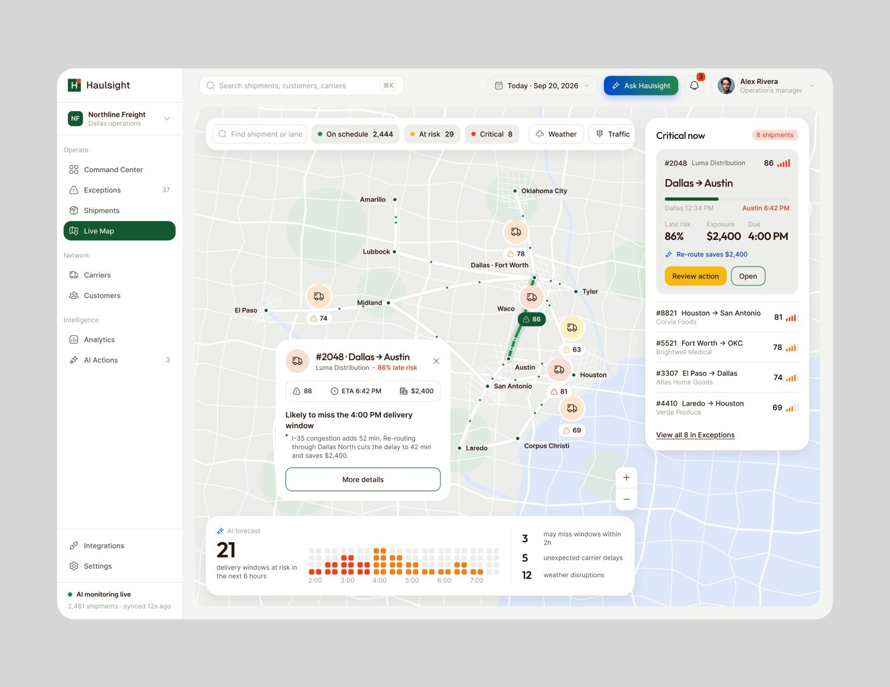
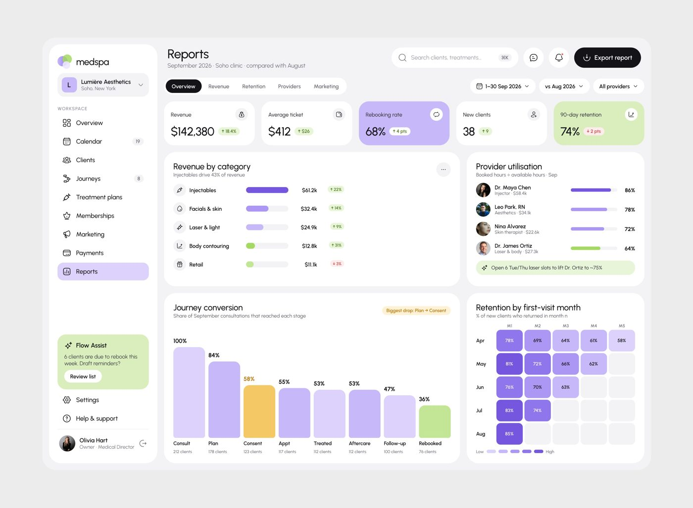
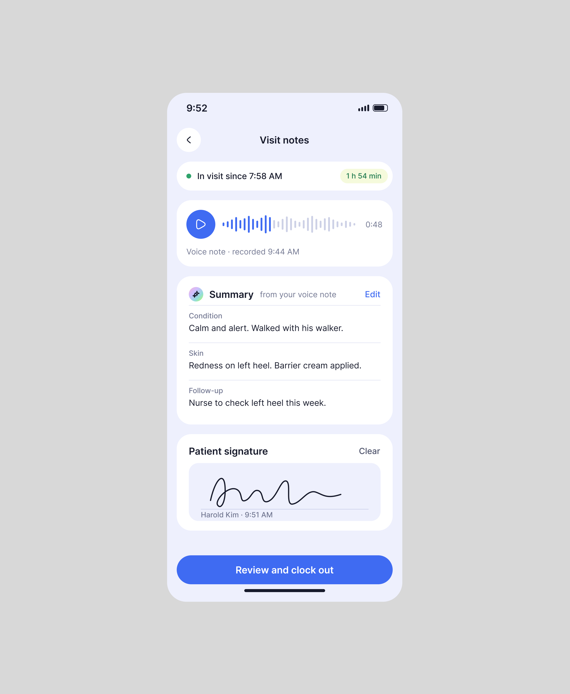
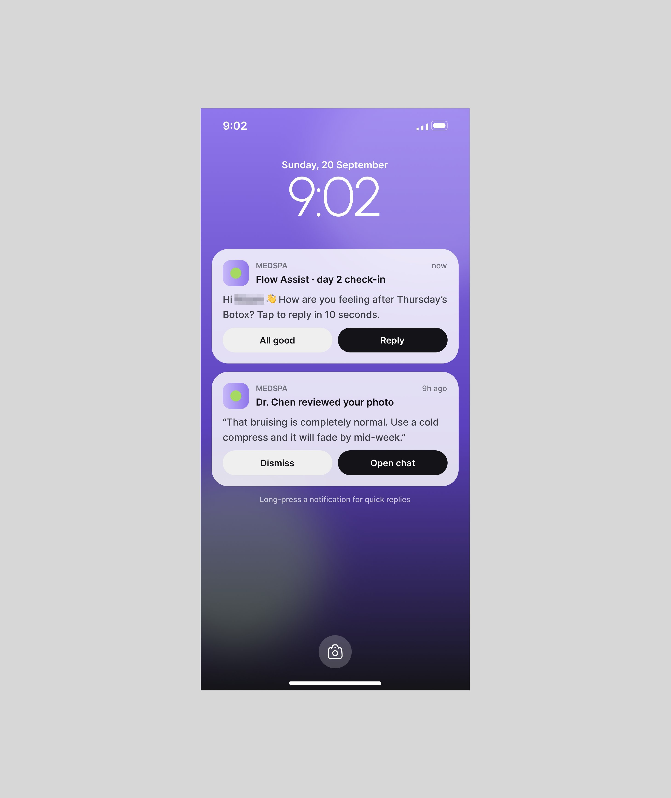

# 11 · IA embutida no produto vertical, com nome e cor próprios

## O que é

No produto de nicho (licença solar, frota, clínica, cobrança, escola, caixa de pequeno negócio),
a IA não é uma seção: é uma **camada que aparece nos pontos de decisão do fluxo que já existe**,
sempre com o mesmo nome, o mesmo ícone de brilho e uma cor de destaque que só ela usa.

## Problema que resolve

Dono de empresa tradicional não quer "usar IA": quer a licença aprovada, a entrega no horário,
o cliente de volta. A IA do método entra **no vocabulário do ramo** e na tela que a pessoa já usa.

## Anatomia (Permitly, 81.873 views, 1.438 salvos)

A IA aparece em **quatro lugares** da mesma tela, sempre com o nome "Permit AI" e o verde-limão
`#C6F048` (cor saturada dominante da imagem, 27.768 amostras; token publicado `lime/500
#C9F24C`, ver `../01-sistema-visual/design-system-publicado.md`):

1. **No pé da sidebar:** card limão "✦ Permit AI · On · 128 projects" com um toggle (a IA pode
   ser desligada) e a linha "7 need attention ›".
2. **No topo da página:** chip limão ao lado da saudação "⚠ 7 projects need attention".
3. **Na tabela:** chip "✦ Ranked by Permit AI" no cabeçalho, ao lado dos filtros. A IA é o
   critério de ordenação.
4. **Card escuro de insight:** "✦ Permit AI · 6 min ago · 7 projects at risk of slipping ·
   ● 3 are missing required documents · ● 2 have unusual review delays · ● 2 may miss their
   install dates" + botão limão "Review risks".

No design system do mesmo produto, as frases de amostra da tipografia
já são a voz da IA: "Permitly reads the address and builds the requirement set.", "Austin
Energy requires battery documentation for this project.", "Main disconnect information
missing". **[OBSERVADO]**

## O mesmo desenho em outros verticais

| Produto (id) | Nome da IA | Cor/forma da IA | Onde entra no fluxo |
|---|---|---|---|
| Haulsight | "Ask Haulsight", "AI Actions 3", "AI forecast", "AI monitoring live" | botão em gradiente azul → verde; ícone de brilho azul | "Re-route saves $2,400" dentro do card do embarque crítico; "21 delivery windows at risk in the next 6 hours"; o motivo em uma frase: "I-35 congestion adds 52 min. Re-routing through Dallas North cuts the delay to 42 min and saves $2,400." |
| medspa | "Flow Assist" | card verde-claro no pé da sidebar; no app do cliente, item de aftercare "Day 2 check-in with Flow Assist" | "6 clients are due to rebook this week. Draft reminders?"; no painel, "✦ Open 6 Tue/Thu laser slots to lift Dr. Ortiz to ~75%" dentro do card de utilização |
| Fino | "Fino's read", "Drafted by Fino", "Fino · Forecast" | borda em gradiente pastel (pêssego → lilás → azul) e chip com o mesmo gradiente | leitura da fatura em atraso, rascunho do lembrete, previsão de caixa |
| Edu.ai | "AI suggestion" | card roxo `#3000BA` com chip limão e link "Why this?" | "2 lessons could benefit from differentiation · Year 8 Biology · Photosynthesis · 3 EAL · 2 SEN learners" + "Review suggestions" |
| PriorAuth | sem nome, só o evento | ícone de brilho em círculo lilás na lista de atividade | "AI review completed · Knee Arthroscopy · Maria Gonzal…"; e as "Approval odds" por caso |
| CollectAI | sem nome, ícone de brilho verde | frase em cinza embaixo de cada devedor | "Delay is 2.2x their normal pattern", "Third missed promise this quarter", "Usually pays 3 days after the due date" |
| Lepo | "Lepo" como sujeito das frases | selos verdes | "Where Lepo heard it", "How Lepo is doing across your 7 techs" |
| Torin | "we" | card branco com seção "WHY WE FLAGGED IT" | "These might do the same job · ChatGPT Plus / Perplexity Pro · Both are general AI assistants with web search. Plenty of people pay for both on purpose — only you know." + "Keep both" / "Cancel Perplexity" |
| Mortgage Flow | sem nome, ícone de brilho roxo | campo e nota com brilho | "Ask what a mortgage term means…", "Only the September payslip an[d]… are left. Everything else is in." |
| Marketing | "AI found a pattern" | chip roxo translúcido | "Lifestyle photos beat white-background shots · Creatives showing the cap out on a walk generated 32% higher CTR than white-background product shots across your last 18 campaigns." com "18 campaigns analysed" |

## Regras que se repetem

1. **Nome próprio para a IA**, derivado do produto ("Permit AI", "Flow Assist", "Fino"), e o
   nome é o sujeito da frase ("Permitly reads…", "Fino will update this insight…").
2. **Uma cor reservada para a IA** em cada produto (limão no Permitly, gradiente no Haulsight e
   no Fino, roxo no Edu.ai). A cor não é usada para outra coisa na tela. **[OBSERVADO em 5
   produtos]**
3. **Ícone de brilho (✦, quatro pontas, às vezes com um brilho menor)** marca toda saída de IA:
   chip, linha de insight, botão, evento de atividade. É o único ícone "mágico" da interface.
4. **A frase da IA é do ramo, não de IA**: "at risk of slipping", "missing required documents",
   "may miss their install dates", "due to rebook". Nenhuma tela diz "AI-powered insight".
5. **A IA quantifica em dinheiro ou tempo do negócio** ("Re-route saves $2,400", "You've saved
   3h 42m this week", "$184,500 across 8 cases that may miss their procedure date").
6. **A IA pode ser desligada** (toggle "Permit AI · On").
7. **Respeita a decisão do dono**: Torin diz "Plenty of people pay for both on purpose — only you
   know" e oferece "Keep both" com o mesmo peso visual de "Cancel".

## Quando usar

Em todo produto de nicho. É o padrão das peças que mais salvam: Permitly (1.438 salvos),
Mongi/delivery (973), OrchestrateIQ (865). **[MEDIDO]**

## Como reproduzir

- Escolha o nome ("{Produto} AI" ou um nome curto) e a cor de IA; use-os em **todos** os pontos.
- Coloque a IA em quatro lugares no máximo: estado global (sidebar), alerta do topo, critério da
  lista, card de insight com CTA.
- Card de insight: `✦ {Nome} · {há quanto tempo}` / título com número e consequência / 3
  bullets com número / 1 botão com verbo ("Review risks").
- Toda frase da IA passa no teste: um dono do ramo entenderia sem saber que existe IA?

## Mais exemplos

Telas de outras séries que repetem ou estendem o padrão (fichas em [../06-produtos/](../06-produtos/README.md)).

- **Quotepilot, trabalho extra** — a nota de voz vira texto ("written up from your voice note") e o botão azul "price it with ai" precifica o serviço extra.
  
- **CareOps, nota da visita** — o "Summary from your voice note" separado por campo (condição, pele, acompanhamento) antes da assinatura do paciente.
  
- **PriorAuth, evidências** — "Scan a paper document · The AI reads it and links it to the right requirement".
  
- **Torin, preço que subiu** — "What Torin noticed" com a base (bank data, 6 charges) e as saídas ("See cheaper ways to keep it" / "It's fine, keep it").
  
- **Medspa, notificação** — o Flow Assist pergunta pelo dia 2 do pós-procedimento com resposta direta na notificação ("All good" / "Reply").
  
