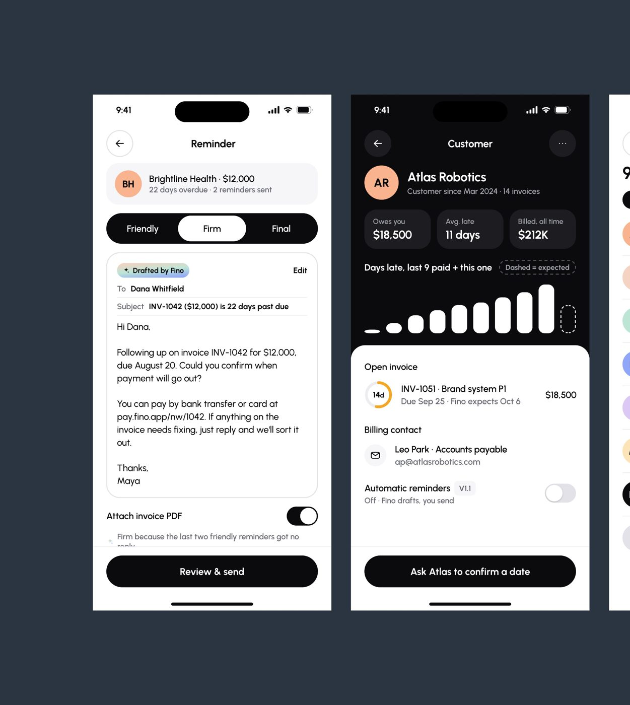
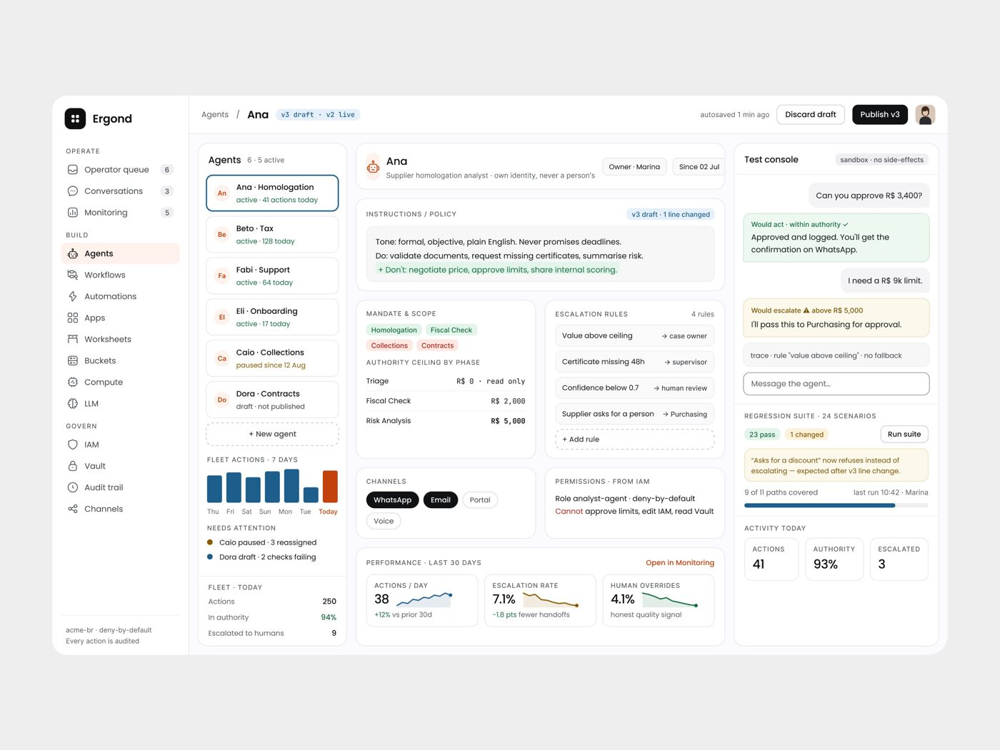
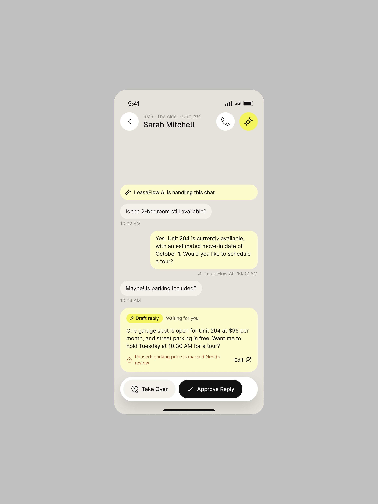
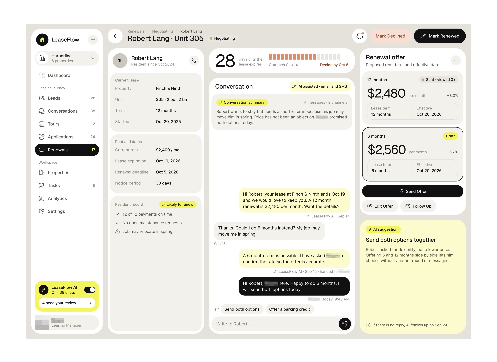
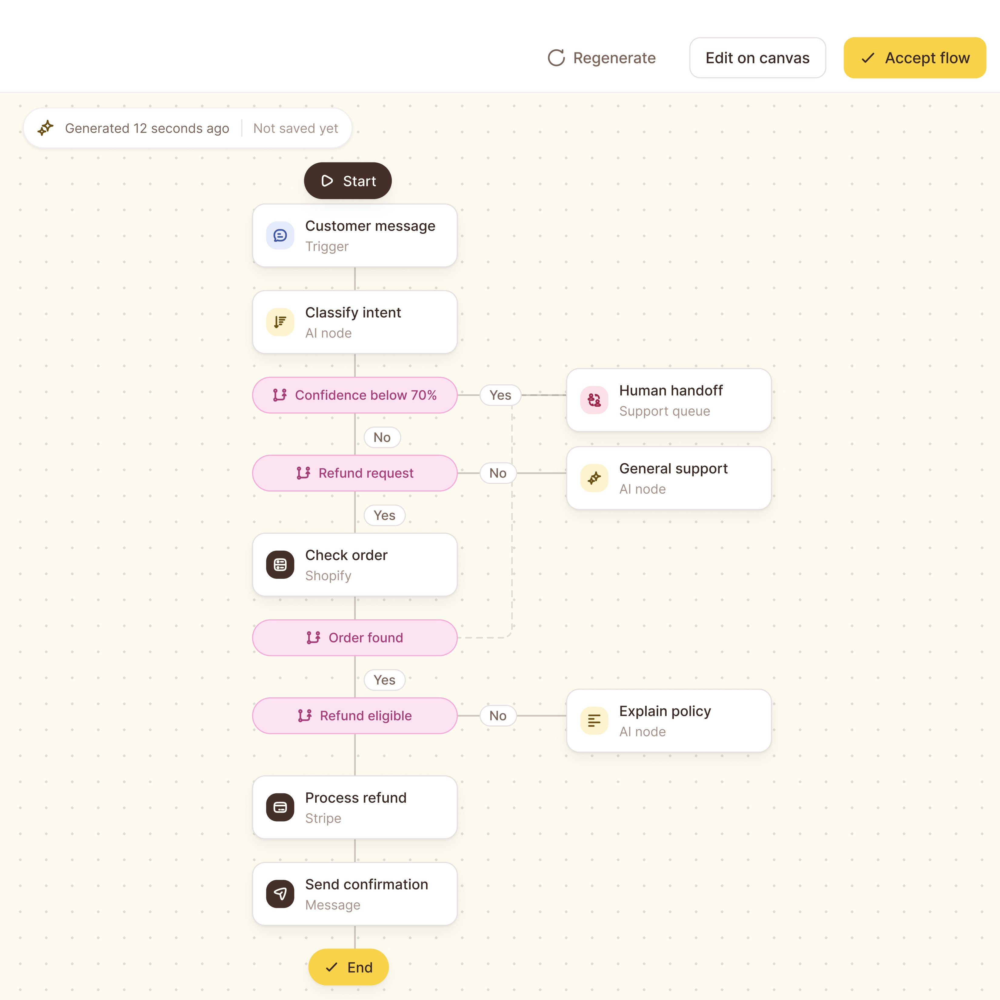
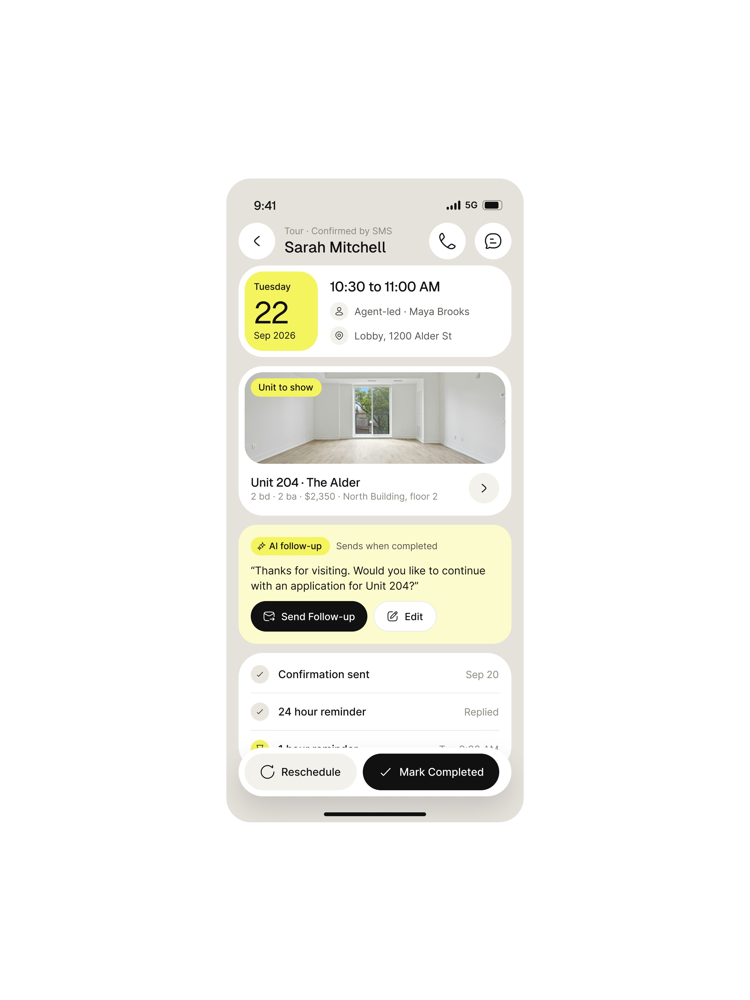

# 12 · A IA rascunha, o humano envia; tudo reversível; sandbox antes de publicar

Padrão acrescentado nesta pesquisa (não estava no briefing). Aparece em cinco produtos e fecha o
circuito do padrão 06: se a IA age dentro de um limite, o que ela fez precisa poder ser visto
antes, testado antes e desfeito depois.

## O que é

Três mecanismos de segurança, com interface própria:

1. **Rascunho:** a IA prepara a ação (e-mail, reembolso, mudança de estágio) e para no botão de
   envio, que é humano.
2. **Desfazer:** toda ação executada tem volta visível (toast com "Undo", reversão por prazo,
   "Hand back to agent").
3. **Sandbox:** mudança de instrução ou política é testada num console sem efeito colateral e
   numa suíte de regressão antes de ser publicada.

## Anatomia 1: rascunho (Fino)

- Tela "Reminder" com o contexto "Brightline Health · $12,000 · 22 days overdue · 2 reminders
  sent".
- **Segmentado de tom:** Friendly · **Firm** · Final. A IA escolheu "Firm" e explica no rodapé:
  "✦ Firm because the last two friendly reminders got no reply."
- **Chip "✦ Drafted by Fino"** com gradiente, e "Edit" à direita.
- O e-mail inteiro visível (To, Subject "INV-1042 ($12,000) is 22 days past due", corpo, "Thanks,
  Maya"). **Assinado pela pessoa, não pela IA.**
- Toggle "Attach invoice PDF" e o CTA "Review & send". O verbo é "revisar e enviar", nunca
  "enviar" direto.
- Na ficha do cliente: "Automatic reminders · V1.1 · Off · **Fino drafts, you send**". A frase
  do toggle desligado explica o modo em que a IA opera.

## Anatomia 2: desfazer

- Fino: toast escuro "✓ Reminder sent to Dana · Undo" sobre o histórico, e o botão principal
  vira "Reminded today" desabilitado. **[OBSERVADO]**
- Contractor app: "sarah knows you're coming · we texted her an 8:55 –
  9:10 am window · ✓ notified 8:33 am · office updated · **undo**". A ação automática aconteceu,
  e o undo fica no mesmo card.
- Vero (leitura parcial): "Every stage move vero makes can be reverted for
  thirty days. Reverting also pins the stage so vero will not move it again." **[OBSERVADO,
  imagem de 1024 px, texto pequeno]**
- Vero decision record: "How to reverse it" como campo fixo (padrão 04).
- Rillo: "Every step is editable before it runs. Nothing has been actioned — this decision is
  held pending…".
- Ergond: "Hand back to agent" (padrão 06).

## Anatomia 3: sandbox e regressão (Ergond)

- Cabeçalho da ficha do agente: "Agents / Ana · `v3 draft · v2 live`" + "autosaved 1 min ago" +
  "Discard draft" + **"Publish v3"**.
- Instrução com diff: "v3 draft · 1 line changed", a linha nova em verde com "+".
- **"Test console · sandbox · no side-effects"**: conversa simulada em que a resposta do agente
  vem com o **veredito da política** em cima, em verde "Would act · within authority ✓" ou âmbar
  "Would escalate ⚠ above R$ 5,000", e embaixo a linha de trace "trace · rule "value above
  ceiling" · no fallback". Campo "Message the agent…".
- **"REGRESSION SUITE · 24 SCENARIOS":** "23 pass" (verde), "1 changed" (âmbar), "Run suite", e a
  explicação da mudança: ""Asks for a discount" now refuses instead of escalating — expected
  after v3 line change." + "9 of 11 paths covered · last run 10:42 · Marina".

## Quando usar

Rascunho: sempre que a IA fala **para fora** da empresa (cliente, fornecedor). Desfazer: sempre
que a IA age sozinha em algo visível para terceiro. Sandbox: sempre que a pessoa muda o
comportamento do agente. **[OBSERVADO em 5 produtos]**

## Como reproduzir

1. Ação externa da IA = rascunho com chip "✦ Drafted by {IA}", botão "Edit" e CTA "Review &
   send". Assinatura da pessoa.
2. Se a IA escolheu um tom ou uma variante, mostre as opções (segmentado) e **uma linha dizendo
   por que escolheu aquela**.
3. Ação automática executada = toast com "Undo" + o botão principal muda para o estado feito.
4. Versão de agente e de política no cabeçalho (`v3 draft · v2 live`), com "Discard draft" e
   "Publish v3".
5. Console de teste marcado "sandbox · no side-effects", com veredito da política em cada
   resposta, em condicional ("Would act", "Would escalate").
6. Suíte de regressão com contagem de passou / mudou e a frase que explica cada mudança como
   esperada ou não.

## Mais exemplos

Telas de outras séries que repetem ou estendem o padrão (fichas em [../06-produtos/](../06-produtos/README.md)).

- **LeaseFlow, rascunho esperando** — "LeaseFlow AI is handling this chat" e o rascunho "Draft reply · Waiting for you" com o motivo da pausa e o par **Take Over / Approve Reply**.
  
- **LeaseFlow, renovação** — "AI suggestion · Send both options together" com o porquê, ao lado das duas ofertas prontas.
  
- **"Refund Assistant", fluxo gerado** — "Generated 12 seconds ago · Not saved yet" com Regenerate / Edit on canvas / Accept flow.
  
- **LeaseFlow, follow-up da visita** — "AI follow-up · Sends when completed" com a mensagem pronta e Send follow-up / Edit.
  
- **Clawback, provável garantia** — "Likely under warranty" com o porquê e a lista do que capturar, na versão do app que o cliente recusou.
  
