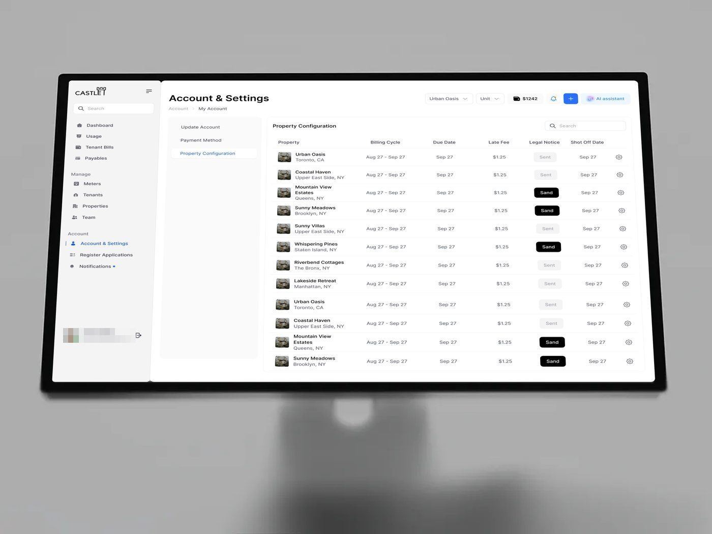

# Configuração

## O que é

Tela onde o usuário define regras. No método, quase nunca é "Settings"
genérico: é **configuração de comportamento de IA** (política, escopo, teto de
autoridade, escalonamento, canais, permissões). Exemplos: Ergond agente "Ana",
AgentTrail Policies, Ergond LLM
routing, Castle Account & Settings,
Castle onboarding "Select an account type".

## Esqueleto (Ergond, bloco central de 593 px)

```
INSTRUCTIONS / POLICY                              [v3 draft · 1 line changed]
┌ caixa cinza com o texto da política; a linha nova em verde com "+ Don't: ..." ┐
┌ MANDATE & SCOPE ──────────────┐ ┌ ESCALATION RULES ─────────── 4 rules ┐
│ chips de escopo (verde/rosa)  │ │ "Value above ceiling → case owner"   │
│ AUTHORITY CEILING BY PHASE    │ │ "Certificate missing 48h → supervisor"│
│ Triage      R$ 0 · read only  │ │ ...                                   │
│ Fiscal      R$ 2,000          │ │ [+ Add rule] tracejado                │
└───────────────────────────────┘ └───────────────────────────────────────┘
┌ CHANNELS: WhatsApp · Email (pretas = ativas) · Portal · Voice (contorno) ┐ ┌ PERMISSIONS · FROM IAM ┐
```
Topo da tela: "autosaved 1 min ago", "Discard draft", **"Publish v3"** em botão
preto: configuração tem **rascunho e publicação**, como código.




## Hierarquia

1. O estado de versão (draft × live) e o botão de publicar.
2. O texto da política com o diff destacado.
3. As regras em linhas "condição → destino".

## Densidade

Média: 5-6 blocos, cada um com 3-5 linhas. Os valores são poucos e explícitos.

## Variações

- **Chips liga/desliga** para canais: preenchido preto = ativo, contorno = inativo.
- **Botão tracejado "+ Add rule" / "+ New agent"** para adicionar item.
- **Tabela de configuração** (Castle Property Configuration): uma linha por imóvel,
  botão preto "Send" na coluna de ação.
- **Escolha de tipo de conta** (Castle): tela inteira com 2 botões grandes lado a
  lado, um azul e um preto.

## Como reproduzir

Rótulos de bloco em caixa alta 11 px, tracking .08em, `#8A8996`; valores de
política em mono; diff: fundo `#EAF6EF` + texto `#1F7A4C` com "+"; regra: linha de
44 px com borda 1 px e seta "→" antes do destino em cinza.
