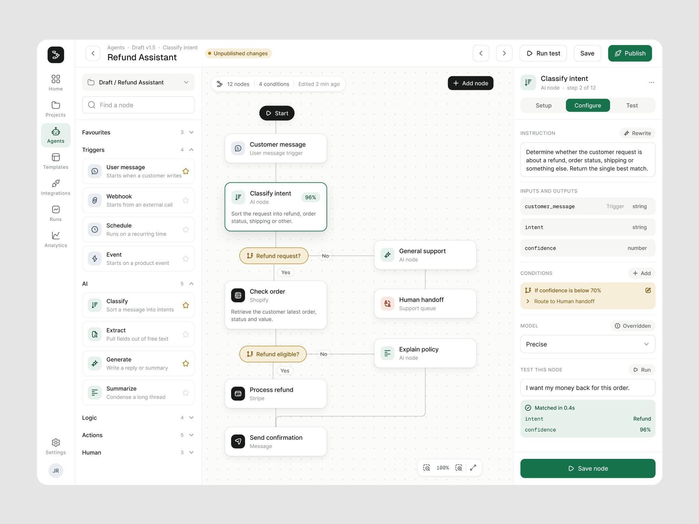
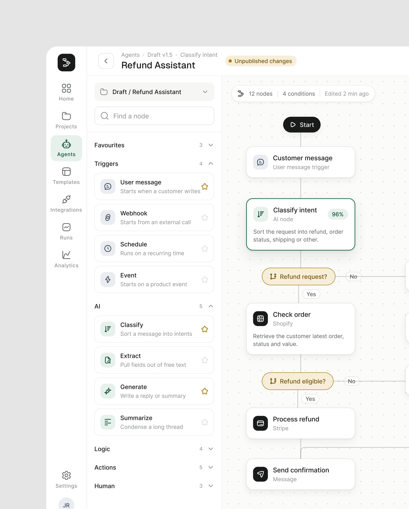
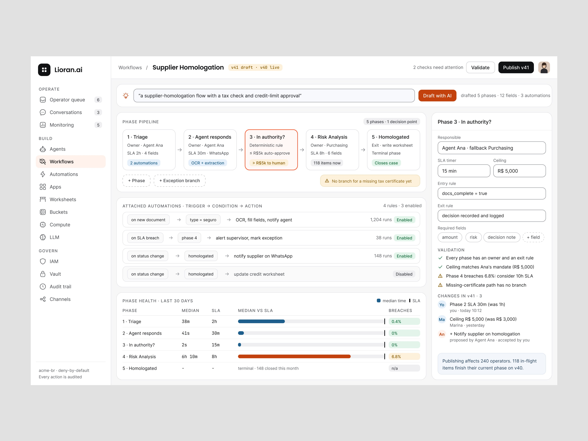
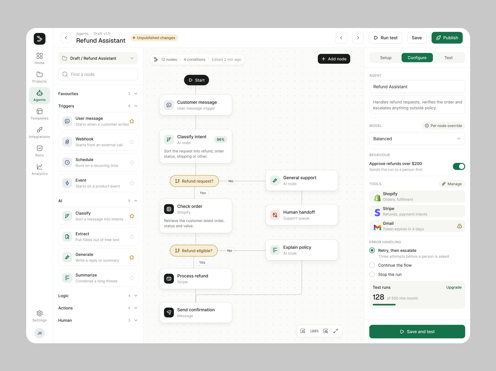

# Construtor (canvas de fluxo)

## O que é

Tela em que o usuário **monta** um fluxo: arrasta nós de uma biblioteca para um canvas, liga, configura
cada nó, testa e publica. É arquétipo próprio porque aparece em duas séries e onze peças em dez
dias: o construtor do "Refund Assistant" (8 peças, 110.577 views, 1.844 salvos) e o Lioran.ai (3
peças). Antes disso existia só como variação do mapa (o canvas de automação do Ergond, em
[mapa-e-grafo.md](mapa-e-grafo.md)). A diferença: o mapa **observa** um sistema
que já roda; o construtor **edita** um que ainda vai rodar. **[OBSERVADO]**

## Esqueleto ("Refund Assistant", construtor inteiro em 4:3)

```
rail de ícones │ breadcrumb "Agents / Draft v1.5 / Classify intent"  [● Unpublished changes]   [< >] [Run test] [Save] [Publish]
               ├──────────────┬────────────────────────────────────────────┬──────────────────────────┐
               │ BIBLIOTECA   │ CANVAS branco pontilhado                    │ PAINEL DO NÓ             │
               │ busca        │ "12 nodes · 4 conditions · Edited 2 min ago"│ abas Setup/Configure/Test│
               │ Favourites ★ │        [Start] (pílula preta)               │ instrução em frase       │
               │ Triggers     │        nó "Customer message"               │ entradas e saídas em mono│
               │ AI           │        nó "Classify intent  96%"           │ condição âmbar           │
               │ Logic        │        pílula âmbar "Refund request?" ─No─▶ │ modelo · teste do nó     │
               │ Actions      │        ...                                  │ [Save node] verde        │
               │ Human        │ controles de zoom no canto                  │                          │
               └──────────────┴────────────────────────────────────────────┴──────────────────────────┘
```

Proporção observada: biblioteca ≈ 20%, canvas ≈ 50%, painel ≈ 30% da largura útil. **[OBSERVADO]**




## Hierarquia

1. **O caminho do fluxo** no canvas, de cima para baixo, com os nós em cartão branco e as decisões em
   pílula colorida (âmbar no construtor do "Refund Assistant", rosa no fluxo gerado).
2. **O estado de publicação** no topo ("Unpublished changes", "v12 live", "Draft saved") e os três
   botões Run test / Save / Publish, com Publish na cor do produto.
3. **O painel do nó selecionado**, que é onde a regra se escreve em frase.

## O que nunca falta

- **Cor = tipo do nó**, a mesma na biblioteca e no canvas; o resto do canvas não tem cor. É regra
  escrita (*"those tiles are the type system, not decoration"*; ver
  [../06-produtos/assistente-reembolso.md](../06-produtos/assistente-reembolso.md) e
  [../01-sistema-visual/iconografia.md](../01-sistema-visual/iconografia.md)).
- **O efeito antes de salvar**: o popup de condição mostra o replay nas últimas 50 execuções; o
  Lioran.ai tem "Dry run · last 20 events" e a checagem "1 of 5 blocking" antes de publicar. Padrão em
  [../03-padroes-de-ia/05-governanca-politica-simulacao.md](../03-padroes-de-ia/05-governanca-politica-simulacao.md).
- **Teste dentro do produto**: aba Test no nó ("Matched in 0.4s") e um Test Lab com casos salvos.
- **Versão com autor e volta**: o histórico do Lioran.ai lista quem mudou (pessoa ou agente), o diff
  e "Roll back to v11".
- **Linguagem comum para começar**: "What should this agent do?" (redesenho do "Refund Assistant") e
  "Draft with AI" (Lioran.ai) geram o primeiro rascunho, que chega marcado como não salvo, com
  Regenerate / Edit on canvas / Accept flow.

## Variações

- **Pipeline de fases em vez de canvas livre** (Lioran.ai): cinco fases em cartões lado a lado, cada
  uma com dono, SLA e campos; a fase com problema em laranja; embaixo, as automações em linha
  gatilho → condição → ação, e a saúde das fases em barras de mediana contra SLA.
  
- **Painel do agente** em vez do painel do nó: modelo, chaves de comportamento ("Approve refunds over
  $200" manda para uma pessoa), ferramentas conectadas com aviso de token e tratamento de erro.
  
- **Fluxo gerado em canvas creme quadrado**, só o caminho, com as decisões em rosa e os três botões
  de aceitar ou editar. 

## Como montar

- Partir do modelo de painel (`assets/modelo-tela.html`) para a casca e o rail; o canvas é uma área
  `bg/canvas` com pontilhado de 1 px a cada 16 px de escala; nós em cartão branco de raio do nível
  de cartão; decisões em pílula de raio máximo.
- Um acento só para Publish e para o item ativo; as cores dos tipos de nó ficam nos ladrilhos de
  ícone (fundo tint + ícone 700), nunca no texto.
