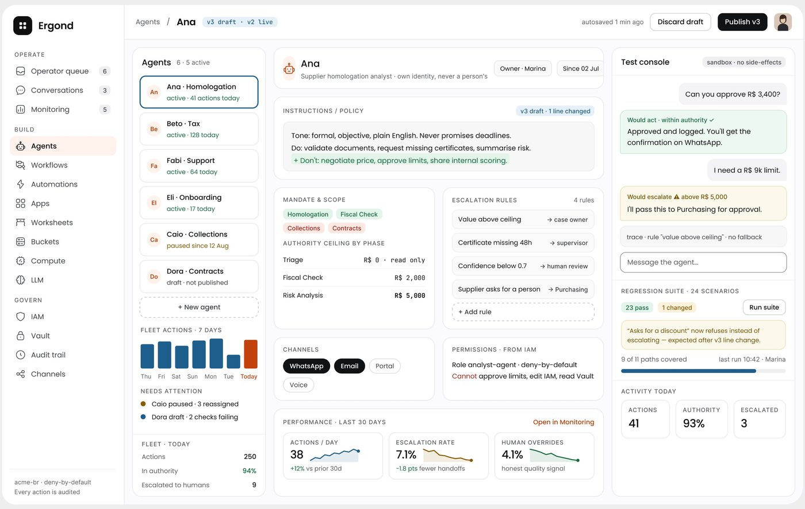
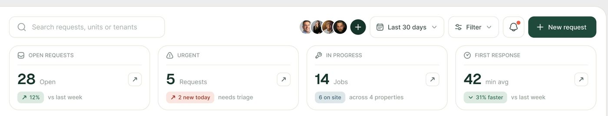

# Visão geral / dashboard

## O que é

A primeira tela de toda série e a que mais performa: FixTrack (46.208 views),
OrchestrateIQ overview (78.682), Ergond (46.261), Permitly (81.873). Responde "o
que precisa de mim hoje" e "como estamos".

## Esqueleto 1: sidebar + faixa de KPIs + grade de 2 linhas (FixTrack)

Medidas em px de tela 1440, de **[MEDIDO: moldura de 1.750 px na imagem reduzida, fator 0,823]**:

```
┌───────────┬──────────────────────────────────────────────────────────────────┐
│ sidebar   │ [busca 300]            [avatares][30 dias][Filter][🔔][+ New]    │ 41
│ 225       ├──────────┬──────────┬──────────┬──────────┐                      │
│           │ KPI 273  │ KPI 273  │ KPI 273  │ KPI 273  │  altura 126          │
│           ├──────────┴───────┬──┴──────────┴──────────┤                      │
│           │ Pipeline 402     │ Gráfico de linha 720   │  altura 413          │
│           ├──────────────────┼────────────┬───────────┤                      │
│           │ Needs attn 402   │ Agenda 353 │ Carga 354 │  altura 298          │
└───────────┴──────────────────┴────────────┴───────────┘
gap 16-17 entre cartões; padding da moldura ≈16
```

## Esqueleto 2: topo em pílulas + rail de ícones + hero largo (OrchestrateIQ)

 / **[MEDIDO: moldura 1.740 px, fator 0,828]**:

```
[logo pílula] [ Overview | Workflows | Live Map | Traces | ... ] [● Live 30min] [🔍🔔] [avatar]   altura 56
┌──┐ ┌──────────────────────────────────────────────────────────────────┐
│66│ │ Título 40px  + pílulas de filtro           [data][Filter][CTA]    │
│  │ │ bloco principal largo (linha do tempo / grafo)                    │
│  │ └──────────────────────────────────────────────────────────────────┘
│  │ ┌────────────────┐ ┌────────────────┐ ┌────────────────────────┐
│  │ │ Next steps     │ │ Detected 2×2   │ │ Assistente (orbe)      │
└──┘ └────────────────┘ └────────────────┘ └────────────────────────┘
```
Rail de 66 px, 33 px de respiro até o conteúdo. No Live Map, o conteúdo se
divide em 848 px (grafo + tabela) + 426 px (painel do nó), gap 17.


## Esqueleto 3: três colunas de trabalho (Ergond)

 **[MEDIDO: moldura 1.790 px, fator 0,805]**: sidebar 220 |
lista 238 | centro 593 | console 330, gap ≈15. Ver [detalhe.md](detalhe.md).



## Hierarquia (o que o olho vê)

1. **O bloco em cor chapada**: KPI preto (Permitly), cartão verde "$184,500"
   (PriorAuth), cartão amarelo "Do first" (OrchestrateIQ), coluna "agora" azul.
2. **A faixa de números** grandes: 4 KPIs em linha, cada um com 1 número de
   ≈28-32 px e uma pílula de variação.
3. **A lista do que precisa de ação** ("Needs attention", "Attention required",
   "Next steps"), sempre com status em pílula colorida.
4. Gráfico de tendência e blocos secundários.

## Densidade

| Produto | Blocos | Números visíveis |
|---|---:|---:|
| FixTrack | 9 | ≈25 |
| Permitly (as 2 metades) | 8 | ≈40 |
| OrchestrateIQ overview | 6 grandes + 15 colunas de tempo | ≈30 |
| Ergond agente | 14 | ≈45 |

## Anatomia do cartão de KPI (FixTrack)

`[ícone 14] RÓTULO EM CAIXA ALTA 12px` ─ linha ─ `28 · Open` (número ≈30 px + unidade
14 px cinza) · `[↗ 12%] vs last week` · botão ↗ em quadrado de borda no canto.
Altura 126 px, largura 273 px. 

## Variações

- **Saudação como título** (Permitly, PriorAuth, Edu.ai, AgentPay).
- **Frase-diagnóstico como título** ("We found your system", "Support Resolution").
- **Nav no topo em abas** (OrchestrateIQ, ResolveAI, PriorAuth) × **sidebar**
  (FixTrack, Permitly, Ergond, Vero). As duas coisas convivem.

## Como reproduzir

```css
.app { display:grid; grid-template-columns: 224px 1fr; gap:16px; padding:16px; background:#EFEEF4; }
.kpis { display:grid; grid-template-columns: repeat(4,1fr); gap:16px; }
.card { background:#fff; border:1px solid #E3E2EC; border-radius:16px; padding:20px; }
.kpi-label { font:500 12px/1 Inter; text-transform:uppercase; letter-spacing:.04em; color:#8A8996; }
.kpi-value { font:400 30px/1.1 Geist; letter-spacing:-.02em; }
.kpi-unit  { font:400 14px Inter; color:#8A8996; margin-left:6px; }
```
Tokens reais em [../01-sistema-visual/design-system-publicado.md](../01-sistema-visual/design-system-publicado.md).
