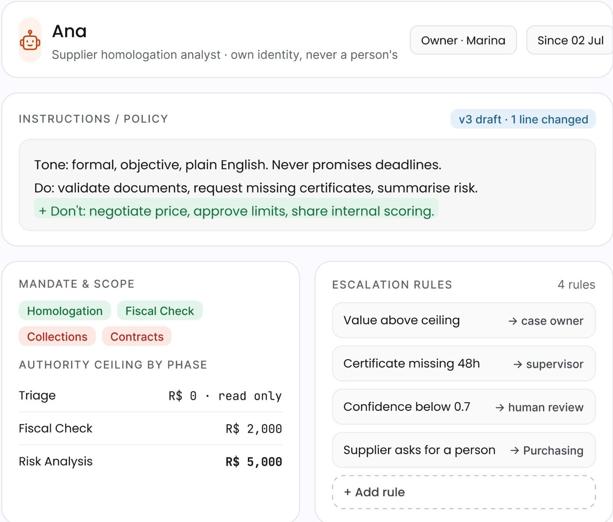
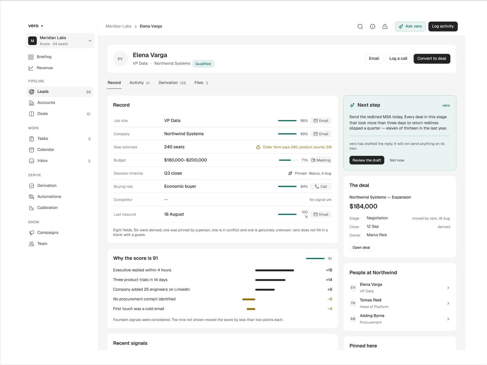
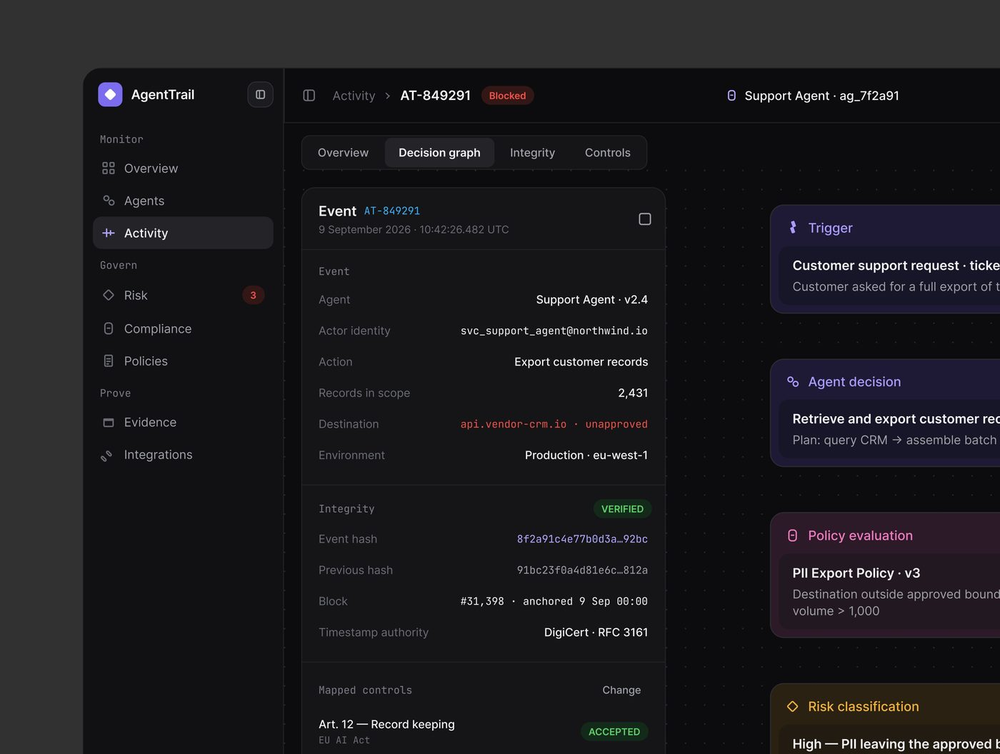

# Página de detalhe

## O que é

A tela de **um** objeto: um agente (Ergond "Ana"), um lead (Vero "Elena Varga"),
um evento (AgentTrail "AT-849291"), um entregador (Mongi "Sohel Rana"), um caso
(Rillo "Blue Bottle Coffee"). Sempre com o objeto nomeado em linguagem humana no
topo e um identificador técnico ao lado.

## Esqueleto

```
breadcrumb: Coleção / Nome do objeto  [selo de estado ou versão em mono]      [ação secundária] [AÇÃO PRIMÁRIA preta]
┌─ cabeçalho do objeto ─────────────────────────────────────┐ ┌─ painel lateral ──────────┐
│ avatar/ícone · Nome 20-24px · subtítulo · chips dono/data │ │ IA: próximo passo,       │
├─ abas: Record | Activity 41 | Derivation 128 | Files 3 ───┤ │ console de teste ou      │
│ bloco 1: campos chave-valor (com confiança e fonte)       │ │ contexto do caso         │
│ bloco 2: "por que" (explicação do score / regras)         │ │                          │
│ bloco 3: histórico / desempenho                           │ │                          │
└───────────────────────────────────────────────────────────┘ └──────────────────────────┘
proporção principal:lateral ≈ 64:36 (Vero) a 60:40 (Ergond: 593 + 330 com lista de 238 à esquerda)
```

Medidas Ergond **[MEDIDO, tela 1440]**: lista de agentes 238 px, centro 593 px,
console 330 px, gap 15 px; cabeçalho do objeto ≈75 px de altura; blocos com
rótulo em caixa alta 11-12 px e tracking largo.

## Hierarquia

1. Nome do objeto + estado (pílula "Blocked" vermelha, "Qualified" verde, "v3 draft · v2 live" em mono).
2. O bloco que explica ("Why the score is 91", "Escalation rules", "What rillo checked").
3. Painel lateral da IA com uma ação ("Review the draft", "Run suite").

## Densidade

Alta: 6 a 9 blocos, 20 a 45 valores. Chave-valor alinhado em duas colunas
(rótulo cinza à esquerda, valor preto à direita), 8 a 12 linhas por bloco.

## Exemplos





## Variações

- **Detalhe com abas** (Vero: Record / Activity / Derivation / Files; AgentTrail:
  Overview / Decision graph / Integrity / Controls).
- **Detalhe como painel lateral** dentro de outra tela (OrchestrateIQ "Selected
  node", Haulsight frete selecionado).
- **Detalhe de pessoa** com 4 KPIs coloridos no topo (Mongi rider).

## Como reproduzir

Campo chave-valor: linha de 44-48 px, rótulo 13 px `#8A8996`, valor 14 px
`#111116`, separador 1 px; valores técnicos (hash, ID, versão, dinheiro de
política) em mono 13 px. Barra de confiança de 60 × 3 px verde + % à direita.
