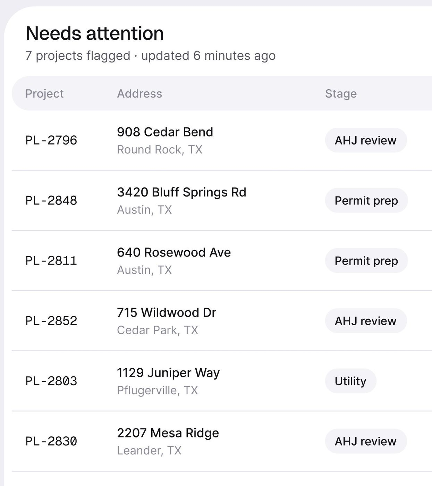
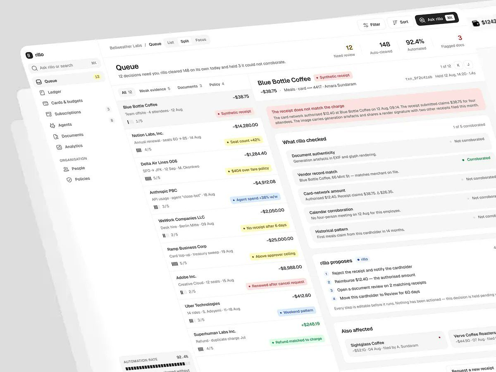
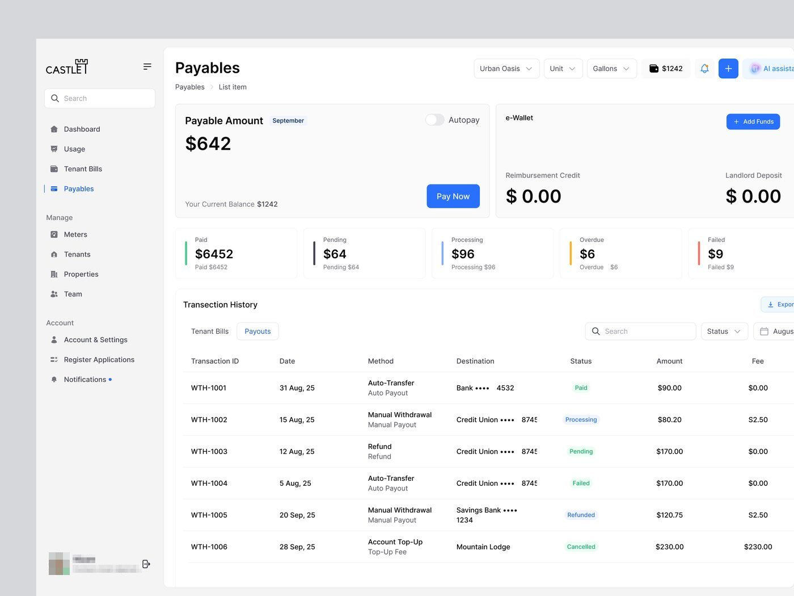

# Fila / lista

## O que é

A lista do que precisa de ação, **já ordenada pela IA** ("Ranked by Permit AI",
"Sorted by procedure date, then approval odds", "12 decisions need you"). É o
tipo com maior salvos/1k: Permitly 17,6, PriorAuth 24,0, Rillo Queue 21,8.

## Esqueleto

**Fila como tabela** (Permitly, PriorAuth):
```
Título "Needs attention" 32px              [Ranked by Permit AI (lime)] [filtro] [⋯]
7 projects flagged · updated 6 minutes ago
┌ cabeçalho cinza em pílula (Project | Address | Stage | Blocker | Risk | Due) ┐
│ PL-2796 (mono) │ 908 Cedar Bend / Round Rock, TX │ [AHJ review] │ AHJ review 11 days │ [High] │ Oct 1 (mono) │
│ ... 6 a 8 linhas de ≈80 px, separador 1 px                                          │
```

**Fila como caixa de entrada + detalhe** (Rillo Queue, Ergond Conversations):
```
┌ lista 35% ───────────────┐ ┌ detalhe 65% ─────────────────────────────┐
│ item: nome, valor, motivo│ │ alerta vermelho em frase                 │
│ em pílula colorida,      │ │ "What rillo checked" (5 verificações)    │
│ evidência 3/5            │ │ "rillo proposes" (passos numerados)      │
└──────────────────────────┘ └──────────────────────────────────────────┘
```

**Fila curta dentro do dashboard** (FixTrack "Needs attention"): 3 itens com
ícone em quadrado arredondado, título "Problema · Local", quem/quando, pílula de
estado, e botão "View all 12 flagged requests".




## Hierarquia

1. Contagem no título ou subtítulo ("7 projects flagged", "8 cases need action").
2. A coluna de risco/estado em pílula colorida (vermelho High, bege Medium).
3. O prazo em mono à direita.

## Densidade

6 a 8 linhas visíveis; 4 a 6 colunas. Linhas altas (≈80 px no Permitly) com duas
linhas de texto na coluna principal (endereço + cidade em cinza).

## Lista simples (sem ranking)

Castle Payables / Tenant Bills: tabela convencional de 7-8
colunas com foto do imóvel na primeira e status em texto colorido. É o modelo
genérico que o método deixa para trás. 

## Como reproduzir

Cabeçalho da tabela em pílula `#F4F4F8` com raio total e texto 14 px `#8A8996`;
linhas sem zebra, separador `#E3E2EC`; ID e data em Geist Mono; pílula de risco com
fundo tint (`clay/tint #FBE3DE`, `amber/tint #FCEFD8`) e texto da cor 700.
