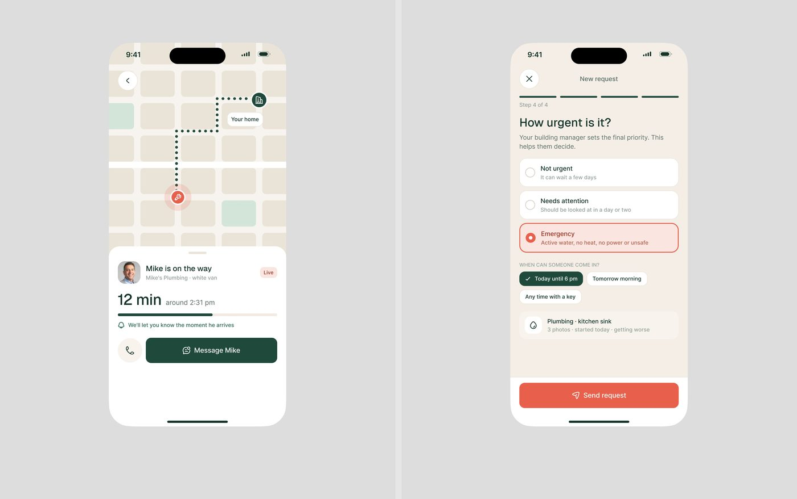

# Fluxo mobile passo a passo

## O que é

Sequência de 2 a 4 telas para uma tarefa só, publicada lado a lado no mesmo
post. Exemplos: Torin cancelar assinatura (7.895 views,
"Rate the UI Bro! No fancy graphics, just functionality."), Care Circle onboarding
, FixTrack pedido do inquilino,
Mongi nova entrega.

## Esqueleto (Torin, 1 passo)

```
[←]  ▬▬ ▬▬ ▬▬ (barra segmentada coral)                   Step 1 of 3
[h] Cancel in the App Store  20px
    Headspace · free trial · ends Sat 12 pm
┌ cartão de passos ───────────────────────────────┐
│ ① Open your Apple subscriptions (atual, coral)   │
│   Settings › your name › Subscriptions           │
│   [ ↗ Open Subscriptions ] botão preto           │
│ ② Tap Headspace, then "Cancel Free Trial"        │
│ ③ Confirm · Apple emails a receipt               │
└─────────────────────────────────────────────────┘
WHAT YOU'LL SEE: prévia da tela de fora
✓ You keep the trial until Sep 12 and nothing is charged.
            (espaço)
[ I've cancelled ]  botão preto largura total
    I got stuck     link sublinhado
```




## Hierarquia

1. Onde estou (barra segmentada + "Step 2 of 4").
2. Uma pergunta ou tarefa por tela, em frase ("Who are you caring for?", "How
   urgent is it?", "What brought Eleanor home?").
3. Um único botão primário no pé, largura total; a saída honesta embaixo ("I got
   stuck", "Stop · change nothing").

## Densidade

Muito baixa: 1 pergunta, 3 a 5 opções grandes (≈48-56 px de altura), 1 botão.
Opção selecionada = fundo tint + borda da cor + ✓ (Care Circle menta).

## Como reproduzir

Barra de progresso em segmentos de 4 px de altura com gap 4; opções como cartões
de 56 px com ícone à esquerda; botão primário 52 px de altura, raio total, preto
(ou cor da marca: teal no Care Circle, coral no FixTrack); link secundário 14 px
sublinhado centralizado.
