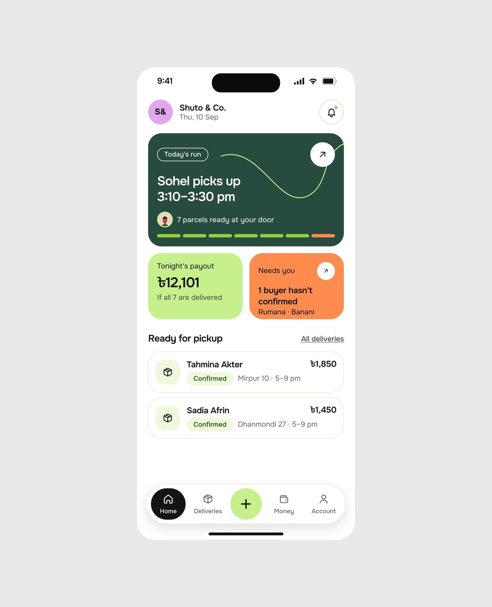
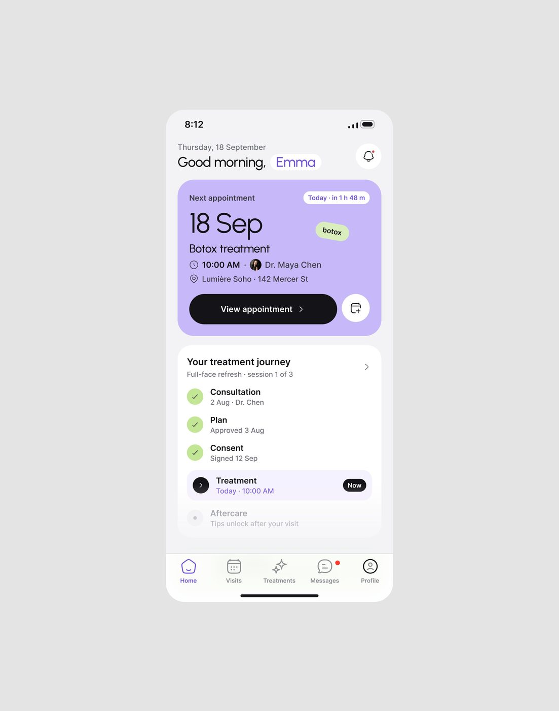

# Home mobile

## O que é

A tela inicial de app. Exemplos: Mongi vendedor (62.896
views, 973 salvos), Medspa paciente, PriorAuth
, Contractor app, Care Circle
"Today", o app de bem-estar "Your trends".

## Esqueleto (Mongi, tela 390 × 844)

Medidas **[MEDIDO: tela 719 px na imagem reduzida, fator 0,542]**:

```
status bar
[avatar 44 "S&"] Nome da loja 18px / data 14px cinza            [🔔 em círculo 44]
┌ cartão-herói 350 × 202, raio ≈26, cor escura da marca ──────┐
│ pílula de contorno "Today's run" · botão ↗ branco           │
│ frase de 2 linhas 24px branca "Sohel picks up 3:10-3:30 pm" │
│ avatar + "7 parcels ready at your door"                     │
│ barra de 7 segmentos (6 lime, 1 laranja)                    │
└─────────────────────────────────────────────────────────────┘
┌ cartão 169 × 117 lime ┐ ┌ cartão 169 × 117 laranja ┐   gap 12
Seção "Ready for pickup" ........................ "All deliveries" sublinhado
┌ item 350 × 73: ícone em quadrado tint · nome · pílula "Confirmed" · valor à direita ┐
...
tab bar flutuante: pílula 356 × 70, margem lateral 17, item ativo preto, "+" central lime
```
Margem lateral 20 px; gap vertical 12-16 px.




## Hierarquia

1. O cartão-herói em cor chapada: **a próxima coisa que vai acontecer**
   ("Today's run", "Next appointment 18 Sep", "Revenue at risk $184,500", "next up ·
   starts in 14 min").
2. Dois cartões menores lado a lado: um positivo (dinheiro, progresso) e um que
   pede ação ("Needs you").
3. Lista do dia.

## Densidade

Baixa: 5 a 7 blocos, 1 número grande por cartão. Linguagem de pessoa, não de
sistema.

## Variações

- **Saudação em minúsculas** e tom casual (Contractor: "good morning, mike").
- **Jornada em checklist** no lugar da lista (Medspa "Your treatment journey").
- **Tendências com faixa pessoal** (app de bem-estar: "Your usual range").
- **Tab bar**: flutuante em pílula com ativo preto (Mongi, PriorAuth) ou barra
  clássica de 5 ícones com rótulo (Medspa, Care Circle, Contractor).

## Como reproduzir

Tela 390; cartão-herói raio 24-28 px, padding 16-20 px; título do cartão 22-24 px
semibold com entrelinha 1,15; número de dinheiro 28-32 px; tab bar 64-70 px de
altura, raio total, sombra `0 8px 24px rgba(0,0,0,.08)`.
