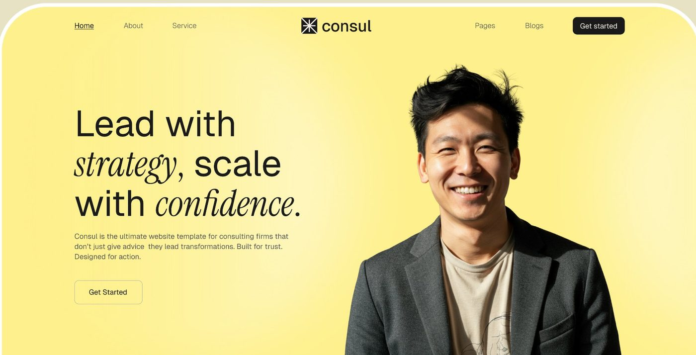
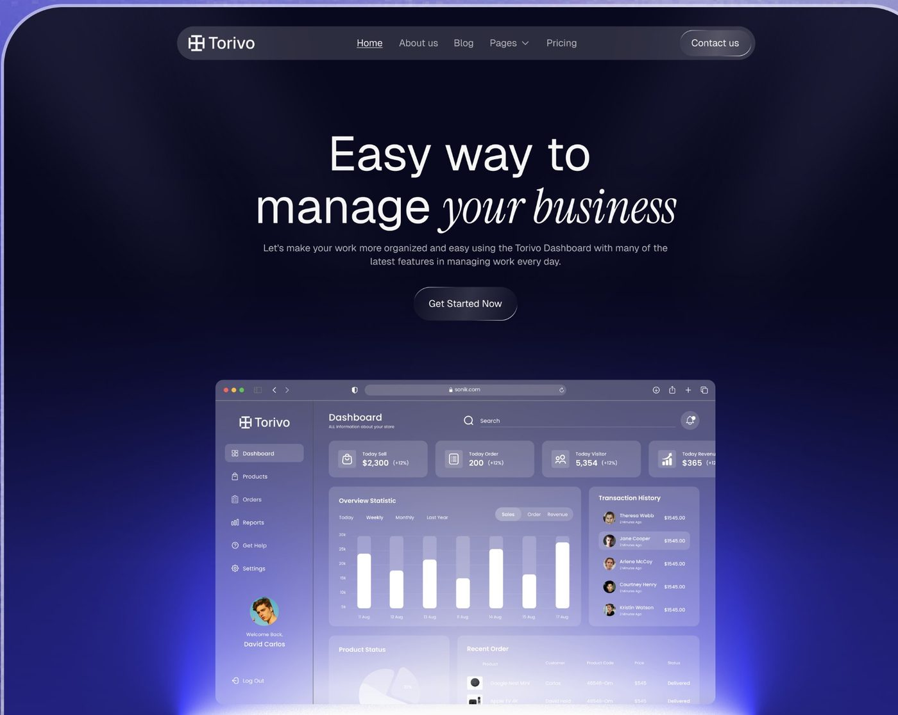
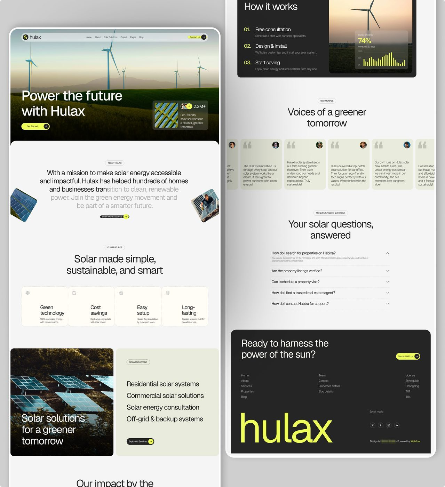
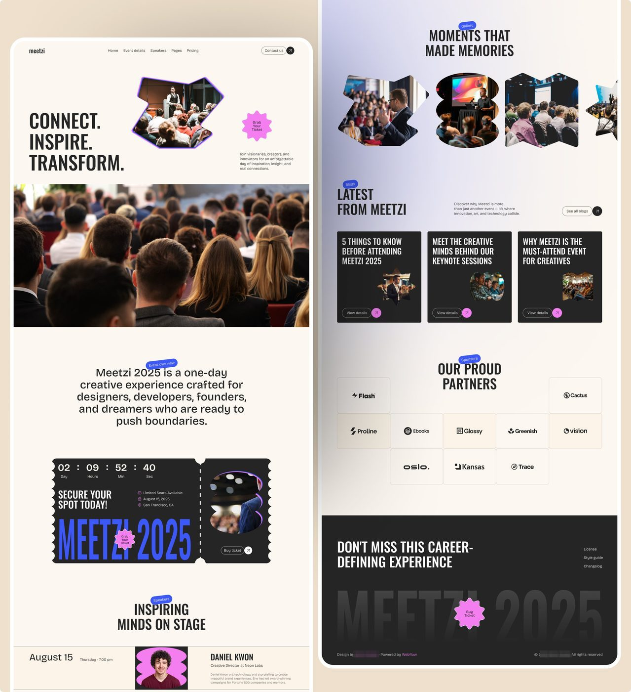
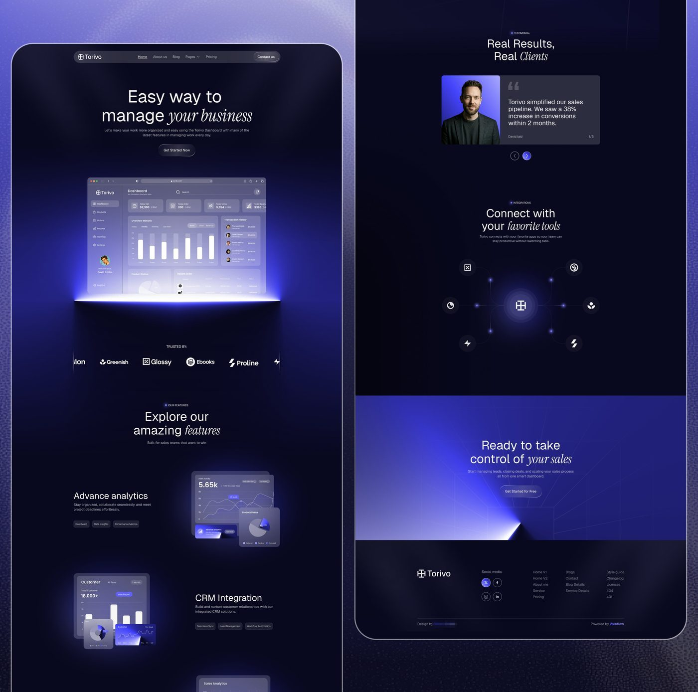
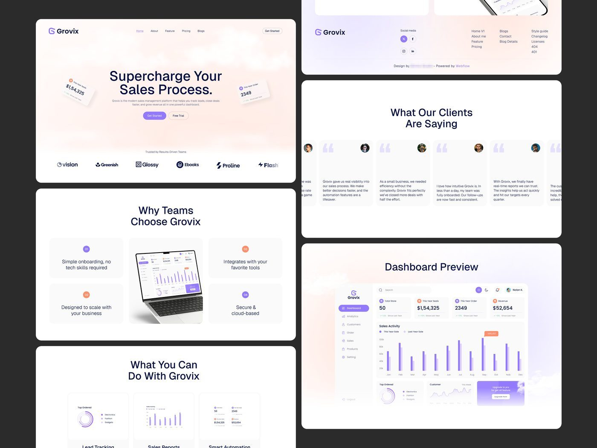
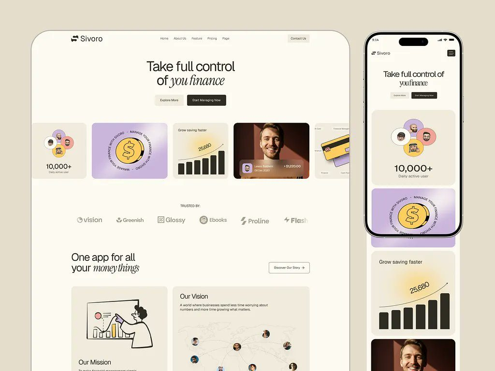
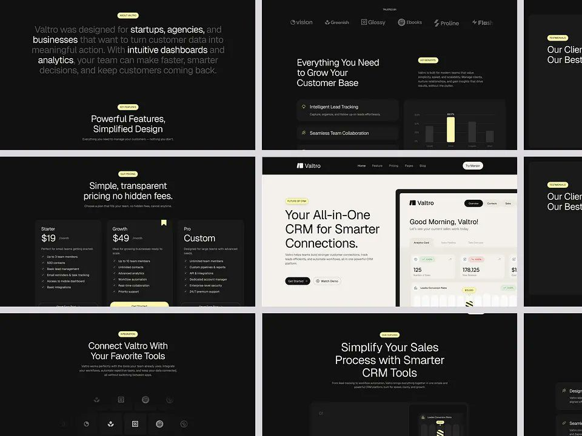

# Landing page / site de marketing

## O que é

Sites de marketing mostrados no formato **"<nome> full page 👀 What do you
think?"**: a página inteira cortada em duas colunas lado a lado dentro de uma
moldura de tela arredondada, sobre fundo da cor da marca. São templates de site
(rodapé com a assinatura de quem fez e "Powered by Webflow"). Os cinco mais vistos:
Consul (13.672 views), Torivo (7.100), Meetzi (6.606), Grovix (5.663), Hulax
(5.573).


## Anatomia: a ordem das seções

Ordem medida nas 5 páginas completas **[OBSERVADO]**:

| # | Seção | Consul | Hulax | Meetzi | Torivo | Grovix |
|---|---|---|---|---|---|---|
| 1 | Nav | links esq. + logo centro + links e botão preto dir. | pílula translúcida sobre a foto | logo esq., links centro, "Contact us" + círculo ↗ | pílula escura translúcida | logo, links, botão contorno |
| 2 | Hero | texto esq. + retrato recortado dir. sobre amarelo | foto full-bleed, título branco embaixo à esq. | "CONNECT. INSPIRE. TRANSFORM." + foto em máscara de forma + selo-estrela | título centralizado + mockup do produto com luz por baixo | título centralizado + 2 cartões de número flutuando inclinados |
| 3 | Prova logo após o hero | foto full-width com frase sobreposta | cartão "2.3M+" com avatares no próprio hero | foto de plateia full-width | faixa "Trusted by" com 6 logos | faixa "Trusted by Results-Driven Teams" |
| 4 | Quem somos | "● WHO WE ARE" + parágrafo grande de 5 linhas + avatares | "ABOUT HULAX" + parágrafo grande centralizado, metade em cinza | "Event overview" + parágrafo centralizado | (não tem) | (não tem) |
| 5 | Serviços / features | 2×2 cartões, o 1º em amarelo | 4 cartões em linha | ingresso com contagem regressiva | features alternando texto e imagem | 4 cartões + laptop no centro |
| 6 | Prova de resultado | número "5+ Years of experience" sobre foto escura | "Our impact by the numbers" | speakers em linhas | "Real Results, Real Clients" | "What you can do" |
| 7 | Depoimento | 1 cartão foto + citação, setas ‹ › | carrossel de 6 cartões | galeria em formas | 1 cartão foto + citação | carrossel de 6 cartões |
| 8 | Conteúdo | Blog, 3 cartões | FAQ em acordeão | Blog, 3 cartões pretos | Integrações em hub radial | Dashboard preview |
| 9 | CTA final | faixa amarela com 2 retratos nas laterais | bloco preto "Ready to harness the power of the sun?" | "Our proud partners" (grade de logos) | faixa índigo com feixe de luz | (dentro do footer) |
| 10 | Footer | logo, redes, 3 colunas de links, **wordmark gigante cortado** | preto com **wordmark "hulax" gigante em lime** | preto com **"MEETZI 2025" gigante em degradê** | logo, redes, 3 colunas | logo, redes, 3 colunas |

Padrão: **hero → prova imediata → quem somos → o que fazemos → prova → depoimento
→ conteúdo → CTA → footer com wordmark gigante**. O wordmark que sangra no pé da
página aparece em Consul, Hulax, Meetzi e Glirix. **[OBSERVADO]**

## Hero

| Medida (Consul, tela 1440) | Valor | Como medi |
|---|---|---|
| Altura do hero | ≈720 px | 444 px de 886 px de moldura na imagem reduzida |
| Título | 3 linhas, corpo ≈74 px, entrelinha ≈80 px (≈1,08) | linhas de texto em 544-611, 649-736, 750-821 px na imagem de 3.882 px, fator 1,26 **[MEDIDO]** |
| Subtítulo | 3 linhas de ≈14 px, cinza escuro, largura ≈400 px | **[OBSERVADO]** |
| Botão | contorno fino, raio ≈6 px, "Get Started" | **[OBSERVADO]** |

Tipos de hero:

1. **Texto à esquerda + retrato recortado à direita** sobre cor chapada (Consul,
   Orixo, David Laid).
2. **Foto de paisagem full-bleed** com título branco no canto inferior esquerdo e
   um cartão de prova no canto inferior direito (Hulax, Turex, Averon).
3. **Centralizado com mockup do produto** abaixo do título, iluminado por baixo
   (Torivo, Rovoxa, Optiro, Pixaly, Grovix, Riquro, Marqor).
4. **Tipográfico condensado** com foto em máscara e selo em estrela (Meetzi).




## A serifa itálica misturada

Em 2 de cada 3 sites o título mistura **grotesca romana** com **uma
ou duas palavras em serifa itálica**, sempre a palavra de valor:

| Site | Título |
|---|---|
| Consul | "Lead with *strategy*, scale with *confidence*." / "Your growth *partner*" / "What our *clients say*" / "Tailored solutions, *measurable impact*" |
| Torivo | "Easy way to manage *your business*" / "Explore our amazing *features*" / "Real Results, Real *Clients*" / "Connect with your *favorite tools*" / "Ready to take control of *your sales*" |
| Sivoro | "Simple, transparent pricing for *every bu[siness]*" / "The story behind our *company*" / "Powerful finance features. all in *one place*." |
| Rovoxa | "Talk smarter. Scale *faster*." / "Smart features. Smarter *conversa[tions]*" |
| Pixaly | "Turn words into stunning images *in seconds*" |
| Orixo | "helping people unlock *clarity and growth*." |

Regras **[OBSERVADO]**:
- A itálica vem **na segunda metade da frase**, nunca na primeira palavra.
- Mesmo corpo e mesma cor da romana; a serifa parece um pouco menor no olho
  porque tem altura-x menor.
- Só em títulos de seção e hero. Nunca em botão, nav ou corpo.
- **Nunca dentro do produto** (dashboards usam só grotesca).

Fonte: **não dá para afirmar**. Candidatas: *Instrument Serif Italic* e *PP
Editorial New Italic*. O traço que decidiria é o "g" e a terminação do "y" em
"strategy", que no recorte disponível não têm resolução suficiente. Na romana,
grotesca neutra (candidatas Geist, Inter; a tipografia dos produtos está em
[../01-sistema-visual/tipografia.md](../01-sistema-visual/tipografia.md)).

Meetzi é a exceção: condensada em caixa alta (candidatas Oswald, Bebas Neue) +
grotesca redonda no corpo, sem serifa.

## Prova social

- **Faixa de logos** logo abaixo do hero, 6 logos fictícios **sempre os mesmos**
  entre sites: vision, Greenish, Glossy, Ebooks, Proline, Flash (Grovix, Torivo,
  Meetzi). **[OBSERVADO]** É um kit de logos de template; troque por logos reais
  quando houver.
- **Depoimento** em dois formatos: (a) um cartão por vez com foto grande à
  esquerda, citação à direita, "David laid · 1/5" e setas ‹ › (Consul, Torivo);
  (b) carrossel horizontal de 5-6 cartões com aspas grandes cinza e avatar no
  canto (Hulax, Grovix).
- **Número em cartão** com avatares empilhados ("2.3M+ Eco-friendly solar
  solutions", "5+ Years of experience").

## Rótulo de seção

Pílula ou ponto antes do título em caixa alta pequena: "● WHO WE ARE",
"● TESTIMONIAL" (Consul, Torivo), pílula de borda "ABOUT HULAX", "OUR FEATURES"
(Hulax), pílula azul inclinada "Speakers", "Gallery" (Meetzi).

## Quando usar

Para mostrar site de marketing, não tela de produto. Na vitrine, a página inteira
vem primeiro; depois o site aparece em mockup de laptop/iPad em perspectiva e em
recortes (hero, pricing, footer). Quando o trabalho vira produto, as séries de
produto tomam o lugar dos sites. **[OBSERVADO]** ver
[../06-produtos/outros-produtos.md](../06-produtos/outros-produtos.md) e
[../09-do-generico-ao-produto/README.md](../09-do-generico-ao-produto/README.md).

## Exemplos








## Como reproduzir

```css
.hero h1 { font: 400 74px/80px "Geist", sans-serif; letter-spacing: -0.02em; }
.hero h1 em { font-family: "Instrument Serif", serif; font-style: italic; letter-spacing: 0; }
.section-label { font: 500 11px/1 "Geist"; text-transform: uppercase; letter-spacing: .06em; }
.section-label::before { content: "●"; margin-right: 6px; }
.footer-wordmark { font-size: 22vw; line-height: .8; margin-bottom: -4vw; overflow: hidden; }
```

Ordem mínima: nav, hero com uma palavra itálica, faixa de 6 logos, parágrafo "quem
somos" grande, 4 cartões de serviço (1 na cor da marca), depoimento, CTA na cor da
marca, footer com wordmark gigante.
