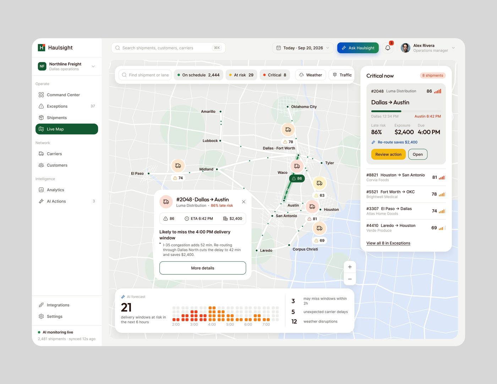

# Mapa / grafo

## O que é

Tela em que o conteúdo principal é uma rede de nós ou um mapa geográfico. Tipo
de alto alcance: OrchestrateIQ Live Map (21.452 views,
375 salvos), Haulsight (13.342 / 265), Ctrl.ai Agent map, AgentTrail Decision
graph, Ergond Automations (canvas de fluxo), Care Circle (grafo radial de pessoas).

## Esqueleto (OrchestrateIQ Live Map)

Em tela 1440 **[MEDIDO]**:
```
Título "Live Agent Map" 40px · subtítulo em frase · filtros em pílula      [Export snapshot]
                                              [Workflow: Customer Support ▾] [− 1.0× +]
┌ cartão 848 ────────────────────────────────────┐ ┌ painel 426 ──────────────┐
│ "Customer Support · Production"  [size = calls · weight = handoffs] │ SELECTED NODE        │
│ ┌ canvas cinza `#F3F4F7` ─────────────────────┐ │ Billing Agent [Critical] │
│ │ nós = cartões brancos 180×60 com ícone,    │ │ 6 KPIs em 3×2            │
│ │ nome e "18.4K · 99.2%"; legenda no canto   │ │ SELECTED HANDOFF         │
│ └────────────────────────────────────────────┘ │ checklist de campos      │
│ Live handoffs: tabela de 5 linhas              │ COORDINATION ANOMALIES   │
└────────────────────────────────────────────────┘ │ [Open Agent Detail] azul │
                                                    └──────────────────────────┘
```

## Hierarquia

1. **O nó com problema** se destaca por borda tracejada colorida (amarelo
   degradado, vermelho falhando) e fundo tint; a aresta com problema vira linha
   vermelha grossa com rótulo "⚠ auth_scope missing".
2. O painel do item selecionado à direita.
3. A tabela de eventos ao vivo embaixo.

## Variações

- **Mapa geográfico claro** (Haulsight): mapa como fundo de todo o conteúdo, filtros
  flutuando no topo em pílulas com contagem colorida ("● On schedule 2,444"),
  cartão do item selecionado flutuando sobre o mapa, lista "Critical now" em painel
  à direita, previsão em heatmap no pé. 
- **Grafo em colunas** (Ctrl.ai): nó central à esquerda, coluna de agentes, coluna
  de sistemas, curvas finas; fundo escuro com grade de pontos.
- **Fluxo de automação** (Ergond): nós retangulares com rótulo em caixa alta
  (TRIGGER, CONDITION, ACTION), linhas ortogonais, rótulos "yes/no" em pílula.
- **Grafo radial de pessoas** (Care Circle): iniciais em círculos coloridos em
  volta do paciente.

## Densidade

Média: o canvas ocupa 50-60% da tela e carrega 5 a 10 nós; o resto é painel.

## Como reproduzir

Canvas com fundo 1 tom abaixo do cartão e raio 16-20 px; nó = cartão branco com
ícone em círculo tint + 2 linhas (nome 14 px, métrica 12 px cinza); arestas 1,5 px
cinza `#C9CBD3`, a de erro 2,5 px `#E5533D`; legenda de estados em pílula branca
no canto superior direito do canvas.
