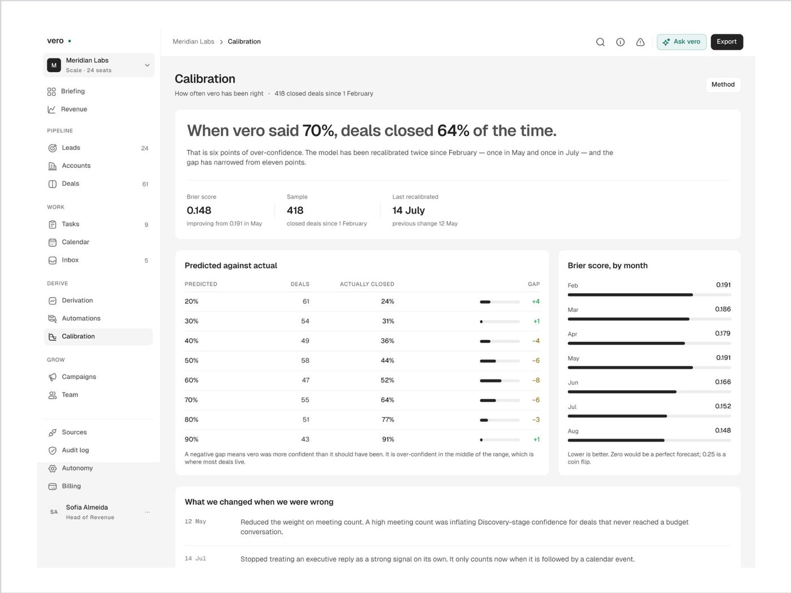
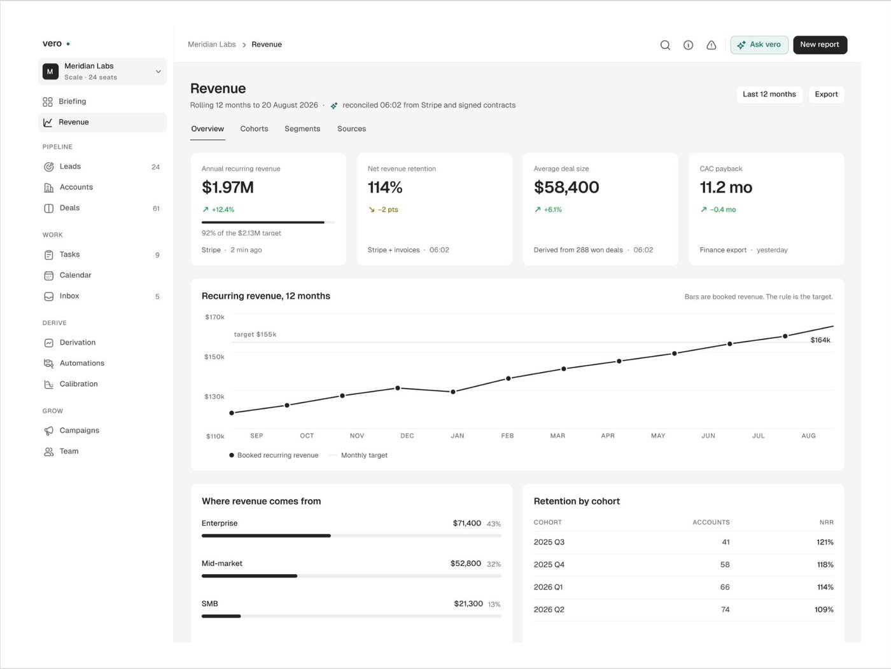
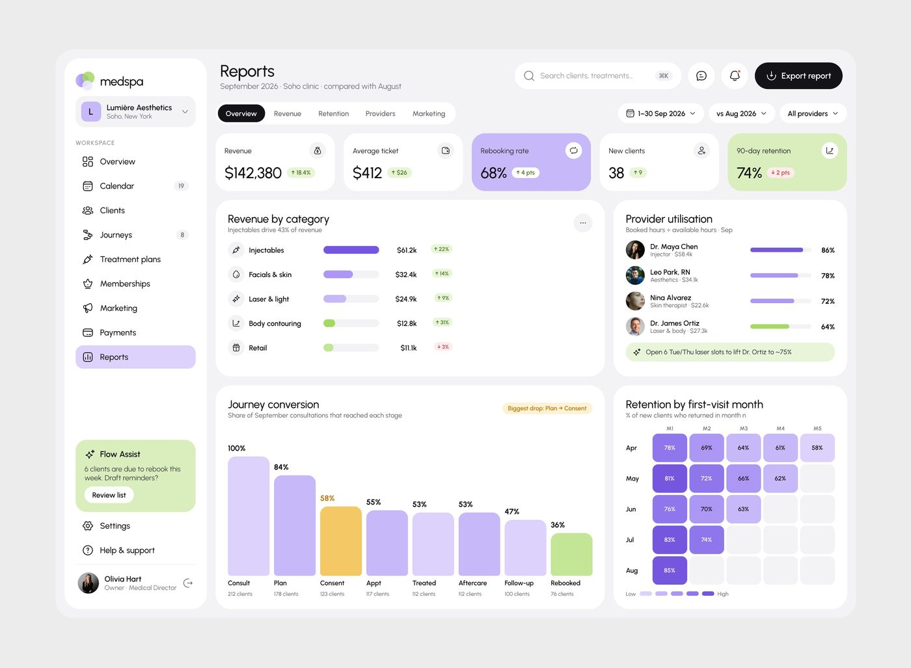

# Relatório / analytics

## O que é

Tela de análise de um período, com comparação. Exemplos: Medspa Reports
(19.015 views), Vero Revenue e Calibration, Rillo Analytics,
Lepo Insights, ResolveAI, Castle Usage.

## Esqueleto (Medspa)

```
Reports · September 2026 · Soho clinic · compared with August     [busca][💬][🔔][Export report]
[Overview][Revenue][Retention][Providers][Marketing]     [1-30 Sep 2026][vs Aug 2026][All providers]
┌KPI┐┌KPI┐┌KPI lavanda┐┌KPI┐┌KPI verde┐                          5 KPIs, 1-2 em cor
┌ Revenue by category (barras H) ─┐┌ Provider utilisation (pessoa+barra) ┐   linha 2: 58/42
┌ Journey conversion (funil V) ───┐┌ Retention by cohort (heatmap) ──────┐   linha 3: 58/42
```

Vero Revenue: 4 KPIs → gráfico de linha de 12 meses largura total → duas tabelas
lado a lado (fonte da receita, coorte).

## Hierarquia

1. **O filtro de comparação** está sempre visível ("compared with August", "vs Aug
   2026", "Rolling 12 months").
2. O KPI destacado em cor.
3. O gráfico com **um ponto anotado** (a etapa com maior queda em amarelo e selo
   "Biggest drop: Plan → Consent"; tooltip escuro no mês de junho no FixTrack).

## A manchete em frase (Vero Calibration)

Em vez de título neutro, a tela abre com a conclusão: *"When vero said 70%, deals
closed 64% of the time."* com os números em negrito, e embaixo "What we changed
when we were wrong". **[OBSERVADO]**.





## Densidade

Média-alta: 7 a 10 blocos, 25 a 50 números, 2 a 4 tipos de gráfico por tela
(barra horizontal, funil vertical, linha, heatmap). Nunca pizza; anel só como
contador ("8/10 received").

## Como reproduzir

Um matiz por tela em 4-5 tons (lavanda no Medspa: barra, KPI, heatmap); o dado de
comparação em cinza claro atrás do atual; barras com raio total; um único
destaque de cor diferente (amarelo) para o ponto que a tela quer mostrar.
