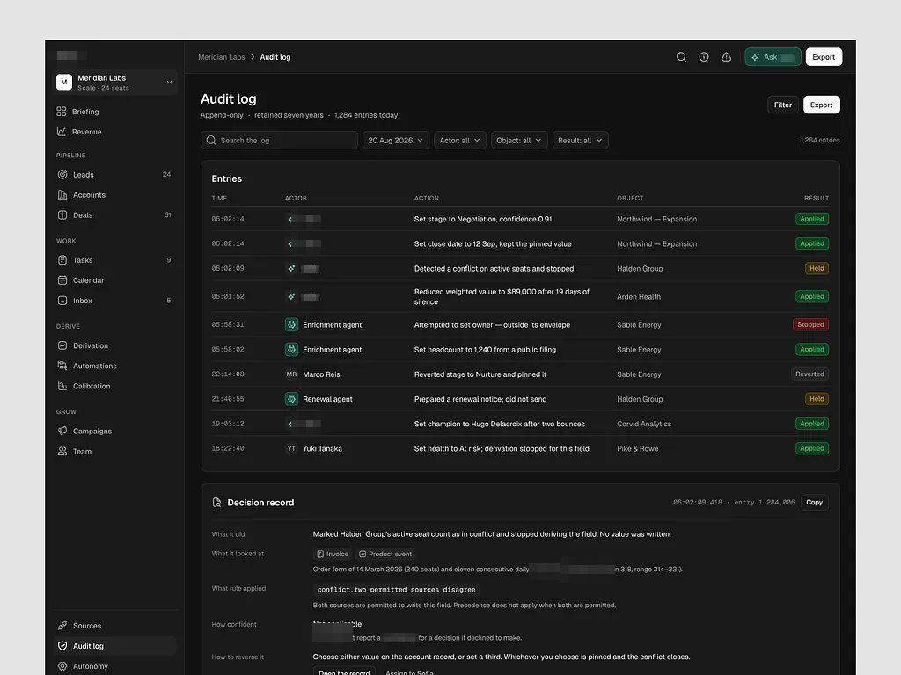
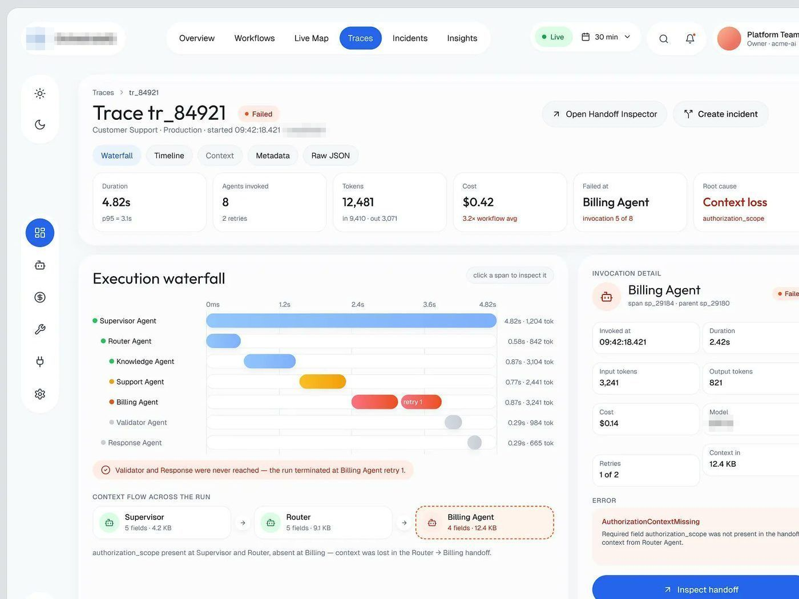

# Trace / log

## O que é

Tela de registro: o que aconteceu, em que ordem, e se dá para confiar. Exemplos:
Painel de agentes hospitalares Trace, painel de auditoria de agentes
evento e integridade, CRM de receita Audit log
(escuro), painel de agentes de operação "Runs · last 7 days".

## Esqueleto (painel de agentes hospitalares Trace)

```
Traces > tr_84921
Trace tr_84921 [● Failed]                    [Open Handoff Inspector] [Create incident]
Customer Support · Production · started 09:42:18.421 · framework de agentes
[Waterfall][Timeline][Context][Metadata][Raw JSON]
┌Duration┐┌Agents┐┌Tokens┐┌Cost┐┌Failed at┐┌Root cause (vermelho)┐     6 KPIs
┌ Execution waterfall 62% ───────────────────┐ ┌ Invocation detail 38% ─┐
│ agente (ponto de cor) │ barra no eixo 0-4.82s │ 0.87s · 3,241 tok │ │ KPIs 2×3, ERROR       │
│ ⓘ alerta em frase: "the run terminated at…"│ │ [Inspect handoff] azul│
│ CONTEXT FLOW ACROSS THE RUN: cartões → →   │ └───────────────────────┘
└────────────────────────────────────────────┘
```

## Esqueleto (CRM de receita Audit log, escuro)

Título "Audit log" + "Append-only · retained seven years · 1,284 entries today";
filtros por data, ator, objeto, resultado; tabela TIME (mono) / ACTOR (ícone CRM de receita
ou avatar humano) / ACTION (frase) / OBJECT / RESULT (pílula Applied, Held,
Stopped, Reverted); abaixo, "Decision record" do item selecionado com What it did,
What it looked at, What rule applied (mono), How confident, How to reverse it.




## Hierarquia

1. Estado do registro (Failed, Blocked, INTEGRITY FAILED) em pílula ao lado do ID.
2. A causa em frase e em vermelho ("Context loss · authorization_scope").
3. A sequência (waterfall, timeline, tabela por hora).

## Densidade

Alta, e **monoespaçada** em tudo que é identificador, hora com milissegundos, hash
e bloco. É o tipo de tela em que mono ocupa mais área (≈30% do texto no painel de auditoria de agentes).

## Como reproduzir

Timestamp em mono 12-13 px; resultado em pílula tint (verde, âmbar, vermelho);
alerta em frase com ícone ⓘ dentro de faixa tint; "How to reverse it" sempre
presente: registro de IA vem com saída.
