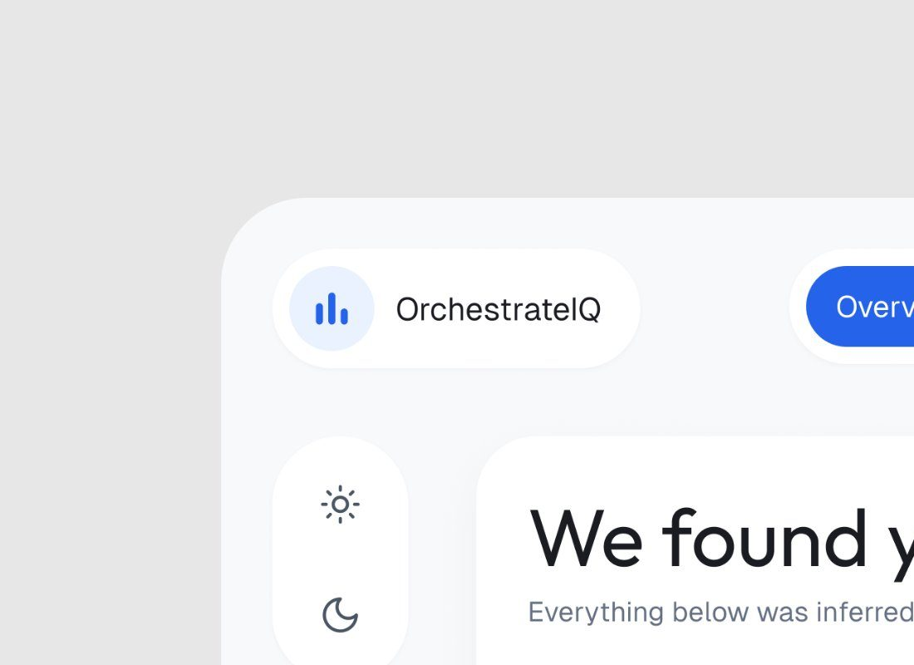
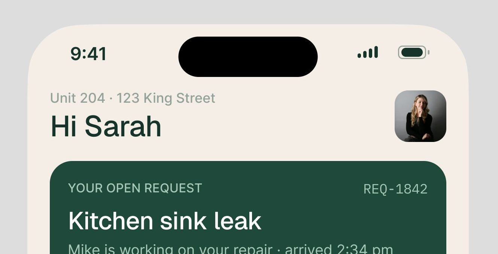
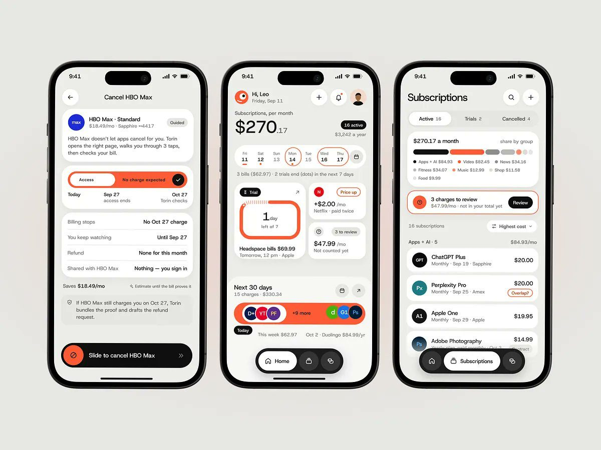
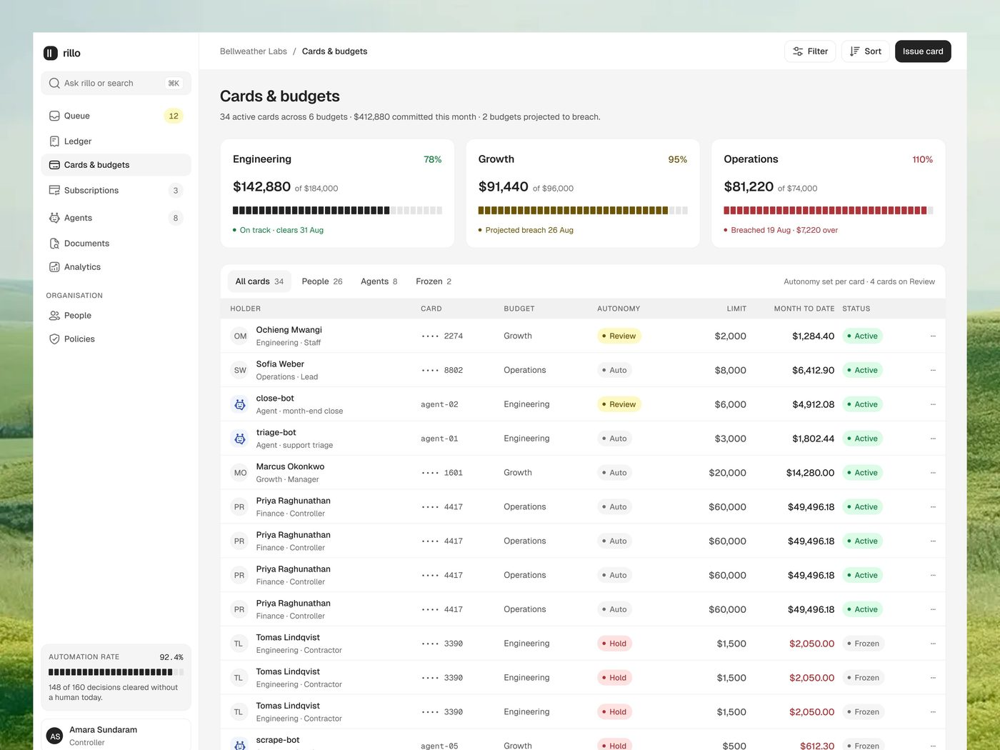
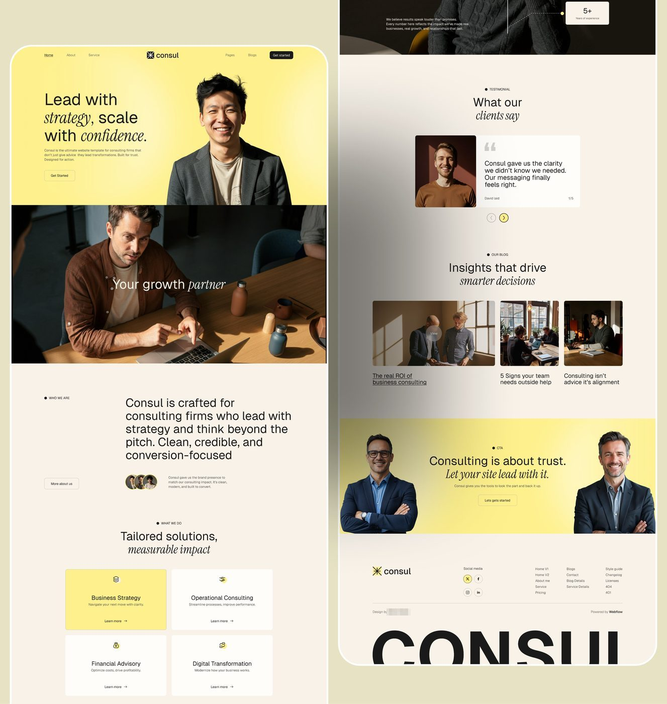
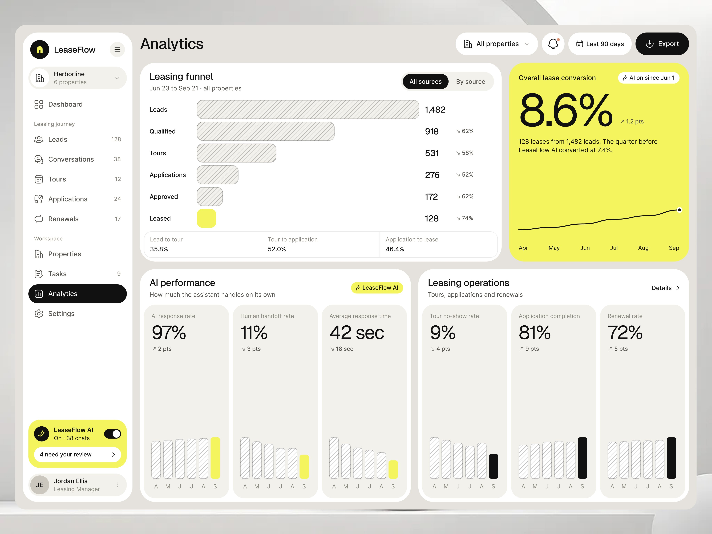

# Formato e enquadramento: o quadro em volta da interface

## O que é

Tudo o que fica entre a interface e a borda da imagem: a proporção do arquivo, a cor do fundo, o ar em volta, a moldura do app, o raio, a sombra, o mockup de aparelho e a cena. É a parte do "shot" que não é design de produto, e é a mais fácil de copiar.

**Base [MEDIDO]:** 900 imagens de peças publicadas e o tamanho de cada mídia. Para cada imagem foram medidos: a proporção, a cor mediana de uma faixa de 1% em cada borda, a uniformidade dessa faixa (desvio padrão), e a caixa do conteúdo (onde a imagem deixa de ser fundo). Com isso cada imagem caiu num tipo de enquadramento: moldura inteira (fundo liso nas quatro bordas), sangria (fundo liso em três bordas e a interface saindo pela quarta), ou tela cheia/cena (sem fundo liso). Os tipos foram conferidos olhando folhas de 40 miniaturas por tipo. Raio e margem foram medidos em pixel na imagem original.

**Os três grupos da amostra:** **genérico** (o trabalho de site e de template, antes das séries de produto), **transição** (sites de SaaS, preços, A/B e os primeiros produtos) e **produto** (as séries de produto de IA). Ver [../09-do-generico-ao-produto/README.md](../09-do-generico-ao-produto/README.md).

**Escala:** o arquivo não é a tela. Nos mockups de iPhone, a tela mede exatamente 1179 px de largura, que é 393 pt × 3: **exportação a 3x** **[MEDIDO]** (Contractor, 2916 px de largura, repete 1178 px). No díptico do Permitly (2466 px por metade), o raio da moldura mede 94 px e a própria folha do design system diz "Panels 32": **fator de ~2,94** **[MEDIDO + INFERIDO]**. No shot de 4096 × 3072 o fator é menor, **~2,5** (faixa 2,4 a 2,6), medido pela maiúscula do texto e pela linha de 1 px em três produtos; ver [01 · Escala](../01-sistema-visual/README.md#escala-dos-shots-de-4096-px). Regra prática desta página: **divida os pixels do arquivo por 3 nos retratos, nos iPhones e no díptico, e por 2,5 no shot de 4096 × 3072.** Nos arquivos de 1200 e 1600 px de largura (formato de vitrine), o conteúdo é a tela inteira reduzida, e o fator deve ser menor que 1x **[INFERIDO]**: a tela de 1080 px de largura útil num quadro de 1200 corresponde a um painel de 1440 reduzido a 0,75.

## 1. Proporção

Proporção de cada imagem, por grupo **[MEDIDO]**:

| proporção | site de marketing (160 imagens) | transição (254) | produto (304) |
|---|---:|---:|---:|
| 4:3 (1,30 a 1,37) | 58% | **75%** | **54%** |
| 5:4 aprox. (1,10 a 1,30) | 9% | 13% | 3% |
| 1:1 | 9% | 5% | 1% |
| 4:5 (0,76 a 0,84) | 6% | 0% | **16%** |
| 7:8 aprox. (0,84 a 0,95) | 7% | 2% | 7% |
| alta, 9:16 ou mais estreita (< 0,60) | 0% | 0% | **9%** |
| 3:2, 16:10, 16:9 e panorâmica | 10% | 4% | 6% |

- **O 4:3 é o padrão.** Tamanhos mais comuns nas peças de produto: 1024×768 (56 imagens), 4096×3072 (53), 1200×900 (23), 1600×1200 (13), 3200×2400 (6). Na amostra inteira, 4096×3072 é o tamanho mais frequente (285 imagens).
- **O retrato chega com as séries de produto** e só em peças de várias imagens: 4:5 (2640×3252, 2391×3129, 2880×3657, 2466×3051) e 7:8 (2628×3048, 2754×3261). Ver `sequencia-do-post.md`.
- **As tiras altas** (1440×2700, razão 0,53) são uma tela larga partida em faixas; nunca aparecem sozinhas.
- 1:1 praticamente some: 4 imagens no grupo de produto.

**Formato × desempenho, peças de uma imagem [MEDIDO]** (índice relativo: views da peça divididas pela mediana das peças com mídia do perfil na janela de 7 dias; 1,0 é a peça típica):

| proporção | peças | views med. | salvos med. | índice views | índice salvos |
|---|---:|---:|---:|---:|---:|
| 4:3 | 331 | 666 | 4 | 1,01 | 1,00 |
| 5:4 aprox. | 37 | 769 | 2 | **1,33** | 1,00 |
| 3:2 aprox. | 16 | 1.416 | 6 | 1,01 | 1,01 |
| 7:8 aprox. | 8 | 982 | 4 | 1,05 | 0,51 |
| 1:1 | 17 | 363 | 1 | 0,68 | 0,19 |
| 16:10 aprox. | 4 | 208 | 0 | 0,51 | 0,00 |

O 4:3 é a média por definição (é quase tudo). O quadrado rende menos. O 5:4 (4096×3200 a 4096×3500, um 4:3 um pouco mais alto) vai bem, mas no grupo de produto são só 5 peças. **Conclusão:** na imagem única, fique no 4:3 ou num 4:3 um pouco mais alto; o retrato é para sequência.

## 2. Fundo

Cor da borda, só nas imagens com fundo liso (moldura ou sangria) **[MEDIDO]**:

| tom da borda | genérico | transição | produto |
|---|---:|---:|---:|
| **cinza claro** (luminância 195 a 249, sem cor) | 38 | 71 | **170** |
| escuro (luminância < 60) | 75 | 49 | 51 |
| branco (≥ 250) | 24 | 4 | 17 |
| colorido | 41 | 37 | 9 |

- No genérico o fundo mais comum é **escuro**, e há muita cor (degradê, lilás, verde). No produto, **cinza claro** é 67% dos fundos lisos.
- Os cinzas mais usados no produto: `#DDDDDD` (35 imagens, o fundo padrão do formato de vitrine), `#EEEEEE` (13), `#DEDEDE` (13), `#E7E7E7` (9), `#E4E4E4` (8), `#DEE2E5` (6, um cinza levemente azulado), `#E2E2E2` (5), `#F7F7F7`, `#EFEFEF`, `#F2F2F2` e `#E9E9E9` (4 cada). Luminância mediana 226 (quartis 216 e 242). Alguns têm um toque de cor da marca do produto: `#EAEBF0` (azulado, OrchestrateIQ), `#ECE4E2` (quente), `#D1CCC6` (PriorAuth, bege).
- **Sem degradê, sem ruído, sem textura** nos shots de produto **[OBSERVADO]** nas folhas de miniaturas das 320 imagens do grupo: o classificador não achou nenhum degradê liso (no genérico foram 19). Os degradês aparecem só nos vídeos (ver `video-e-movimento.md`) e em peças genéricas (antes e depois com canto verde-menta).
- **O fundo é sempre mais escuro que a interface.** Moldura do app `#F8F9FB` sobre fundo `#E7E7E7` no OrchestrateIQ; painel `#FFFFFF` e casca `#EFEEF3` sobre `#E2E2E2` no Permitly **[MEDIDO]**. A separação é por tom, não por sombra.

Desempenho por família de fundo (primeira imagem da peça, grupo de produto, peças de imagem) **[MEDIDO]**, conferido à mão para as famílias de cena:

| família | peças | views med. | salvos med. | salvos/views | índice views | índice salvos |
|---|---:|---:|---:|---:|---:|---:|
| **plano cinza claro** | 102 | 2.340 | 30 | 1,09% | **1,30** | **1,81** |
| perspectiva inclinada | 12 | 1.407 | 20 | 1,35% | 1,21 | 2,35 |
| plano branco | 7 | 3.934 | 28 | 0,67% | 1,00 | 2,00 |
| tela sem moldura | 11 | 1.064 | 8 | 0,33% | 1,01 | 0,72 |
| site em colunas (landing longa partida) | 12 | 686 | 6 | 1,01% | 0,92 | 1,00 |
| plano escuro | 25 | 1.716 | 10 | 0,58% | 0,84 | 0,71 |
| **mockup em cena** (notebook, monitor, mão, pedra, planta) | 37 | 457 | 2 | 0,45% | **0,66** | **0,40** |
| fundo de paisagem (foto) | 3 | 618 | 4 | 0,65% | 0,50 | 0,40 |

- **A cena 3D e o mockup de notebook perdem.** Caem de 23% das peças para 12% de um mês para o outro, e o plano cinza sobe de 34% para 59%.
- A exceção é "OrchestrateIQ , AI Agent Management Product" (22.088 views): um monitor branco de cantos arredondados sobre mesa branca, luz suave, tudo quase monocromático. É a cena mais parecida com o plano cinza.

  

- O escuro rende abaixo da média nos dois índices, mas é usado quando o produto é escuro (AgentTrail, ctrl.ai, Lepo). Nesse caso o fundo é o próprio preto do produto e a interface sangra pela borda.

  

## 3. O ar em volta (margem)

Margem = distância entre a borda da imagem e o primeiro pixel da interface, em % da dimensão **[MEDIDO]**, grupo de produto:

| tipo | imagens | esquerda | direita | topo | base |
|---|---:|---:|---:|---:|---:|
| 4:3, moldura inteira | 70 | **5,1%** (4,9 a 7,0) | **5,2%** (5,0 a 7,0) | **8,6%** (5,0 a 10,5) | **8,5%** (5,0 a 10,5) |
| 4:3, sangria embaixo | 21 | 5,0% | 5,0% | 6,1% | 0 |
| 4:3, sangria à direita e embaixo | 26 | 2,6% | 0 | 3,4% | 0 |
| retrato (4:5, 7:8), moldura inteira | 54 | 27,8% | 27,8% | 14,5% | 14,5% |

(valores: mediana; entre parênteses, quartis)

- **Nos lados, o ar é fino: 5% da largura.** Em 1200×900 isso dá exatamente 60 px de cada lado; em 4096×3072, 205 a 293 px.
- **Em cima e embaixo, o ar é maior que nos lados** (8,5% contra 5%), porque a tela de 16:10 ou 16:9 fica menos alta que o quadro 4:3. Quando o painel é mais alto que o quadro, ele corta embaixo (sangria) em vez de encolher.
- **No retrato, a interface ocupa só 40% a 56% da largura** (o iPhone e o cartão isolado ficam no meio, com 25% a 30% de ar de cada lado). Ver o porquê em `sequencia-do-post.md`.

*Canto de cima à esquerda de "Enjoyable Saas UI that makes UX smoother..." (4096×3072) em tamanho real: 266 px de ar à esquerda (6,5%), 238 px em cima (7,7%), moldura do app `#F8F9FB` com raio de ~100 px sobre fundo `#E7E7E7`, sem sombra.*

## 4. Os dois jeitos de enquadrar a tela

### A. Formato de vitrine: a tela inteira, reta, com 5% de ar

- **Arquivo:** 1200×900, 1600×1200 ou 1024×768. É o tamanho de shot das plataformas de portfólio; a mesma peça serve à rede e ao portfólio.
- **Enquadramento:** a tela do produto inteira (1440 de largura em escala), **cantos retos** ou quase **[MEDIDO]**: em 28 de 39 imagens de 1024 a 1600 px o canto é reto, e em 32 de 39 o raio fica em até 20 px, fundo `#DDDDDD`, 60 px de ar em 1200 (5%), 34 a 51 px em cima.
- **Variante com janela de navegador:** a barra do navegador com os três pontos (vermelho, amarelo, verde) em cima da tela (OrchestrateIQ, 5.697 views, 108 salvos).
- É o formato das séries Vero e Rillo (52 peças).

### B. Shot ampliado: a moldura do app com raio grande, em 4096

- **Arquivo:** 4096×3072 (ou 4096 × 3000 a 3200).
- **Enquadramento:** a interface aparece ampliada (fator ~2,5 em relação à tela real; ver [01 · Escala](../01-sistema-visual/README.md#escala-dos-shots-de-4096-px)), e o que se vê é a "casca" do app, um retângulo claro de cantos bem arredondados que contém a barra lateral e os cartões. Muitas vezes só a metade de cima do painel cabe, e o resto sai pela borda de baixo.
- **Raio da casca [MEDIDO]** (ajuste de círculo no canto, 30 imagens de 4096 px com ajuste bom): 13 têm raio de 76 a 112 px (OrchestrateIQ 99 a 101; FixTrack, Haulsight, PriorAuth, Medspa 76 a 79; o app de cuidador 112), 6 têm 39 a 60 px (Ergond 60, SalesAsk 39 a 40), e 11 têm canto reto (telas inteiras do formato de vitrine exportadas em 4096). Em % da largura: 1,0% a 2,7%. Divididos por 2,5, o fator medido do shot de 4096: **16 a 45 px no Figma**; FixTrack, Haulsight, PriorAuth e Medspa dão 30 a 32, e o OrchestrateIQ, 40. No díptico do Permitly (fator ~2,94), casca, painel lateral e cartão da casa medem o mesmo raio (94 px), o que bate com "Panels 32" da folha do design system.
- **Sombra [MEDIDO]:** nas mesmas 30 imagens, a luminância logo fora da borda da moldura cai no máximo 2,7 níveis (em 255) em 29 delas. Ou seja, **não há sombra projetada**. A única exceção é um site da SalesAsk, com queda de 5 níveis espalhada em ~44 px: uma sombra quase invisível.

**Desempenho [MEDIDO]** (peças de uma imagem em plano cinza claro, grupo de produto, sem peças com menos de 24 h):

| jeito | peças | views med. | salvos med. | índice views | índice salvos | maior |
|---|---:|---:|---:|---:|---:|---:|
| ampliado 4096 | 32 | 3.127 | 32 | **1,41** | **2,96** | 78.682 |
| formato de vitrine (até 1600) | 43 | 1.920 | 24 | 1,14 | 1,77 | 31.458 |

O shot ampliado rende mais e, principalmente, é mais salvo: quem salva quer ver o detalhe do componente, e a ampliação entrega isso sem clicar. **[INFERIDO]**

## 5. Mockup de iPhone

*Topo de "Yoo🫡" (17.553 views) em tamanho real.*

- **Não é um aparelho: é a tela.** Não há corpo de metal, borda preta nem botão lateral. É o frame de 393×852 pt (iPhone 15/16 Pro) com cantos arredondados e a ilha dinâmica desenhada **[MEDIDO]**: tela de 1179×2556 px no arquivo (393 × 852 × 3).
- **Raio da tela:** 165 a 180 px no arquivo, ~55 a 60 pt, o raio real do display do iPhone.
- **Ilha dinâmica:** pílula preta `#000000` de ~371×107 px (124×36 pt), centralizada, a ~34 px (11 pt) do topo da tela. Barra de status com "9:41", sinal e bateria na cor do texto do app.
- **Sem sombra**, fundo cinza liso (`#DDDDDD`, `#E6E6E6`, `#E9E9E9`), telefone centralizado com 27% a 30% de ar de cada lado e 8% a 15% em cima.
- **Frame do Figma:** 876×1108 a 972×1197 pt, exportado a 3x (2628×3324, 2916×3591 px).
- **Variações:**
  - três telefones lado a lado numa imagem 4:3 (Torin, Mongi), com o do meio um pouco maior ou mais alto;

    

  - telefone inclinado em close, com a tela ocupando quase todo o quadro (Mongi, Lepo, Lora), em fundo cinza ou escuro. Rende pouco (Lora: 623 views, índice 0,26).
  - iPhone escuro, com moldura, para comparação A/B.

## 6. Perspectiva, cena e outros

- **Perspectiva inclinada** (12 peças, quase todas Rillo): o painel girado em 3D, visto de cima em ângulo, com cópias da tela empilhadas atrás e sombra suave, sangrando pelas bordas. Índice de salvos 2,35, o maior entre as famílias, mas com views medianas de 1.407 e máximo de 5.907. Quase some quando o plano cinza se firma (3 peças no mês seguinte).

  

- **Fundo de paisagem:** a tela sobre uma foto de campo verde (Rillo, 2.686 views). Índice 0,50.

  

- **Site em colunas** (landing page longa cortada em 2 ou 3 colunas lado a lado, herança do formato de site: "consul full page 👀 What do you think?", 13.672 views): 12 peças num mês, 2 no seguinte.

  

- **Recorte ampliado de componente como imagem única**: o topo do painel com o componente principal (a grade de agentes do OrchestrateIQ, o gráfico de linha do FixTrack) ocupando a imagem inteira. É o caso da peça mais vista de imagem única (78.682 views) e está descrito em A e B acima.

- **Cena cinza com formas em perspectiva**: a tela inteira sobre um fundo cinza com blocos claros em perspectiva e sombra suave, como uma mesa de estúdio. Duas vezes, as duas de baixo rendimento (1.927 e 2.056 views).

  
  

- **Recorte ampliado sem moldura**: um pedaço da tela em zoom grande, sem moldura de produto, em que a letra fica do tamanho de título (CareOps, a agenda do dia). Sai sozinho e em díptico.

  

## Numa amostra mais recente **[MEDIDO]**

Medido em 208 imagens de peças de dez dias (sem os vídeos), pela largura e altura de cada arquivo e pela
cor mediana da faixa de 1% do topo:

- **Imagem única:** 4:3 em 44, outras paisagens entre 1,17 e 1,45 em 33, **quadrado em 8** (a landing
  do OrchestrateIQ em 4096×4096 e o fluxo gerado em 3300×3300 entre eles).
- **Três ou quatro imagens: retrato sempre.** 72 imagens em 4:5 e o resto entre 0,85 e 0,92; os
  tamanhos mais comuns foram 1520×1817, 2952×3933, 2919×3471, 2682×3336 e 2748×3231. Nenhum trio em
  paisagem.
- **Fundo:** cinza neutro de `#C0C0C0` a `#E0E0E0` na maioria (140 das 205 bordas medidas), branco
  `#F8F8F8` em 14 (LeaseFlow e os cartões isolados claros), quase preto `#202020`–`#282828` em 11
  (AgentTrail, AdStudio, agentes de voz) e bege `#E8E0D8` em 5 (FixTrack). Nenhum degradê atrás de
  tela de produto, fora as duas cenas cinza da seção 6.

## Como reproduzir

1. **Proporção:** imagem única em 4:3 (quadro de ~1640×1230 no Figma, exportado com "Width: 4096", o que dá o fator ~2,5 medido). Sequência em 4:5 (ver `receita-do-shot.md` e `sequencia-do-post.md`).
2. **Fundo:** cinza liso entre `#DDDDDD` e `#EEEEEE` (padrão: `#E7E7E7`). Nunca degradê, textura ou foto no shot estático.
3. **Ar:** 5% nos lados; 7% a 9% em cima. Se o painel for mais alto, corte embaixo.
4. **Moldura:** a casca do app mais clara que o fundo (`#F8F9FB` ou branco), raio de 30 a 40 px no Figma (em 4096, 76 a 101 px, ÷ 2,5), **sem sombra**.
5. **iPhone:** só a tela de 393×852 com raio de 55 pt e a ilha de 124×36 pt, sem corpo de aparelho, sem sombra, centralizada em cinza, exportada a 3x.
6. **Evitar como padrão:** notebook em cena, pedra, planta, mão segurando, foto de paisagem, fundo colorido.
