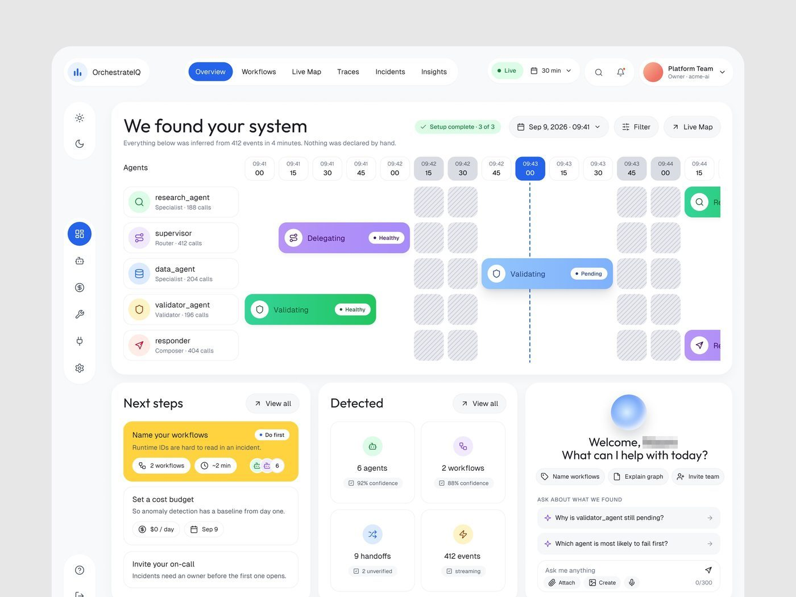
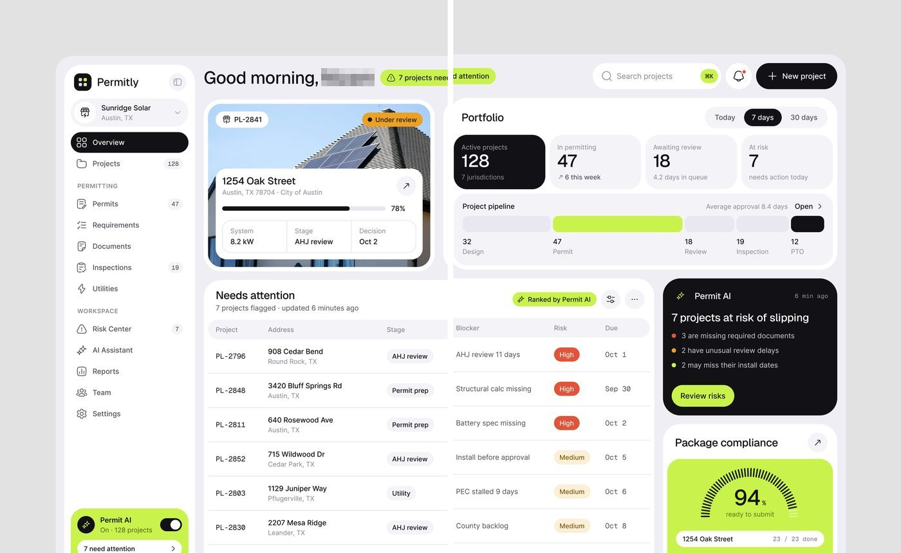
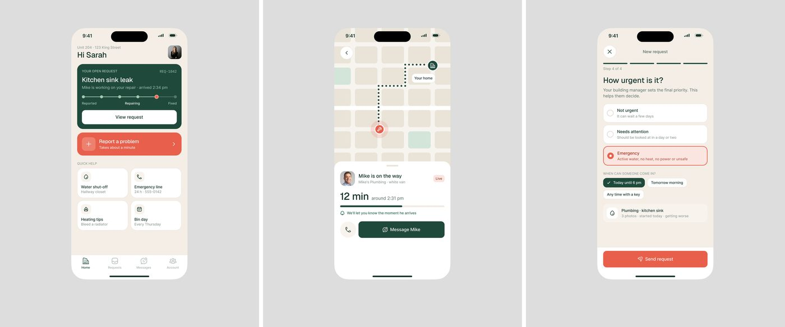
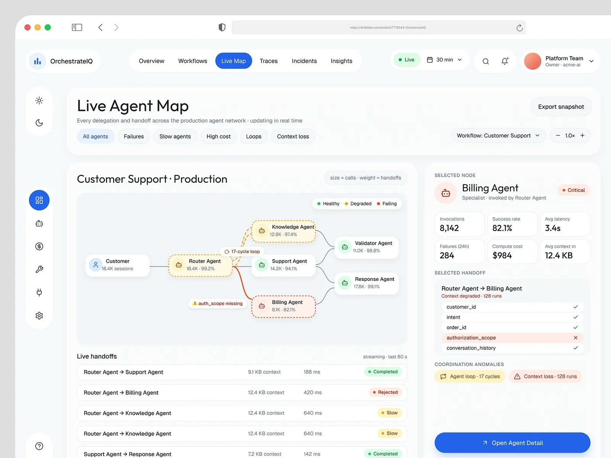

# Receita do shot: montar no Figma o quadro da peça

## O que é

O passo a passo para montar, no Figma, as quatro apresentações que mais aparecem e mais rendem nas peças de produto. Todos os valores vêm das medições de `formato-e-enquadramento.md` e `sequencia-do-post.md`; a conversão de pixel do arquivo para pixel do Figma usa o fator 3 nos iPhones e cartões em retrato (tela de 1179 px = 393 pt × 3), ~2,94 no díptico do Permitly (raio de 94 px = "Panels 32") e **2,5** no shot de 4096 × 3072, medido pela maiúscula do texto e pela linha de 1 px em três produtos (ver [01 · Escala](../01-sistema-visual/README.md#escala-dos-shots-de-4096-px)). Onde o valor é convertido e não lido direto, está marcado **[INFERIDO]**.

Pré-requisito: a tela do produto pronta num frame próprio (desktop de 1440 de largura, ou iPhone de 393×852), com a casca do app (o contêiner externo com a barra lateral e os cartões) mais clara que o fundo que vai entrar em volta.

## Receita 1: shot ampliado 4:3 (a peça de uma imagem)

*Modelo: "Enjoyable Saas UI that makes UX smoother..." (78.682 views, 865 salvos).*

| item | valor | origem |
|---|---|---|
| frame | **~1640 × 1230** | 4096×3072 ÷ 2,5 **[INFERIDO]** do fator medido |
| preenchimento do frame | `#E7E7E7` (faixa aceitável `#DDDDDD` a `#EEEEEE`) | **[MEDIDO]** |
| casca do app | `#F8F9FB` ou `#FFFFFF`, sem borda | **[MEDIDO]** |
| raio da casca | **30 a 40** | 76 a 101 px no arquivo **[MEDIDO]**, ÷ 2,5 (FixTrack 30 a 32, OrchestrateIQ 40) |
| ar à esquerda e à direita | **82 a 117** (5% a 7% da largura) | 205 a 293 px no arquivo **[MEDIDO]**, ÷ 2,5 |
| ar em cima | **86 a 123** (7% a 10%) | **[MEDIDO]** em %, convertido com 2,5 |
| ar embaixo | igual ao de cima, **ou zero** (a casca sai pela borda) | **[MEDIDO]** |
| sombra | **nenhuma** | queda de luminância ≤ 2,7 níveis em 29 de 30 imagens **[MEDIDO]** |
| exportação | "Width: 4096" (~2,5x, 4096×3072), JPG de alta qualidade ou PNG | **[MEDIDO]**: 296 JPG e 34 PNG nas peças de produto |

Passo a passo:

1. Crie um frame de **~1640×1230** com preenchimento `#E7E7E7` e "Clip content" ligado.
2. Cole dentro a tela do produto como instância ou cópia achatada e deixe a casca com **~1.420 a 1.480 de largura** (a tela de 1440 quase em 1:1: a casca mede 3.564 a 3.702 px nos shots, ÷ 2,5). Para mostrar só o topo do painel, maior, aumente a escala e deixe o resto sair por baixo. O efeito de "ampliado" vem da exportação: no arquivo final, cada pixel da interface vira ~2,5 pixels.
3. Posicione a casca com **~105 de ar à esquerda** e à direita, e **~95 em cima**.
4. Decida o corte de baixo: se a tela inteira couber, deixe o mesmo ar embaixo. Se não couber, **deixe a casca sair pela borda de baixo** e escolha o corte para que a última linha visível seja de cartões inteiros ou de títulos, nunca um texto cortado ao meio.
5. Confira o raio da casca: 30 a 40. Se a tela tiver raio menor, ajuste só a casca externa.
6. Não adicione sombra, borda, reflexo, degradê nem texto por cima.
7. Exporte com **"Width: 4096"** (~2,5x). Confira que o arquivo saiu com 4096×3072.

Versão "moldura inteira" (a tela toda aparece, com ar dos quatro lados): o mesmo frame, casca com ~82 a 108 de ar nos lados e ~100 em cima e embaixo. Modelos: Ergond ("So many things on one screen, still seamless Experience.", 46.261 views) e FixTrack ("Another masterpiece. Redesigned it.", 46.208 views).

## Receita 2: díptico retrato (uma tela partida em duas imagens)

*Modelo: "From vibe-coded chaos to polished product." (81.873 views, 1.438 salvos).*

| item | valor | origem |
|---|---|---|
| frame de montagem | **1680 × 1040** | 2 × 2466 × 3051 ÷ 2,94 **[INFERIDO]** |
| cada metade | **840 × 1040** (razão 0,81) | 2466×3051 **[MEDIDO]** |
| fundo | `#E2E2E2` | **[MEDIDO]** |
| casca | `#EFEEF3`, raio 32 | **[MEDIDO]** 94 px ÷ 2,94 |
| ar à esquerda (metade 1) e à direita (metade 2) | **~104** | 306 px **[MEDIDO]** |
| ar em cima | **~105** | 309 px **[MEDIDO]** |
| embaixo | a casca sai pela borda | **[MEDIDO]** |
| exportação | 2,94x por metade, 2466×3051 | **[MEDIDO]** |

Passo a passo:

1. Frame de **1680×1040**, fundo `#E2E2E2`.
2. Tela do produto de 1440 de largura, ampliada até a casca ter ~1472 de largura (quase 1:1), posicionada com 104 de ar à esquerda e em cima, saindo por baixo.
3. Crie dois frames de **840×1040** lado a lado exatamente sobre o frame de montagem (x = 0 e x = 840). Use cada um como máscara do mesmo conteúdo (copie o conteúdo para dentro de cada frame e desloque 840 no segundo).
4. **Mova o corte, não a tela:** confira que a linha x = 840 não corta um número, um ícone ou uma palavra curta no meio de um jeito ilegível. No Permitly o corte passa no meio de "needs" ("7 projects nee|d attention") e ainda assim se lê, porque as duas imagens aparecem coladas.
5. Exporte cada frame a 2,94x (2466×3051). Publique a esquerda primeiro.

## Receita 3: trio de iPhones (ou de cartões isolados)

*Modelo: "Yoo🫡" (17.553 views, 145 salvos).*

| item | valor | origem |
|---|---|---|
| frame | **876 × 1108** (razão 0,79) | 2628×3324 ÷ 3 **[MEDIDO]** |
| fundo | `#DDDDDD` (ou `#E6E6E6`, `#E9E9E9`) | **[MEDIDO]** |
| tela do iPhone | **393 × 852**, sem corpo de aparelho | 1179×2556 px ÷ 3 **[MEDIDO]** |
| raio da tela | **55** | 165 a 180 px ÷ 3 **[MEDIDO]** |
| ilha dinâmica | pílula `#000000` de **124 × 36**, centralizada, **11** abaixo do topo da tela | **[MEDIDO]** |
| barra de status | "9:41", sinal e bateria na cor do texto do app | **[OBSERVADO]** |
| posição | centralizado na horizontal (241 de cada lado); **95** de ar em cima | 722 px e 284 px ÷ 3 **[MEDIDO]** |
| sombra | nenhuma | **[OBSERVADO]** |
| exportação | 3x (2628×3324) | **[MEDIDO]** |

Passo a passo:

1. Frame de **876×1108**, fundo `#DDDDDD`.
2. Dentro, a tela do app de **393×852** com raio 55, a pílula da ilha e a barra de status. Nada de moldura de aparelho.
3. Posicione em x = 241, y = 95. Duplique o frame duas vezes e troque só a tela: **o telefone não muda de lugar** entre as três imagens.
4. Ordem: tela inicial, tela de acompanhamento, tela de ação.
5. Exporte os três a 3x.

Para **cartões isolados** (C1 em `sequencia-do-post.md`): frame de ~1067×1330 (3201×3990 ÷ 3), fundo `#F3F3F3`, um cartão por imagem, centralizado, com 42% a 56% da largura do frame.

## Receita 4: formato de vitrine 4:3 (a tela inteira, reta)

| item | valor | origem |
|---|---|---|
| frame | **1600 × 1200** (ou 1200 × 900) | **[MEDIDO]** |
| fundo | `#DDDDDD` | **[MEDIDO]**, 35 imagens de produto |
| tela | a página inteira de 1440, reduzida para caber | **[OBSERVADO]** |
| ar nos lados | **80** em 1600 (5%) | **[MEDIDO]** |
| ar em cima | 54 a 76 em 1600 (4,5% a 6,3%) | **[MEDIDO]** |
| canto da tela | reto (ou raio até 20 no arquivo) | **[MEDIDO]** 28 de 39 retos |
| opcional | barra do navegador em cima, com os três pontos coloridos | **[OBSERVADO]** OrchestrateIQ |
| exportação | 1x (o arquivo final tem 1600 ou 1200 px) | tamanho **[MEDIDO]**, fator **[INFERIDO]** |

É o formato de volume: as séries Vero e Rillo saíram nele. Rende menos que a Receita 1 (índice de views 1,14 contra 1,41 e de salvos 1,77 contra 2,96 **[MEDIDO]**), mas é rápido de produzir e serve também à plataforma de portfólio.

## Checklist antes de publicar

- [ ] Fundo cinza liso, mais escuro que a casca do app.
- [ ] Ar lateral de ~5%; nada colado na borda, a não ser a sangria de propósito.
- [ ] Raio da casca entre 30 e 40 no Figma (shot de 4096); iPhone com 55.
- [ ] Nenhuma sombra, nenhum reflexo, nenhum degradê, nenhuma cena.
- [ ] Nenhum texto por cima da imagem (título, logo, marca d'água, seta): nas 20 peças mais vistas não há nenhum **[OBSERVADO]**.
- [ ] Sequência: todas as imagens do mesmo tamanho, o telefone ou a casca no mesmo lugar.
- [ ] Exportação a ~2,5x no shot 4:3 de 4096 e a 3x nos retratos; lado maior até 4096 px (o limite de imagem do X).
