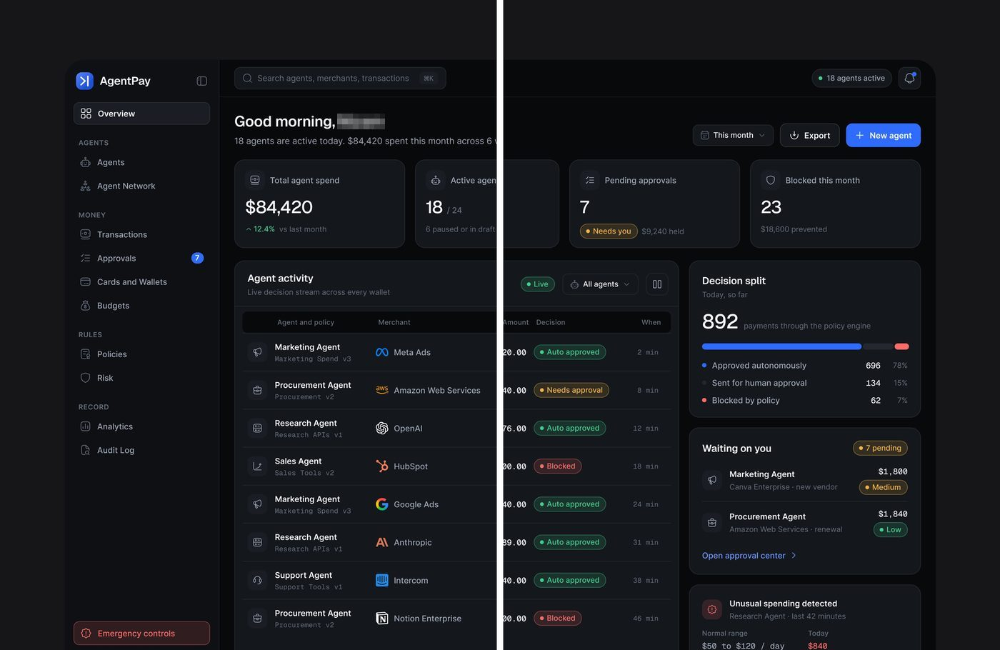
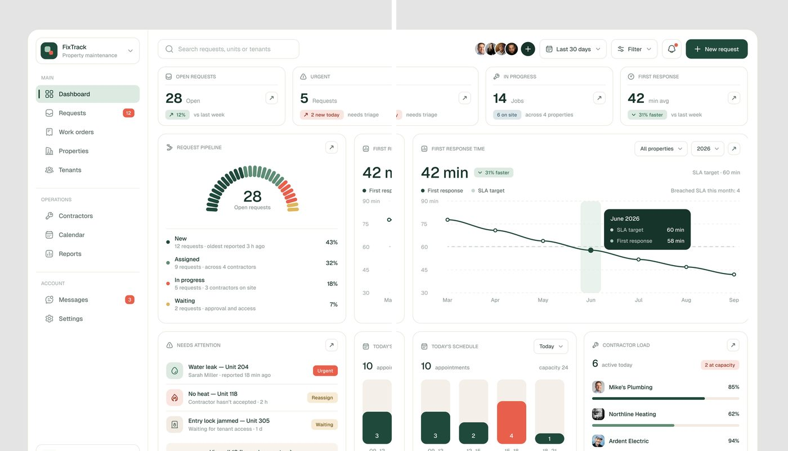
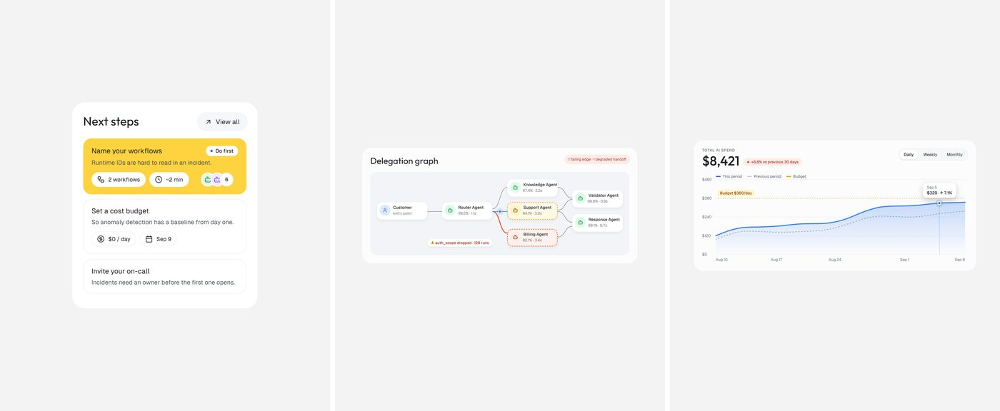
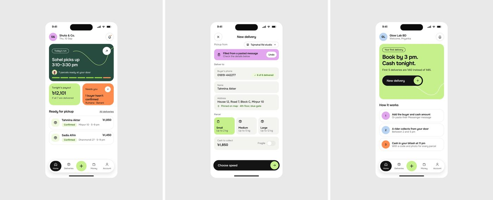
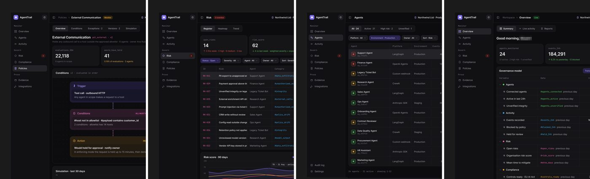
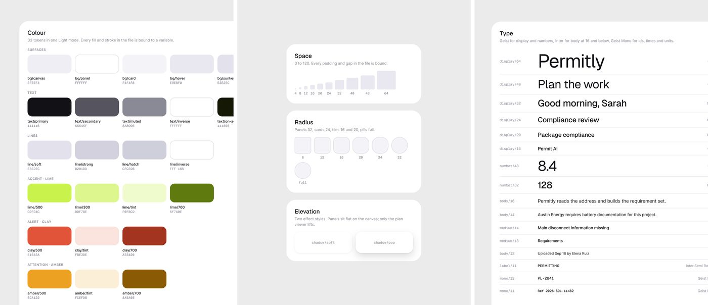
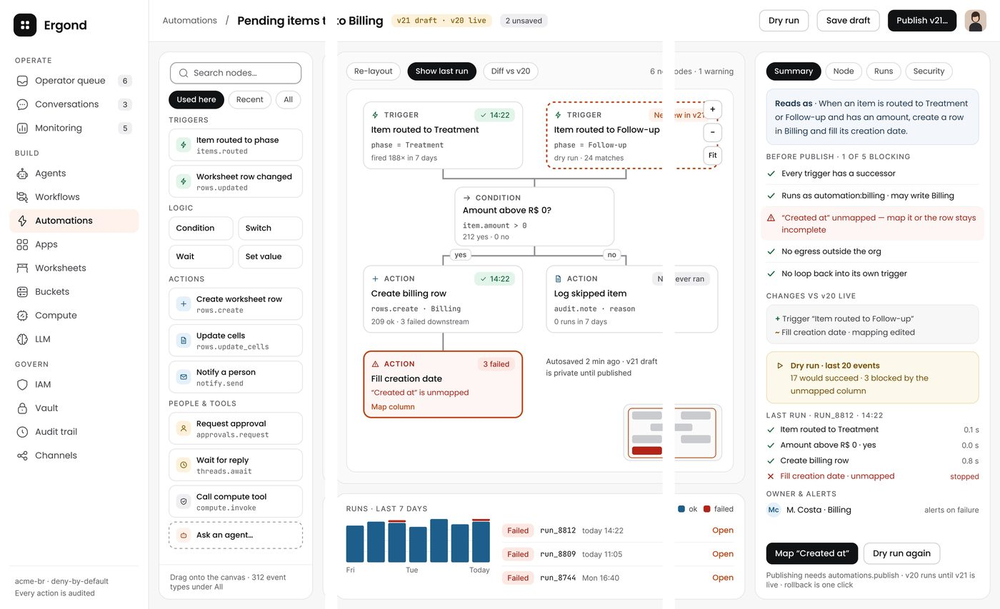
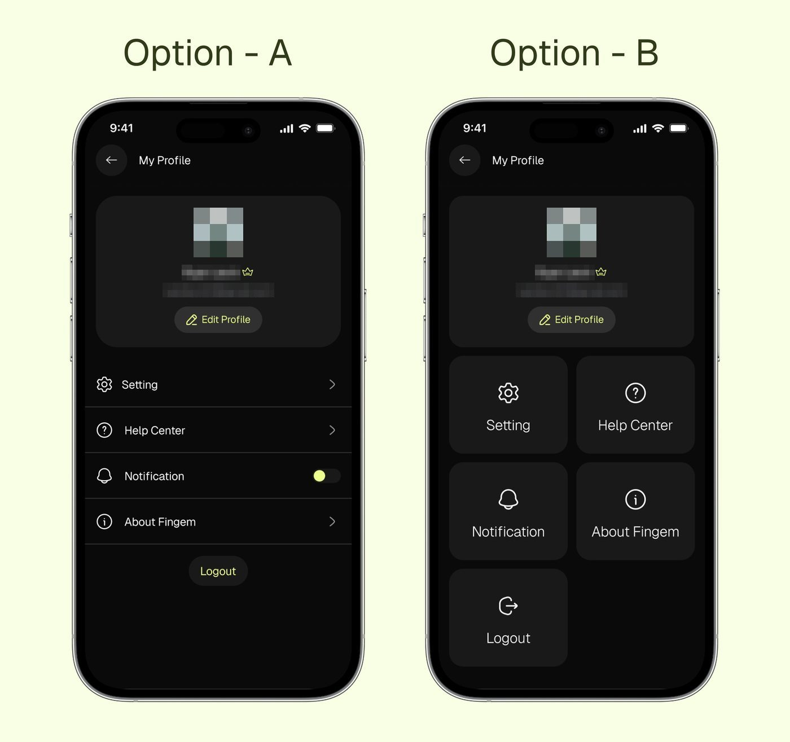
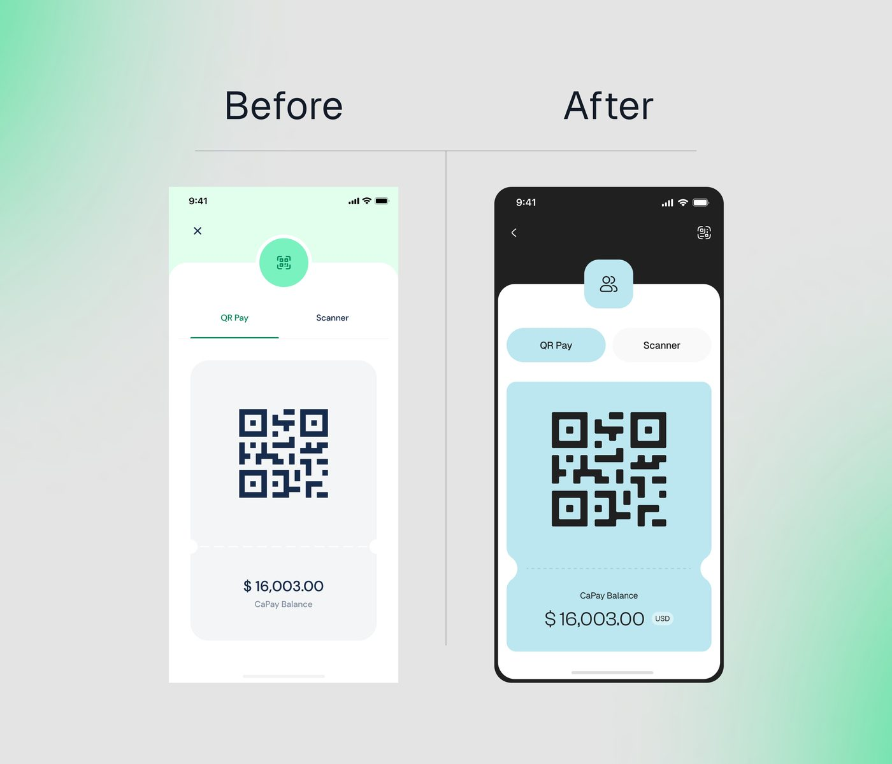
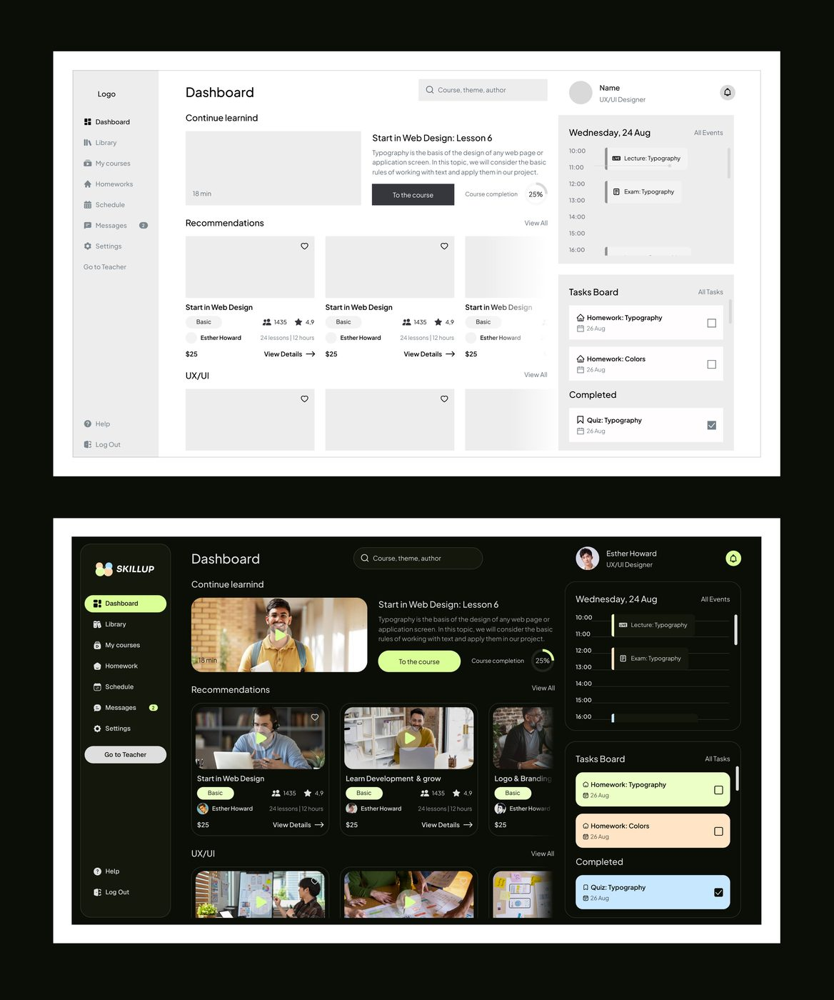

# Sequência da peça: como montar 1, 2, 3 ou 4 imagens

## O que é

A decisão de quantas imagens vão numa peça e como elas se relacionam: se são telas diferentes, pedaços da mesma tela ou recortes de um componente. Medido no tamanho de cada mídia de peças publicadas, cruzado com as imagens abertas uma a uma. Algumas peças tinham menos de 24 horas na leitura; onde isso muda a leitura, está dito. O desempenho usa o índice relativo à semana (views da peça divididas pela mediana das peças com mídia do perfil numa janela de 7 dias; 1,0 é a peça típica), explicado em `../08-conteudo-e-crescimento/legendas.md`.

## Quantas imagens **[MEDIDO]**

Peças com imagem, nas fases de transição e de produto (ver [formato-e-enquadramento.md](formato-e-enquadramento.md)):

| imagens | transição | produto | índice de views | índice de salvos |
|---:|---:|---:|---:|---:|
| 1 | 254 | 168 | 1,00 | 1,00 |
| 2 | 0 | 11 | 0,86 | 0,91 |
| 3 | 0 | 34 | **1,20** | **1,30** |
| 4 | 0 | 3 | 0,71 | 0,78 |

Na transição, **toda** peça tem uma imagem. As peças de 2 a 4 imagens aparecem com as séries de produto e viram rotina: num dia típico, 7 de 11 peças com 3 ou 4 imagens. A peça de uma imagem continua sendo a base (78% no grupo de produto).

A média esconde o que importa: **o formato das imagens dentro da sequência decide mais que a quantidade.**

| tipo de sequência | peças | índice mediano de views | índice mediano de salvos | exemplos |
|---|---:|---:|---:|---|
| **díptico retrato** (uma tela partida em duas metades) | 4 | ver abaixo | ver abaixo | FixTrack 45.397 views; Permitly 81.873 |
| **trio retrato** (3 ou 4 imagens 4:5 ou 7:8) | 20 (17 com mais de 24 h) | **2,51** | **2,45** | "Turn your UI AI slop..." 62.896; "Organized information..." 17.374 |
| tiras altas (tela partida em 3 faixas verticais) | 9 | 1,47 | 0,79 | "Data heavy UI FOR ai agents..." 11.016 |
| par ou trio paisagem 4:3 (telas diferentes do mesmo projeto) | 11 | **0,53** | 0,60 | "Mongi, Delivery & Logistics Mobile App" 892 |

Os quatro dípticos, um por um: FixTrack índice 10,8; Permitly (13 horas de vida na leitura) 19,7; CollectAI (9 horas) 1,9; AgentPay (2,5 horas) 0,17. O único com tempo para fechar a conta já passou de 10 vezes a semana, e o Permitly passou disso em meio dia.

Todos os números desta tabela são **[MEDIDO]**; a separação por tipo foi feita olhando cada peça.

## Os tipos, um por um

### A. Uma imagem (a base)

Uma tela inteira ou um recorte ampliado dela, em 4:3 (ver `formato-e-enquadramento.md`). 141 das 168 peças de uma imagem do grupo de produto são 4:3 (razão de 1,30 a 1,37, a faixa de `formato-e-enquadramento.md`). A peça de uma imagem mais vista é "Enjoyable Saas UI that makes UX smoother..." (78.682 views), um recorte ampliado do topo do painel que sangra pela borda de baixo.

### B. Díptico: uma tela partida em duas metades verticais

*As duas imagens de "From vibe-coded chaos to polished product." postas lado a lado. A frase "7 projects nee|d attention" e as linhas da tabela continuam de uma imagem para a outra. Em horas: 81.873 views e 1.438 salvos, a peça com mais salvos da amostra.*

- **Anatomia [MEDIDO]:** duas imagens do mesmo tamanho (2466×3051, razão 0,81; no FixTrack 2658×3066, razão 0,87). A imagem 1 tem o canto arredondado da moldura do app em cima à esquerda e sangra pela direita e por baixo; a imagem 2 tem o canto em cima à direita e sangra pela esquerda e por baixo. O fundo cinza (`#DEDEDE` a `#E7E7E7`) aparece só em cima e nas laterais externas.
- No Permitly o corte é contínuo (sem sobreposição). No FixTrack há uma faixa repetida de ~10% da largura (a coluna "First response" aparece nas duas) **[OBSERVADO]**.
- **Por que funciona [INFERIDO]:** no feed do X, duas imagens aparecem lado a lado, cada uma numa célula vertical. Com o corte no meio, a dupla vira uma tela larga mostrada quase no dobro do tamanho de uma peça de uma imagem 4:3. O painel fica legível no celular sem clicar.
- É o formato de duas das peças de maior índice relativo (10,8 e 19,7).
- O mesmo formato vale em produto escuro: "AgentPay is a control layer between AI agents and the payment network. Btw, look at the interface ❤️" (2391×3129), com a frase "Active agen|ts" cortada ao meio entre as duas imagens.

### C. Trio retrato: três telas ou três componentes em 4:5

**C1. Três componentes isolados, pequenos, no centro**

*"Organized information that helps to take action without cognitive load. Although they are small cards." (17.374 views, 252 salvos).*

- Três imagens 3201×3990 (4:5), fundo cinza muito claro liso, um cartão por imagem, centrado. **[MEDIDO]** O primeiro cartão ocupa 56% da largura (1.799 px de 3.201) e 50% da altura, com 22% de margem lateral e 25% em cima; os dois seguintes são mais largos (83% a 85%) e baixos (28% a 32% da altura). Na peça "Do you want to see the full screen?" os cartões ocupam só 42% a 46% da largura. Muito ar em volta.
- **Por que tanto ar [INFERIDO]:** no grid de três imagens do feed do X, as duas da direita aparecem cortadas no centro em faixa horizontal. Cartão pequeno e centralizado sobrevive a qualquer corte central.
- Também em "Do you want to see the full screen?" (11.836 views): três cartões do mesmo produto (Documents, Case activity, calendário).

**C2. Três telas de app em iPhone**

*"Yoo🫡" (17.553 views), app do FixTrack para o morador.*

Três imagens 4:5, cada uma com um iPhone de frente centrado sobre cinza liso (`#DDDDDD` no FixTrack, `#E9E9E9` no Mongi, `#E6E6E6` no Contractor). **[MEDIDO]** O iPhone ocupa 40% a 45% da largura e 71% a 78% da altura, na mesma posição exata nas três imagens (a moldura não se mexe, só a tela troca), com 8% a 15% de margem em cima. As três telas contam um fluxo (início, acompanhamento no mapa, pedido novo). Mesmo esquema em "Contractor Mobile app" (10.505), "Run your company smoothly..." (12.863) e na peça "Turn your UI AI slop into production-ready design!" (62.896):

Repare que **nenhuma das três imagens da peça "AI slop" mostra o antes**. A legenda promete a transformação e a sequência mostra só o resultado.

**C3. Quatro recortes escuros com sangria**

*"Tell me whats wrong here?" (6.461 views, 4 imagens 2640×3252).*

Quatro telas diferentes do mesmo produto escuro (AgentTrail), cada uma recortada para mostrar a barra lateral e o começo do conteúdo, sangrando pela direita e por baixo. O fundo é o preto do próprio produto, sem moldura cinza.

**C4. A folha do design system como peça**

*"Does your vibe-coded product maintain a proper design system?" (3 imagens 2391×3129): 2.032 views e 49 salvos com poucas horas de vida, 2,41% de salvos por view, uma das maiores taxas da amostra entre peças com mais de mil views.*

Três pranchas do design system do Permitly, cada uma um cartão branco de raio grande sobre cinza claro, sangrando pela direita (1 e 3) ou flutuando (2): **Colour** (33 tokens em modo claro, amostras com nome e hex), **Space / Radius / Elevation** e **Type** (a escala tipográfica com o nome de cada estilo à esquerda, `display/64` a `mono/11`). A versão escura do mesmo tipo de prancha sai como resposta à própria peça ("Designed with a scalable design system."). É a documentação por trás da tela posta à mostra. **[OBSERVADO]**

O texto das pranchas é uma fonte primária para outras seções desta biblioteca: diz "Panels 32, cards 24, tiles 16 and 20, pills full" (raio), "0 to 120. Every padding and gap in the file is bound" (espaço) e "Geist for display and numbers, Inter for body at 16 and below, Geist Mono for ids, times and units" (tipografia). Na versão escura: "Cards 16, controls 8 to 12, pills full" e "36 tokens in Dark mode". **[MEDIDO]** por leitura das imagens.

### D. Tiras altas: uma tela larga partida em três faixas

*"Data heavy UI FOR ai agents that runs company..." (11.016 views, 211 salvos, 1,92% de salvos por view), três imagens 1440×2700.*

A tela do editor de automações do Ergond, cortada em três faixas verticais que se encaixam ("Pending items t" + "o Billing"). Cada faixa tem razão 0,53, mais alta que um celular. Aparece em 9 peças, com índice mediano 1,47.

### E. Duas a quatro telas 4:3 diferentes (o que não funciona)

Duas, três ou quatro telas inteiras do mesmo projeto, cada uma em 4:3, lado a lado no grid. Índice mediano 0,53 em 11 peças **[MEDIDO]**: "Lora, AI Powered Household Management Mobile App" (623 views, índice 0,26), "Fino, an AI cash layer..." (1.716, índice 0,38), "Mongi, Delivery & Logistics Mobile App" com 4 telas (1.784, 0,41). Com 4:3 no grid, cada tela fica pequena e cortada, e nenhuma se lê. **[INFERIDO]**

### F. Comparação A/B e antes/depois numa imagem só

Quando houver comparação, ela vai numa única imagem, não em imagens separadas:

- **A/B:** "which UI Design is better A or B?" (36.242 views, 375 respostas): dois iPhones escuros lado a lado sobre fundo creme-limão (`#F5F9DC` aprox.), rótulos "Option - A" e "Option - B" em cima, em fonte regular grande.

  

- **Antes/depois:** "Before" e "After" como títulos, duas telas de celular separadas por uma linha vertical fina, fundo com degradê verde-menta nos cantos.

  

- **Wireframe to design** (45.262 views): o wireframe cinza em cima e o layout final embaixo, os dois em moldura branca sobre fundo preto.

  

Nas peças de produto a comparação quase some: "Before, After, A Smarter Task Board Experience" (1.064 views, índice 0,25) e "Interface Before & After, A Cleaner Mobile UI" (1.057, índice 0,24). O "antes e depois" que funciona é o **declarado na legenda**, com a imagem mostrando só o depois.

## Ordem dentro da sequência **[OBSERVADO]** nas 48 peças de 2 a 4 imagens

1. **A primeira imagem é a mais forte e a mais fácil de ler:** o cartão com mais cor (o amarelo "Next steps"), a tela inicial do app ("Hi Sarah", "good morning, mike"), a metade esquerda do díptico com o logo e a saudação.
2. **As seguintes aprofundam o mesmo produto:** próxima tela do fluxo, outro cartão do mesmo painel, a outra metade.
3. **Nunca misture projetos** numa peça.
4. **Tamanho idêntico** em todas as imagens da sequência (43 das 48 peças de 2 a 4 imagens têm todas as mídias com o mesmo tamanho) **[MEDIDO]**.
5. Não há imagem de texto, capa com título ou slide final de chamada. Todas as imagens são interface ou a documentação da interface (a folha do design system).

## Numa amostra mais recente **[MEDIDO]**

154 peças em dez dias: 80 com uma imagem, 10 com duas, 31 com três, 3 com quatro, 25 vídeos e 5 só de
texto. Mediana de views por formato: **duas imagens 6.502**, vídeo 5.754, três imagens 5.418, uma
imagem 3.427, quatro imagens 2.188, texto 948. Salvos medianos: duas imagens 106, vídeo 93, uma 46,
três 48, quatro 9, texto 1.

- **O díptico vira o formato de duas imagens** e o melhor por peça: Permitly (Reports), LeaseFlow
  (Analytics, duas vezes), CollectAI (cliente), Clawback (home), Bench (Talent pool, duas vezes),
  CareOps (recorte da agenda) e o construtor do "Refund Assistant" (canvas e painel).
  
  
- **O trio de cartões isolados** é formato próprio (CaseDraft, PriorAuth, AgentTrail, Rillo, e os
  cartões de recurso): três decisões, uma por imagem, em retrato. Ver
  [../02-componentes/sobreposicoes-e-cartoes-isolados.md](../02-componentes/sobreposicoes-e-cartoes-isolados.md).
- **Trio de celular** continua a forma do app: três telas em sequência de uso (hoje → detalhe →
  confirmação), sobre cinza.
- **Repostagem do mesmo trio:** as três telas de celular do FixTrack saem três vezes em uma semana; as
  do CollectAI, três vezes; a jornada do Mortgage Flow, três vezes. A legenda muda, as imagens não.

## Como reproduzir

| objetivo | montagem | tamanho de exportação |
|---|---|---|
| peça diária | 1 imagem, tela ou recorte ampliado | 4096×3072 (4:3) |
| mostrar um painel grande legível no celular | díptico: frame de 4.932×3.051, cortado em duas metades | 2 × 2466×3051 |
| mostrar componentes | trio de cartões isolados, cartão com ~55% da largura, centrado | 3 × 3200×4000 (4:5) |
| mostrar fluxo de app | trio de iPhones, um por imagem, na ordem do fluxo | 3 × 2640×3300 (4:5) |
| mostrar um editor ou tabela muito larga | 3 tiras de uma mesma tela | 3 × 1440×2700 |
| evitar | 2 a 4 telas 4:3 diferentes na mesma peça | |

Passo a passo do díptico no Figma:
1. Monte o shot como em `receita-do-shot.md`, mas num frame de **4932×3051** (duas vezes 2466 de largura).
2. Posicione a moldura do app começando a ~6% da largura à esquerda e terminando a ~6% à direita, com o topo a ~8% da altura e sangrando pela borda de baixo.
3. Crie dois frames de 2466×3051 lado a lado e use cada um como máscara (ou "Clip content") sobre o mesmo shot.
4. Confira que nenhum texto importante cai exatamente no corte. Exporte os dois em PNG ou JPG em 1x.
5. Publique na ordem esquerda, direita.
