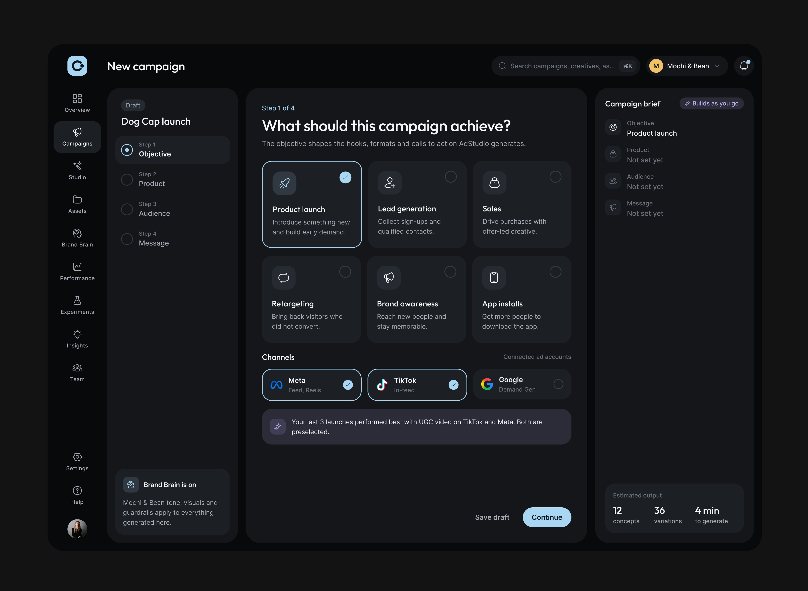
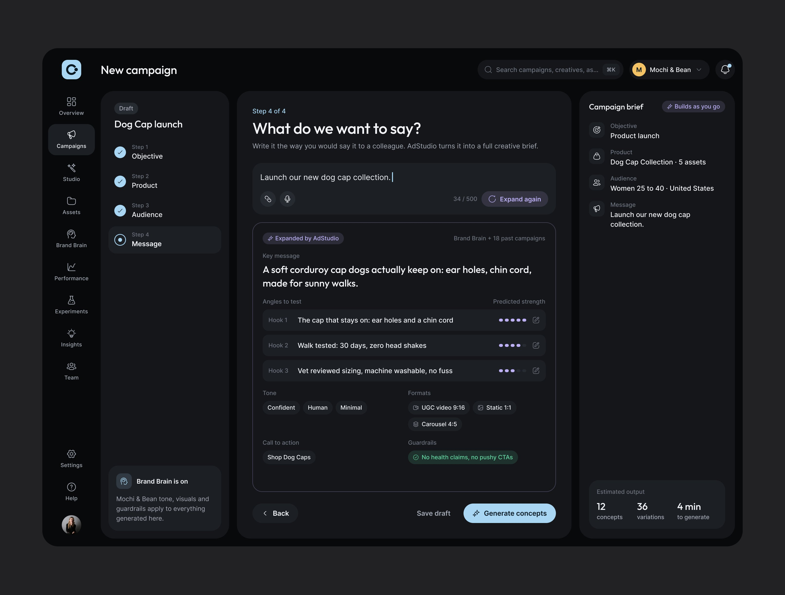
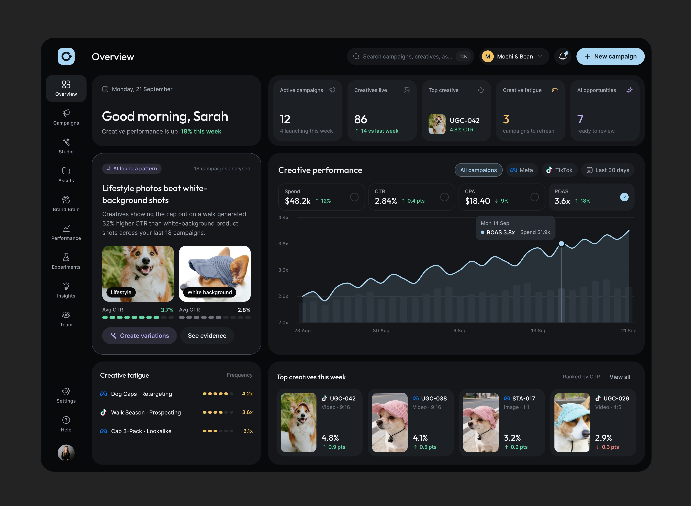
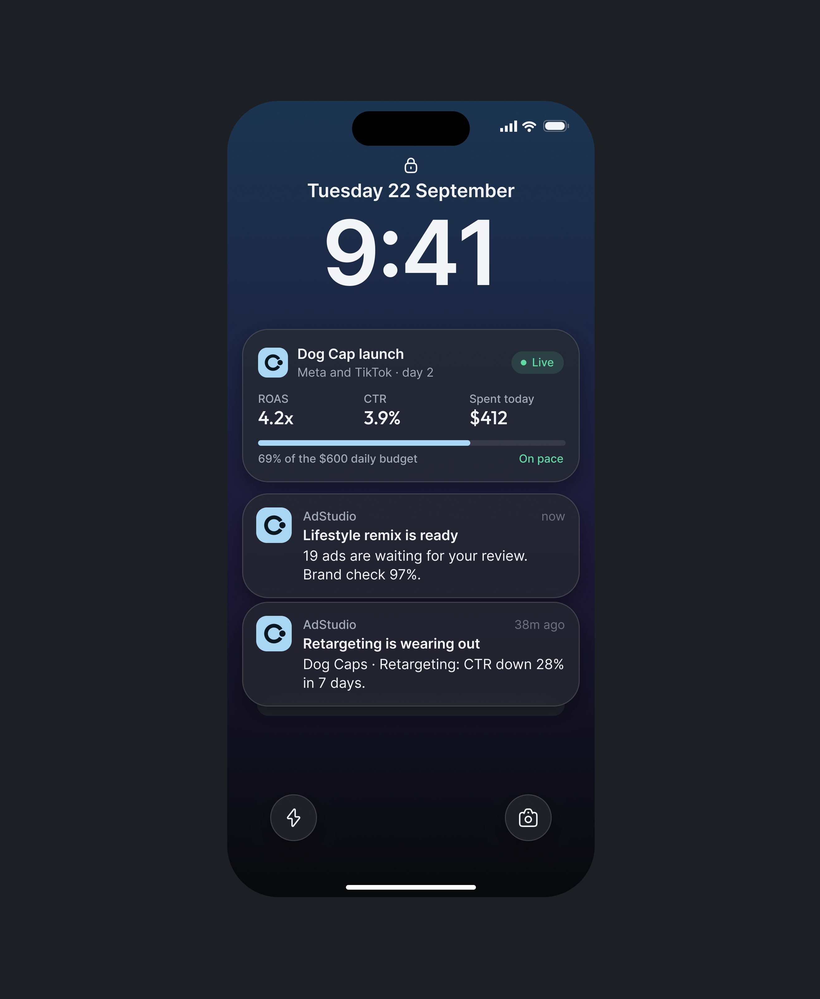
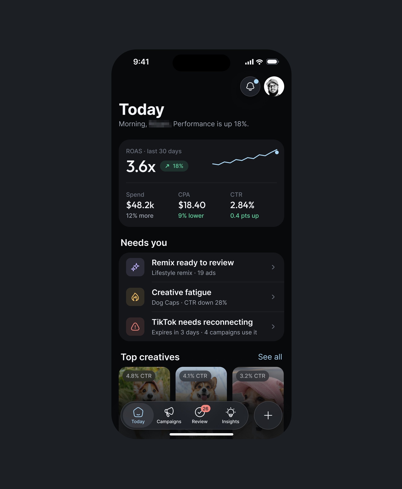
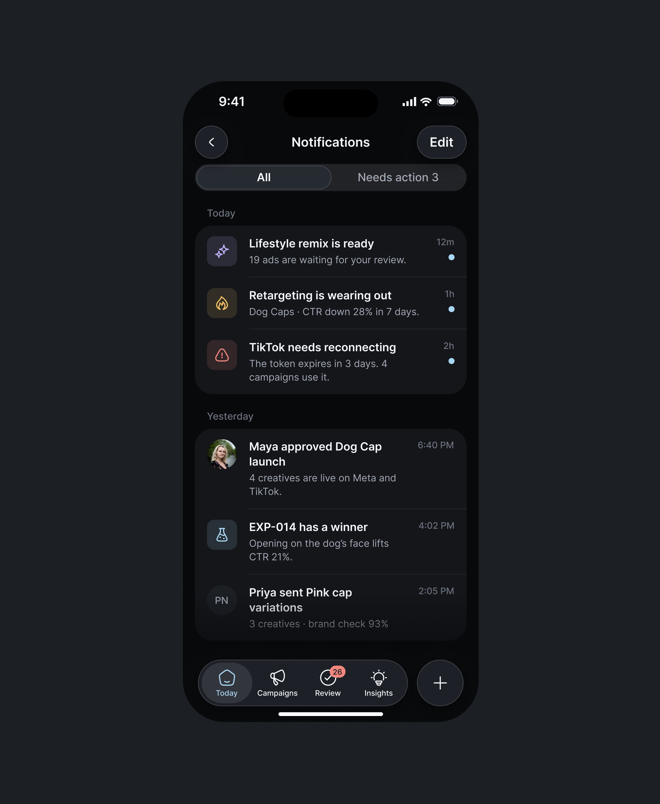

# AdStudio AI

**Estúdio de criativos de anúncio, escuro, web e iOS.** 5 peças em uma semana (as primeiras telas
estão em [outros-produtos.md](outros-produtos.md)). As legendas dizem o que é: *"AdStudio AI is a creative production and
marketing SaaS for DTC brands, SaaS companies, performance teams, and agencies."* e *"AdStudio is an AI Creative Studio for Performance Marketers."*. **[CONFIRMADO]**

| Campo | Valor |
|---|---|
| Setor | marketing de performance: campanha, conceitos criativos, variações, fadiga, desempenho por canal |
| Para quem | o time de marketing de uma marca DTC (a conta "Mochi & Bean", bonés para cachorro) |
| Tema | escuro quase preto `#0C0C18` **[MEDIDO, amostra quantizada]**; fotos de produto dentro da interface |
| Plataforma | web (New campaign, Overview, Brand Brain, Creative Studio) + iOS (tela de bloqueio, Today, Notifications) |
| Acento | azul-claro no botão principal ("Continue", "Generate concepts", "New campaign"); verdes e âmbares só em estado |

## Telas publicadas

<!--T:AdStudio-->
| # | views | salvos | salvos/1k | mídia | legenda |
|---|---:|---:|---:|---|---|
| 1 | 1.901 | 12 | 6,3 | 1 img | AdStudio AI is a creative production and marketing SaaS for DTC brands, SaaS companies, pe |
| 2 | 2.030 | 19 | 9,4 | 1 img | Launch new campaign... What do you think about this interface design? Isn't it visually ap |
| 3 | 2.027 | 19 | 9,4 | 1 img | Do you want to see the mobile design also? AdStudio AI, Closing the Loop Between Creative  |
| 4 | 10.793 | 162 | 15,0 | vídeo | Yooo... How seamless the design is! |
| 5 | 2.663 | 7 | 2,6 | 3 img | Just designed iOS App Adstudio AI! |
| **total** | **19.414** | **219** | **11,3** | | |
<!--/T-->

## O que cada tela tem

- **New campaign** — assistente em quatro passos com o resumo da campanha à direita ("Campaign
  brief · Builds as you go") e a estimativa no pé (12 conceitos, 36 variações, 4 min). No passo 1,
  seis objetivos em cartão e a nota da IA *"Your last 3 launches performed best with UGC video on
  TikTok and Meta. Both are preselected."*; no passo 4, a frase-chave "Expanded by AdStudio", três
  ângulos com força prevista em pontos e os guardrails.
  
  
- **Overview** — "Good morning, Sarah", KPIs, o cartão **"AI found a pattern"** que compara duas
  fotos (lifestyle × fundo branco) com o CTR de cada e "Create variations" / "See evidence", a
  linha de desempenho, fadiga criativa em pontos e os melhores criativos da semana.
  
- **iOS** — tela de bloqueio com o widget ao vivo da campanha, Today com "Needs you" e
  Notifications com "Needs action 3".
  
  
  
- **Vídeo das telas web** (a melhor peça da série, 10.793 views): Brand Brain, Creative Studio e
  o modal "Remix 19 ads". Ver [../05-apresentacao/video-e-movimento.md](../05-apresentacao/video-e-movimento.md).

## O que a série ensina

- **A sugestão da IA vem com a evidência visual**: duas fotos lado a lado com o número de cada,
  não uma frase.
- **O resumo que se monta enquanto a pessoa responde** (Campaign brief à direita do assistente).
- **Rendimento baixo para o tamanho da série** (mediana perto de 2 mil views nas peças de imagem):
  o escuro e o setor de marketing renderam menos que os produtos de operação da mesma semana.
