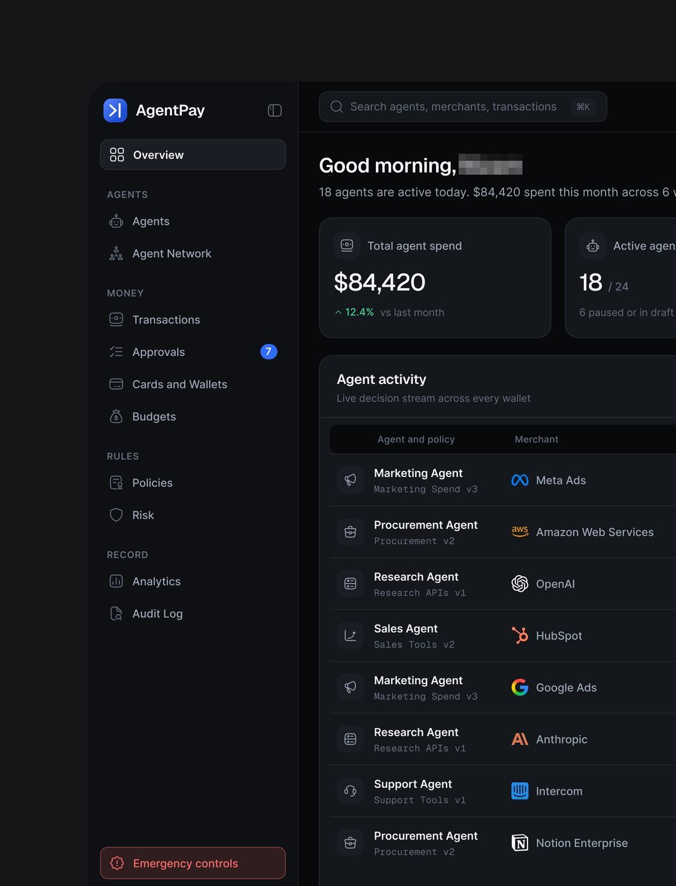
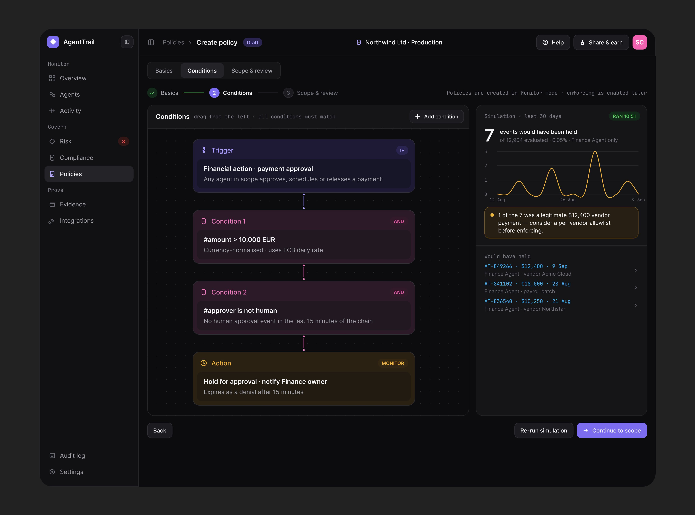
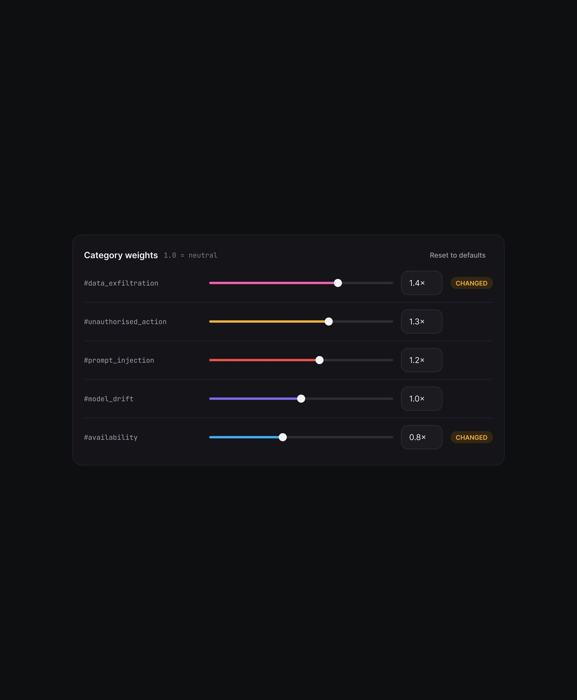
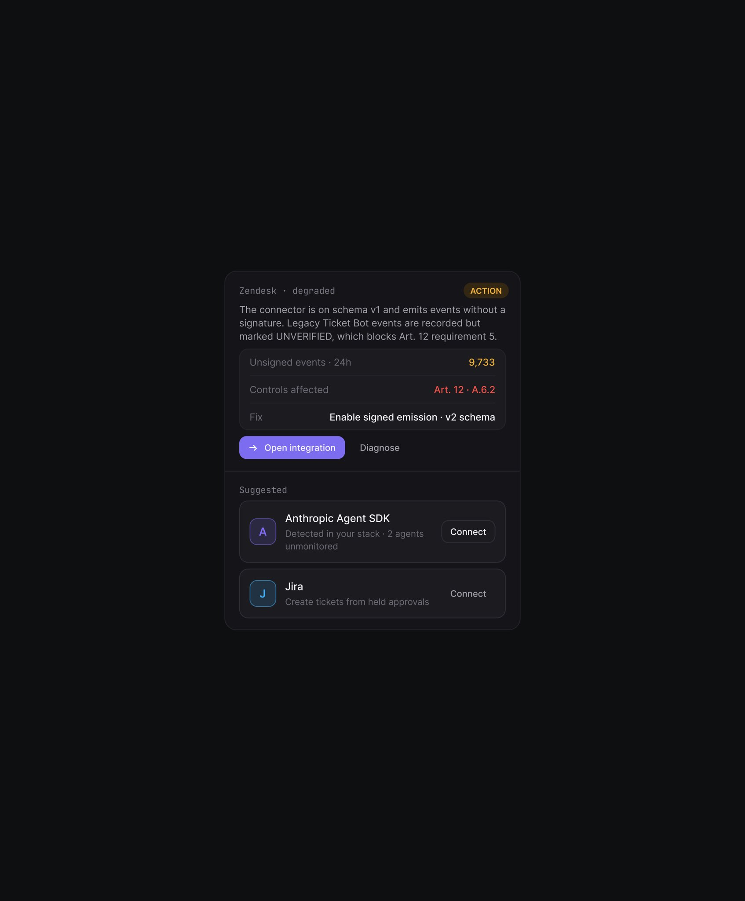
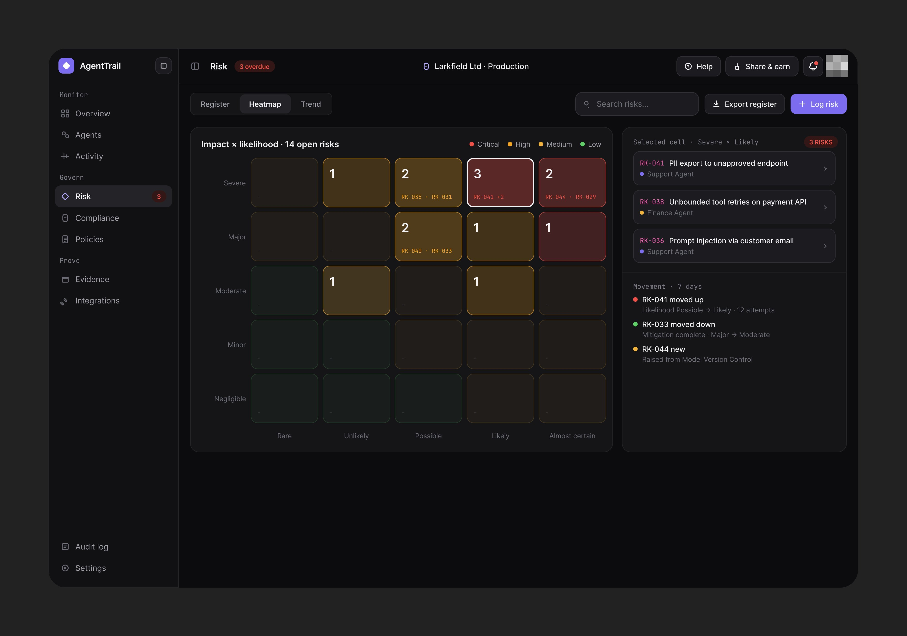
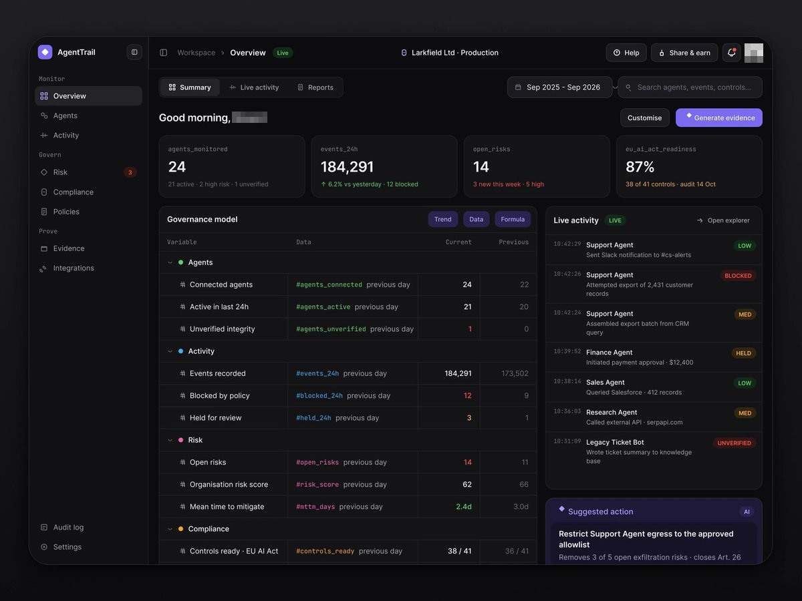

# AgentTrail e AgentPay

Os dois produtos escuros de governança de agentes. Mesma família visual (e, segundo
a peça da folha de DS, **o mesmo design system escuro**: "Designed with a
scalable design system", tokens em
[../01-sistema-visual/design-system-publicado.md](../01-sistema-visual/design-system-publicado.md)).

## AgentTrail

| Campo | Valor |
|---|---|
| Nome | AgentTrail (logo: losango branco em quadrado roxo) |
| Setor | governança, auditoria e compliance de agentes (EU AI Act, trilha com hash) |
| Para quem | compliance / segurança de empresa que usa agentes |
| Tema | escuro; fundo `#151515`-`#1B1B1B` **[MEDIDO]**, grade de pontos no canvas |
| Plataforma | web desktop |
| Acento | roxo `#7C6CF0`; status verde (VERIFIED, ACCEPTED), vermelho (Blocked, MISMATCH), âmbar (not yet anchored) |

### Telas publicadas

<!--T:AgentTrail-->
| # | views | salvos | salvos/1k | mídia | legenda |
|---|---:|---:|---:|---|---|
| 1 | 3.814 | 10 | 2,6 | 3 img | AI Agents |
| 2 | 8.059 | 13 | 1,6 | 3 img | Going to be live soon! - Enjoy! |
| 3 | 8.053 | 38 | 4,7 | 1 img | Agent risk management |
| 4 | 9.329 | 18 | 1,9 | 3 img |  |
| 5 | 8.127 | 138 | 17,0 | 3 img | Enjoy the hierarchy! |
| 6 | 6.461 | 52 | 8,0 | 4 img | Tell me whats wrong here? |
| 7 | 1.710 | 10 | 5,8 | 1 img | AgentTrail, AI Agent Governance & Audit Platform. |
| 8 | 2.333 | 30 | 12,9 | 2 img | AgentTrail, AI Agent Governance & Audit Platform |
| 9 | 13.275 | 63 | 4,7 | 1 img | Ai Agentic product design! |
| 10 | 5.241 | 48 | 9,2 | 1 img | Check which Agent does what? |
| 11 | 3.708 | 29 | 7,8 | 3 img | Dark UI cards ❤️ |
| 12 | 2.011 | 9 | 4,5 | 1 img | Clean ui and bext ux design for the Policy page. Design the policy: how should your agent  |
| 13 | 2.842 | 22 | 7,7 | 3 img | Cards UI design! Wanna see the product? |
| 14 | 10.532 | 94 | 8,9 | 1 img | Risk management page UI design |
| 15 | 3.348 | 34 | 10,2 | vídeo | I don't know why I love the dark UI so much. Do you like dark or light more? |
| **total** | **88.843** | **608** | **6,8** | | |
<!--/T-->

### Navegação

Sidebar com grupos em **monoespaçada minúscula** ("Monitor", "Govern", "Prove"):
Overview, Agents, Activity / Risk (badge 3), Compliance, Policies / Evidence,
Integrations; no pé Audit log e Settings. Topo: breadcrumb "Activity > AT-849291"
com pílula vermelha "Blocked" e o agente à direita.

### Módulos

| Tela | Conteúdo |
|---|---|
| Evento (Decision graph) | abas Overview / Decision graph / Integrity / Controls; tabela chave-valor do evento; bloco Integrity com hashes em mono; controles mapeados (Art. 12, EU AI Act) e, à direita, a cadeia Trigger → Agent decision → Policy evaluation → Risk classification em cartões coloridos por etapa (roxo, lilás, vinho, âmbar) |
| Integridade | modal "INTEGRITY FAILED" com hash armazenado × recalculado e lista de eventos da faixa |
| Policies | condições como nós (Trigger, Condition, Action) e simulação de 30 dias |

### Performance

15 peças, 88.843 views, 608 salvos, **6,8 salvos/1k**: muita atenção, pouco
salvo. Os carrosséis de 3 imagens com legenda vazia ou mínima ("Going to be live
soon", só link) passaram de 8 mil; os dois com o nome na legenda ficaram em 1.710 e
2.333.

## AgentPay

| Campo | Valor |
|---|---|
| Nome | AgentPay (logo: ">|" branco em quadrado azul) |
| Setor | camada de controle entre agentes de IA e a rede de pagamento: gasto, aprovações, cartões, orçamentos |
| Tema | escuro |
| Acento | azul (logo, badge de aprovações "7"); botão de emergência em vermelho translúcido |
| Peças | o díptico "AgentPay is a control layer between AI agents and the payment network. Btw, look at the interface", + folha de DS |

<!--T:AgentPay-->
| # | views | salvos | salvos/1k | mídia | legenda |
|---|---:|---:|---:|---|---|
| 1 | 682 | 5 | 7,3 | 2 img | AgentPay is a control layer between AI agents and the payment network. |
| 2 | 161 | 1 | 6,2 | 3 img | Designed with a scalable design system. |
| 3 | 9.828 | 52 | 5,3 | 1 img | Does your vibe-coded ui looks chaotic? Or a clean, consistent UI that helps to take decisi |
| 4 | 2.521 | 19 | 7,5 | vídeo | Agentic subscription management mobile app, UXUI Design. |
| 5 | 2.732 | 17 | 6,2 | vídeo | Subscription management mobile app UI design. |
| 6 | 614 | 0 | 0,0 | 1 img | Popup design, dark UI! |
| **total** | **16.538** | **94** | **5,7** | | |
<!--/T-->

Sidebar em grupos AGENTS (Agents, Agent Network) / MONEY (Transactions, Approvals 7,
Cards and Wallets, Budgets) / RULES (Policies, Risk) / RECORD (Analytics, Audit Log)
e, no pé, **"Emergency controls"** em cartão vermelho translúcido. Conteúdo:
"Good morning, [nome]", KPIs "Total agent spend $84,420" e "Active agents 18 / 24",
stream "Agent activity" com agente, política em mono e merchant com logo real
(Meta Ads, AWS, OpenAI, HubSpot, Anthropic, Notion).

## O que é específico deste setor

Prova e controle: hash, âncora de bloco, carimbo de tempo, versão de política,
botão de emergência. Escuro + mono + ID por toda parte comunicam "sistema de
registro". **[OBSERVADO]**

## Mais telas da série

AgentTrail: a política em blocos empilhados (Trigger, Condition 1 e 2, Action) com a
simulação dos últimos 30 dias, três cartões isolados (pesos por categoria com selo CHANGED, pacote de
evidências pronto com hash e "Share with [auditoria]", integração degradada com a correção sugerida), o
mapa de risco impacto × probabilidade e um vídeo das telas.

AgentPay: o modal "New wallet" escuro (publicado duas vezes) e os dois vídeos-esteira do app
(claro e escuro). Ver [../05-apresentacao/video-e-movimento.md](../05-apresentacao/video-e-movimento.md).

