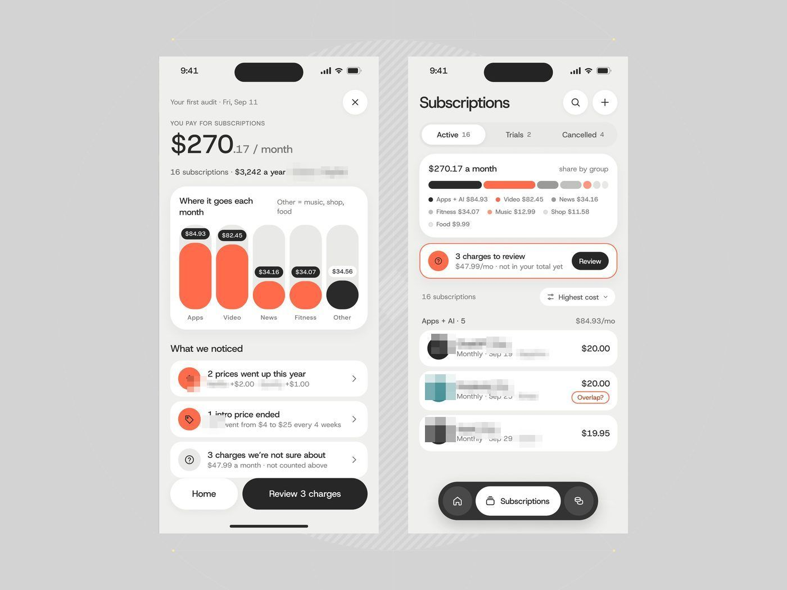
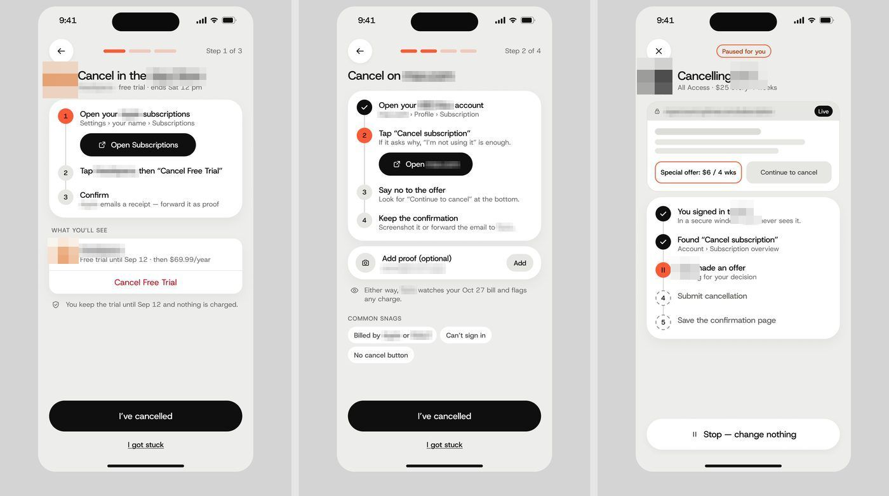
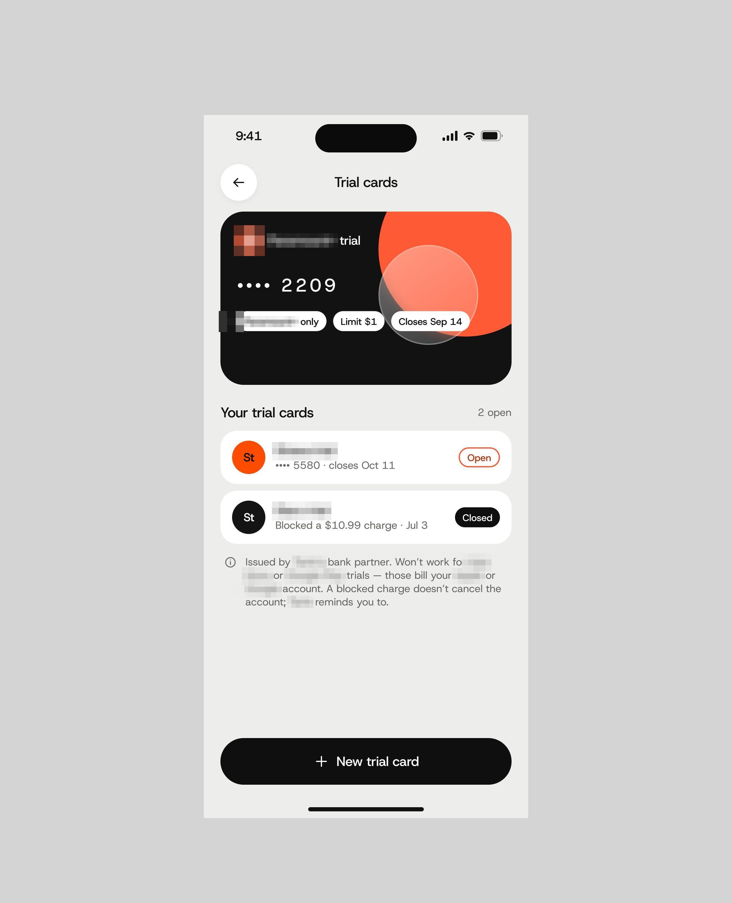
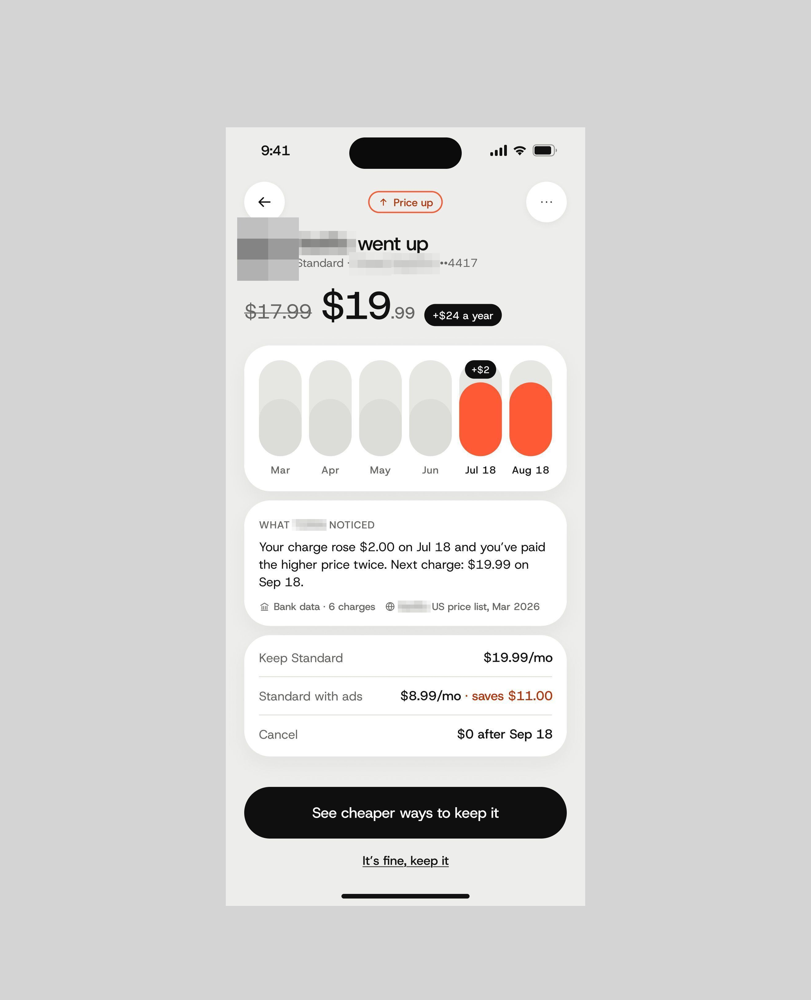
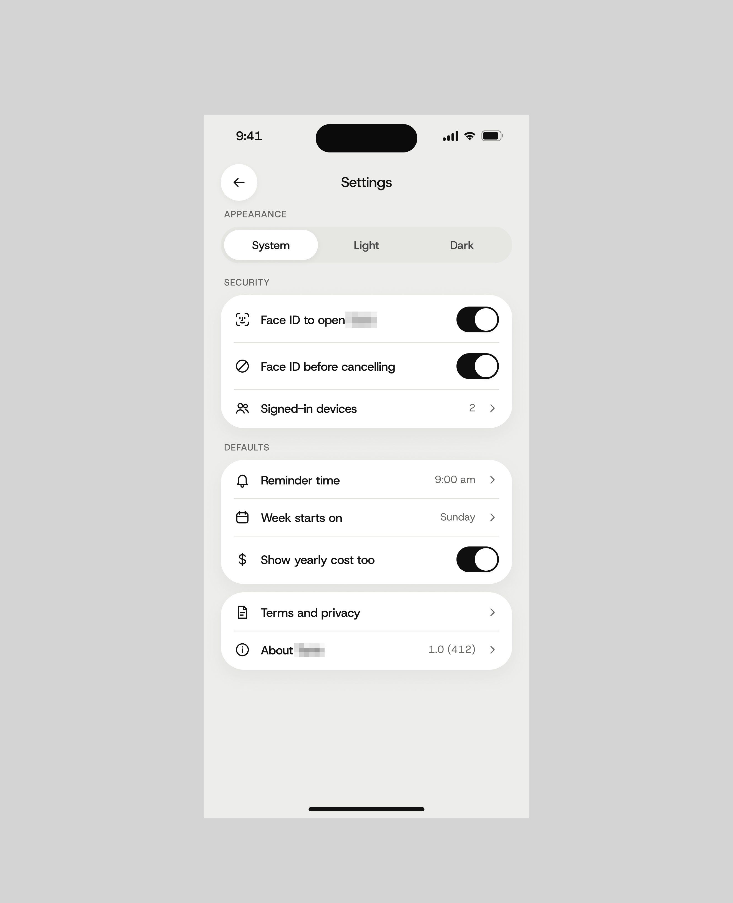
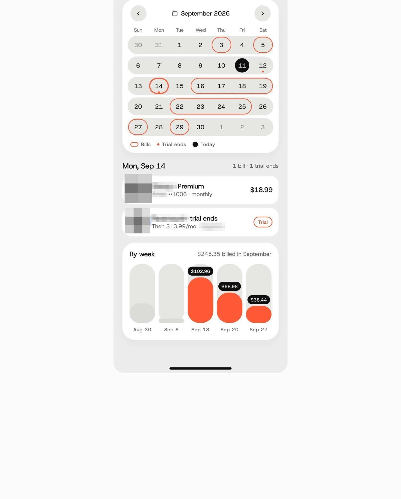
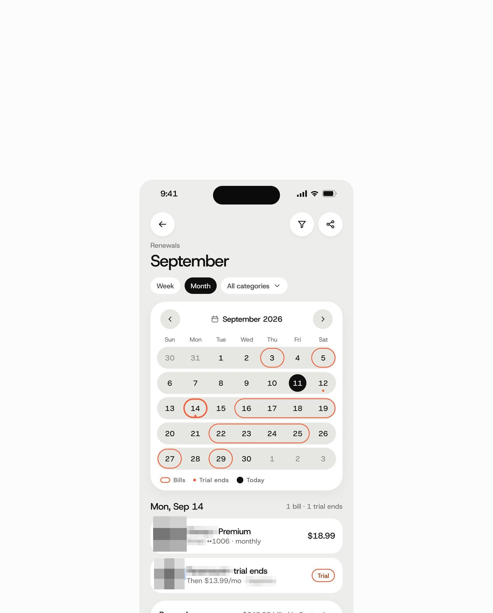
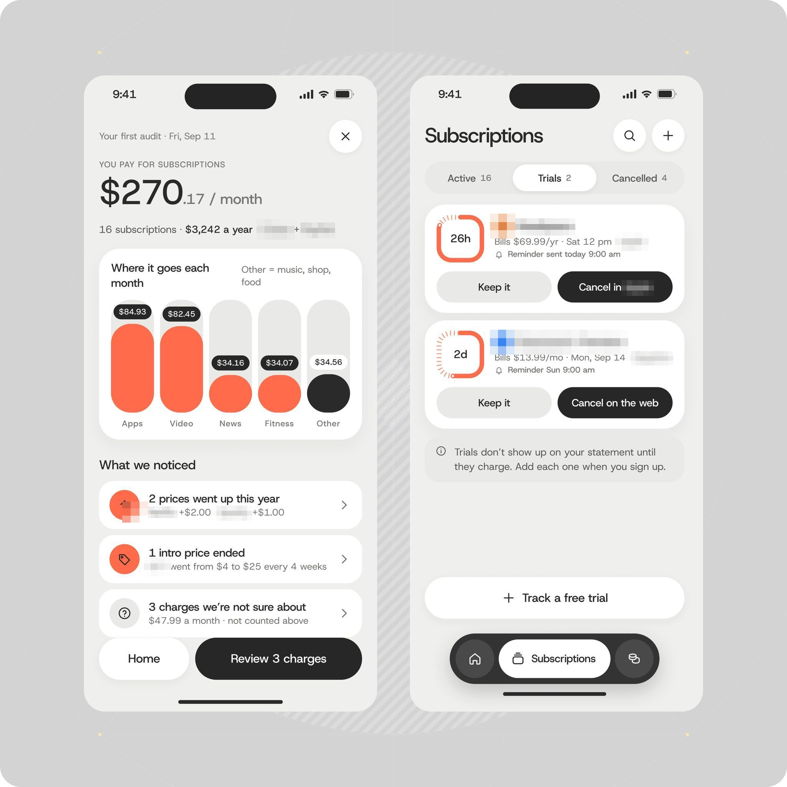
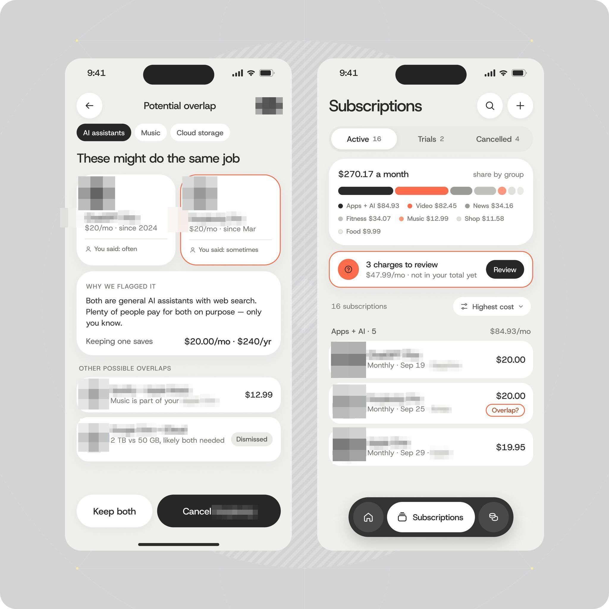

# App de assinaturas

| Campo | Valor |
|---|---|
| Nome | App de assinaturas (legenda: app de gestão de assinaturas e dinheiro) |
| Setor | finanças pessoais: auditoria e cancelamento de assinaturas |
| Para quem | consumidor com muitas assinaturas ("16 subscriptions · $3,242 a year · [banco] + [carteira digital]") |
| Tema | claro; fundo de tela cinza-quente `#EDEDEA`, moldura `#D2D2D2` **[MEDIDO]** |
| Plataforma | mobile |
| Acento | coral `#FF6645`; botões de ação pretos **[MEDIDO]** |

## Módulos

- **Primeira auditoria**: "$270.17 / month" enorme, barras verticais arredondadas
  por grupo (Apps, Video em coral cheio; News, Fitness em coral pela metade; Other
  em preto), "What we noticed" (preço subiu, intro terminou, cobranças suspeitas),
  botão preto "Review 3 charges".
- **Subscriptions**: abas Active 16 / Trials 2 / Cancelled 4, barra empilhada por
  grupo, alerta com borda coral "3 charges to review", lista de serviços reais
  (assistente de IA, buscador de IA com selo "Overlap?", pacote de assinaturas); tab bar flutuante
  preta.
- **Fluxo de cancelamento** (a legenda pede nota para a interface e
  gaba a função sem enfeite): passo a passo com barra de progresso segmentada
  coral, passos numerados com o atual em círculo coral, botão preto de
  deep link ("Open Subscriptions", "Open [site do serviço]"), "Common snags" em chips, CTA
  "I've cancelled" + link "I got stuck".

## O que é específico

O app **não cancela por você**: guia o usuário por fora (a loja de apps, o site do serviço) e
pede prova. Honestidade sobre o limite do produto é o design.

## Mais telas da série

App de assinaturas tem também estas três telas: cartões virtuais de teste (limite de $1, fecha na data do fim do
teste), **"[streaming] went up"** com o preço riscado, "+$24 a year", o histórico em barras e o bloco "What
app de assinaturas noticed" com a base (bank data, 6 charges), e as configurações ("Face ID before cancelling", "Show
yearly cost too").

## Mais telas

- Ganhou o calendário de renovações no celular e o díptico de auditoria ("These might do the same job").

Telas:

- App de assinaturas, app de assinaturas, no celular: calendário de setembro com renovações circuladas, a lista do dia e barras de gasto por semana 
- App de assinaturas, app de assinaturas, no iPhone: "September" com abas Week/Month, calendário com renovações e cobranças do dia 14 
- Díptico de dois iPhones do app de assinaturas: "$270.17 / month" com "What we noticed" e a lista de testes grátis com "Cancel in [conta online]" 
- Díptico de dois iPhones do app de assinaturas: "These might do the same job" (assistente de IA x buscador de IA) com "Cancel [buscador de IA]" e a lista de assinaturas 
