# Construtor do assistente de reembolso

**Construtor de agente de atendimento em canvas, verde-escuro.** A marca não aparece nos shots: o
nome é o do agente que está sendo montado (assistente de reembolso, rascunho v1.5). 8 peças em seis dias,
e a série de maior soma de salvos do período depois do painel de licenciamento solar (1.844). O vídeo o apresenta como
redesenho, numa legenda que pergunta o que acham e provoca: produto feito com IA só fica de pé se
quem o fez entende de design; se não, é repensar. **[CONFIRMADO]**

| Campo | Valor |
|---|---|
| Setor | automação de atendimento: agentes que respondem pedido de reembolso com regras e passagem a humano |
| Para quem | quem monta e publica o agente (time de operação de suporte) |
| Tema | claro; canvas branco pontilhado **[OBSERVADO]** |
| Plataforma | web (construtor, popup de condição, Test Lab, configuração do agente, publicação) |
| Acento | verde-escuro `#0C6C48` (Publish, Save node, Save condition, aba ativa) **[MEDIDO, amostra quantizada]**; condições em pílula âmbar; o fluxo gerado em creme com decisões em rosa |

## O que cada tela tem

- **Construtor** — três colunas: a biblioteca de nós à esquerda (favoritos, Triggers, AI, Logic,
  Actions, Human), o canvas pontilhado com Start → Customer message → Classify intent (96%) →
  condições em pílula âmbar ("Refund request?", "Refund eligible?") → ações, e o painel do nó à
  direita com abas Setup / Configure / Test.
  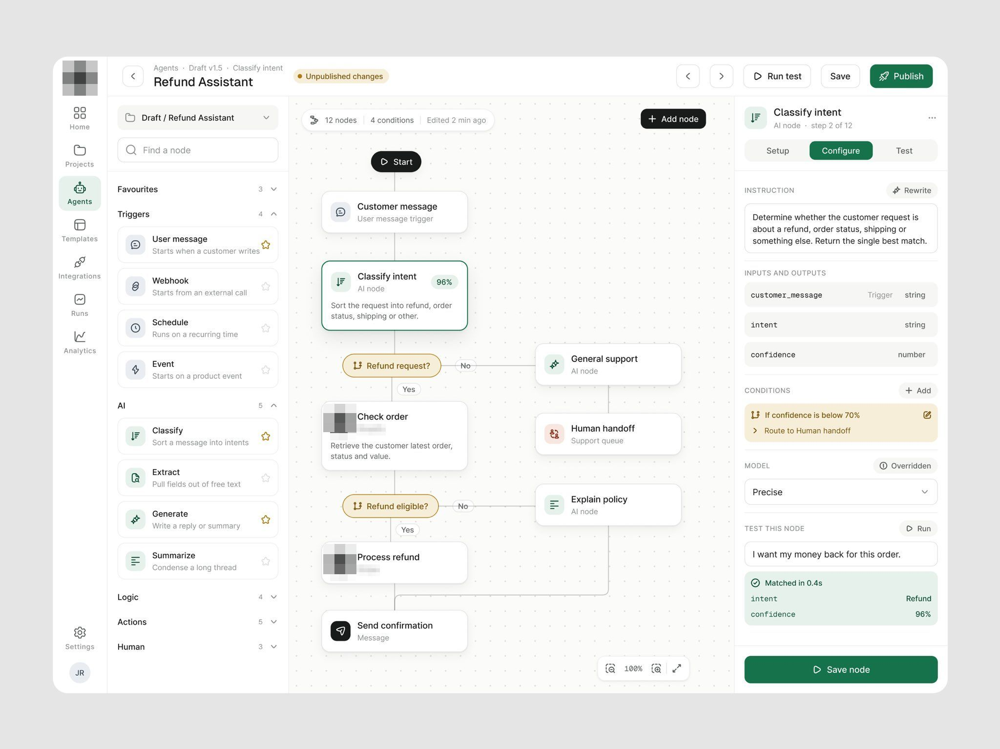
  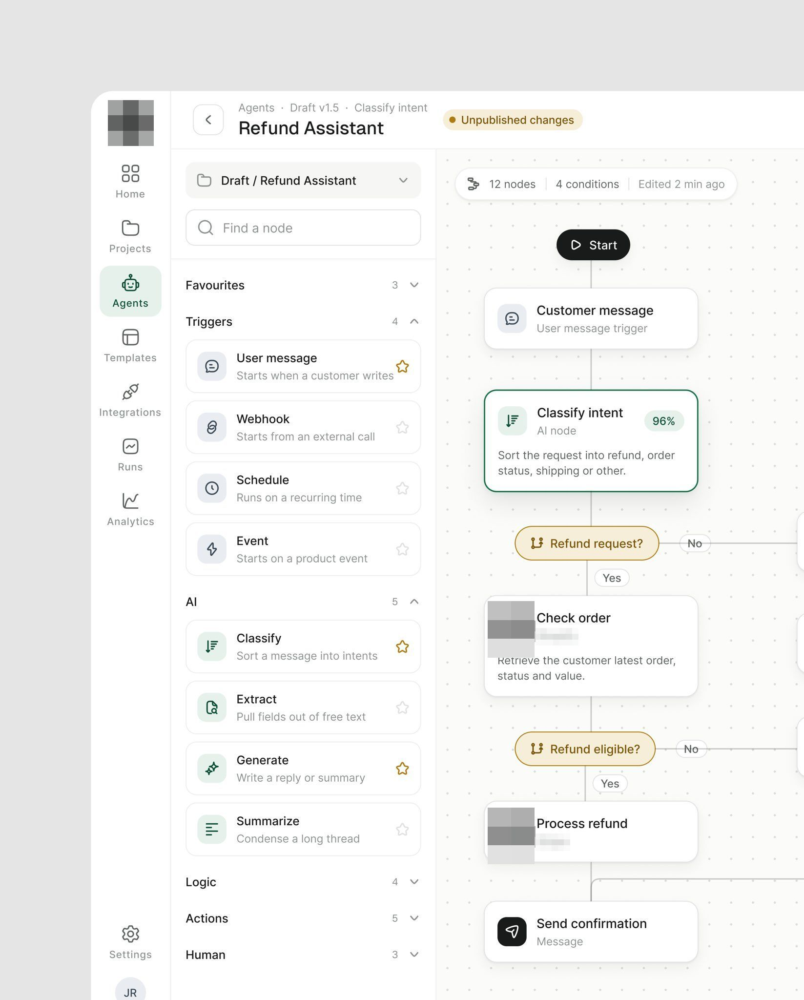
  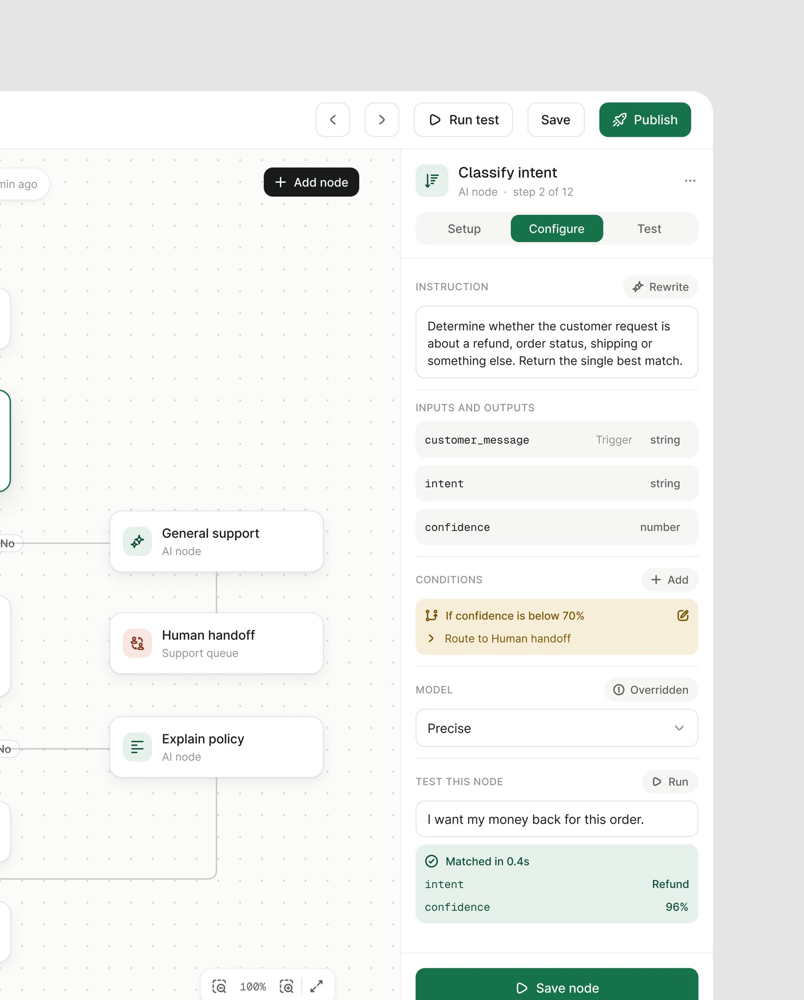
  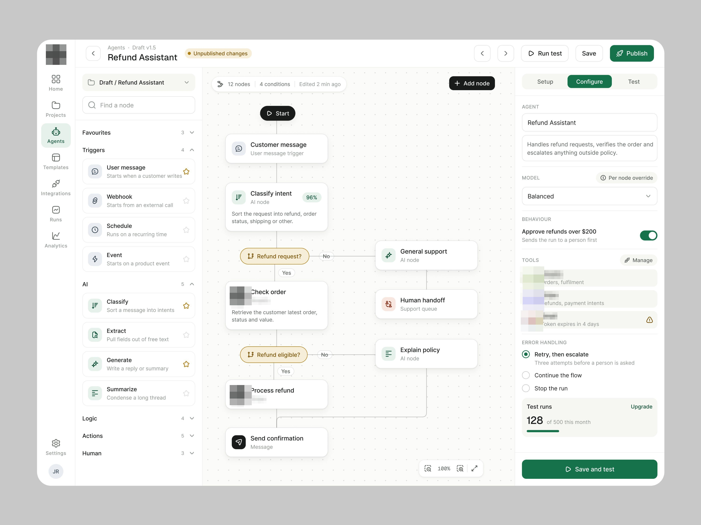
- **Popup Edit condition** (a versão mais completa da série, com legenda que pede opinião sobre o acabamento do popup): condições E, ramos Then / Else e a faixa verde *"Replayed against the last 50
  runs, 47 would take Then and 3 would take Else"*. Repostado em 4:3 dias depois.
  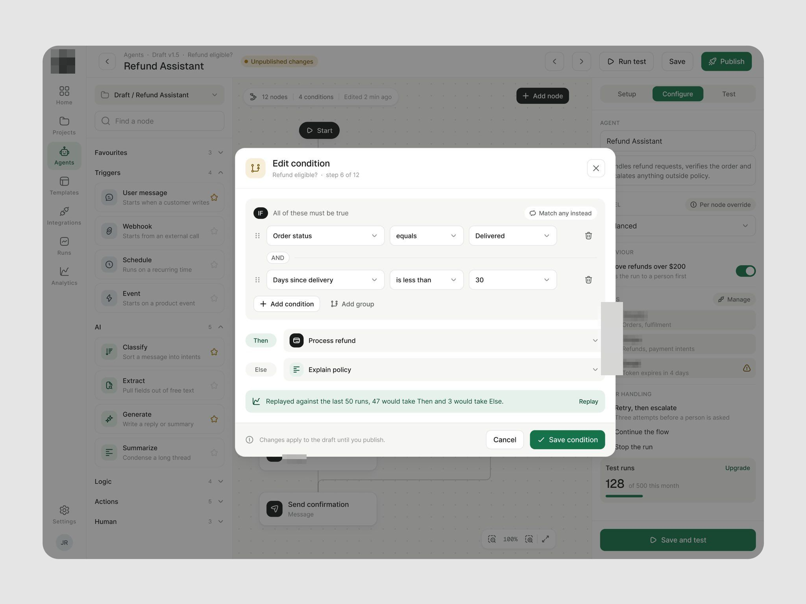
  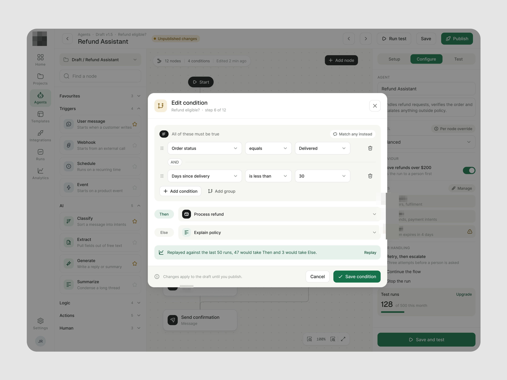
- **Test Lab** — a entrada do cliente, a execução nó a nó com tempo e decisão, o resultado com a
  resposta final, os números da execução e "Saved cases 5 of 6 pass".
  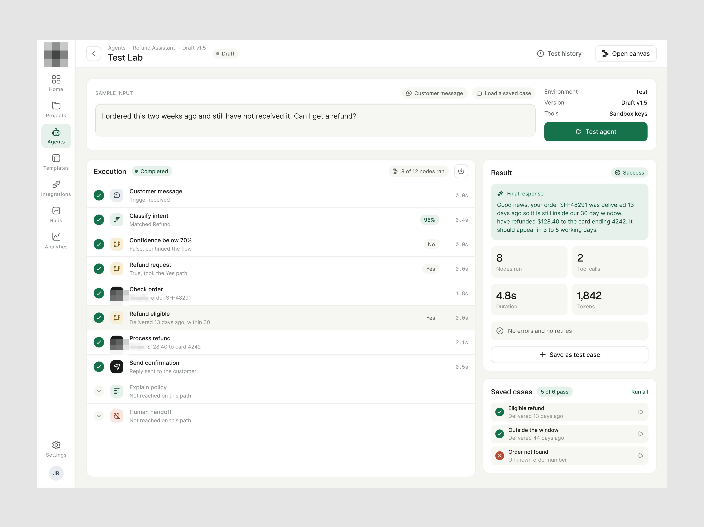
- **Fluxo gerado** — canvas creme quadrado com "Generated 12 seconds ago · Not saved yet" e
  Regenerate / Edit on canvas / Accept flow (legenda: desenhar como o agente decide o passo
  seguinte).
  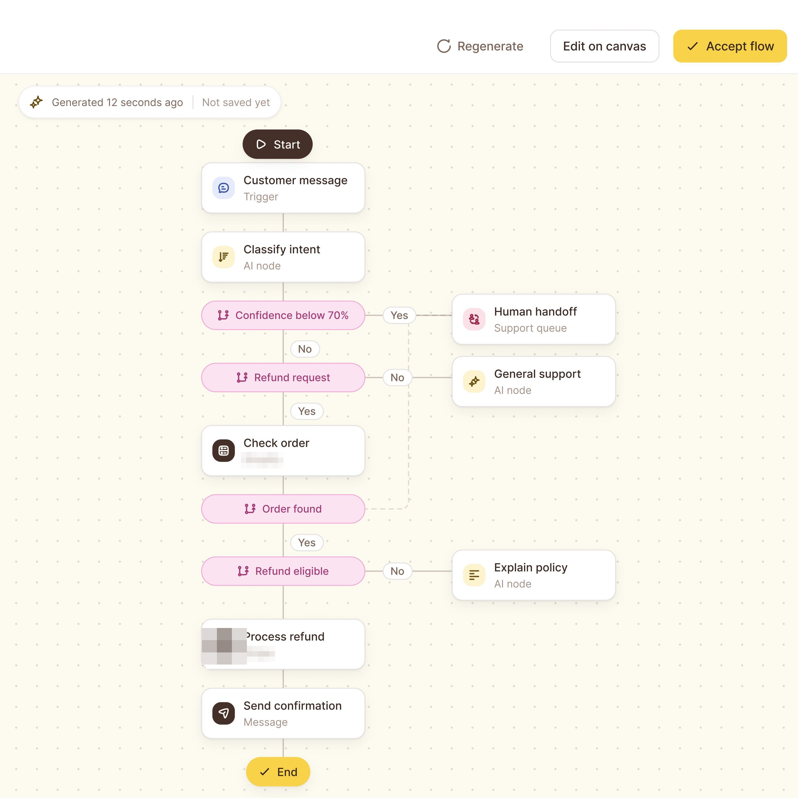
- **Vídeo do redesenho** — "New agent · What should this agent do?" em linguagem comum → o
  construtor com "Draft saved" → "Publish [produto]" com checklist de prontidão. Quadros em
  [../05-apresentacao/video-e-movimento.md](../05-apresentacao/video-e-movimento.md).

## O que a série ensina

- **Antes de salvar, o efeito**: a condição mostra o que teria acontecido nas últimas 50
  execuções. É o padrão de simulação de
  [../03-padroes-de-ia/05-governanca-politica-simulacao.md](../03-padroes-de-ia/05-governanca-politica-simulacao.md)
  levado para dentro do popup.
- **Cor como tipo do nó** (gatilho, IA, lógica, ação, humano), igual na biblioteca e no canvas: o
  que você arrasta é o que aparece. À crítica de que os ícones eram informação demais (vinda junto
  de um elogio à hierarquia e ao modelo mental), a resposta nomeia a biblioteca (Hugeicons Pro, de
  traço e cantos arredondados) e defende os ladrilhos coloridos: eles são o sistema de tipos, não
  enfeite; a cor é a única coisa que codifica a categoria do nó, a biblioteca usa o mesmo ladrilho
  do canvas e nada mais no canvas tem cor; sem eles, a leitura cai para os rótulos, bem mais lenta
  num fluxo de 12 nós. Ver
  [../01-sistema-visual/iconografia.md](../01-sistema-visual/iconografia.md).
- **Tipo de tela próprio na biblioteca**: [../04-tipos-de-tela/construtor.md](../04-tipos-de-tela/construtor.md).

## Mais telas

- O vídeo do construtor voltou (capa idêntica à de antes, quadros novos): da descrição em frase ao fluxo e à publicação.

Telas:

- Capa do vídeo do construtor de agente: tela clara vazia 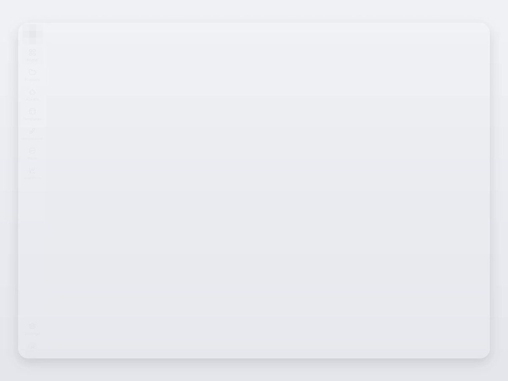
- Quadro a 15%: "New agent · What should this agent do?" com a descrição em frase e modelos 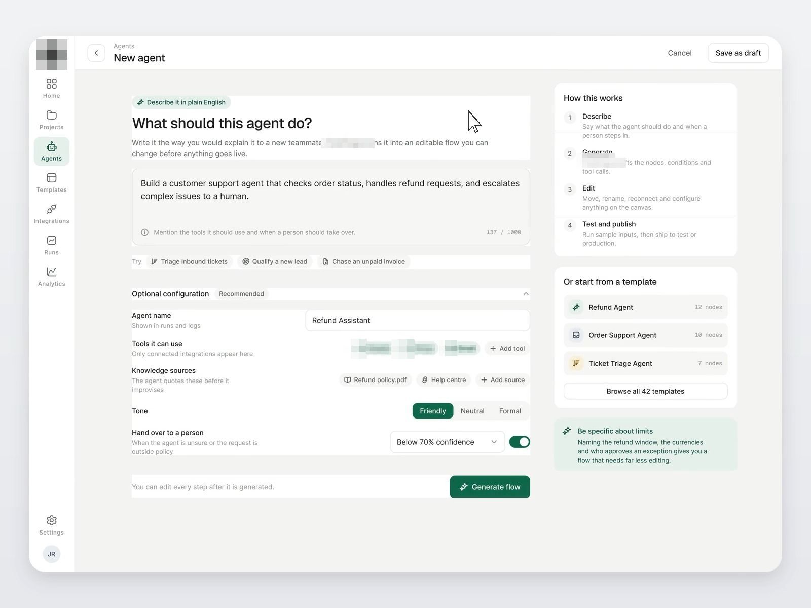
- Quadro a 50%: o fluxo do assistente de reembolso em canvas com o painel de configuração 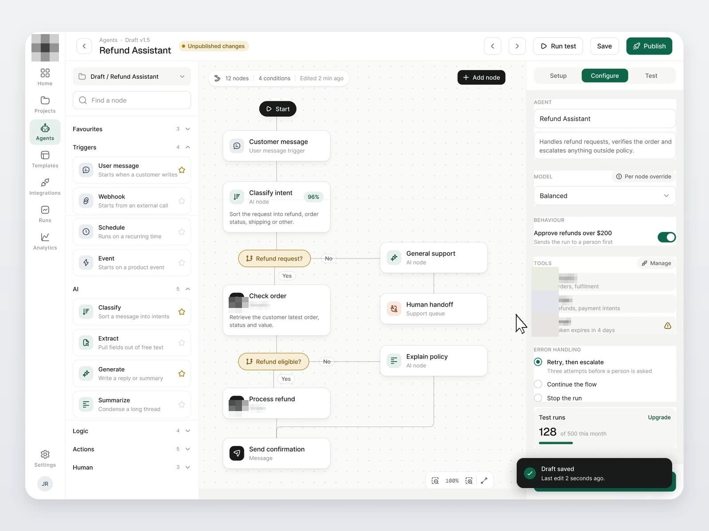
- Quadro a 85%: "Publish [produto]" com a prontidão e as notas da versão 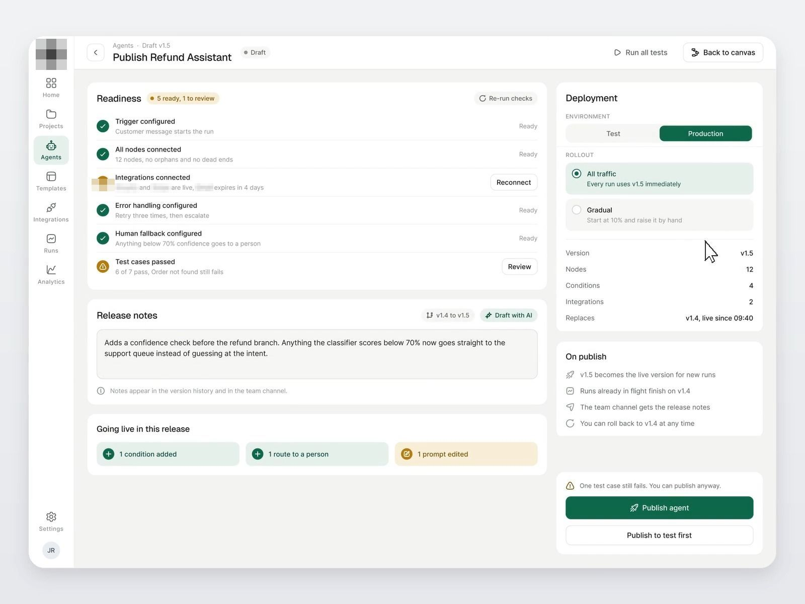
