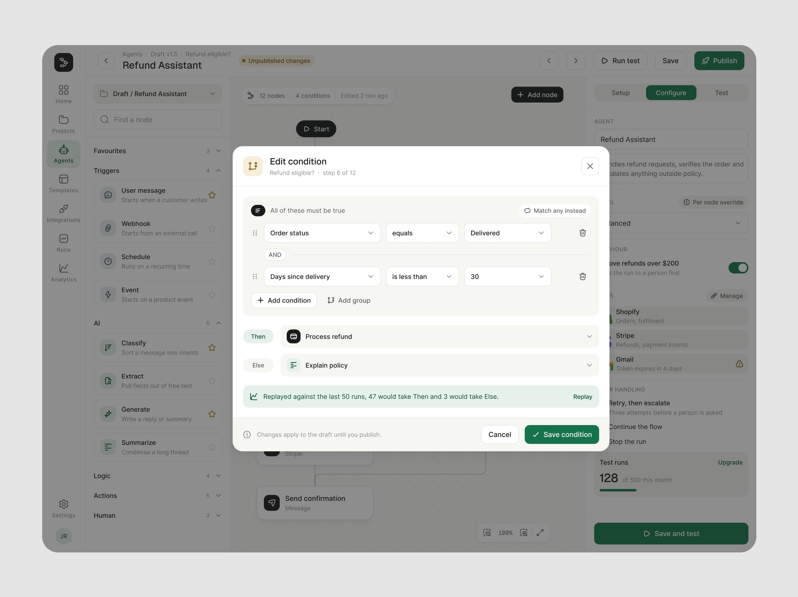
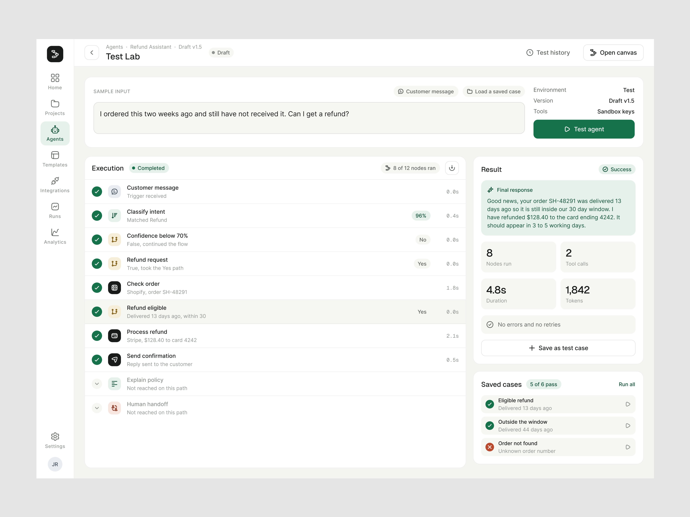

# Construtor do "Refund Assistant"

**Construtor de agente de atendimento em canvas, verde-escuro.** A marca não aparece nos shots: o
nome é o do agente que está sendo montado ("Refund Assistant", rascunho v1.5). 8 peças em seis dias,
e a série de maior soma de salvos do período depois do Permitly (1.844). O vídeo o apresenta como
redesenho: *"Hey, how is this product
redesign? If your product is vibe-coded by someone with design knowledge, then it may be okay.
Otherwise, rethink it, man. Seriously!"*. **[CONFIRMADO]**

| Campo | Valor |
|---|---|
| Setor | automação de atendimento: agentes que respondem pedido de reembolso com regras e passagem a humano |
| Para quem | quem monta e publica o agente (time de operação de suporte) |
| Tema | claro; canvas branco pontilhado **[OBSERVADO]** |
| Plataforma | web (construtor, popup de condição, Test Lab, configuração do agente, publicação) |
| Acento | verde-escuro `#0C6C48` (Publish, Save node, Save condition, aba ativa) **[MEDIDO, amostra quantizada]**; condições em pílula âmbar; o fluxo gerado em creme com decisões em rosa |

## Telas publicadas

<!--T:RefundAssistant-->
| # | views | salvos | salvos/1k | mídia | legenda |
|---|---:|---:|---:|---|---|
| 1 | 30.865 | 427 | 13,8 | 1 img | How clean is this popup ui design? |
| 2 | 23.285 | 520 | 22,3 | 2 img | Build your workflow…. Easy and focused User interface design |
| 3 | 4.584 | 93 | 20,3 | 1 img | Test lab screen.. UI design. |
| 4 | 32.229 | 499 | 15,5 | 1 img | How is this board looking! Do you wanna see the demo? |
| 5 | 6.169 | 107 | 17,3 | 1 img | UIUX design for automation board screen! |
| 6 | 5.730 | 85 | 14,8 | 1 img | Logic builder popup design for an automation tool. |
| 7 | 1.764 | 20 | 11,3 | 1 img | Designing how AI agents decide what happens next. |
| 8 | 5.951 | 93 | 15,6 | vídeo | Hey, how is this product redesign? If your product is vibe-coded by someone with design kn |
| **total** | **110.577** | **1.844** | **16,7** | | |
<!--/T-->

## O que cada tela tem

- **Construtor** — três colunas: a biblioteca de nós à esquerda (favoritos, Triggers, AI, Logic,
  Actions, Human), o canvas pontilhado com Start → Customer message → Classify intent (96%) →
  condições em pílula âmbar ("Refund request?", "Refund eligible?") → ações, e o painel do nó à
  direita com abas Setup / Configure / Test.
  
  
  
  
- **Popup Edit condition** (a peça mais vista da série, *"How clean is this popup ui design?"*,
  30.865 views): condições E, ramos Then / Else e a faixa verde *"Replayed against the last 50
  runs, 47 would take Then and 3 would take Else"*. Repostado em 4:3 dias depois.
  
  
- **Test Lab** — a entrada do cliente, a execução nó a nó com tempo e decisão, o resultado com a
  resposta final, os números da execução e "Saved cases 5 of 6 pass".
  
- **Fluxo gerado** — canvas creme quadrado com "Generated 12 seconds ago · Not saved yet" e
  Regenerate / Edit on canvas / Accept flow (*"Designing how AI agents decide what happens
  next."*).
  
- **Vídeo do redesenho** — "New agent · What should this agent do?" em linguagem comum → o
  construtor com "Draft saved" → "Publish Refund Assistant" com checklist de prontidão. Quadros em
  [../05-apresentacao/video-e-movimento.md](../05-apresentacao/video-e-movimento.md).

## O que a série ensina

- **Antes de salvar, o efeito**: a condição mostra o que teria acontecido nas últimas 50
  execuções. É o padrão de simulação de
  [../03-padroes-de-ia/05-governanca-politica-simulacao.md](../03-padroes-de-ia/05-governanca-politica-simulacao.md)
  levado para dentro do popup.
- **Cor como tipo do nó** (gatilho, IA, lógica, ação, humano), igual na biblioteca e no canvas: o
  que você arrasta é o que aparece. À crítica de que os ícones eram informação demais (vinda junto
  com "good hierarchy, clear mental model"), a resposta nomeia a biblioteca, *"Hugeicons Pro, stroke
  and rounded."*, e defende os ladrilhos coloridos:
  *"those tiles are the type system, not decoration. Colour is the only thing encoding node
  category (trigger, AI, logic, action, human), the library row uses the identical tile so what you
  drag is what you get, and nothing else on the canvas is tinted. Take them out and that read falls
  to the labels, which is a lot slower across a 12 node flow."* Ver
  [../01-sistema-visual/iconografia.md](../01-sistema-visual/iconografia.md).
- **Tipo de tela próprio na biblioteca**: [../04-tipos-de-tela/construtor.md](../04-tipos-de-tela/construtor.md).
