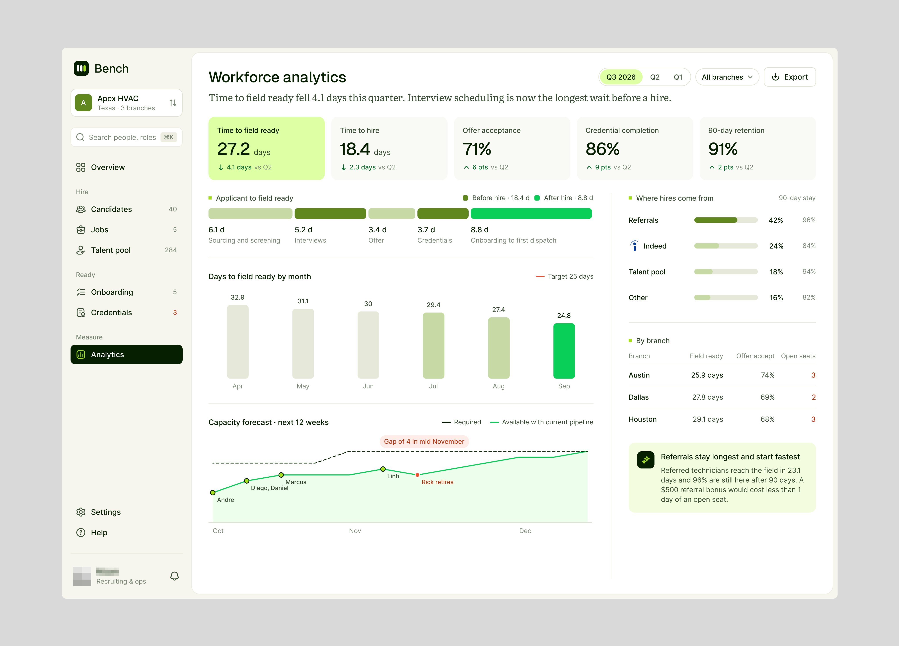
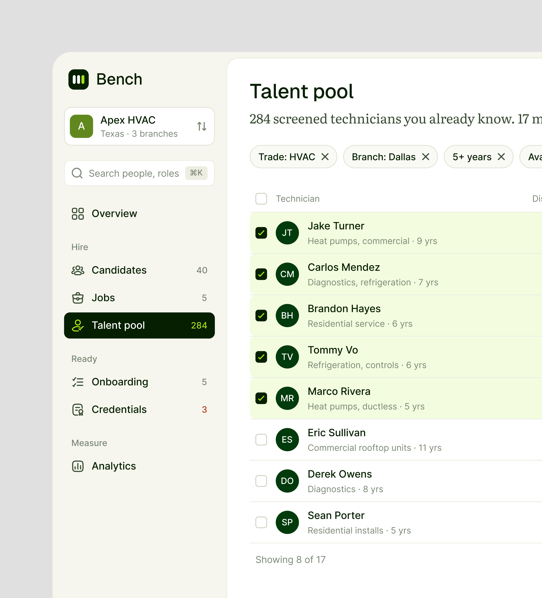
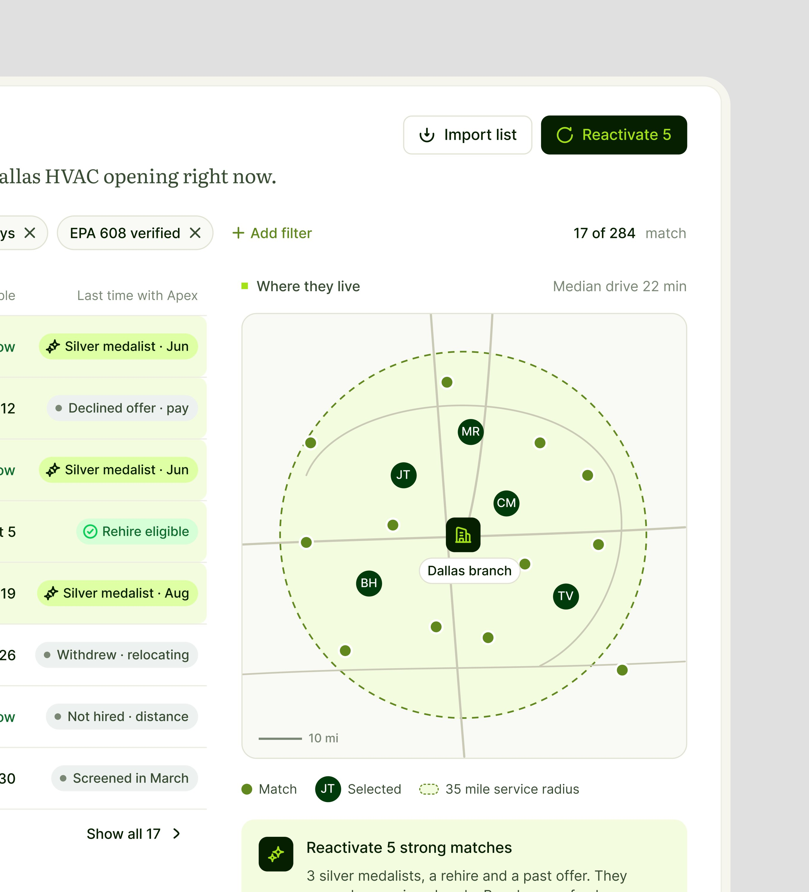

# Bench

**Contratação de técnicos para empresas de serviço residencial.** 4 peças em seis dias. A legenda
explica: *"Bench helps home-service contractors turn qualified candidates into field-ready
technicians and ties every open seat, candidate and credential to the service capacity it
unlocks."*, e uma das peças diz *"Redesigned the bench!"*. **[CONFIRMADO]**

| Campo | Valor |
|---|---|
| Setor | recrutamento de técnicos (HVAC): candidatos, vagas, banco de talentos, onboarding, credenciais |
| Para quem | o recrutador de uma empresa com filiais (Apex HVAC, Texas, 3 filiais) |
| Tema | claro com fundo creme-esverdeado; subtítulo das páginas em **serifa** ("Time to field ready fell 4.1 days this quarter. Interview scheduling is now the longest wait before a hire.") |
| Plataforma | web (Workforce analytics, Talent pool) |
| Acento | verde-limão `#D8FC9C` em cartão e seleção, verde vivo `#00CC54` no mês atual, verde-oliva `#608418` **[MEDIDO, amostra quantizada]** |

## Telas publicadas

<!--T:Bench-->
| # | views | salvos | salvos/1k | mídia | legenda |
|---|---:|---:|---:|---|---|
| 1 | 4.321 | 67 | 15,5 | 1 img | Did i cook it? analytics page ui design BTW, Bench helps home-service contractors turn qua |
| 2 | 6.502 | 52 | 8,0 | 2 img | Redesigned the bench! Did I cook? |
| 3 | 1.838 | 16 | 8,7 | 2 img | Talent pool page redesign! |
| 4 | 2.009 | 23 | 11,4 | 1 img | Simple and clean UI Design for analytics interface! |
| **total** | **14.670** | **158** | **10,8** | | |
<!--/T-->

## O que cada tela tem

- **Workforce analytics** — o título-frase em serifa, cinco KPIs (o primeiro em verde-limão, "Time
  to field ready 27.2 days"), a barra segmentada "Applicant to field ready" por etapa, os dias por
  mês com o atual em verde, a previsão de capacidade com a lacuna marcada em vermelho ("Gap of 4
  in mid November") e o cartão da conclusão sobre indicações.
  
- **Talent pool (díptico)** — "284 screened technicians you already know" em serifa, filtros em
  pílula, os cinco escolhidos em verde-claro, selos de histórico com a empresa (Silver medalist,
  Declined offer, Rehire eligible), o mapa "Where they live" com o raio de 35 milhas e o cartão
  "Reactivate 5 strong matches".
  
  

## O que a série ensina

- **O subtítulo é a conclusão do analista**, em serifa, em cima dos números: a tela já diz o que
  mudou e onde está o gargalo.
- **Histórico de relação como selo** (já foi finalista, recusou oferta, pode ser recontratado):
  memória do produto na linha da pessoa.
