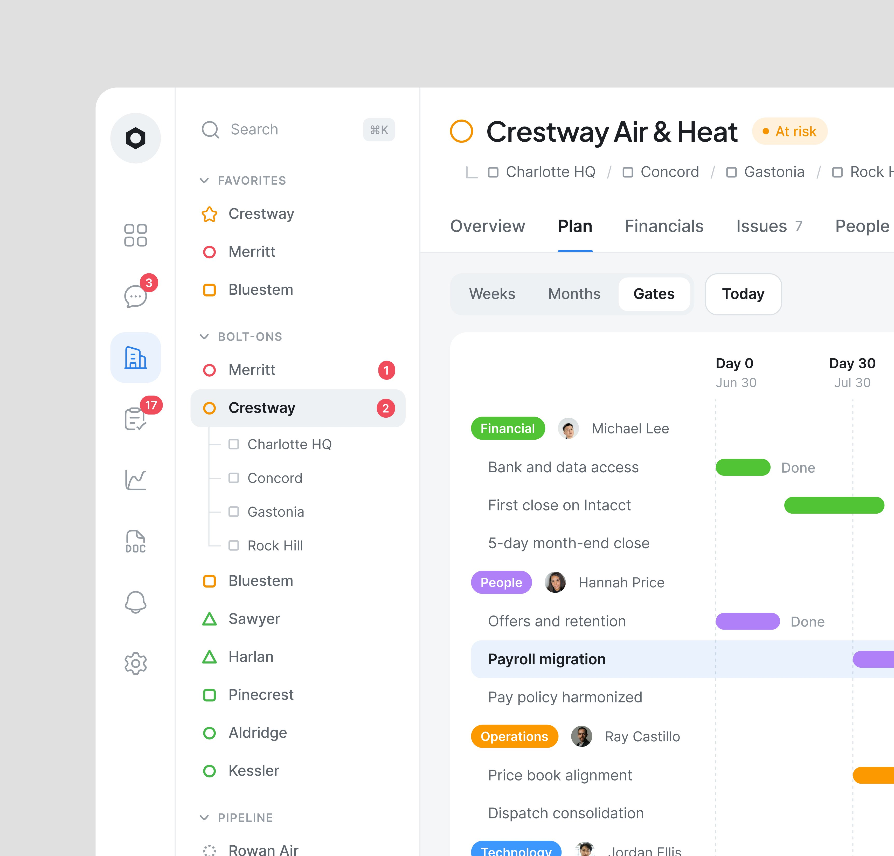
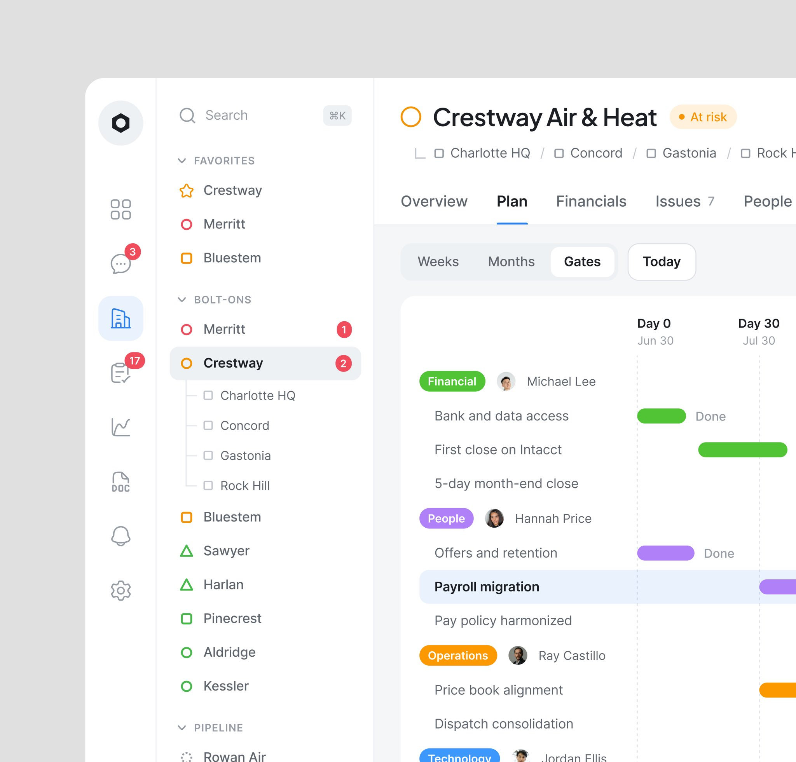
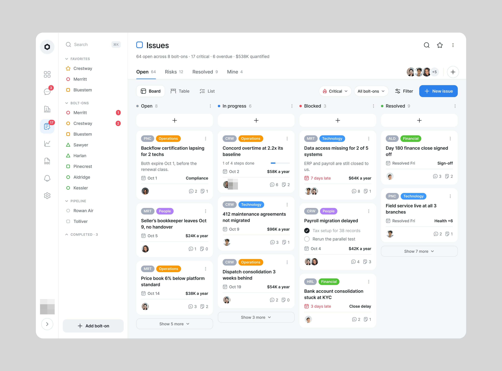

# Bolton

**Integração das empresas compradas por um grupo ("bolt-ons").** 4 peças em cinco dias; o vídeo
diz *"Saas Product redesign for Bolton!"* (17.747 views, 357 salvos). As telas são de um grupo de climatização que compra
empresas menores (Crestway Air & Heat, Merritt, Bluestem...). **[CONFIRMADO]**

| Campo | Valor |
|---|---|
| Setor | fusões e aquisições de serviço residencial: plano de integração dos 30 dias, pendências, financeiros, sinergias |
| Para quem | o time de integração do grupo comprador |
| Tema | claro; branco `#FCFCFC` **[MEDIDO, amostra quantizada]** |
| Plataforma | web (Portfolio, Bolt-ons, Plan, Issues, Financials) |
| Acento | azul `#2478E4` (botões), laranja `#FC9000` em alerta; selos de área coloridos (Financial verde, People lilás, Operations laranja, Technology azul) **[MEDIDO, amostra quantizada]** |
| Navegação | rail de ícones + árvore de empresas (favoritas, bolt-ons, pipeline) com o estado de cada uma por cor de anel |

## Telas publicadas

<!--T:Bolton-->
| # | views | salvos | salvos/1k | mídia | legenda |
|---|---:|---:|---:|---|---|
| 1 | 3.317 | 42 | 12,7 | 1 img | Founders, Are your users struggling with your product's UX or UI? No matter how complex th |
| 2 | 10.652 | 144 | 13,5 | 1 img | Track the issues! A User interface design that helps users to take action without thinking |
| 3 | 2.453 | 37 | 15,1 | 1 img | Just next level design  |
| 4 | 17.747 | 357 | 20,1 | vídeo | Saas Product redesign for Bolton! |
| **total** | **34.169** | **580** | **17,0** | | |
<!--/T-->

## O que cada tela tem

- **Plan** — "Crestway Air & Heat" com selo At risk, abas, e o cronograma do Day 0 ao Day 30 em
  barras por área, com responsável e "Done". Publicado e repostado no dia seguinte em arquivo quase
  quadrado.
  
  
- **Issues** — quadro de quatro colunas (Open, In progress, Blocked, Resolved) com cartões de
  pendência: selo de área, frase do problema, prazo, valor por ano em mono e avatares.
  
- **Vídeo** — Portfolio (saúde da integração por empresa em tabela de números coloridos), Bolt-ons,
  o modal "Create issue" e Financials (ponte do EBITDA em cascata). Quadros em
  [../05-apresentacao/video-e-movimento.md](../05-apresentacao/video-e-movimento.md).

## O que a série ensina

- **A árvore de empresas com estado** substitui a sidebar de módulos quando o objeto principal é
  uma carteira.
- **Cada pendência carrega dinheiro por ano**: o kanban é priorizado por valor, não só por prazo.
