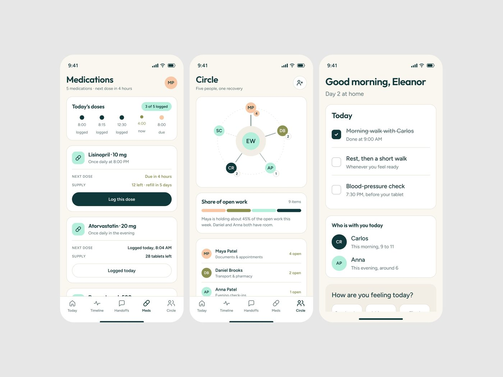
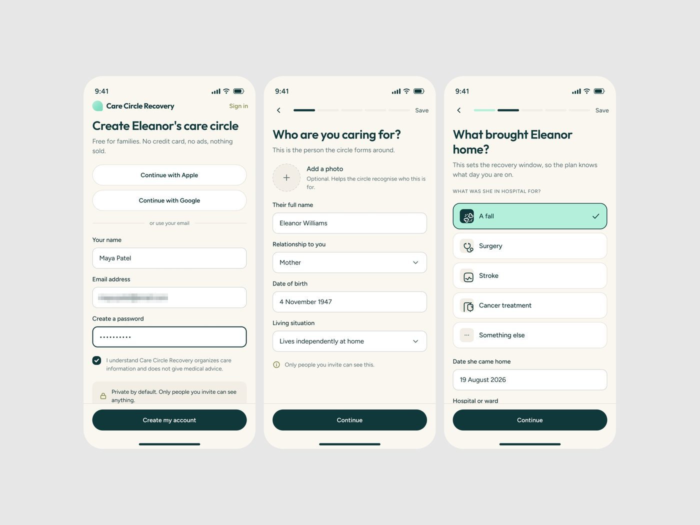

# Care Circle Recovery

4 peças em três dias, 9.642 views, 102 salvos (10,6/1k). Uma das legendas
explica o público: *"People around 40 to 60 years
are the main audience of the app."* **[CONFIRMADO]**

| Campo | Valor |
|---|---|
| Nome | Care Circle Recovery |
| Setor | cuidado familiar depois de alta hospitalar: remédios, tarefas do dia, quem está com o paciente |
| Para quem | filho/filha de 40 a 60 anos organizando o cuidado de um dos pais ("Create Eleanor's care circle") |
| Tema | claro, creme `#F9F6F0` sobre `#E7E7E7` **[MEDIDO]** |
| Plataforma | mobile |
| Acento | teal escuro `#10383A` (botões, pontos) + menta claro na opção selecionada **[MEDIDO]** |

## Telas publicadas

<!--T:CareCircle-->
| # | views | salvos | salvos/1k | mídia | legenda |
|---|---:|---:|---:|---|---|
| 1 | 4.279 | 41 | 9,6 | 1 img | Personal care mobile app / HEALTH TECH product design. |
| 2 | 2.350 | 29 | 12,3 | 1 img | People around 40 to 60 years are the main audience of the app. |
| 3 | 1.388 | 11 | 7,9 | 2 img | Caregiver mobile app Onboarding... |
| 4 | 1.625 | 21 | 12,9 | 1 img | 👀🩷 |
| **total** | **9.642** | **102** | **10,6** | | |
<!--/T-->

## Módulos

Medications ("3 of 5 logged", doses em linha do tempo horizontal, "Log this dose"),
Circle (grafo radial das pessoas em volta de "EW" com carga de tarefas), Today
(checklist com riscado no feito), onboarding em 3 passos (conta, "Who are you
caring for?", "What brought Eleanor home?" com opções grandes: A fall, Surgery,
Stroke, Cancer treatment).

## O que é específico

Público mais velho: fonte maior que o padrão do método, botão de largura total, uma
pergunta por tela, linguagem de família ("Five people, one recovery"), nada de
número técnico. Promessa de privacidade explícita ("Private by default").
